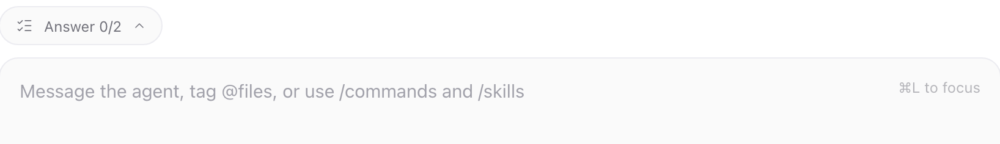
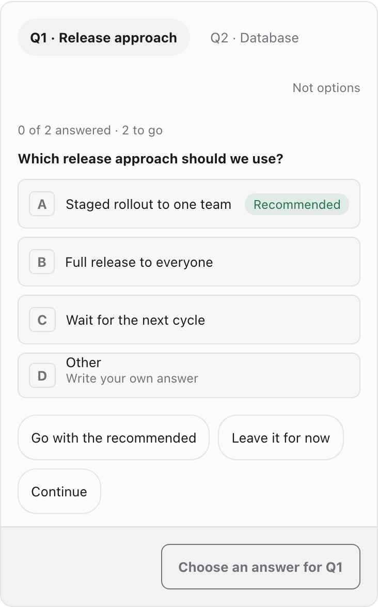
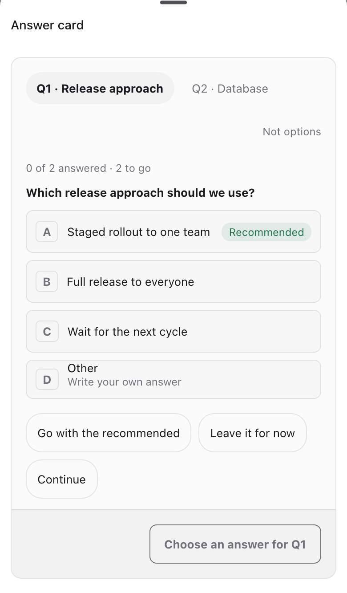
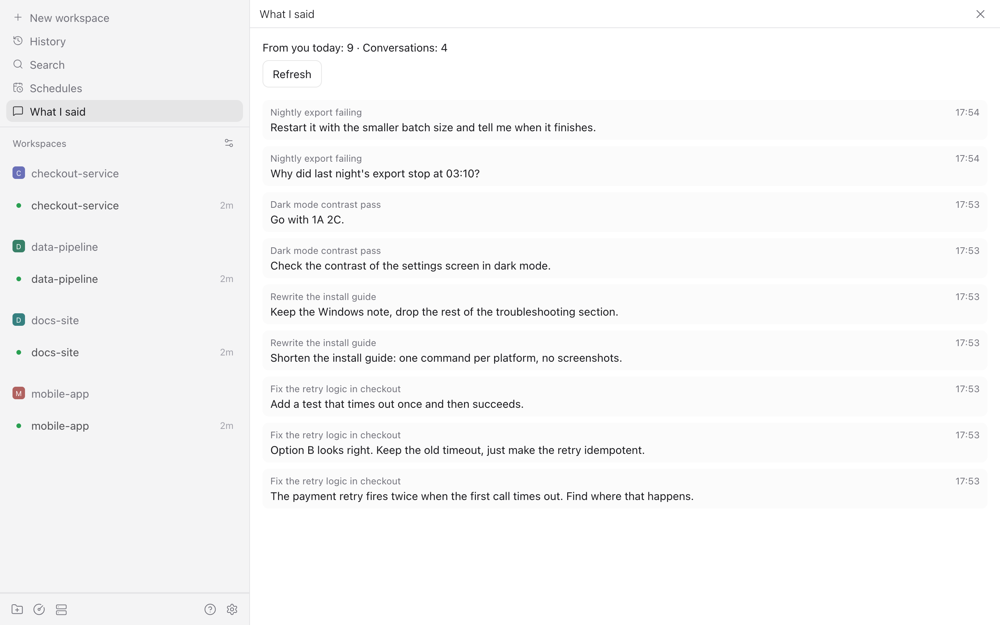

<p align="right"><a href="README.md">English</a> | <a href="README.zh-CN.md">简体中文</a> | <b>日本語</b></p>

<p align="center">
  
</p>

<h1 align="center">Clear Chat</h1>

<p align="center">Clear Chat は <a href="https://paseo.sh">Paseo</a> のプラグインです。回答カードを残します。返信にアルファベットの選択肢があるとき、カードで選ぶか自分で書き、プレビューして送信します。この版では <b>自分の発言</b> が加わりました。会話の横のパネルで今日の発言を一覧でき、サイドバーからはこのホストの会話の今日の発言をまとめた画面も開けます。Clear Chat は会話を描きません。会話の表示には、別のプラグイン <a href="https://paseo.sh/plugins/roundreddot/better-paseo">Better Paseo</a> を使ってください。</p>

<p align="center">
  <a href="https://github.com/jasonhnd/paseo-clear-chat/releases"></a>
  <a href="LICENSE"></a>
  <a href="https://paseo.sh"></a>
</p>

## この版

Clear Chat 0.17.4.3 は Paseo 0.17.4 に合わせた版です。バージョンの最初の 3 つは、確認を行った Paseo のバージョンです。この版では **自分の発言** の画面が加わりました。サイドバーのヘッダーにある **自分の発言** の行を押すと全幅の画面が開き、このホストの会話で今日打ったメッセージをまとめて一覧します（読めない会話は[既知の制限](#既知の制限)）。今日アーカイブした会話も含みます。各行は会話の題名、ローカル時刻（`HH:MM`）、本文の最大 3 行です。行を押すと送ったままの形でコピーし、**コピーしました** と出ます。上の 1 行が今日の数を示し（例 `今日の発言 12 件 · 3 件の会話`）、読み込み中は「会話を読み込み中（3 / 7 件）…」と出て、読み終わった会話の行から順に並びます。読み切れなかった一覧は「一部のメッセージが表示されていない可能性があります。」と **再試行** を出し、**更新** で読み直せます。履歴を返せない会話は別の行で数えます。会話の横のパネルと回答カードは前の版と同じです。制限は[既知の制限](#既知の制限)にあります。画面が読むのは今日だけで、行はコピーのみで元のメッセージへは戻れず、別のエージェントが開いた会話は並ばず、daemon の再起動直後はストレージから戻す会話 1 件につき約 1 秒かかります（Codex。テスト用のプロバイダーでは約 4 秒）。

変更の一覧は [変更履歴](CHANGELOG.md) にあります。

## 回答カード

アルファベットの選択肢がある質問を含む返信の生成が終わると、入力欄の上にボタンが出ます。ボタンには進み具合が入り、例えば **回答 0/2** です。デスクトップではマウスを乗せると正式な名前 **回答カード · 回答済み 0/2** が出ます。幅の狭い画面では、開いたパネルの題名がその正式な名前です。押すとカード全体がパネルで開きます。幅の狭い画面では下からせり上がるパネルです。デスクトップのパネルでは、質問の部分がカードの中でスクロールし、進み具合の行と **送信** は下の 1 行に固定されるので、パネルをスクロールしなくても **送信** が見えます。パネルで答えを選び、カードの **送信** を押します。メッセージは自分で送ったときと同じようにその会話へ送られ、入力欄に書きかけの文はそのまま残ります。1 問答えるごとに数字が変わり（**回答 1/2**）、閉じて開き直しても答えは残ります。送信するとボタンは消え、次にアルファベットの選択肢がある返信が終わるとまた出ます。一部に答えた状態で普通のメッセージを送っても、ボタンは進み具合を持ったまま入力欄の上に残り、押すと **回答を続ける** のあるカードが開きます。そのボタンを押すと保存された下書きが戻ります。ボタンは画面に出ている会話のもので、別の会話に移るとその会話のカードが出るか、何も出ません。

<p align="center">
  
  
  
</p>

**Settings → Plugins → Clear Chat** を開きます。ページの見出しは **Clear Chat** で、最初の設定カードの題名は **回答カード** です。設定ファイルに値がなければ、**アルファベットの選択肢がある返信の下に回答カードを表示** はオンです。保存済みのオンまたはオフはそのまま優先されます。スイッチの下には、既存の返信を更新するにはチャットを再読み込みする、と書いてあります。

カード自体の操作は次のとおりです。

返信が質問として読まれるのは、番号つきの質問があり、各問にアルファベットの選択肢が 2 つ以上あり（`A`–`H`、全角の `Ａ`–`Ｈ` も含む）、おすすめの印があるか、「reply with」「answer with」のような短い答えを求める文があるときだけです。コードブロックと引用の中の行は見ません。1 つの質問の中では文字が前に進む必要があります（`A` の次に `C` は数え、`B` の次に `A` は数えません）。`（推荐）` や `(recommended)` は読み、「not recommended」と `不推荐` は読みません。選択肢の下に単独の行で、1 つの選択肢だけを名指し、ほかに何も書かれていないおすすめの印、例えば `Recommended: A`、`推荐：A`、`おすすめ：A` があると、その選択肢がおすすめとして示され、上の選択肢の一部にはなりません。印のあとに句点が付いても、太字でもかまいません。日本語では印のあとにコロンか空白が必要です。`不推荐：A` のような行はおすすめとして読みません。この行は普通の文として残ります。

1. 選択肢をクリックします。カード内にフォーカスがあるときは、その文字を押しても選べます。**↑/↓** で移動し、**Enter** で選ぶこともできます。Paseo の入力欄で押したキーは入力欄のままです。
2. 未回答の質問に答えると、次の未回答へ進みます。最後の選択でフォーカスは **送信** に移ります。すべての質問に答えがつくまで、**送信** は足りない質問を示し、押せません。
3. 質問のタブには短い名前が出ます。現在の質問以外で回答済みのタブは `✓` と答えを示します。回答済みの質問を変えても、その質問に留まります。
4. 自分の言葉で書くときは **自分で書く** を選びます。**Enter** で確定して進み、**Shift+Enter** で改行します。入力方式での文字選択では確定しません。空のままでは案内が出ます。
5. **送信** は `1B 2A` のような文字の索引を示します。自分で書いた答えは、確定した文面のままメッセージに入ります。デスクトップのパネルでは、自分で書いた答えは下の行の上に最大 2 行でプレビューされます。1 行目は答えの索引全体、2 行目は最初に書いた答えの始まりです。送られるメッセージは完全な答えのままです。送信に成功するとボタンは消え、カードは表示されません。チャットのメッセージ（例えば `1B 2A`）があなたの答えです。
6. 普通のリストが質問と誤認されたら、**選択肢ではない** を押します。その返信は再読み込み後も閉じたままです。送信中には、このボタンは出ません。
7. 設定ページで編集したよく使う回答は、カード上のボタンになります。デスクトップのパネルでは選択肢の下にあり、質問と一緒にスクロールします。選ぶとその語句をカーソル位置に挿入し、送信はしません。

文の中の裸の 1 文字は答えとして扱いません。例は “wait a moment” です。`1A`、`2b`、`Q1A` のような番号つきの印は数え、隣に句読点があっても数えます（`1A.`）。メッセージ全体が答えだけのときはこれまでどおりで、質問が 1 つでメッセージ全体が `b` のときも含みます。`Plan 2B` のようなメッセージは、今も答えとして読まれることがあります。

## 自分の発言

**自分の発言** は、会話の横に今日送ったメッセージを並べるパネルです。ワークスペースのヘッダーにある **自分の発言** ボタン（メッセージのアイコン）で開きます。パネルは会話の横の区画に開きます。ホストがそこに置けないときは、メイン区画のタブとして開きます。スマートフォンの幅では、ワークスペースのヘッダーが操作を **Workspace actions** のシートにまとめます。ボタンはそのシートにあり、パネルは全画面で開きます。

上の 1 行が今日の数を示します。例えば `今日の機械メッセージ 5 件 · 自分の発言 7 件` です。その下に自分の発言が新しい順に並び、それぞれローカル時刻（`HH:MM`）と最大 3 行の本文が付きます。行を押すと、そのメッセージを送ったままの形（空白と改行もそのまま）でコピーし、**コピーしました** と出ます。画像だけの行にはコピーできる文字がなく、押すとその旨が出ます。行を押しても、会話のそのメッセージへは移動しません。

- パネルが読むのは今日、つまり端末のローカルな暦日です。それより前の日は並びません。次のローカル深夜と、アプリが前面に戻ったときに読み直します。
- 機械メッセージは数えるだけで、並びません。ホストの封筒、指示タグ、貼り付けたコンテキストの見出し、委任のラッパーです。途中で差し込まれたメッセージは自分のものとして、マーカーの間の本文で並びます。画像だけのメッセージは `（画像）` と出ます。
- 1 日を読み切れなかったときは、一部だけ読んだ旨と **再試行** を出します。押すたびに先まで読みます（上限まで）。このとき数は下限で、並んでいる行数以上です。
- 数が前の日のものになると、その旨と **再試行** を出します。今日の数としては出しません。
- パネルを開いている間に新しいメッセージが来ると、数と一覧が更新されます。「新しいメッセージが届いていません」という警告は、実際に配信が止まったときにだけ出ます。
- ワークスペースに会話が複数あり、どれも前面にないとき、ボタンは推測しません。Paseo が自分のトーストで Clear Chat の案内「このワークスペースで会話を開いてから、このボタンを押してください。」を出します。ボタンは会話の一覧を最大 25 ページ・1 ページ 200 件まで読み、それを超えると一覧を読めないと伝えます。

### 自分の発言の画面

パネルは 1 つの会話を読みます。画面はワークスペースの会話を読みます。サイドバーのヘッダーにある **自分の発言** の行から全幅で開き、このホストの会話で今日（端末のローカルな暦日）打ったメッセージを一覧します。今日アーカイブした会話も含みます。スマートフォンの幅ではこの行はサイドバーのドロワーにあり、一覧は横にはみ出しません。

上の 1 行が今日の数を示します（例 `今日の発言 12 件 · 3 件の会話`）。読み込み中は「会話一覧を読み込んでいます…」、続いて「会話を読み込み中（3 / 7 件）…」と出て、読み終わった会話の行から順に並ぶので、読み込みが終わる前から読んだりコピーしたりできます。各行は会話の題名、ローカル時刻（`HH:MM`）、本文の最大 3 行です。行を押すと、そのメッセージを送ったままの形（空白と改行もそのまま）でコピーし、**コピーしました** と出ます。画像だけの行にはコピーできる文字がなく、押すとその旨が出ます。題名がないときは **無題の会話** と出ます。

- **更新** は会話の一覧を取り直し、空の一覧から埋め直します。今日すでに読んだ会話はすぐ戻ります。一部しか読めなかったときや読めない会話があるときは **再試行** が出て、同じ流れをもう一度実行します。違いは、一部だった会話と読めなかった会話のページ数の上限を倍にすることだけです（上限まで）。
- 読み切れない、読み取りに失敗した、ホストが履歴を返せない、のいずれかがあると「一部のメッセージが表示されていない可能性があります。」と出ます。履歴を返せない会話は「今日の会話のうち 3 件は履歴を読めませんでした。」のように別の行で数えます。これらの会話はキャッシュしないので、**更新** でも **再試行** でも読み直します。
- 画面を開いたままローカル深夜を過ぎると、次にスクロールするか押したときに前日以前のメッセージである旨を表示し、**更新** で今日の発言に切り替わります。
- 別のエージェントが開いた会話は並びません。**その会話に直接打った文字も並びません**。プロバイダーが使えない会話はホストが一覧に出さないので、画面も読みません。
- まだ読み込まれていない会話を読むと、daemon がストレージから読み込みます。その分の時間とメモリは、daemon のアイドル時の解放まで使われます。
- 実測（Paseo 0.17.4、2 つの条件を別々に測定）: 会話がすべて読み込み済みのとき、モデルを使わないテスト agent で 60 件の会話を 9 秒以内に読み切り、最初の行は 0.5 秒以内に出ました。daemon の再起動直後は、会話は使うときにストレージから戻ります。実際のプロバイダー（Codex）では 20 件の会話（うち 5 件はアーカイブ済み）を冷えた状態から読むのに 20.4 秒、1 件あたり約 1 秒で、開き直すと 0.38 秒でした。同じテスト agent では 1 件あたり約 4 秒だったので、ほかのプロバイダーではもっと遅くなることがあります。読み込み中も、読み終わった行から先に表示します。これらはその条件で測った数字で、ほかのホストやプロバイダーに対する保証ではありません。

<p align="center">
  
</p>

## インストール

Clear Chat 0.17.4.3 には Paseo 0.16.0 以降が必要です。Paseo 0.15.x ではこの版を通常どおりインストールまたは実行できないので、Clear Chat 0.15.4.x のままにしてください。ブラウザーの確認は Paseo 0.17.4 で行いました。Paseo 0.16.x、0.17.1、0.17.2、0.17.3 では確認していません。インストールのコマンドは Paseo 0.16.x では確認していません。Paseo 0.16.0 と 0.16.1 は確認していません。

```bash
paseo plugin install git:jasonhnd/paseo-clear-chat --ref v0.17.4.3
```

インストールは daemon のホストで `npm ci --include=dev --ignore-scripts` を実行します。そのマシンに Node.js と npm があり、npm レジストリへ届く必要があります。

すでに入っている Clear Chat をこの版へ更新するには:

```bash
paseo plugin update clear-chat --ref v0.17.4.3 --yes
```

**Settings → Plugins → Clear Chat** を開き、**回答カード** カード内のバージョン行を見てください。ディレクトリからのインストールでは、そのディレクトリにあるバージョン情報がそのまま使われるため、古いリリースが表示されることがあります。使えるバージョン情報がないときは **不明** と出ます。

> [!IMPORTANT]
> すでに Beautiful Chat を使っていますか？プラグインのインストールや削除を**する前に**、[Beautiful Chat からのアップグレード](#beautiful-chat-からのアップグレード)をお読みください。Paseo ではプラグインを削除すると、その設定も一緒に消えます。

<details>
<summary><b>以前の Paseo（0.13 / 0.12）とバージョン番号の見方</b></summary>

Paseo 0.13 を使い続ける場合、公開済みの Clear Chat 0.13.2.2 は Paseo 0.13.0 以降への対応を明記しています。以下のインストールコマンドは Paseo 0.13 でまだ確認していません:

```bash
paseo plugin install git:jasonhnd/paseo-clear-chat --ref v0.13.2.2
```

すでに Clear Chat が入っている場合、下は旧リリースを指定するための候補コマンドです。**この切り替えと設定への影響は Paseo 0.13 でまだ確認していません。新しい版から古い版への切り替えも未確認です。**

```bash
paseo plugin update clear-chat --ref v0.13.2.2 --yes
```

Paseo 0.12 では、代わりに Clear Chat 0.12.0.1 をインストールしてください:

```bash
paseo plugin install git:jasonhnd/paseo-clear-chat --ref v0.12.0.1
```

すでに Clear Chat が入っていると、`install` は `Plugin ID clear-chat is already configured` と表示して止まります。その場合は `update` でバージョンを切り替えてください。設定はそのまま残ります:

```bash
paseo plugin update clear-chat --ref v0.12.0.1 --yes
```

Clear Chat のバージョンは、対応する Paseo のバージョンに、その Paseo のバージョンで何回目のリリースかを表す番号を 1 つ足したものです。たとえば 0.13.0.1 は Paseo 0.13.0 向けの最初のリリースで、0.13.0.2 は 2 つ目です。Paseo が新しくなっても、Clear Chat に新しい変更がなければリリースはしません。1.0.0 と 1.0.1 はこの規則の前に出したもので、0.12.0.1 のほうが新しい版です。

</details>

## アップグレードとロールバック

```bash
paseo plugin update clear-chat --ref v0.17.4.3 --yes
```

更新しても設定ファイルは残ります。回答カード、よく使う回答、誤検出を閉じた記録、書きかけの下書きは残ります。保存された下書きのうち、壊れたもの、古い形のもの、形の分からないものは、設定の読み込み時に無視されます（その項目はファイルに残り、次に設定を書き込むときに消えます）。ほかの下書きと設定はそのまま読み込まれ、設定ページがファイル全体を無効と表示することはありません。この版が表示しない機能のキーはファイルに残り、設定ページに操作はありません。以前の ref へ戻してもファイルは通常残りますが、その回の設定への影響は保証されないので、設定が重要なら先にバックアップしてください。前の版に戻すと設定は残りますが、**自分の発言** の画面はなくなります（その版には画面がありません）。会話の横のパネルはそのまま残ります（その版にもあるため）。さらに前の版に戻すと選んだ内容は残りますが、その版は `resumed: true` を無視するので、**回答を続ける** を押したカードは読み込み直したあともう一度 **回答を続ける** を押す必要があります。プラグインを削除すると設定も削除されます。

更新後、会話は Clear Chat が描きません。その表示には [Better Paseo](https://paseo.sh/plugins/roundreddot/better-paseo) を使ってください。Clear Chat のステップ行、ツールカード、サイドバーは見えません。

回答カードは入力欄の上のボタンから開きます。更新後、アルファベットの選択肢がある質問を含む返信の生成が終わると、**回答 0/2** のようなボタンが入力欄の上に出ます。デスクトップではマウスを乗せると **回答カード · 回答済み 0/2** が出て（幅の狭い画面では開いたパネルの題名がこれです）、押すとカードが開きます。

起動時にプラグインのデータディレクトリの中は消しません。以前の画像と履歴のディレクトリはそのまま残ります。この版はそれらを使いません。

## 設定

ページの見出しは **Clear Chat** で、最初の設定カードの題名は **回答カード** です。

| 設定 | 内容 |
|---|---|
| アルファベットの選択肢がある返信の下に回答カードを表示 | 値がなければオンです。保存済みの値が優先されます。スイッチの下には、既存の返信を更新するにはチャットを再読み込みする、と書いてあります。 |
| よく使う回答 | 1 行に 1 つの語句です。初期値は `Go with the recommended`、`Leave it for now`、`Continue` です。回答カードで選ぶと挿入され、送信はしません。ここで編集すると、入力欄を離れたときに保存されます。 |

**インストール済みバージョン。** **回答カード** カード内に、このインストールの元になったビルドのバージョンが出ます。ディレクトリからのインストールでは、そのディレクトリにあるバージョン情報がそのまま使われるため、古いリリースが表示されることがあります。使える情報がないときは **不明** です。

**問題を報告** はブラウザーで GitHub のフォームを開きます。自分で送信しない限り、何も送られません。

設定はホストに保存され、そのホストにつないだクライアントで共有されます。

## 言語

Clear Chat 自身の文字は Paseo のアプリの言語（英語、簡体字中国語、日本語）に従います。設定ページ、回答カード、パネル、画面は翻訳されています。Paseo 自身の文字は Paseo の言語のままで、エージェントの出力は翻訳しません。プラグイン一覧の説明は英語です。

## 既知の制限

- **自分の発言** の画面とパネルが読むのは今日、つまり端末のローカルな暦日です。それより前の日は並びません。
- 画面は、このホストでいちばん最後のメッセージが今日の会話を、アーカイブ済みも含めて並べます。別のエージェントが開いた会話は並ばず、**その会話に直接打った文字も並びません**。
- プロバイダーが使えない会話はホストが一覧に出さないので、画面も読みません。
- 一部のプロバイダーは、ストレージから戻した会話の履歴を返せません。そのような会話は並ばず、「今日の会話のうち N 件は履歴を読めませんでした。」と別に数えます。キャッシュしないので、**更新** でも **再試行** でも読み直します。
- 検出できるのは今日の履歴が丸ごと失われた場合だけです。一部だけ失われた場合は知らせず、プロバイダーが返した分をそのまま並べます。
- まだ読み込まれていない会話を読むと、daemon がストレージから読み込みます。その分の時間とメモリは、daemon のアイドル時の解放まで使われます。
- daemon の再起動直後は、画面を開くのにストレージから戻す会話 1 件につき約 1 秒（Codex）、テスト agent では約 4 秒かかり、ほかのプロバイダーではもっと遅くなることがあります。会話がすべて読み込み済みなら、60 件を 9 秒以内に読み切り、最初の行は 0.5 秒以内で出ます。これらは Paseo 0.17.4 で測った数字で、ほかのホストやプロバイダーに対する保証ではありません。
- 画面の行はメッセージをコピーするだけで、元のメッセージへは戻れません。
- パネルの行はメッセージをコピーするだけで、そのメッセージへは移動しません。プラグイン API にはメッセージへスクロールする仕組みがありません。
- 画像だけの行にはコピーできる文字がなく、押すとその旨が出ます。
- 機械メッセージは先頭の文字で判定するので、別の理由でその形から始まる自分のメッセージは機械として数えられ、並びません。
- 1 日にはページ数の上限があります。読み切れないときは一部だけ読んだ旨と **再試行** を出し、**再試行** は上限まで読み進めます。数は下限（並んでいる行数以上）になります。パネルを開いている間は、タイムラインの出来事ごとに今日の読み直しを求めるので、大きな会話では 1 回で何ページも読むことがあります。
- ワークスペースに会話が複数あり、どれも前面にないとき、**自分の発言** ボタンは推測しません。Paseo が自分のトーストで Clear Chat の案内を出します。
- スマートフォンの幅では、**自分の発言** ボタンは **Workspace actions** のシートにあり、パネルは会話を覆います（ホストが Explorer のオーバーレイを開きます）。
- `Plan 2B` は今も答えとして読まれることがあります。文の中の裸の 1 文字は読まれません。
- デスクトップのパネルでは、長い自分で書いた答えは最大 2 行でプレビューされます。1 行目は答えの索引全体、2 行目は最初に書いた答えの始まりです。送られるメッセージは完全な答えのままで、幅の狭いパネルでは完全に表示されます。長いときは幅の狭いパネルの中でスクロールが必要なことがあります。
- 高さが約 117px 未満のウィンドウには対応しません。パネルの下の行が収まりません。
- agent が答えている間、まだ編集できるカードは入力欄の上にボタンが出ません。開いているパネルは返信を生成中だと伝え、答え終わるとボタンと回答が戻ります。答えを待っている読み取り専用のカードはこれまでどおりボタンを表示します。
- agent が答え始めてから半秒ほどは、ボタンがまだ出ていることがあります。その間に開いたパネルは待機の案内を表示することがあります。
- 設定の準備ができたあとに下書きの読み取りが失敗し、そのあと新しい返信も自分の新しいメッセージもない場合、カードは次の返信か自分のメッセージ、または読み込み直しまで戻りません。下書き自体は失われません。読み取りに成功して下書きがない場合や、この版が受け付けない形だった場合は確定で、読み直しはしません。
- 前の版に戻すと、選んだ内容は残りますが「続けた」状態は残りません。**回答を続ける** を押したカードは、読み込み直したあともう一度 **回答を続ける** を押す必要があります。
- 同じターンで普通のメッセージを送ったあとに `1B` のような答えを打っても、その答えはカードに結び付きません。失われるものはありません。カードは続けて使え、下書きも残ります。
- スマートフォンの幅では、Paseo 自身の入力欄で Enter を押すと改行になります。送るにはその入力欄の送信ボタンを使ってください。これはホストの動作です。
- スマートフォンの幅では、Esc を押しても回答カードは閉じません。パネルの外側を押すと閉じます（約 1 秒後に閉じます）。これはホストの動作です。**選択肢ではない** はカードを閉じる操作ではありません。その返信を恒久的に閉じるので、カードも入力欄の上のボタンも戻りません。
- 入力欄の上のボタンは Paseo が描くもので、タブレットとスマートフォンの幅では高さ 32px です。カードの選択肢の行と **送信** は 44px 以上あります。
- ブラウザーの確認は Paseo 0.17.4 の画面（`paseo` コマンドで起動する web UI）で、ヘッドレスブラウザー、1280×800 と 390×844、モデルを使わないテスト agent と実際のプロバイダー（Codex）により、コミット 0b334a91 で行いました。画面については、サイドバーの行から画面が開くこと、行と会話の題名が正しいこと、コピーがバイト単位で同じで案内が出ること、390 幅では行がサイドバーのドロワーにあり一覧が横にはみ出さないこと、会話の横のパネルのボタンが残っていること、コンソールにプラグインのエラーがないこと、実際のプロバイダーのアーカイブ済みの会話が daemon の再起動後もメッセージを並べること、履歴を再生できないテスト agent の会話が「履歴を読めない」と数えられることを確認しました。リリース先頭では別途スモークを行い、結果は[変更履歴](CHANGELOG.md)に記します。デスクトップアプリ、実機の iOS と Android、Paseo 0.16.x、0.17.1、0.17.2、0.17.3、ダークテーマ、ほかの表示言語、ほかのビューポートでは確認していません。
- プラグインを外すと設定も消えます。先にバックアップしてください。起動時に、プラグインのデータディレクトリにある古いファイルは消しません。

## プライバシーとホスト上のデータ

- Clear Chat は、自分で送るメッセージを除き、会話の内容をホストの外、エージェントの提供者、その他のサービスへ送りません。回答カードの **送信** は、自分のメッセージとして、Paseo を通して現在のチャットのエージェントへ 1 通送ります。手で打ったメッセージと同じです。
- **自分の発言** パネルと画面はホストから会話を読み、行を押したときにそのメッセージをクリップボードへコピーします。何も送信せず、独自の設定も持ちません。
- この版はローカルの画像を読まず、コードを色分けせず、プロバイダーの複製も登録しません。
- Clear Chat 自身がネットワークを使うのは、インストール時の `npm ci` だけです。
- **問題を報告** はブラウザーで GitHub のフォームを開きます。自分で送信しない限り、何も送られません。
- すでにあるプラグインのデータディレクトリは残します。この版は新しい画像や履歴の保存先を作りません。

## よくある質問

**Clear Chat はまだ会話を描きますか？** 描きません。ステップの行、ツールカード、サイドバー、検索、引用返信、ジャンプチップ、構文の色分けはありません。**Workspace changes during this turn** のカードもなくなりました。会話の表示には [Better Paseo](https://paseo.sh/plugins/roundreddot/better-paseo) を使ってください。

**回答カードが見えないのはなぜですか？** **アルファベットの選択肢がある返信の下に回答カードを表示** をオンにしてください。最新の返信に番号つきの質問があり、各問にアルファベットの選択肢が 2 つ以上あり、おすすめの印か、「reply with」「answer with」のような短い答えを求める文がある必要があります。その返信の生成が終わると入力欄の上にボタンが出るので、押してカードを開きます。

**どの返信が質問として読まれますか？** 番号つきの質問で、各問にアルファベットの選択肢が 2 つ以上あり、おすすめの印か短い答えを求める文があるものです。コードブロックと引用は対象外です。

**エージェントの設定を変える必要はありますか？** ありません。この版はプロバイダーの複製を追加しません。以前の貼り付け画像の扱いはありません。

**「自分の発言」にメッセージが出ないのはなぜですか？** パネルは目の前の会話で、画面はこのホストの会話で、自分の発言と判断した今日のメッセージを並べます。先頭が機械の形（ホストの封筒、指示タグ、貼り付けたコンテキストの見出し、委任のラッパー）のメッセージは機械メッセージとして数え、それより前の日は並ばず、別のエージェントが開いた会話は会話ごと飛ばします（その会話に直接打った文字も並びません）。途中で差し込まれたメッセージはマーカーの間の本文で並びます。

**どの Paseo に対応しますか？** 0.16.0 以降です。Paseo 0.15.x ではこの版は通常どおり動かないので、Clear Chat 0.15.4.x のままにしてください。Paseo 0.13 と 0.12 の古い入れ方は [インストール](#インストール) にあり、0.13 のコマンドは未確認です。

**プラグインを外すと設定はどうなりますか？** プラグインと一緒に削除されます。先にバックアップしてください。[Beautiful Chat からのアップグレード](#beautiful-chat-からのアップグレード) を見てください。

**会話はどこかに送られますか？** 自分で送る答え以外は送られません。その答えは、手で打ったメッセージと同じように Paseo を通ります。全文は [OVERVIEW](OVERVIEW.md) にあります。

## トラブルシューティング

| 症状 | 対処 |
|---|---|
| Cafe プラグインからのインストールに失敗する。 | [インストール](#インストール) の Paseo CLI のコマンドで、同じリポジトリとリリースの ref を指定してやり直してください。Clear Chat は `npm ci --include=dev --ignore-scripts` で依存パッケージを入れるので、daemon のホストに Node.js と npm があり、npm レジストリへ届く必要があります。チェックアウトを自分で管理している場合は、先にそこで `npm ci --include=dev --ignore-scripts` を実行してからやり直してください。 |
| プラグインに新しい Paseo が必要なため、インストールが止まる。 | Clear Chat 0.17.4.3 には、daemon のホストと接続するすべてのアプリで Paseo 0.16.0 以降が必要です。Paseo 0.15.x では Clear Chat 0.15.4.x のままにしてください。それより古いホストは [インストール](#インストール) を見てください。 |
| Clear Chat が、プラグイン RPC、設定画面、設定の登録、リクエスト処理が必要だと表示する。 | daemon のホストと、つないでいるすべてのアプリの Paseo を更新してから、Clear Chat を再読み込みしてください。必要なバージョンは `paseo-plugin.json` に書いてあります。 |
| プラグインの登録に失敗し、Clear Chat が起動しない。 | Paseo を更新して Clear Chat を再読み込みしてください。それでも直らない場合は、プラグインの設定をバックアップしてから CLI で入れ直してください。 |
| Clear Chat がホストの設定を読み込めない。 | ホストにつなぎ直し、設定ページで **再試行** を選んでください。それでも直らない場合は、daemon がプラグインの設定フォルダーにアクセスできるか確認してください。 |
| Clear Chat が、設定が正しくない、または対応していない形式だと表示する。 | まず設定をバックアップしてください。正しいバックアップから戻すか、daemon のホストで設定ファイルを直してから **再試行** を選んでください。Clear Chat がこのファイルを勝手に消すことはありません。 |
| Clear Chat が設定を保存できない。 | daemon のホストの書き込み権限と空き容量を確認し、つなぎ直してから、もう一度設定を変えてください。**再試行** は設定を読み込み直すだけで、失敗した変更を送り直すことはありません。 |
| ほかのクライアントからの変更で、設定が変わり続ける。 | ほかの変更が終わるのを待ってから、もう一度設定を変えてください。 |
| Beautiful Chat の設定がコピーされない。 | Beautiful Chat の元の設定は残したまま、バックアップしてください。両方のプラグインの設定フォルダーの読み書き権限と空き容量を確認し、Clear Chat を再読み込みしてやり直してください。コピーに失敗すると daemon のログに復旧用のメッセージが残ります。すでにある Clear Chat の設定ファイルが上書きされることはありません。 |

Paseo がビルドのコマンドを実行できない、またはプラグインの束を読み込めない場合、Clear Chat は自分でメッセージを表示できません。daemon のホストの Node.js、npm、Paseo のバージョンを確認し、CLI からやり直してください。それでも直らない場合は、設定ページの **問題を報告** から、復旧用のメッセージと Paseo のバージョンを添えてください。ログを共有する前に、個人的なパスや会話の内容は消してください。

## Beautiful Chat からのアップグレード

1. Beautiful Chat の設定を**バックアップ**します。
2. Beautiful Chat を入れたまま **Clear Chat をインストール**します。Clear Chat は、自分の設定ファイルがまだない初回起動時に、Beautiful Chat のファイルをコピーします。
3. ファイルが届いたことを**確認**してから、Beautiful Chat を削除します。設定ページに出るのは回答カードのスイッチとよく使う回答だけです。コピーされたほかのキーはファイルに残り、操作はありません。

<details>
<summary><b>具体的なコマンド、元に戻す方法、コピーのしくみ</b></summary>

以下のコマンドは `PASEO_HOME` を使い、未設定のときは `$HOME/.paseo` を使います。daemon のフォルダーを `--home` だけで指定している場合は、先に `PASEO_HOME` をそのパスに設定してください。バックアップや確認に失敗したら、そこで止めてください。

**1. バックアップ**

```bash
legacy_backup="${PASEO_HOME:-$HOME/.paseo}/backups/plugin-settings-beautiful-chat-$(date +%Y%m%d-%H%M%S)"
mkdir -p "${PASEO_HOME:-$HOME/.paseo}/backups"
cp -a "${PASEO_HOME:-$HOME/.paseo}/plugin-settings/beautiful-chat" "$legacy_backup"
```

`beautiful-chat` の設定フォルダーがない場合は、Beautiful Chat の設定を変えたことがないので、この手順は飛ばしてかまいません。

**2. インストール**

```bash
paseo plugin install git:jasonhnd/paseo-clear-chat --ref v0.17.4.3
```

**3. 確認してから古いプラグインを削除**

`${PASEO_HOME:-$HOME/.paseo}/plugin-settings/clear-chat/presentation.json` ができていて、`$legacy_backup/presentation.json` と同じ内容であることを確認してください。すでにある Clear Chat の設定ファイルが上書きされることはありません。ファイルがない、または内容が違う場合は、Beautiful Chat とバックアップを残したまま、ログでコピーのエラーを確認してください。

```bash
paseo plugin remove beautiful-chat
```

バックアップは残しておいてください。

**元に戻す**

Clear Chat の今の設定をバックアップしてから削除します。Clear Chat を削除すると設定もすべて消えます（`update` では消えません）。`clear-chat` の設定フォルダーがない場合は、`cp` の行は飛ばしてください。

```bash
clear_chat_backup="${PASEO_HOME:-$HOME/.paseo}/backups/plugin-settings-clear-chat-$(date +%Y%m%d-%H%M%S)"
mkdir -p "${PASEO_HOME:-$HOME/.paseo}/backups"
cp -a "${PASEO_HOME:-$HOME/.paseo}/plugin-settings/clear-chat" "$clear_chat_backup"
paseo plugin remove clear-chat
```

Beautiful Chat の設定フォルダーがなくなっている場合は、アップグレード時のバックアップから戻します。`YYYYMMDD-HHMMSS` はバックアップの日時に置き換えてください。すでにあるフォルダーが上書きされることはありません。

```bash
legacy_backup="${PASEO_HOME:-$HOME/.paseo}/backups/plugin-settings-beautiful-chat-YYYYMMDD-HHMMSS"
test ! -e "${PASEO_HOME:-$HOME/.paseo}/plugin-settings/beautiful-chat" &&
  cp -a "$legacy_backup" "${PASEO_HOME:-$HOME/.paseo}/plugin-settings/beautiful-chat"
```

そのあと、Beautiful Chat の最後のバージョンをインストールします。

```bash
paseo plugin install git:jasonhnd/paseo-clear-chat --ref 2bf25e8
```

Clear Chat で変えた設定は Beautiful Chat には戻りません。バックアップは両方とも残しておいてください。

**コピーのしくみ**

- 初回の起動時、Clear Chat の設定ファイルがまだなければ、サーバーが Beautiful Chat の `presentation.json` を Clear Chat の設定フォルダーにコピーします。どちらのファイルも削除・上書きしません。
- コピーに失敗した場合はエラーをログに残し、Clear Chat は初期設定で起動します。次回の起動時にもう一度試します。
- そのあと、現在の設定の形式で読みます。回答カードの値は残ります。この版が表示しない機能のキーは受け入れられますが、操作としては出ません。
- ブラウザーでは、以前ブラウザーに保存されていた設定を 1 回だけ取り込みます。ホストに保存された設定が常に優先です。
- コピーは標準のインストール id を前提にしています。`--id` を変えている場合や、daemon のフォルダーを `--home` だけで指定している場合は、設定を手でコピーしてください。

</details>

## 問題の報告

不具合や要望は [GitHub の Issue](https://github.com/jasonhnd/paseo-clear-chat/issues/new/choose) で知らせてください。設定画面のいちばん下にある **問題を報告** からも開けます。リリースごとの変更は [変更履歴](CHANGELOG.md) にまとめています。

不具合フォームでは、画面の問題について、個人情報を除いたスクリーンショットか動画の提出を求めています。提出できない場合は理由を記入してください。画面以外の問題で画像が不要な場合は `N/A — not a UI issue` と記入してください。インストール済みの製品バージョンが分かる場合は記入してください。機能の要望フォームでは、使う場面と期待する結果を尋ねます。GitHub フォームの実際の表示と送信は未確認です。

## クレジット

Clear Chat は [Beautiful Chat](https://github.com/ABorakati/beautiful-chat)（作者 ABorakati）をもとに、MIT ライセンスで作っています。元の著作権表示は [LICENSE](LICENSE) に残しています。

開発者向けのビルド手順と構成は [docs/DEVELOPMENT.md](docs/DEVELOPMENT.md)（英語）にあります。

## ライセンス

[MIT](LICENSE)
