<p align="right"><a href="README.md">English</a> | <a href="README.zh-CN.md">简体中文</a> | <b>日本語</b></p>

<p align="center">
  
</p>

<h1 align="center">Clear Chat</h1>

<p align="center">Clear Chat は <a href="https://paseo.sh">Paseo</a> のプラグインで、エージェントの動作は変えずに、長い会話を読みやすくします。終わったステップは 1 行ずつにまとまり、ツール呼び出しはそれぞれカードになり、ターンの最後の返信はコード・リンク・パスをそのまま保ちます。折りたたんだステップを押すと、入力と出力の全文（プロバイダーが報告した場合は終了コードと所要時間も）が、デスクトップではサイドパネル、iPad ではポップオーバー、スマートフォンでは下から出るシートで開きます。設定ページ（アクセントカラー、フォント、文字サイズ、折りたたみ、インストール済みバージョン）と、どのメッセージにも使える引用返信が加わります。速さとその測り方は<a href="#performance">パフォーマンスの節</a>にあります。</p>

<p align="center">
  <a href="https://github.com/jasonhnd/paseo-clear-chat/releases"></a>
  <a href="LICENSE"></a>
  <a href="https://paseo.sh"></a>
</p>

<p align="center">
  <picture>
    <source media="(prefers-color-scheme: dark)" srcset="images/hero-dark.png">
    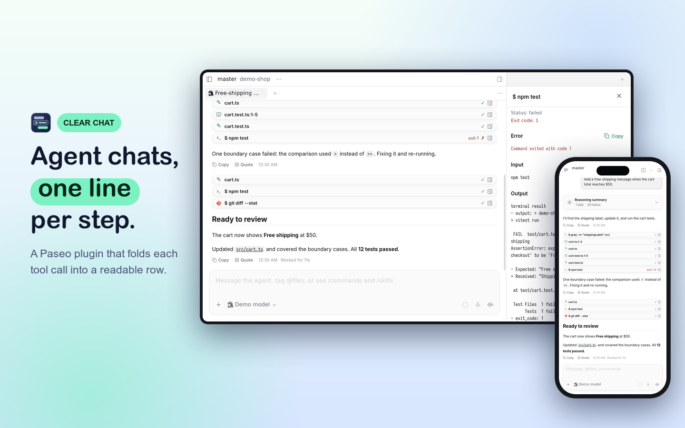
  </picture>
</p>

<p align="center">
  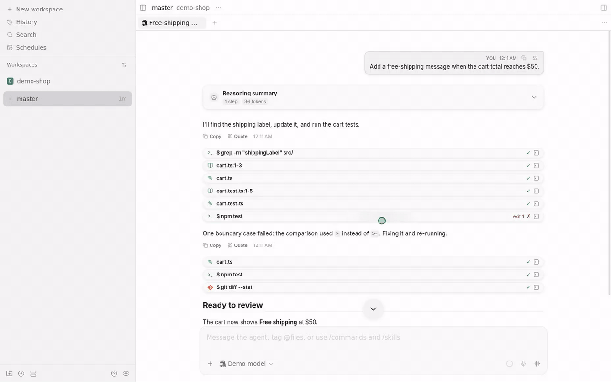
</p>

<p align="center"><sub>スクリーンショットとデモはすべてサンプルデータです。</sub></p>

## Clear Chat を選ぶ理由

- **1 ステップ 1 行。** 各ステップは状態つきの 1 行で表示され、編集のステップでは追加・削除した行数も出ます。ターンの最後の返信はいつも全文表示です。
- **どのステップも開けます。** ステップの入力、出力、エラーの全文を、デスクトップではサイドパネル、iPad ではポップオーバー、スマートフォンでは下から出るシートで表示するので、長い出力で会話が押し広げられることはありません。[スマートフォンと iPad](#スマートフォンと-ipad) をご覧ください。
- **ツールごとにカードがあります。** Claude、Codex、Hermes の呼び出しをすべてきちんとしたカードで表示します。Paseo が伝えるツールにはそれぞれ専用カードがあり、`skill_view` や `memory` などの Hermes ツールにも専用の表示があります。[機能](#機能)をご覧ください。
- **あなたの言語で表示します。** Clear Chat 自身の表示文字は Paseo アプリの言語（英語、簡体字中国語、日本語）に合わせます。
- **好みに合わせて変えられます。** 設定は 22 項目：アクセントカラー、UI とコードのフォント、文字サイズ、折りたたみ、インストール済みバージョンなど。設定はホストに保存され、そのホストにつないだ端末で共有されます。[設定](#設定)をご覧ください。
- **速さはそのまま。** 4 コアのクラウドマシンでの 300 ステップのテストでは、Clear Chat の初回表示は 673〜843 ミリ秒でした。Clear Chat をオフにして Paseo 標準の表示にすると 387〜444 ミリ秒で、標準はターン全体を 1 行にまとめるためステップを 1 つずつ表示しません。計測方法は[パフォーマンス](#パフォーマンス)にあります。<sup>1</sup>
- **引用して返信。** 文字を含むメッセージで引用アイコンを押すと、返信を引用ブロックとして送れます。

<sub>1. 1 台のマシンでヘッドレスの Google Chrome を 5 回動かした中央値です。環境によって結果は変わります。測り方は [scripts/perf/README.md](scripts/perf/README.md)（英語）にあります。</sub>

## この版の新機能（0.15.3.2）

- **「選択肢ではない」は再読み込みのあとも覚えています。** 普通のリストが選択肢と誤認されたときは **選択肢ではない** を押すと、その返信の下のカードを閉じられます。これからは、チャットを再読み込みしても閉じたままで、入力欄の上のタブと浮動パネルもその返信には出ません。Clear Chat はこうした返信を最大 100 件、ホストに保存された設定に記録します（古いものから削除）。**初期設定に戻す** で消去されます。新しい返信には影響せず、答えを送信してもこの一覧には加わりません（[#252](https://github.com/jasonhnd/paseo-clear-chat/issues/252)）。
- **スマートフォンのポップオーバー：タブと送信行を固定。** スマートフォンでタブから開くポップオーバーは、質問のタブを上に、送信行を下に固定し、質問文と選択肢はその間でスクロールします。以前はタブが内容と一緒にスクロールして見えなくなっていました。ポップオーバーの高さは画面の高さに対する一定の割合に制限され、タッチ操作の対象は引き続き 44 ポイント以上です（[#258](https://github.com/jasonhnd/paseo-clear-chat/issues/258)、[PR #291](https://github.com/jasonhnd/paseo-clear-chat/pull/291)、[#294](https://github.com/jasonhnd/paseo-clear-chat/issues/294)、[PR #297](https://github.com/jasonhnd/paseo-clear-chat/pull/297)）。
- **長い返信の上のジャンプチップ（初期値はオフ）。** 新しい設定 **長い返信にジャンプチップを表示**（Show jump chips on long replies）。オンにすると、書き終えた返信が 3000 文字以上で、見出し（レベル 1〜3）が 3 つ以上あるとき、本文の上にチップが 1 行並びます。見出し 1 つにつき 1 つで、最大 8 個です。チップには見出し（24 文字まで）が表示され、押すとその見出しまで返信がスクロールします。エージェントがまだ書いている間はチップは出ません。ウェブページとデスクトップアプリで使えます。ネイティブのスマートフォンアプリには表示されません。返信の文章が折りたたまれたり削られたりすることはありません（[#259](https://github.com/jasonhnd/paseo-clear-chat/issues/259)、[#296](https://github.com/jasonhnd/paseo-clear-chat/issues/296)）。

  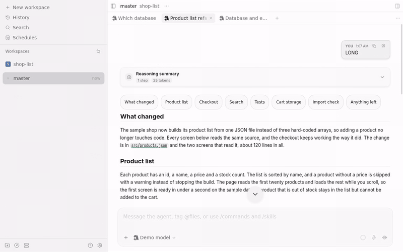

### 前のリリースで追加されたもの

- **新しい設定：アルファベットの選択肢がある質問の回答カード（初期値はオフ）。** 最新の返信が番号つきの質問とアルファベットの選択肢（例：「1. どのデータベース？ A. SQLite B. Postgres」）を示し、短い形での返信を求めているか、おすすめの選択肢が示されているときに、Clear Chat はその返信の下にカードを表示します。カードには質問ごとのタブ、**おすすめ** の印がついた選択肢、メモを書く **自分で入力**、**次へ**、選択肢に見えただけのときの **選択肢ではない** があります。**送信** ボタンは送る文字そのまま（例：`1B 2A`）を表示し、まだ選んでいない質問を示します。カードは最新の返信の下にだけ、エージェントが動いていないときだけ表示され、新しいメッセージが来ると消えます。タッチでもマウスでも使え、行とボタンの高さは 44 ポイント以上です（[#235](https://github.com/jasonhnd/paseo-clear-chat/issues/235)）。
- **Web とデスクトップではキーボードで操作できます。** カードをクリックするか、入力欄が空のときに上下の矢印キーを押すまで、カードはキー入力を受け取りません。その後は、上下の矢印で選択肢を移動し、`A`〜`H` または `1`〜`8` で選び、**Enter** でハイライト中の選択肢を選んで次へ進み（最後の **Enter** で送信）、**Tab** または右矢印で次の質問（最後の質問で **Tab** を押すと **送信** ボタンに移ります）、**Shift+Tab** または左矢印で前の質問、**Esc** でカードを閉じて入力欄に戻ります。入力欄に文字があるときはカードが閉じ、すべてのキーは入力欄に渡されます（[#236](https://github.com/jasonhnd/paseo-clear-chat/issues/236)）。
- **入力して送るときも、選んだ答えが付きます。** カードが使えるとき（入力を始めるとカードは自動で閉じます）、一部を選び、残りを自分で入力できます。**Enter** で入力した文字を送るとき、選んだ答えが文字の前に付き、その後にスペースが入ります。付くのは、入力欄が空でなく、1 問以上選んであり、Shift や Alt を押しておらず、入力方式（IME）で変換中でないときだけで、ホストが 300 ミリ秒以内に送信しない場合は前に付けた分が取り除かれます（Web とデスクトップのみ）。入力欄はカードのある会話のページから探すので、別の会話を開いてから戻っても、選んだ答えは同じように入力した文字の前に付きます。（[#230](https://github.com/jasonhnd/paseo-clear-chat/issues/230)、[#281](https://github.com/jasonhnd/paseo-clear-chat/issues/281)）。

  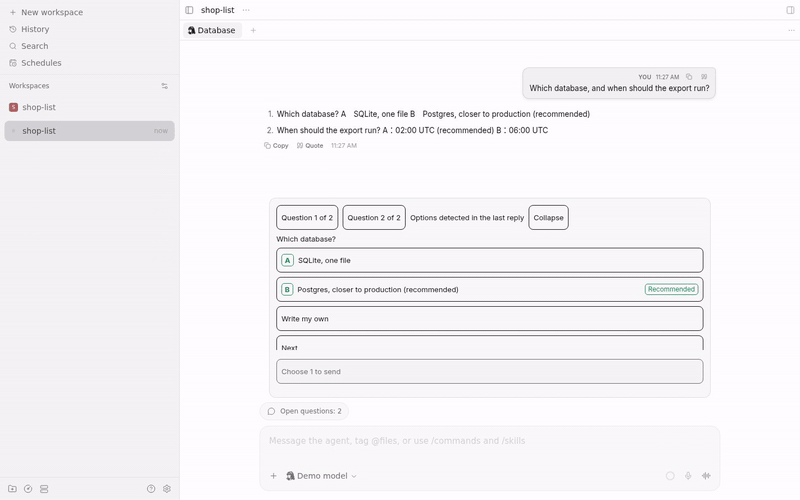
- **入力欄の上の小さなタブに、未回答の質問が出ます。** カードが使えるとき、入力欄の上に「未回答の質問: N」というタブが出ます（N はまだ選んでいない質問の数）。押すと同じ選択パネルが開きます（広い画面ではポップオーバー、スマートフォンでは下からのシート）。スクロールして離れても質問の全文を読めます。選択はカードと共有されます。エージェントが動いている間もパネルは開けますが、送信は押せません。設定がオフのとき、また「選択肢ではない」を押したあとは、タブは表示されません（[#231](https://github.com/jasonhnd/paseo-clear-chat/issues/231)）。
- **Web とデスクトップの浮動回答パネル。** 入力欄の上に、カードと同じ質問・選択・キー操作・送信が出ます。パネルが出ている間、返信の下のカードは非表示になります。Paseo のページ構造に依存します。入力欄が見つからない、隠れている・置き換えられている、上の余白が足りないなど、ページがパネルの想定と違うときは、パネルは自分で取り下げ、返信の下のカードを開いたままにします（エラーは出ず、キー操作は引き続き使えます）。パネルのボタンは最初のクリックから効きます。パネルと送信行、送信ボタンは不透明な背景で描かれるので、下の行は透けません。上のタブのポップオーバーが開いている間パネルは非表示になり、閉じると戻ります。送信行はパネルのスクロール部分の下に置かれ、送信が **次へ**、**選択肢ではない**、選択肢の行に重ならなくなります。再描画ではスクロール位置が保たれ、質問を替えると先頭に戻ります。カードが出たときに入力欄がまだページにない場合は、250 ミリ秒ごとに最長 3 秒探し直します。パネルは、会話のページが隠れたため、またはページ構造の問題のためにカードに戻ったあとでも、会話のページが再び表示されるたび（会話に戻るとき）に、また再読み込みのあとに、もう一度試されます（[#229](https://github.com/jasonhnd/paseo-clear-chat/issues/229)、[#255](https://github.com/jasonhnd/paseo-clear-chat/issues/255)、[#261](https://github.com/jasonhnd/paseo-clear-chat/issues/261)、[#263](https://github.com/jasonhnd/paseo-clear-chat/issues/263)、[#265](https://github.com/jasonhnd/paseo-clear-chat/issues/265)、[#264](https://github.com/jasonhnd/paseo-clear-chat/issues/264)、[#267](https://github.com/jasonhnd/paseo-clear-chat/issues/267)、[#275](https://github.com/jasonhnd/paseo-clear-chat/issues/275)、[#276](https://github.com/jasonhnd/paseo-clear-chat/issues/276)、[#281](https://github.com/jasonhnd/paseo-clear-chat/issues/281)）。
- **おすすめの印を正しく読みます。** 選択肢の後ろの `（推荐）` や `(recommended)` は認識され、「not recommended」と `不推荐` は認識されません（[#239](https://github.com/jasonhnd/paseo-clear-chat/issues/239)）。

## インストール

```bash
paseo plugin install git:jasonhnd/paseo-clear-chat --ref v0.15.3.2
```

Paseo のプラグイン画面を開き、Clear Chat の説明の先頭でバージョンを確認してください。Paseo 0.14.0 は、アプリの言語を切り替えても、ここに既定の英語の説明を表示します。

Clear Chat 0.15.3.2 には Paseo 0.14.0 以降が必要です。**Settings → Plugins → Clear Chat** で色、フォント、折りたたみを選べます。

あとで更新するには：

```bash
paseo plugin update clear-chat
```

最初にインストールしたリリースではなく、`main` ブランチの最新版に切り替わります。変更する前に確認が出ます。スクリプトで実行するときは `--yes` を付けてください。特定のリリースに切り替えたり前のリリースに戻したりするには、`--ref` を付けます（例：`paseo plugin update clear-chat --ref v0.13.0.1`）。更新時は通常設定が残りますが、特定バージョンへの切り戻し結果や設定の互換性は保証されません。以下の未検証の Paseo 0.13 の例をご覧ください。

> [!IMPORTANT]
> すでに Beautiful Chat を使っていますか？プラグインのインストールや削除を**する前に**、[Beautiful Chat からのアップグレード](#beautiful-chat-からのアップグレード)をお読みください。Paseo ではプラグインを削除すると、その設定も一緒に消えます。

<details>
<summary><b>以前の Paseo（0.13 / 0.12）とバージョン番号の見方</b></summary>

Paseo 0.13 を使い続ける場合、公開済みの Clear Chat 0.13.2.2 は Paseo 0.13.0 以降への対応を明記しています。以下のインストールコマンドは Paseo 0.13 でまだ実機確認していません：

```bash
paseo plugin install git:jasonhnd/paseo-clear-chat --ref v0.13.2.2
```

すでに Clear Chat が入っている場合、下は旧リリースを指定するための候補コマンドです。**この切り替えと設定への影響は Paseo 0.13 でまだ実機確認していません。新しい版から古い版への切り替えも未検証です。**

```bash
paseo plugin update clear-chat --ref v0.13.2.2 --yes
```

Paseo 0.12 では、代わりに Clear Chat 0.12.0.1 をインストールしてください：

```bash
paseo plugin install git:jasonhnd/paseo-clear-chat --ref v0.12.0.1
```

すでに Clear Chat が入っていると、`install` は `Plugin ID clear-chat is already configured` と表示して止まります。その場合は `update` でバージョンを切り替えてください。設定はそのまま残ります：

```bash
paseo plugin update clear-chat --ref v0.12.0.1 --yes
```

Clear Chat のバージョンは、対応してテストした Paseo のバージョンに、その Paseo のバージョンで何回目のリリースかを表す番号を 1 つ足したものです。たとえば 0.13.0.1 は Paseo 0.13.0 向けの最初のリリースで、0.13.0.2 は 2 つ目です。Paseo の新しいバージョンが出たら、Clear Chat の次のリリースから数え直します（Paseo 0.13.1 向けなら 0.13.1.1）。Paseo が新しくなっても、Clear Chat に新しい変更がなければリリースはしません。1.0.0 と 1.0.1 はこのルールの前に出したもので、0.12.0.1 のほうが新しい版です。

</details>

## アップグレードとロールバック

```bash
paseo plugin update clear-chat                 # main の最新へ（確認あり）
paseo plugin update clear-chat --yes           # 確認なし
paseo plugin update clear-chat --ref v0.15.3.2 --yes   # 特定リリースに固定
```

更新しても設定は残ります。以前のバージョンへのロールバックも通常は設定を保ちますが、その回の影響は保証されないため、設定が重要なら先にバックアップしてください。プラグインを削除すると設定も削除されます。

## 端末ごとの違い

### デスクトップと Web
フル配置です。ステップの詳細はサイドパネル、カードにはホバープレビュー、ステップ間はキーボードで移動でき、ポインターの光とテキスト選択が使えます。検索バー（Ctrl/Cmd+F）もここで使えます。

### iPad
ステップの詳細はポップオーバーで開き、会話の幅は変わりません。折りたたみの規則とスクリーンショットは同じで、ツールバーは 1 行のままです。**アシスタントの Markdown** をオフにするとドラッグで選択できます。

### スマートフォン
ステップの詳細は下から出るシートで開き、長い出力はその中でスクロールし、会話は幅いっぱいを使います。入力欄は書き足すまで 1 行のままです。選択範囲の操作とポインターの光はオフなので、コピーボタンを使ってください。


Paseo は同じプラグインをデスクトップ、Web、iPhone、iPad で動かします。Clear Chat は端末の名前ではなく使える幅で表示の形を選ぶので、幅の狭いデスクトップのウィンドウはスマートフォンと同じ表示になります。

| | スマートフォン | iPad | デスクトップと Web |
|---|---|---|---|
| ステップの詳細 | 下から出るシート | ポップオーバー（幅 744〜1023px）またはサイドパネル（1024px 以上） | サイドパネル。狭いウィンドウではポップオーバーかシート |
| 行の表示 | タイトル、アイコン、余白を小さくして、1 画面に多くのステップが入ります。ボタンは押しやすい大きさのまま | 標準 | 標準 |
| ステップのメニュー | ステップを長押し | ステップを長押し | ステップを右クリック |
| ホバーでプレビュー | – | – | 折りたたまれたステップにポインターを少し置く |
| キーボード | – | ブラウザーでハードウェアキーボードをつなぐと Tab、矢印キー、Enter、Esc が使えます | Tab、矢印キー、Enter、Esc |
| 返信の中のパス | クリップボードにコピーし、ホストで開くよう案内 | クリップボードにコピーし、ホストで開くよう案内 | Finder やエクスプローラーなどのファイルマネージャーで表示 |

ウィンドウの大きさを変えたり、iPad を回転したり Split View にしたりしても、表示の形だけが切り替わり、同じステップ、読んでいる位置、開いている内容はそのままです。

<sub>これらのスクリーンショットは、ブラウザーでスマートフォンと iPad の幅にして撮ったもので、サンプルデータを使っています。</sub>

| スマートフォンの幅：会話 | スマートフォンの幅：ステップの詳細 | スマートフォンの幅：ステップのメニュー |
|---|---|---|
| <picture><source media="(prefers-color-scheme: dark)" srcset="docs/images/phone-timeline-dark.png">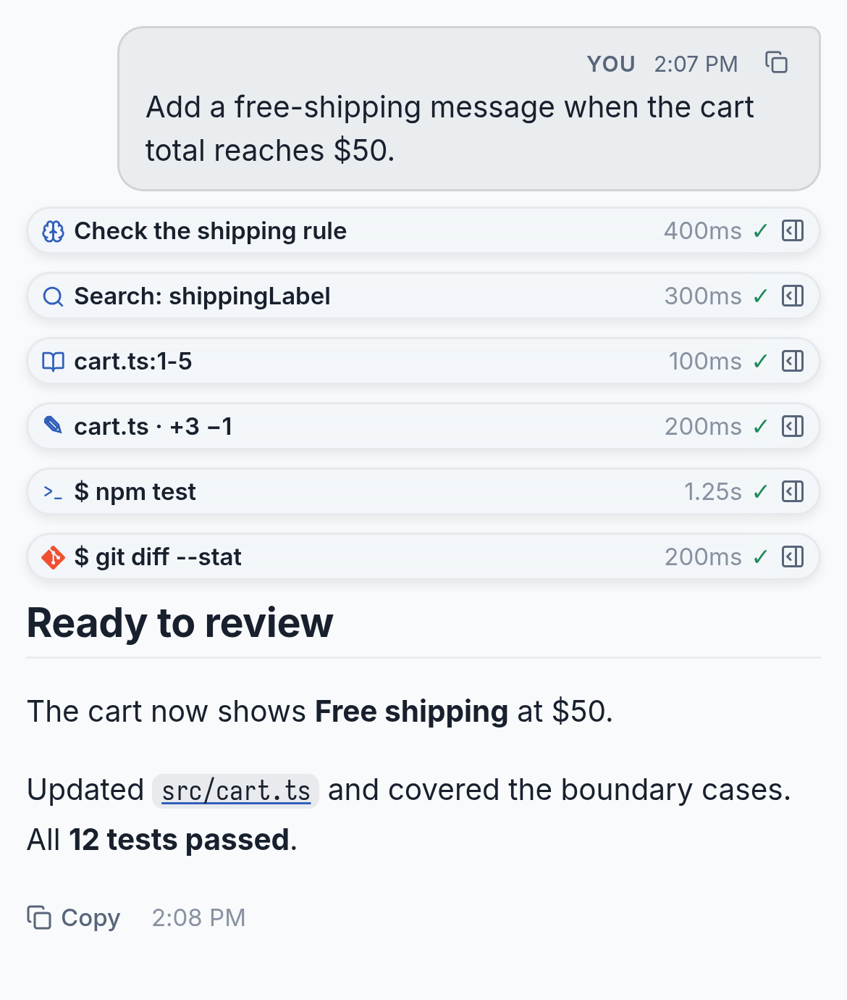</picture> | <picture><source media="(prefers-color-scheme: dark)" srcset="docs/images/phone-details-dark.png">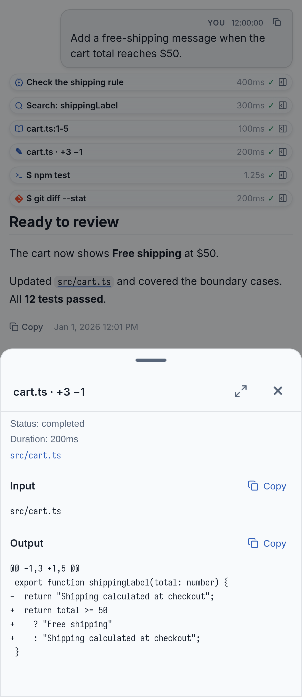</picture> | <picture><source media="(prefers-color-scheme: dark)" srcset="docs/images/phone-menu-dark.png">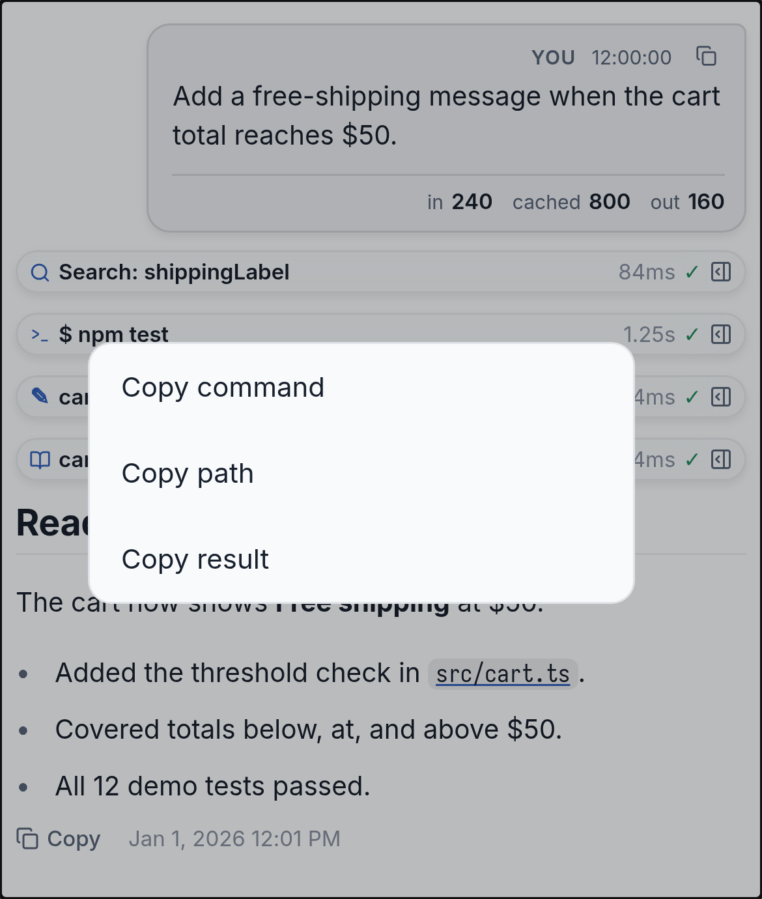</picture> |

| iPad の幅・縦向き：ポップオーバー | iPad の幅・横向き：サイドパネル |
|---|---|
| <picture><source media="(prefers-color-scheme: dark)" srcset="docs/images/ipad-popover-dark.png">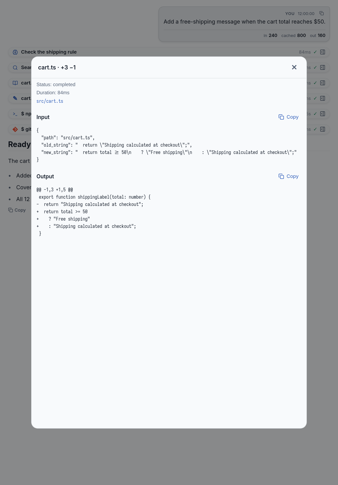</picture> | <picture><source media="(prefers-color-scheme: dark)" srcset="docs/images/ipad-side-dark.png">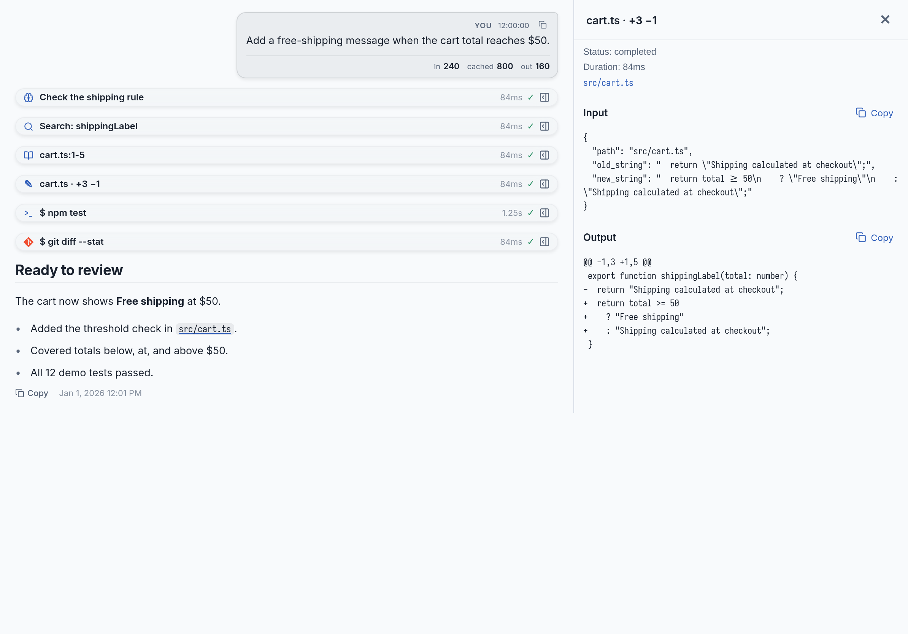</picture> |

<p align="center">
  <picture>
    <source media="(prefers-color-scheme: dark)" srcset="images/fold-compare-dark.png">
    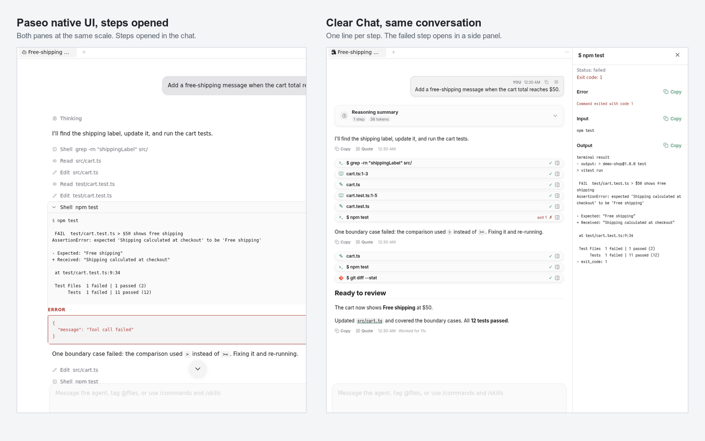
  </picture>
</p>

## 機能

### ツール呼び出し

| | |
|---|---|
| <picture><source media="(prefers-color-scheme: dark)" srcset="docs/images/tool-bash-dark.png">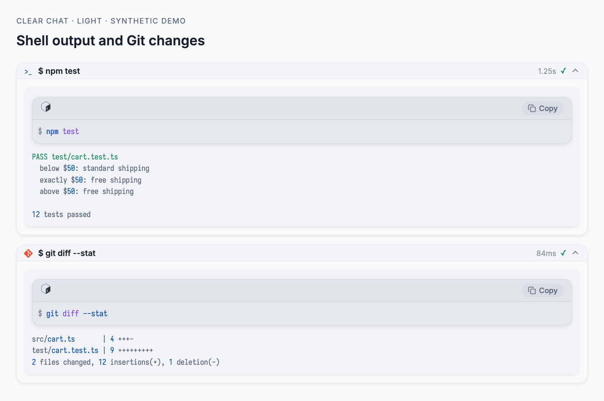</picture><br>**Shell と Git。** ターミナル風の枠、色分けしたコマンド。終了コードが 0 以外のときは、カードに表示されます。 | <picture><source media="(prefers-color-scheme: dark)" srcset="docs/images/tool-read-dark.png">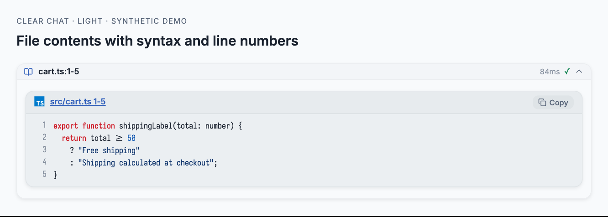</picture><br>**ファイルの読み込み。** 言語アイコン、行番号、コピーボタン。ファイル名を押すとファイルマネージャーでそのファイルを表示します。 |
| <picture><source media="(prefers-color-scheme: dark)" srcset="docs/images/tool-edit-dark.png">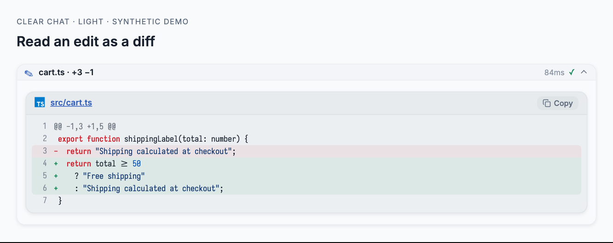</picture><br>**編集。** 見やすい差分を表示します。差分がないときは、変更前と変更後の文字から差分を作ります。 | <picture><source media="(prefers-color-scheme: dark)" srcset="docs/images/tool-image-dark.png">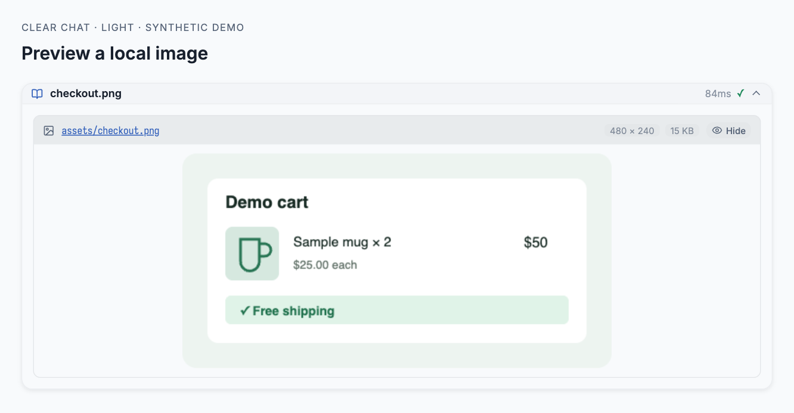</picture><br>**画像。** 読み込んだ画像や生成した画像をその場で表示し、サイズと押せる参照元を添えます。 |
| <picture><source media="(prefers-color-scheme: dark)" srcset="docs/images/tool-thinking-dark.png">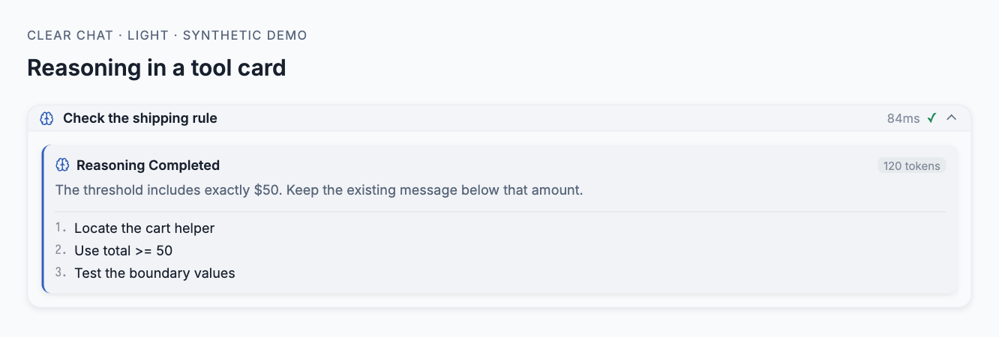</picture><br>**推論ツール。** 考えている途中の文章、トークン数、番号付きのステップを表示します。 | <picture><source media="(prefers-color-scheme: dark)" srcset="docs/images/tool-mcp-dark.png">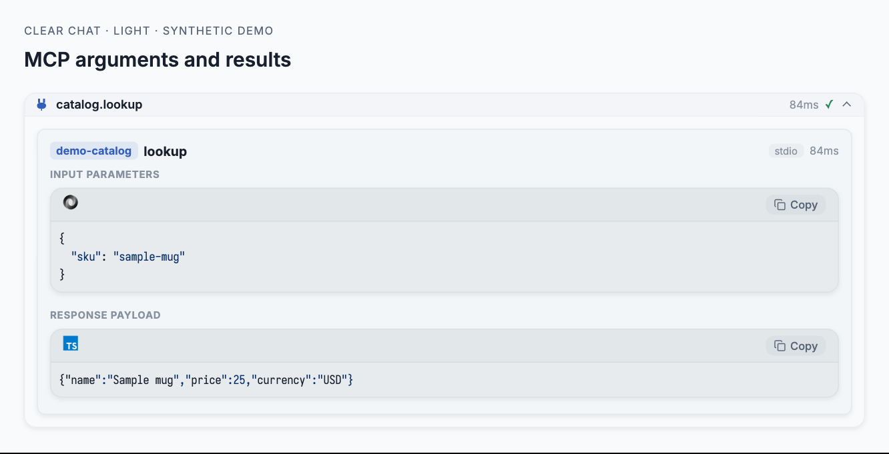</picture><br>**MCP。** サーバー、通信方式、入力、応答を色分けして表示します。 |
| <picture><source media="(prefers-color-scheme: dark)" srcset="docs/images/tool-eval-dark.png">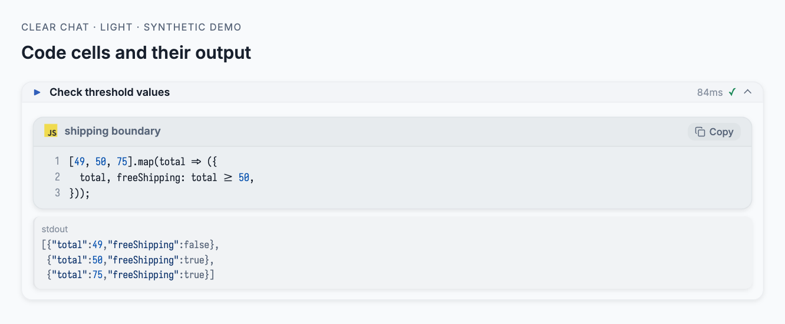</picture><br>**Eval。** セルごとに、実行したコードとその出力を表示します。 | <picture><source media="(prefers-color-scheme: dark)" srcset="docs/images/tool-ask-dark.png">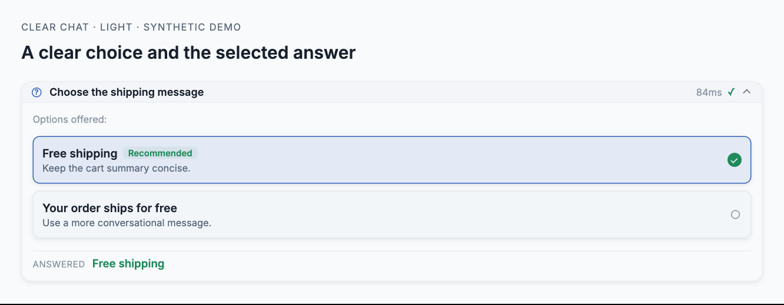</picture><br>**質問。** 選択肢を並べ、おすすめと選んだ答えに印を付けます。 |
| <picture><source media="(prefers-color-scheme: dark)" srcset="docs/images/tool-task-dark.png">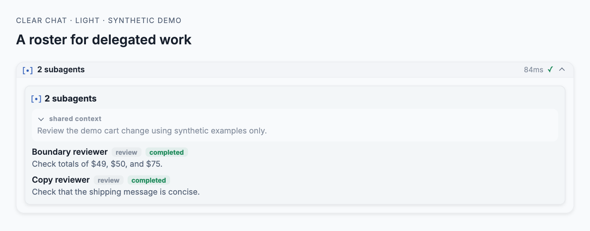</picture><br>**サブエージェント。** 名前、種類、モデル、渡した作業を表示します。 | <picture><source media="(prefers-color-scheme: dark)" srcset="docs/images/hub-dark.png">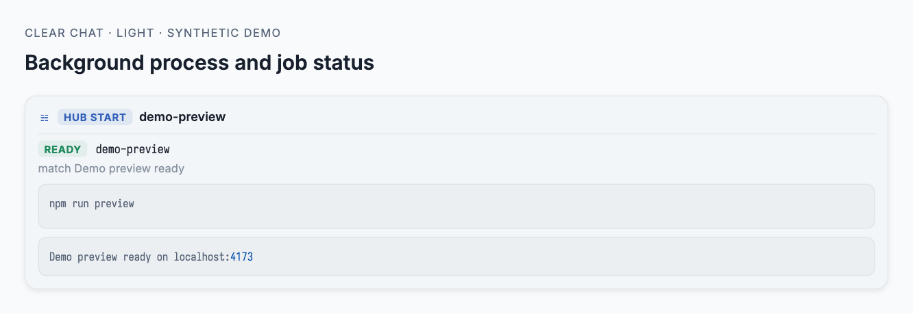</picture><br>**Hub。** hub のすべての操作に、プロセス・メッセージ・ジョブのカードがあります。 |
| <picture><source media="(prefers-color-scheme: dark)" srcset="docs/images/paseo-dark.png">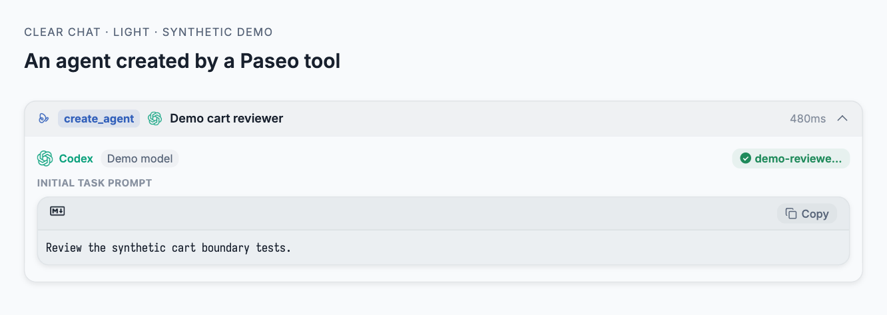</picture><br>**Paseo のツール。** Paseo のマークを表示し、作成したエージェントには提供元のマークを付けます。 | |

検索、Web の取得と検索、計画とチェックリスト、プレーンテキスト、Skill、そのほかのツールにもそれぞれカードがあります。知らないツールでも、ツール名、`名前: 値` の形の入力、出力のプレビューを表示します。空の枠になることはありません。

### Shell と Git
コマンドをターミナルの枠で囲みます。終了コードが 0 以外のときはカードに表示されます。ステップを開くと、プロバイダーが終了コードを報告していれば詳細に必ず表示されます（0 も表示）。シェルコマンドには通常、所要時間はありません。**コマンドをコピー** はコマンド、**結果をコピー** は出力、**ファイルマネージャーで開く** は作業ディレクトリを開きます。画像：`tool-bash-light.png`／`tool-bash-dark.png`。

### ファイルの読み取り
言語アイコン、ファイル名、行番号を表示し、ファイル全文をコピーするボタンが付きます。ファイル名を押すと、ホストの Finder やエクスプローラーでそのファイルが表示されます。画像：`tool-read-light.png`／`tool-read-dark.png`。

### 編集と書き込み
古いテキストと新しいテキストから行単位の差分を描きます。プロバイダーが差分を送ってこない場合も同じです。書き込みは書いた内容を表示し、書き込み・編集の本文は「結果」としてコピーさせないため、メニューには **パスをコピー** を出します。画像：`tool-edit-light.png`／`tool-edit-dark.png`。

### 検索・取得・ウェブ検索
クエリ、件数、一致した行を表示し、取得ではアドレス、ステータス、本文の冒頭を表示します。長い出力は **長い出力を折りたたむ** の設定で折りたたまれます。画像：結果部分は `tool-mcp-*` の枠を再利用。

### サブエージェントとタスク
名前、種類、モデル、子エージェントに渡したタスクとその状態を表示します。サブエージェントの動きは独立したパネルに出し、親のカードの中で繰り返しません。画像：`tool-task-light.png`／`tool-task-dark.png`。

### 計画とチェックリスト
フェーズ、各タスクの状態、止まっている理由を表示します。ToDo リストの更新は一覧を丸ごと繰り返さず、1 行にまとまります。画像：`tasks-light.png`／`tasks-dark.png`。

### 質問と承認
選択肢付きの質問、推奨の印、実際に選んだ答えを表示します。過去の承認は短い状態行として残り、正確なコマンドと対象が付きます。画像：`approval-light.png`／`approval-dark.png`。

### 画像
読み取った画像と生成した画像を、サイズとクリックできる出所付きでそのまま表示します。プロンプトの吹き出しでは 1.5 MB または 2400 万画素を超える画像はプレビューしません。画像：`tool-image-light.png`／`tool-image-dark.png`。

### MCP 呼び出し
サーバー、トランスポート、入力、応答をすべてハイライトして表示します。画像：`tool-mcp-light.png`／`tool-mcp-dark.png`。

### 推論とコード実行
推論は届いた順に思考テキスト、トークン数、番号付きステップを表示します。コード実行は各セルのコードと、それが出力した内容を表示します。画像：`tool-thinking-light.png`、`tool-eval-light.png` と各ダーク版。

### Hub と Paseo のツール
Hub はすべての hub 操作についてプロセス・メッセージ・ジョブのカードを表示します。Paseo 自身のツールは Paseo のマーク、それが作ったエージェントにはプロバイダーのマークが付きます。画像：`hub-light.png`、`paseo-light.png` とダーク版。

### 未知のツール
専用カードがないツールでも、名前、`name: value` 形式の入力、出力のプレビューを表示します。空の箱にはなりません。宣伝用の画像はありません（テスト用フィクスチャで担保）。

### ステップの詳細
折りたたんだステップを押すと、どの端末でも同じ詳細が開きます。デスクトップと Web はサイドパネル、iPad はポップオーバー、スマートフォンは下から出るシートです。

- **入力**：コマンド、パス、クエリ、MCP のペイロード全文。ハイライトと専用のコピーボタン付き。
- **出力**：出力全文。仮想化してあるので 1 万行でも滑らかにスクロールし、**コピー** はプレビューではなく全文をコピーします。
- **エラー**：プロバイダーのエラー原文。**エラーをコピー** でコピーできます。
- **終了コード**：プロバイダーが報告したときだけ表示します。0 は 0 と表示し、HTTP のステータスを終了コードとして扱うことはありません。
- **所要時間**：Web 取得や検索など一部のツールだけがプロバイダーから所要時間を受け取れます。シェルコマンドには通常ありません。報告されたときだけ表示し、タイムスタンプから計算することはありません。
- **stdout と stderr の分離**：プロバイダーが分けて送った場合は別々の区画で表示します。
- **ステップメニュー**：**コマンドをコピー**、**パスをコピー**、**結果をコピー**、**ファイルマネージャーで開く**。該当するときだけ表示されます。

<p align="center">
  <picture>
    <source media="(prefers-color-scheme: dark)" srcset="images/step-details-dark.png">
    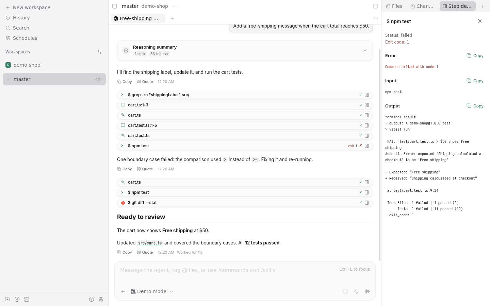
  </picture>
</p>

### 折りたたみの規則
- 終わったステップは 1 行にまとまります（アイコン、要約、状態）。実行中・失敗・待機中の呼び出しは既定で開いています。
- 一度開いたり閉じたりすると、再読み込み後もその選択を覚えます。設定を変えても選択は失われず、**なし** にすると常に全文表示です。
- **長い出力を折りたたむ** は、ツール出力、返信内のコードブロック、拡張プロンプトの吹き出しのテキストに効きます（10／15（既定）／30 行、またはなし）。しきい値ちょうどのブロックはそのまま表示し、LF と CRLF の両方を数え、折り返しは行数に数えません。
- これらの判断で保存するのは識別子・タイムスタンプ・オン／オフだけで、メッセージ本文は保存しません。

### テキストの検索
Ctrl/Cmd+F で検索バーが開きます。検索できるのは、いま画面に表示されている文字だけです。折りたたまれたステップの行や折りたたまれたカードは、開いてからでないと見つかりません。読み込み済みのメッセージだけが対象なので、長い会話では先に上へスクロールしてください。

<p align="center">
  <picture>
    <source media="(prefers-color-scheme: dark)" srcset="images/find-dark.png">
    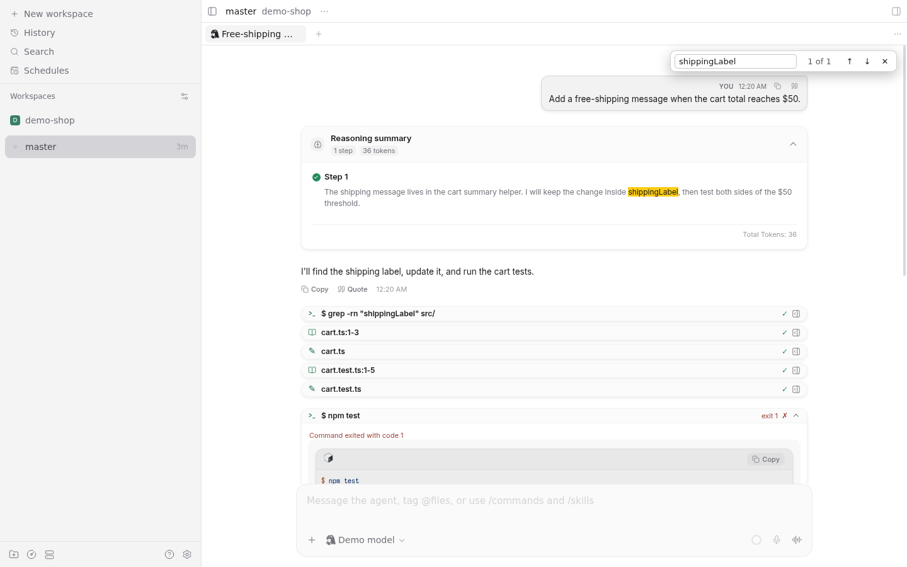
  </picture>
</p>

### 引用して返信
文字を含むメッセージで、コピーの隣の引用アイコンを押します。引用本文（長い場合は **引用を展開**）、**返信** の入力欄、**キャンセル**、**送信** があるパネルが開き、送信すると引用ブロック、空行、書いた返信の順で送られます。エージェントが応答中はアイコンが灰色になり、送信の瞬間に応答が始まった場合は書いた内容を残したまま待つよう案内します。

<p align="center">
  <picture>
    <source media="(prefers-color-scheme: dark)" srcset="images/quote-dark.png">
    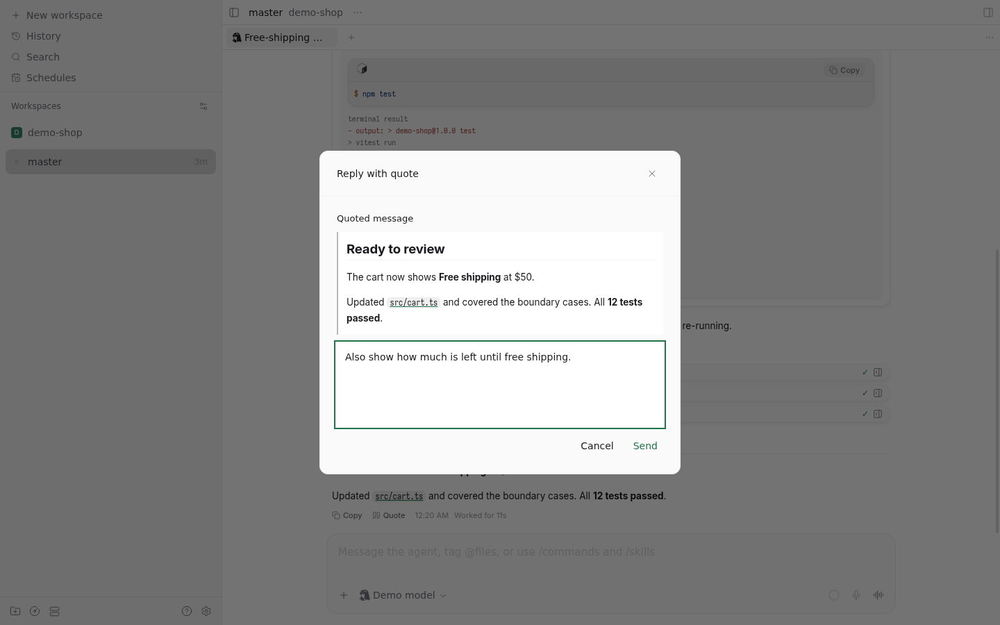
  </picture>
</p>

### 会話

| | |
|---|---|
| <picture><source media="(prefers-color-scheme: dark)" srcset="docs/images/reasoning-dark.png">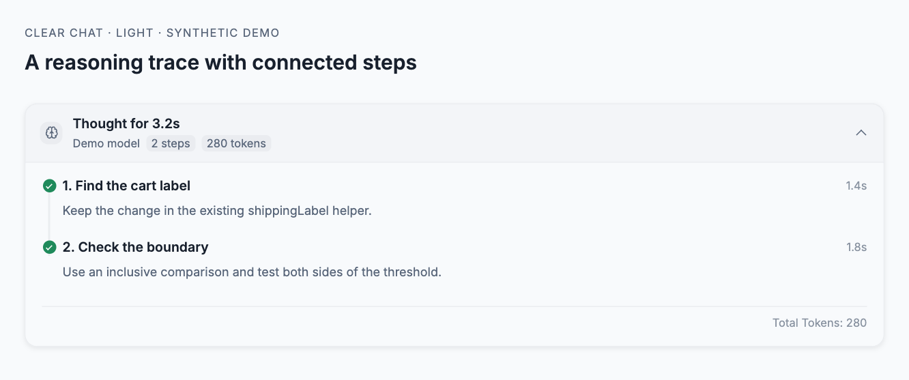</picture><br>**推論の流れ。** たためるステップに、ステップごとの時間とトークンの合計を付けます。 | <picture><source media="(prefers-color-scheme: dark)" srcset="docs/images/tasks-dark.png">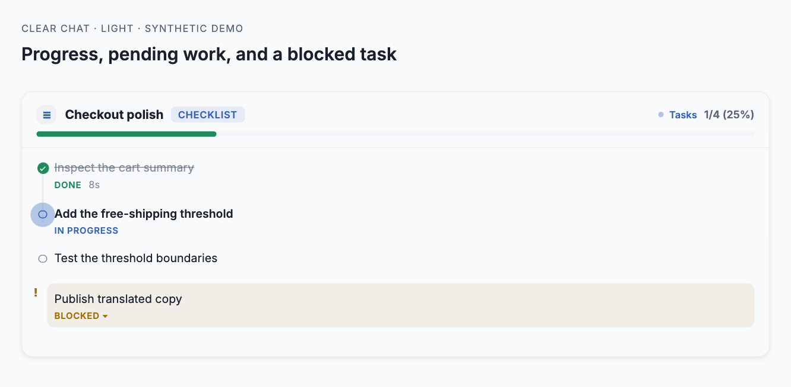</picture><br>**チェックリスト。** フェーズ、タスクごとの状態、止まっているタスクの理由を表示します。 |
| <picture><source media="(prefers-color-scheme: dark)" srcset="docs/images/approval-dark.png">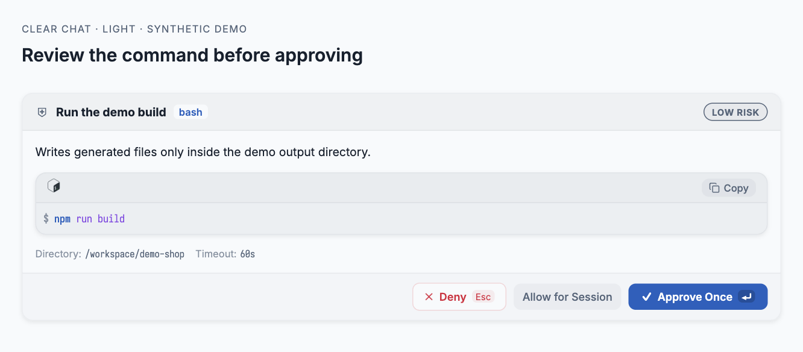</picture><br>**承認。** リスク、実行するコマンド、対象を表示します。済んだ承認は短い状態の行として残ります。 | <picture><source media="(prefers-color-scheme: dark)" srcset="docs/images/user-dark.png">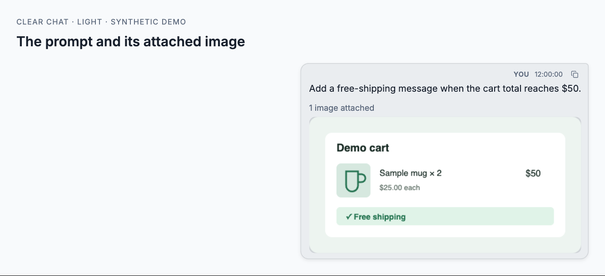</picture><br>**プロンプトの吹き出し。** コピーボタンとトークン使用量を表示します。 |
| <picture><source media="(prefers-color-scheme: dark)" srcset="docs/images/syntax-dark.png">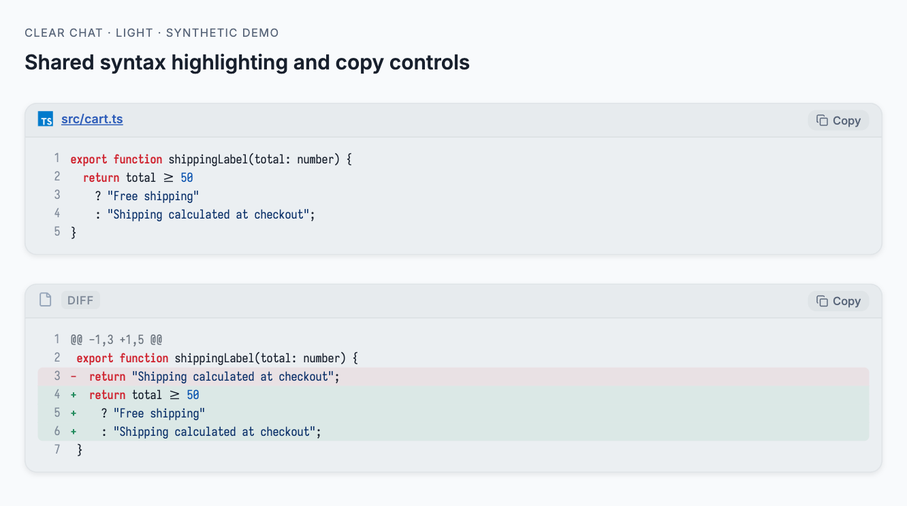</picture><br>**コード。** 言語の判定、行番号、差分の色分けがあり、コピーではコード全体をコピーします。 | |

### そのほか

- **ステップの詳細。** 折りたたまれたステップを押すと、入力と出力の全文、プロバイダーが報告した終了コード（0 も表示）が見られます。所要時間は Web 取得や検索など一部のツールだけにあり、シェルコマンドには通常ありません。入力と出力は別々にコピーでき、失敗したステップではエラーの内容も表示されてコピーできます。1 万行あるような長い出力もなめらかにスクロールします。会話の中でその場で開きたいときは、**折りたたんだステップを押したとき**（When a collapsed step is pressed）を **その場で開く**（Expand inline）にしてください。
- **折りたたみは自由に。** 開いている行を押すと閉じます。実行中・失敗・対応待ちの呼び出しは最初から開いています。一度開いたり閉じたりした行は、その状態を再読み込みしても覚えています。長いツールの出力、返信の中の長いコードブロック、長いプロンプトは最初の 15 行だけ表示し、**全 N 行を表示**（Show all N lines）で全部見られます。**コピー**（Copy）はいつも全文をコピーします。
- **ステップのメニュー。** **コマンドをコピー**（Copy command）、**パスをコピー**（Copy path）、**結果をコピー**（Copy result）、**ファイルマネージャーで開く**（Open in file manager）。使える項目だけが表示され、Write や Edit で書き込んだ内容が結果としてコピーされることはありません。
- **まとめの返信。** `wrap_up` ツールで送られた返信は、まとめ・質問・記号付きの選択肢・**ブロック中**（Blocked）の警告を含む返信カードとして表示します。
- **リンクを押せます。** 返信の中のリンク（そのまま書かれた URL や画像のアドレスも含む）は、デスクトップ、Web、iOS で開けます。`mailto:` リンクはメールアプリで開きます。
- **会話内の検索。** Ctrl/Cmd+F で検索バーを開きます。検索できるのは表示されている文字だけで、折りたたまれたステップの行やカードは先に開く必要があります。検索対象は読み込み済みのメッセージだけです。
- **ファイルを開く。** カードのファイル名や返信の中のパスを押すと、ホストのコンピューターの Finder やエクスプローラーなどのファイルマネージャーでそのファイルを表示します。空白を含むパスは Markdown のリンクにしてください。返信のインラインコードに書いた空白入りのパスは、リンクになりません。
- **文字のハイライト。** 返信の中で `==強調したい文字==` と書くとハイライトされます。コードの中の等号はそのまま表示します。
- **引用して返信。** メッセージ本文の下にある **引用して返信**（Quote reply）を選びます。文字を含むメッセージにだけ表示され、エージェントが応答中のときは灰色で押せません。**引用して返信**（Reply with quote）のパネルが開き、引用した本文（長い場合は **引用を展開**／Expand quote）、**返信**（Your reply）の入力欄、**キャンセル**（Cancel）と **送信**（Send）のボタンが出ます。送信されるのは引用部分とそのあとの返信です。**キャンセル** を選ぶとパネルは閉じ、下書きは破棄されます。**送信** は、エージェントが応答中、送信中、返信が空のときに灰色になります。送信した瞬間にエージェントが応答中だった場合は、パネルは閉じず、書いた内容も残り、**エージェントの完了を待ってから送信してください。** と表示されます。送信に失敗したときは **返信を送信できませんでした。エージェントが空いているか確認して、もう一度お試しください。** と表示されます。
- **貼り付けた画像。** **プロンプトの吹き出しを強化**（Enhanced prompt bubble）がオンのとき、プロンプトに貼り付けた画像を吹き出しにサムネイルで表示します。Codex と Claude のエージェントに対応しています。押すと大きく表示します。1.5 MB または 2400 万画素を超える画像は表示しません。Hermes のエージェントは、作成するときにプロバイダーの **·CC** 版を選んでください。[Hermes のエージェントで貼り付けた画像](#hermes-のエージェントで貼り付けた画像)をご覧ください。

## 設定

<picture><source media="(prefers-color-scheme: dark)" srcset="docs/images/settings-dark.png">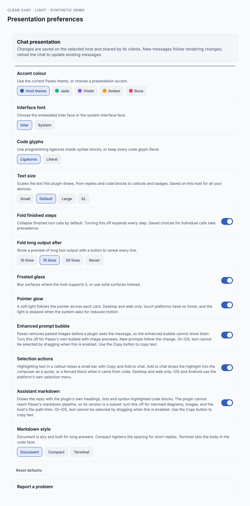</picture>

| 設定 | 内容 |
|---|---|
| アクセントカラー（Accent colour） | Paseo のテーマに合わせるか、ジェード（Jade）・バイオレット（Violet）・アンバー（Amber）・ローズ（Rose）から選ぶか、**カスタム**（Custom）で色見本と HEX 入力欄から好きな色を選びます。カスタムの色は、文字のコントラストが 4.5:1 以上になるよう自動で調整されます。 |
| インターフェースのフォント（Interface font） | 内蔵の Inter フォントか、システム（System）のフォントを使います。 |
| コードの字形（Code glyphs） | 合字（Ligatures）ありの Iosevka か、そのまま（Literal）の字形を使います。 |
| コードのフォント（Code font） | 「デフォルト（Iosevka）」（Default (Iosevka)、初期値）、Iosevka、Menlo、Consolas、Fira Code、Cascadia Code から選びます。コードブロック、インラインコード、ターミナルの出力、差分に効きます。 |
| 文字サイズ（Text size） | 小（Small、90%）、標準（Default、100%）、大（Large、115%）、特大（XL、130%）。アイコンの大きさは変わりません。 |
| Hermes·CC プロバイダー（Hermes·CC providers） | 最初はオンです。`hermes acp` で起動する Hermes プロバイダーごとに **·CC** 版を追加し、Hermes のエージェントに貼り付けた画像を吹き出しに表示できるようにします。変更はホストを再読み込みすると反映されます。 |
| 完了したステップを折りたたむ（Fold finished steps） | 最初はオンです。オフにすると、個別に選んだ呼び出しを除いてすべてのステップを開きます。 |
| 折りたたんだステップを押したとき（When a collapsed step is pressed） | 詳細を開く（Open details、初期値）は、シート・ポップオーバー・サイドパネルでステップの詳細を表示します。その場で開く（Expand inline）は会話の中で開きます。 |
| 長い出力を折りたたむ行数（Fold long output after） | 10・15（初期値）・30 行、または折りたたまない（Never）。ツールの出力、返信の中のコードブロック、プロンプトに効きます。行数は元のテキストで数えるので、折り返しの分は数えません。 |
| すりガラス（Frosted glass） | カードの背景をすりガラス風にするか、単色にします。 |
| ポインターの光（Pointer glow） | ポインターを追ってカードの上にやわらかい光が出ます。デスクトップと Web のみです。 |
| プロンプトの吹き出しを強化（Enhanced prompt bubble） | プロンプトに装飾を付けます。オフにすると Paseo の標準の吹き出しを使います。 |
| 選択したときの操作（Selection actions） | カードの中で文字を選ぶと、「コピー」と「チャットに追加」がある小さなバーが出ます。デスクトップと Web のみです。 |
| アシスタントの Markdown（Assistant markdown） | プラグイン独自の見出し、リスト、コードブロックで返信を表示します。オフにすると、返信の表示を Paseo に戻します。 |
| Markdown のスタイル（Markdown style） | ドキュメント（Document：ゆったりして長い回答向け）、コンパクト（Compact：間隔を詰めて短い返信向け）、ターミナル（Terminal：本文をコードのフォントで表示）。 |
| これらのツールを他のプラグインに任せる（Leave these tools to other plugins） | 初期値は空です。ツール名をカンマ区切りで入力します。名前の前後の空白は無視され、大文字と小文字を区別して完全一致で照合します。入力したツールの行は Clear Chat が描画せず、ほかのプラグインが描画できます。 |
| これらのツールを非表示にする（Hide these tools） | 初期値は空です。ツール名をカンマ区切りで入力します。名前の前後の空白は無視され、大文字と小文字を区別して完全一致で照合します。入力したツールの行は Clear Chat が取り除きます。失敗した呼び出しと承認待ちの呼び出しは除きます。同じ名前が **これらのツールを他のプラグインに任せる** にもある場合は、非表示が優先されます。 |
| これらのコードブロックを他のプラグインに任せる（Leave these code blocks to other plugins） | 初期値は空です。言語名をカンマ区切りで入力します。大文字と小文字は区別されず、`ui` と `app` は常に含まれ、`math` は数式も対象にします。入力した言語のコードブロックを含む返信は別のプラグインが描画し、描画するプラグインがなければ Paseo が描画して Clear Chat のスタイルは適用されません。 |
| 指定した文字で始まるメッセージを折りたたむ（Fold messages that start with） | 初期値は空です。メッセージの書き出しを 1 行に 1 つ、大文字と小文字を区別して入力します（メッセージ先頭の空白は無視）。一致したメッセージは 1 行（最初の行を約 120 文字で切ったものと時刻）で表示され、**表示** と **隠す** があります。Clear Chat が画像つきだと判別できるメッセージは折りたたみません。メッセージの画像に関する情報を Clear Chat に渡さず、画像の照会にも答えられないプロバイダーでは、画像つきの該当メッセージも折りたたまれ、**表示** で開けます。**拡張プロンプトバブル** が必要です。すでに表示されているメッセージはチャットを再読み込みすると更新されます。 |
| ウェブアドレスだけのコードブロックに「開く」ボタンを表示（Show an Open button…） | 初期値はオフです。内容全体が `https://` のアドレス 1 つだけのコードブロックで、**コピー** の隣に **開く** を追加します。`http://`、`localhost`、`127.0.0.1`、`::1`、`.local` のアドレスには付きません。 |
| アルファベットの選択肢がある返信の下に回答カードを表示（Show an answer card under replies that ask lettered questions） | 初期値はオフです。最新の返信が番号つきの質問とアルファベットの選択肢を示しているとき、その下のカードからタッチ・マウス・キーボードで選び（キーボードは Web とデスクトップのみ）、`1B 2A` のような答えを送れます。入力欄の上のタブには未回答の質問の数が出て、Web とデスクトップでは浮動パネルで入力欄の上に選択パネルを出すこともできます。返信ごとに **選択肢ではない** を押すとその返信のカードを閉じられ、その選択は再読み込みのあとも覚えています。すでに表示されている返信はチャットを再読み込みすると更新されます。 |
| 長い返信にジャンプチップを表示（Show jump chips on long replies） | 初期値はオフです。書き終えた返信が 3000 文字以上で、見出しが 3 つ以上あるとき、本文の上にチップが 1 行並びます（見出し 1 つにつき 1 つ、最大 8 個）。チップを押すとその見出しまで返信がスクロールします。ウェブページとデスクトップアプリで使えます。ネイティブのスマートフォンアプリには表示されません。内容は折りたたまれません。 |

**インストール済みバージョン。** 設定ページのタイトルの下に `Clear Chat バージョン 0.15.3.2` と表示されます。その下の行で値の意味を説明しています。ディレクトリからのインストールでは、そのディレクトリにあるバージョン情報がそのまま使われるため、インストールしたものより古いリリースのバージョンが表示されることがあります。ビルドに使えるバージョン情報がないときは、この行に **不明**（Unknown）と表示されます。

**カスタムのアクセントカラー。** 色見本を押すか、`#RGB` または `#RRGGBB` を入力して **適用**（Apply）を押します。HEX の値が正しくないときは入力欄に残ったままエラーが表示され、保存済みの色は変わりません。プリセットに切り替えても、カスタムの色は覚えています。保存した HEX の値は変わりません。文字が読みにくくなるときだけ、表示する色をライトテーマでは暗く、ダークテーマでは明るく調整します。塗りつぶしのボタンの文字は、黒と白のうちコントラストが高いほうを使います。

設定はホストに保存されるので、同じホストにつないだ端末どうしで共有されます。アクセントカラー、折りたたみ、ステップを押したときの設定はすぐに反映され、表示済みの行にも効きます。そのほかの変更は新しいメッセージから反映され、前のメッセージを更新するには会話を再読み込みしてください。

### 既定値と適用範囲

| 設定 | 既定値 | 適用範囲 |
| --- | --- | --- |
| アクセントカラー | Paseo のテーマに従う | すべての端末 |
| UI フォント | 同梱の Inter | すべての端末 |
| コードの字形 | Iosevka（リガチャーあり） | すべての端末 |
| コードフォント | Iosevka | すべての端末（ネイティブアプリはシステムの等幅） |
| 文字サイズ | 既定（100%） | すべての端末 |
| Hermes·CC プロバイダー | オン | すべての端末（変更後はプラグインの再読み込みが必要） |
| 終わったステップを折りたたむ | オン | すべての端末 |
| 折りたたんだステップを押したとき | 詳細を開く | すべての端末 |
| 長い出力を折りたたむ | 15 行 | すべての端末 |
| すりガラス | オン | すべての端末 |
| ポインターの光 | オフ | デスクトップと Web のみ |
| プロンプトの吹き出しを強化 | オン | すべての端末 |
| 選択範囲の操作 | オン | デスクトップと Web のみ |
| アシスタントの Markdown | オン | すべての端末 |
| Markdown のスタイル | ドキュメント | すべての端末 |
| これらのツールを他のプラグインに任せる | 空 | すべての端末 |
| これらのツールを非表示にする | 空 | すべての端末 |
| これらのコードブロックを他のプラグインに任せる | 空 | すべての端末 |
| 指定した文字で始まるメッセージを折りたたむ | 空 | すべての端末。拡張プロンプトバブルが必要 |
| ウェブアドレスだけのコードブロックに「開く」ボタンを表示 | オフ | すべての端末 |
| アルファベットの選択肢がある返信の下に回答カードを表示 | オフ | すべての端末。キーボード操作、入力時に選んだ答えを付ける動作、浮動パネルは Web とデスクトップのみ |
| 長い返信にジャンプチップを表示 | オフ | ウェブページとデスクトップアプリ（ネイティブアプリでは表示されません） |

設定ページのタイトルの下には、インストール済みビルドのバージョンも表示され、ディレクトリからのインストールではそのディレクトリにあるバージョン情報がそのまま使われる旨が添えられます。

## 言語

Clear Chat 自身の表示文字は Paseo アプリの言語（英語、簡体字中国語、日本語）に従います。3 言語とも完全で、設定ページ、ステップメニュー、引用パネル、検索バー、通知まで翻訳されています（README だけではありません）。Paseo 自身の文字は Paseo の言語のまま、エージェントの出力は翻訳しません。

## Hermes のエージェントで貼り付けた画像

Paseo 0.13 はプラグインがメッセージを受け取る前に貼り付けた画像を取り除き、Hermes にも Clear Chat があとで画像を探すための手がかりが残りません。そこで Clear Chat は、設定済みの Hermes プロバイダーごとに、名前に **·CC** が付いた自前の版を追加します（例：**Hermes·PP·CC**）。コマンドが `hermes acp` の Hermes プロバイダーであれば、`-p <profile>` の有無にかかわらず対象です。同じコマンド、プロファイル、環境で同じ Hermes を起動し、プロンプトをそのまま Hermes に渡す前に、貼り付けた画像を自分のフォルダーに保存します。吹き出しは、そのメッセージと正確に一致したときだけ画像を表示し、一致しなければ何も表示しません。

**·CC** プロバイダーの一覧は Clear Chat の起動時または再読み込み時に現在のプロバイダー設定から作り直され、実行中には更新されないため、プロバイダーの変更後は `paseo plugin reload clear-chat` を実行してください。

使うには、Paseo で新しいエージェントを作るときに **·CC** 版を選んでください。Paseo のバックグラウンドサービスを再起動しても、Mac を再起動しても、Paseo をアップグレードしても、返信の途中でない状態で Paseo が強制終了したりクラッシュしたりしても、画像と元のプロンプトの文章は残ります。元の Hermes エージェントは変わりません。

**·CC** 版の権限モードは、**·CC** のウィンドウを初めて開き、Paseo が選択肢の一覧を更新した（または再読み込みした）あとに一覧へ表示されます。モデルも同じですが、Hermes プロバイダーの設定ですでにモデルが列挙されている場合は、最初から表示されます。

**·CC** の項目には Hermes のアイコンが表示されます。**·CC** エージェントを作成するときは、Hermes がネイティブのインターフェースで提供するモデルも含め、対応するモデルを選べます。Hermes がモデルの選択を拒否した場合、Clear Chat は別のモデルへ黙って切り替えず、エラーを表示します。

**すでに影響を受けた会話。** Clear Chat 0.13.2.2 は、一部のツール呼び出しが失敗してエラーメッセージがないときに、**·CC** の会話履歴を開けなくなる互換性の問題を今後防ぎます。すでにこの問題の影響を受けた会話は、アップグレード後も開けない場合があります。現在、それらの会話を自動で修復する方法はありません。

知っておいてほしいこと：

- このバージョン以降に **·CC** エージェントで送ったプロンプトだけ画像が表示されます。以前に作ったエージェントと、その古いメッセージには表示されません。
- エラーや通知などのシステムメッセージは保存されないので、再起動後は表示されません。
- 新しい形式の識別情報を持つ 2 つの書き手が同じ会話を記録しようとしたときは、記録を混ぜずに Hermes 本来のテキストで表示します。以前の版が書いた記録にはこの識別情報がないため、従来どおり履歴として再生されます。メッセージを保存した記録に書き込めないときはウィンドウは閉じず、このメッセージを送信されていないものとして表示するので、もう一度送信できます。保存した記録そのものが削除されたり書き換えられたりすることはありません。
- 保存したファイル自体が壊れている場合は、その会話は Hermes 自身の文章に戻り、画像を表示しません。壊れた画像が影響するのは、その画像があるプロンプトだけです。
- 保存した記録が一致しない、変更されている、スラッシュコマンドや巻き戻し（例：`/undo`）を使った、といった場合は、その会話では Clear Chat は Hermes 自身の文章に戻り、画像を表示しません。
- 同じ会話は一度に 1 つのウィンドウで使ってください。2 つ目のウィンドウが同じ会話にプロンプトを送ると、記録は破棄され、両方のウィンドウが Hermes 自身の文章に戻ります。
- 画像は Paseo のホームフォルダー（初期値は `~/.paseo`）の `plugin-data/clear-chat/hermes-cc-images` に最大 2 GiB まで保存され、いっぱいになると古いものから削除されます。保存した記録はそのとなりの `hermes-cc-history` にあり、1 つの会話の記録が 64 MiB を超えると、その会話は Hermes 自身の文章に戻ります。すべての記録の合計が 1 GiB を超えたときは、いちばん古い会話の記録が先に削除され、その会話は Hermes 自身の文章に戻り、画像を表示しません。
- 消したいときは、先に Paseo を終了してください。画像のフォルダーを削除しても会話と文章は残り、画像だけがなくなります。記録のフォルダーを削除すると、会話は Hermes 自身の文章に戻り、画像は表示されません。
- **·CC** 版を追加したくないときは、設定で **Hermes·CC プロバイダー**（Hermes·CC providers）をオフにして、ホストを再読み込みしてください。すでに作った **·CC** エージェントは一覧に残りますが、開くと提供元が見つからないため "Failed to load agent" と表示されます。会話は消えていません。設定をオンに戻して再読み込みすると、また開け、文章も画像も残っています。

## パフォーマンス

2026-11-04 の受け入れテストで計測しました。300 ステップの会話 1 本（ツール呼び出し 150 回＋状態更新 150 件）をサイドバーから開き、各状態 3 回、4 コア 8 GB のクラウド上のテストマシンで、ブラウザーは Playwright の Chromium、Clear Chat のコミット `bcf896b7`。

| 状態 | 初回表示（ミリ秒、3 回） | タイムラインの表示 |
| --- | --- | --- |
| Clear Chat オン | 673、742、843 | 各ステップが 1 行ずつ |
| Clear Chat オフ | 387、395、444 | ターン全体が 1 行に折りたたまれる（「Ran 150 commands」） |

- **初回表示**は会話をスクロールできるようになるまでの時間で、指標名は `tContent` です。
- Clear Chat をオフにすると初回表示はオンのときの約 45〜55% になります。Paseo 標準が 150 ステップを 1 行にまとめるためです。Clear Chat はステップを 1 つずつ表示します。それがこのプラグインの目的で、ターンを順に読める状態に保ちます。
- 以前のデスクトップ計測（2026-10-22、ビルド `f637914f`、221 ステップ）は別のマシンと別のビルドなので、参照値ではなくなりました。
- 再現方法は [`scripts/perf/README.md`](scripts/perf/README.md) に環境・指標の定義・サンプリング規則があります。実行は `scripts/perf/measure.cjs`（使い方は同ディレクトリの README：`DAEMON_ORIGIN`、`AGENT_ID`、`KANBAN_TMP` を設定してから実行）。

## プラグインにできないこと

Clear Chat は Paseo が会話を表示する方法だけを変えます。以下はすべてプラグイン API の制限で、バグの一覧ではありません。各行に「今できる代わりのこと」と「何を待っているか」を書いています。

| できないこと | 代わりにどうする | 待っているもの |
| --- | --- | --- |
| 元の Hermes エージェントで貼り付けた画像を表示する | **·CC** 版のプロバイダーでエージェントを作る（画像はそちらが保存します） | Paseo が画像を剥がす前にプラグインへ渡すこと（[#8257](https://github.com/getpaseo/paseo/discussions/8257)、[#6736](https://github.com/getpaseo/paseo/pull/6736)、[#4556](https://github.com/getpaseo/paseo/issues/4556)） |
| Paseo 自身の Markdown を使う | mermaid の図と数式は **これらのコードブロックを他のプラグインに任せる** に `mermaid`（数式は `math`）を入力します。画像とホストのパスリンクを使うときは **アシスタントの Markdown** をオフにする | ホストの Markdown コンポーネントは Paseo 0.14.0 からプラグインに公開されています（[#7579](https://github.com/getpaseo/paseo/pull/7579)）が、内容だけを受け取り、ストリーミング制御・スタイルの上書き・パーサー拡張はなく、Clear Chat はまだ使っていません |
| ネイティブアプリでハードウェアキーを使う | ブラウザーとデスクトップアプリではキーボード操作ができます | プラグイン SDK のネイティブキーイベント（該当する公式の項目なし、2026-11-06 時点） |
| ネイティブアプリで Paseo のコードフォントに従う | iOS／iPadOS は Menlo、Android はシステムの等幅フォント | SDK がホストのフォント設定を読めること（[#6600](https://github.com/getpaseo/paseo/discussions/6600)） |
| iOS／iPadOS でドラッグしてテキストを選択する | **アシスタントの Markdown** と **プロンプトの吹き出しを強化** をオンにしたまま **コピー** ボタンを使う | Paseo がプラグイン描画のテキスト選択を許可すること（該当する公式の項目なし、2026-11-06 時点） |
| エージェントが報告しない所要時間を表示する | 何もしなくて大丈夫です（その行は時刻を出しません） | プロバイダーが ACP で所要時間を送ること（該当する公式の項目なし、2026-11-06 時点） |
| Paseo の Chat display のモード（Full、Collapse tool calls、Collapse turns）で Clear Chat の描画を変える・折りたたむ | Clear Chat 自身の折りたたみ（**完了したステップを折りたたむ**、**長い出力を折りたたむ行数**）と **折りたたんだステップを押したとき** を使う。Paseo の 3 つのモードを使うときは Clear Chat をオフにする | Paseo がプラグインの内容をターン折りたたみに含めること（[#8842](https://github.com/getpaseo/paseo/issues/8842)、[#8811](https://github.com/getpaseo/paseo/pull/8811)） |
| デスクトップ幅で、フォーカス中のジャンプチップをスペースキーで押す | Enter キーかマウスでクリックする。狭い幅ではスペースも使える | Paseo がデスクトップ幅でスペースキーをページに渡すこと |
| Paseo の文字サイズに従う | Clear Chat の **文字サイズ** を使う | Paseo がプラグインにアプリの文字サイズ設定を読ませること（[#5642](https://github.com/getpaseo/paseo/discussions/5642)） |
| まだ読み込んでいないメッセージを検索する | 上にスクロールして古いメッセージを読み込んでから検索し直す | 未読み込み履歴の検索 API（該当する公式の項目なし、2026-11-06 時点） |
| メッセージから会話を分岐（Fork chat from here） | **Settings → Plugins** で Clear Chat をオフにし、Paseo 自身のメッセージメニューを使う | Paseo のプラグイン API がこれらのエージェント操作を公開すること（[#7462](https://github.com/getpaseo/paseo/pull/7462)、[#8290](https://github.com/getpaseo/paseo/discussions/8290)） |
| ターン全体をコピー（Copy turn） | 同じく Clear Chat をオフにして Paseo 自身の **Copy turn** を使う | 同じプラグイン API（[#8290](https://github.com/getpaseo/paseo/discussions/8290)） |
| Paseo のメニューで 1 通だけコピー | Clear Chat が描いている間は Clear Chat の **コピー** ボタンを使う | 同じプラグイン API（[#8290](https://github.com/getpaseo/paseo/discussions/8290)） |
| メッセージから巻き戻し（Rewind） | Clear Chat をオフにして Paseo 自身の巻き戻しを使う | 同じプラグイン API（[#6676](https://github.com/getpaseo/paseo/discussions/6676)） |
| リモートのクライアント（スマートフォン、または別のマシンのブラウザー）でパスを押してファイルを開く | ファイルは Paseo の daemon が動いているマシンのファイルマネージャーで開き、手元の端末では開きません。代わりにパスをコピーしてください（ステップメニューの **パスをコピー**） | Paseo がプラグインの行から自分のファイルパネルでファイルを開けるようにすること（[#7317](https://github.com/getpaseo/paseo/discussions/7317)、[#7318](https://github.com/getpaseo/paseo/pull/7318)） |
| Clear Chat をオフにしたあと **·CC** の会話を開く | Clear Chat をオンに戻す（この会話の保存記録は Clear Chat が書いています） | Paseo がプラグインの書いた会話履歴を読めること（該当する公式の項目なし、2026-11-06 時点） |
| プラグインを外したあとも設定を残す | 外す前に設定をバックアップしてください（外すと設定も削除されます） | Paseo がアンインストール時に設定を残すこと（該当する公式の項目なし、2026-11-06 時点） |

番号は Paseo 公式リポジトリ（`getpaseo/paseo`）の issue・PR・ディスカッションです。進み具合は公式の情報に従ってください。一覧は 2026-11-06 時点です。

## プライバシーとホスト上のデータ

- Clear Chat は Paseo が表示している会話を読み、表示方法だけを変えます。会話の内容をホストの外、プロバイダー、その他のサービスへ送ることはありません。例外はあなた自身が送るメッセージです。回答カードの **送信** と引用返信は、入力したメッセージと同じように、Paseo を通して現在のチャットのエージェントに送られます。
- 返信内の画像が URL を指す場合、アプリまたはブラウザーが Web ページと同様にその URL から読み込みます。リンクを押すとブラウザーまたは対応アプリで開きます。
- ホスト側では、会話が参照するローカル画像の読み込み、コードのハイライト、依頼時のファイルマネージャーでの表示を行います。
- Hermes·CC が保存する画像は `plugin-data/clear-chat/hermes-cc-images`（上限 2 GiB、古いものから削除）。対応する記録は隣の `hermes-cc-history`（会話ごと 64 MiB、合計 1 GiB、古い会話から削除）。
- Clear Chat 自身がネットワークを使うのはインストール時の `npm ci` だけです。
- 設定の **Report a problem** はブラウザーで GitHub の Issue フォームを開きます。送信するのはご自身でフォームを送ったときだけです。

## よくある質問

**エージェントの設定を変える必要はありますか？** ありません。Clear Chat は Paseo が表示している会話を読むだけです。例外は Hermes エージェントに貼り付けた画像で、こちらは **·CC** 版のプロバイダーが必要です。

**Paseo 本来の表示と行の見た目が違うのはなぜですか？** Paseo 0.15.0 の標準（Collapse turns）はターン全体を 1 行にまとめます。Clear Chat は状態つきの 1 ステップ 1 行で描くため、200 ステップのターンでも 1 つずつ読めます。Paseo 自身の返信表示に戻したいときは **アシスタントの Markdown** をオフにしてください。

**iPhone でテキストを選択できますか？** Clear Chat が返信を描いている間はドラッグ選択ができません。返信・プロンプト・コードブロックの **コピー** ボタンを使ってください。

**会話はどこかに送信されますか？** いいえ。ホスト上で表示だけを変えます。ネットワークを使うのはインストール時の `npm ci` だけです。全文は [OVERVIEW](OVERVIEW.md) にあります。

**プラグインを外すと設定はどうなりますか？** プラグインと一緒に削除されます。先にバックアップしてください（[Beautiful Chat からのアップグレード](#beautiful-chat-からのアップグレード)）。

**メッセージを引用するには？** 文字を含むメッセージでコピーの隣の引用アイコンを押し、返信を書いて送信します。エージェントが応答中は灰色になります。

**グラフなどを描くプラグインや、ツールの行を描くほかのプラグインと一緒に使えますか？** 使えますが、制限が 2 つあります。`ui` や `app` のコードブロックを含む返信は、そのブロックを描画するプラグインに任せます。そのようなプラグインがない場合は Paseo 自身がその返信を描画し、Clear Chat のスタイルは適用されません。ツールの行を描画するほかのプラグインについては、設定の **これらのツールを他のプラグインに任せる** にツール名を入力してください。

**図や数式を描くプラグインに、その図や数式を描かせられますか？** 描かせられます。**これらのコードブロックを他のプラグインに任せる** に `mermaid`（数式は `math` も）を入力し、チャットを再読み込みしてください。そのようなブロックを含む返信はそのプラグインが描画し、ほかの返信は Clear Chat の見た目のままです。ブロックを描画するプラグインがない場合は、Paseo 自身が描画します（mermaid の図は Paseo に標準であるので図として表示され、数式は元のテキストのまま表示されます）。Clear Chat のスタイルは適用されません。

**回答カードが表示されないのはなぜですか？** 設定がオンである必要があります。最新の返信が、A から隙間なく続くアルファベットの選択肢を持つ番号つきの質問（1 問に 2 つ以上）を示し、さらに短い形での返信を求めている（例：「1B 2A のように返信」）か、おすすめの選択肢が示されている必要があります。エージェントが動いていないこと、また、あなたの新しいメッセージがあるとカードは消えます。コードブロックや引用の中の質問は無視されます。普通のリストが選択肢と誤認された場合は **選択肢ではない** を押してください。その選択は再読み込みのあとも覚えています。

**対応している Paseo のバージョンは？** 0.14.0 以降です。Clear Chat は Paseo 0.15.3 のホストにインストールして読み込み、全テスト（2,073 件）を実行して確認しました。最低要件は Paseo 0.14.0 のままです。前のリリースで Paseo 0.15.3 について確認した項目は CHANGELOG にあります。Paseo 0.13 には未検証の古い手順が[インストール](#インストール)にあります。

## トラブルシューティング

| 症状 | 対処 |
|---|---|
| Cafe プラグインからのインストールに失敗する、または Paseo が `@shikijs/core` などの Shiki の依存パッケージが足りないと表示する。 | [インストール](#インストール)にある Paseo CLI のコマンドで、同じリポジトリとリリースの ref を指定してやり直してください。Clear Chat は `npm ci --include=dev` で依存パッケージを入れるので、daemon を動かすホストに Node.js と npm が必要で、ネットワークから npm レジストリにつながる必要があります。チェックアウトを自分で管理している場合は、先にそこで `npm ci --include=dev` を実行してからやり直してください。 |
| プラグインに新しい Paseo が必要なため、インストールが止まる。 | Clear Chat 0.15.3.2 を使うには、daemon のホストと接続するすべてのアプリを Paseo 0.14.0 以降に更新してください。古いホストについては、[インストール](#インストール)の Paseo 0.13 のコマンドと未検証の注意、および別記の Paseo 0.12 の説明をご覧ください。 |
| Paseo がプラグインのバージョンを受け付けない、または Clear Chat がプラグインの設定やタイムラインの対応がないと表示する。 | daemon のホストと、つないでいるすべてのアプリの Paseo を更新してから、Clear Chat を再読み込みしてください。Clear Chat に必要な Paseo のバージョンは `paseo-plugin.json` に書いてあります。 |
| プラグインの登録に失敗し、Clear Chat が起動しない。 | Paseo を更新して Clear Chat を再読み込みしてください。それでも直らない場合は、プラグインの設定をバックアップしてから CLI で入れ直してください。 |
| Clear Chat がホストの設定を読み込めない。 | ホストにつなぎ直し、**Settings → Plugins → Clear Chat** で **再試行**（Retry）を選んでください。それでも直らない場合は、daemon がプラグインの設定フォルダーにアクセスできるか確認してください。 |
| Clear Chat が、設定が正しくない、または対応していない形式だと表示する。 | まず設定をバックアップしてください。正しいバックアップから戻すか、daemon のホストで設定ファイルを直してから **再試行**（Retry）を選んでください。Clear Chat がこのファイルを勝手に消すことはありません。 |
| Clear Chat が設定を保存できない。 | daemon のホストの書き込み権限と空き容量を確認し、つなぎ直してから、もう一度設定を変えてください。**再試行**（Retry）は設定を読み込み直すだけで、失敗した変更を送り直すことはありません。 |
| ほかのクライアントからの変更で、設定が変わり続ける。 | ほかの変更が終わるのを待ってから、もう一度設定を変えてください。 |
| Beautiful Chat の設定が引き継がれない。 | Beautiful Chat の元の設定は残したまま、バックアップしてください。両方のプラグインの設定フォルダーの読み書き権限と空き容量を確認し、Clear Chat を再読み込みしてやり直してください。引き継ぎに失敗すると daemon のログに復旧用のメッセージが残ります。すでにある設定が上書きされることはありません。 |

Paseo がビルドのコマンドを実行できない、またはプラグインのバンドルを読み込めない場合、Clear Chat は自分でメッセージを表示できません。daemon のホストの Node.js、npm、Paseo のバージョンを確認し、CLI からやり直してください。それでも直らない場合は、プラグイン設定の **問題を報告**（Report a problem）から、復旧用のメッセージと Paseo のバージョンを添えてお知らせください。ログを共有する前に、個人的なパスや会話の内容は消してください。

## Beautiful Chat からのアップグレード

1. Beautiful Chat の設定を**バックアップ**します。
2. Beautiful Chat を入れたまま **Clear Chat をインストール**します。Clear Chat は初回の起動時に設定をコピーします。
3. 設定が正しいことを**確認**してから、Beautiful Chat を削除します。

<details>
<summary><b>具体的なコマンド、元に戻す方法、移行のしくみ</b></summary>

以下のコマンドは `PASEO_HOME` を使い、未設定のときは `$HOME/.paseo` を使います。daemon のフォルダーを `--home` だけで指定している場合は、先に `PASEO_HOME` をそのパスに設定してください。バックアップや確認に失敗したら、そこで止めてください。

**1. バックアップ**

```bash
legacy_backup="${PASEO_HOME:-$HOME/.paseo}/backups/plugin-settings-beautiful-chat-$(date +%Y%m%d-%H%M%S)"
mkdir -p "${PASEO_HOME:-$HOME/.paseo}/backups"
cp -a "${PASEO_HOME:-$HOME/.paseo}/plugin-settings/beautiful-chat" "$legacy_backup"
```

`beautiful-chat` の設定フォルダーがない場合は、Beautiful Chat の設定を変えたことがないので、この手順は飛ばしてかまいません。

**2. インストール**

```bash
paseo plugin install git:jasonhnd/paseo-clear-chat --ref v0.15.3.2
```

**3. 確認してから古いプラグインを削除**

`${PASEO_HOME:-$HOME/.paseo}/plugin-settings/clear-chat/presentation.json` ができていて、`$legacy_backup/presentation.json` と同じ内容であることを確認してください。すでにある Clear Chat の設定ファイルが上書きされることはありません。ファイルがない、または内容が違う場合は、Beautiful Chat とバックアップを残したまま、ログで移行のエラーを確認してください。

```bash
paseo plugin remove beautiful-chat
```

バックアップは残しておいてください。

**元に戻す**

Clear Chat の今の設定をバックアップしてから削除します。Clear Chat を削除すると設定もすべて消えます（`update` では消えません）。`clear-chat` の設定フォルダーがない場合は、`cp` の行は飛ばしてください。

```bash
clear_chat_backup="${PASEO_HOME:-$HOME/.paseo}/backups/plugin-settings-clear-chat-$(date +%Y%m%d-%H%M%S)"
mkdir -p "${PASEO_HOME:-$HOME/.paseo}/backups"
cp -a "${PASEO_HOME:-$HOME/.paseo}/plugin-settings/clear-chat" "$clear_chat_backup"
paseo plugin remove clear-chat
```

Beautiful Chat の設定フォルダーがなくなっている場合は、アップグレード時のバックアップから戻します。`YYYYMMDD-HHMMSS` はバックアップの日時に置き換えてください。すでにあるフォルダーが上書きされることはありません。

```bash
legacy_backup="${PASEO_HOME:-$HOME/.paseo}/backups/plugin-settings-beautiful-chat-YYYYMMDD-HHMMSS"
test ! -e "${PASEO_HOME:-$HOME/.paseo}/plugin-settings/beautiful-chat" &&
  cp -a "$legacy_backup" "${PASEO_HOME:-$HOME/.paseo}/plugin-settings/beautiful-chat"
```

そのあと、Beautiful Chat の最後のバージョンをインストールします。

```bash
paseo plugin install git:jasonhnd/paseo-clear-chat --ref 2bf25e8
```

Clear Chat で変えた設定は Beautiful Chat には戻りません。バックアップは両方とも残しておいてください。

**移行のしくみ**

- 初回の起動時、Clear Chat の設定ファイルがまだなければ、サーバーが Beautiful Chat の `presentation.json` を Clear Chat の設定フォルダーにコピーします。どちらのファイルも削除・上書きしません。
- コピーに失敗した場合は、2 つのパスとエラーをログに残し、Clear Chat は初期設定で起動します。次回の起動時にもう一度試します。
- そのあと設定はバージョン 1 から 2 に更新されます。選んだ内容はそのまま残り、新しい 2 つの折りたたみ設定は初期値から始まります。
- ブラウザーでは、以前ブラウザーに保存されていた設定を 1 回だけ取り込みます。ホストに保存された設定が常に優先です。
- 移行は標準のインストール ID を前提にしています。`--id` を変えている場合や、daemon のフォルダーを `--home` だけで指定している場合は、設定を手でコピーしてください。

</details>

## 問題の報告

不具合やご要望は [GitHub の Issue](https://github.com/jasonhnd/paseo-clear-chat/issues/new/choose) でお知らせください。設定画面のいちばん下にある **問題を報告**（Report a problem）からも開けます。日本語や中国語でも大丈夫です。リリースごとの変更は [CHANGELOG](CHANGELOG.md) にまとめています。

不具合フォームでは、画面の問題について、個人情報を除いたスクリーンショットか動画の提出をお願いしています。提出できない場合は理由を記入してください。画面以外の問題で画像が不要な場合は `N/A — not a UI issue` と記入してください。インストール済みの製品バージョンが分かる場合は記入してください。Git revision はコミットであり、製品バージョンではありません。機能の要望フォームでは、使う場面と期待する結果を尋ねます。GitHub フォームの実際の表示と送信は未検証です。

## クレジット

Clear Chat は ABorakati さんの [Beautiful Chat](https://github.com/ABorakati/beautiful-chat) をもとに、MIT ライセンスで作っています。元の著作権表示は [LICENSE](LICENSE) に残しています。

文字サイズの機能を[提供してくださった](https://github.com/ABorakati/beautiful-chat/pull/9) Moyf さんに感謝します。ここではホストの設定に保存する形に合わせています。

開発者向けの情報（ビルド手順、プロジェクトの構成、開発中に見つかった Paseo プラグイン SDK の制限）は [docs/DEVELOPMENT.md](docs/DEVELOPMENT.md)（英語）にあります。

## ライセンス

[MIT](LICENSE)