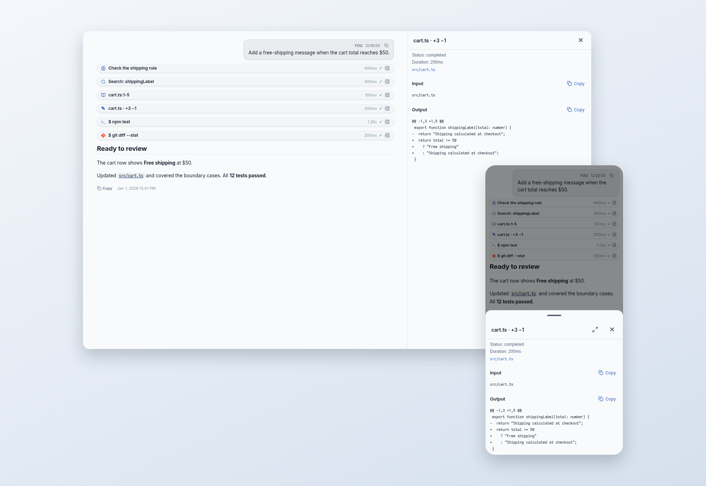
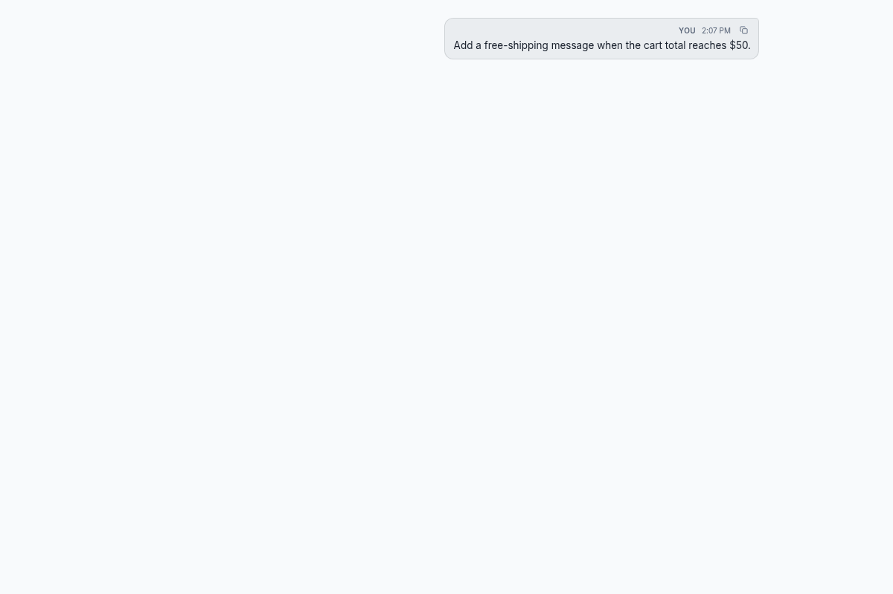
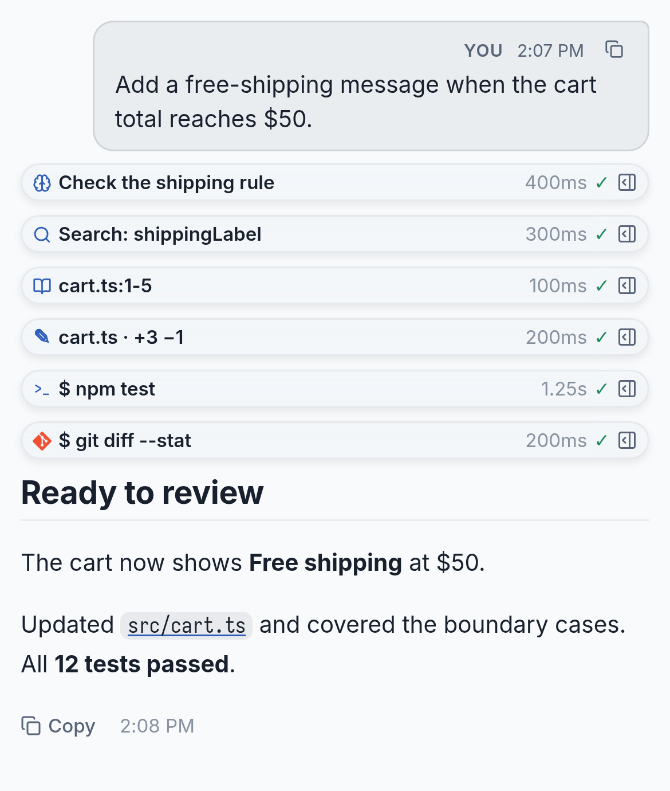
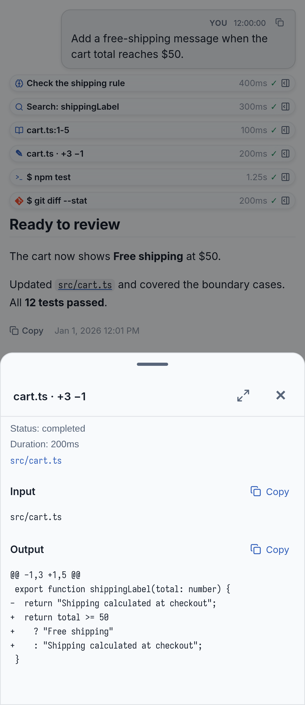
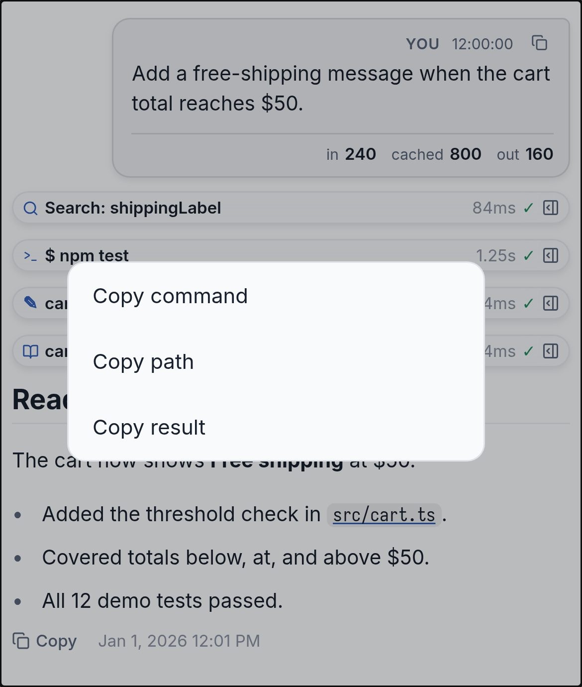
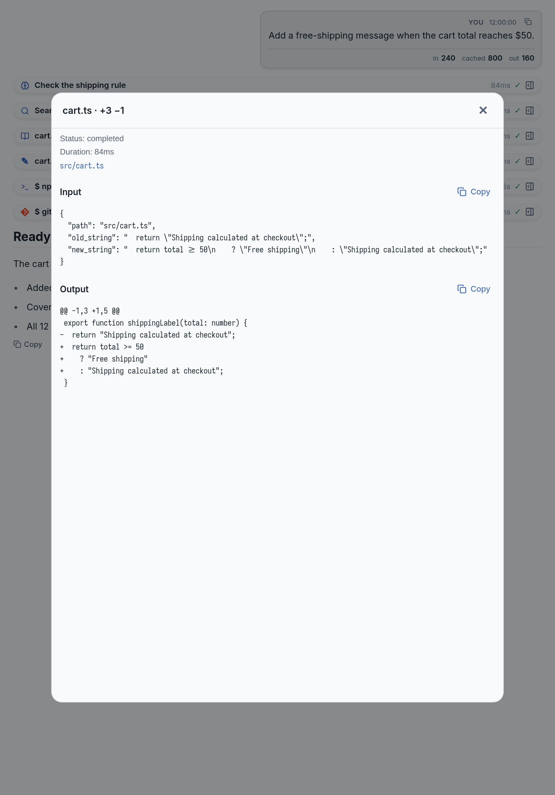
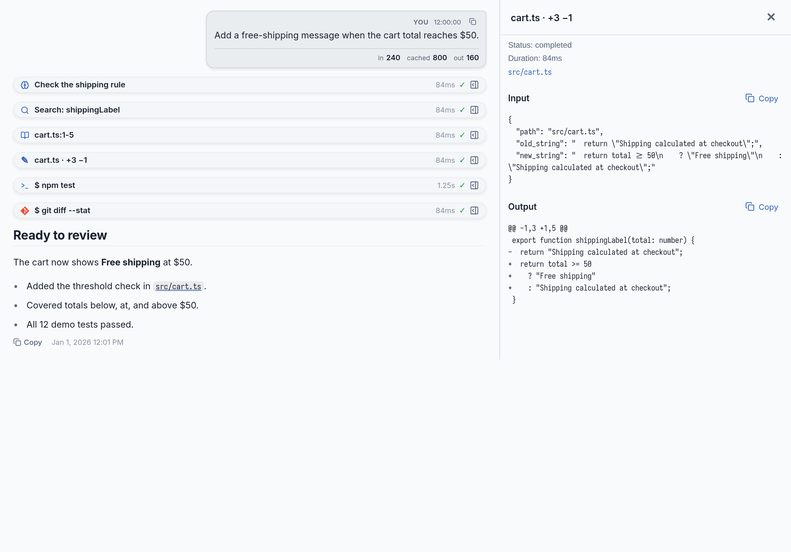

<p align="right"><b>English</b> | <a href="README.zh-CN.md">简体中文</a> | <a href="README.ja.md">日本語</a></p>

<h1 align="center">Clear Chat</h1>

<p align="center"><b>Makes agent conversations easy to read: one-line steps, a card for every tool and step details.</b><br>A plugin for <a href="https://paseo.sh">Paseo</a>, on desktop, web, iPhone and iPad.</p>

<p align="center">
  <a href="https://github.com/jasonhnd/paseo-clear-chat/releases"></a>
  <a href="LICENSE"></a>
  <a href="https://paseo.sh"></a>
</p>

<p align="center">
  <picture>
    <source media="(prefers-color-scheme: dark)" srcset="images/hero-dark.png">
    
  </picture>
</p>

<p align="center">
  
</p>

<p align="center"><sub>Every screenshot and the demo use sample data.</sub></p>

## Why Clear Chat

- **See the answer first.** Finished steps fold into one compact row each, and the reply that ends the turn always stays open.
- **Open any step.** The full input, output and error of a step open in a side panel on desktop, a popover on iPad and a bottom sheet on a phone. See [Phones and iPad](#phones-and-ipad).
- **A card for every tool.** Claude, Codex and Hermes calls all get proper cards. All 12 tool kinds that Paseo reports have their own card, and Hermes tools such as `skill_view` and `memory` get dedicated rows. See [Features](#features).
- **Speaks your language.** Clear Chat's own text follows the Paseo app language: English, Simplified Chinese or Japanese.
- **Make it yours.** Accent colour, fonts, text size and folding. Settings are saved on the host, so every device connected to it shares them. See [Settings](#settings).
- **Stays fast.** In our test, a 221-step conversation shows its first screen in about 1.3 seconds, about the same as Paseo without the plugin.<sup>1</sup>

<p align="center">
  <picture>
    <source media="(prefers-color-scheme: dark)" srcset="images/compare-dark.png">
    
  </picture>
</p>

<p align="center"><sub>Left: the same conversation without the plugin. Right: with Clear Chat.</sub></p>

<sub>1. Median of five runs in headless Google Chrome on one machine. Your numbers will differ. The method is in [scripts/perf/README.md](scripts/perf/README.md).</sub>

## Install

```bash
paseo plugin install git:jasonhnd/paseo-clear-chat --ref v0.14.0.4
```

Open Paseo’s plugins page and look for the version at the start of the Clear Chat description. Paseo 0.14.0 displays the default English description there even when the app language is changed.

Clear Chat 0.14.0.4 needs Paseo 0.14.0 or later. Open **Settings → Plugins → Clear Chat** to choose colours, fonts and folding.

To update later:

```bash
paseo plugin update clear-chat
```

This moves Clear Chat to the latest version on the `main` branch, not the release you first installed, and asks before it changes anything. In a script, add `--yes`. To move to a specific release, or back to an earlier one, add `--ref`, for example `paseo plugin update clear-chat --ref v0.13.0.1`. Updates normally keep settings, but the outcome and settings compatibility of a specific rollback are not guaranteed; see the untested Paseo 0.13 example below.

> [!IMPORTANT]
> Already using Beautiful Chat? Read [Upgrading from Beautiful Chat](#upgrading-from-beautiful-chat) **before** you install or remove anything. Removing a plugin in Paseo also deletes its settings.

<details>
<summary><b>Older Paseo versions (0.13 / 0.12), and how version numbers work</b></summary>

Still on Paseo 0.13? Clear Chat 0.13.2.2 is already released and declares support for Paseo 0.13.0 or later. The exact installation command below has not yet been tested on Paseo 0.13:

```bash
paseo plugin install git:jasonhnd/paseo-clear-chat --ref v0.13.2.2
```

If Clear Chat is already installed, the proposed way to select that release is shown below. **This exact switch and its effect on settings have not yet been verified on Paseo 0.13; switching from the new version to the old one is also untested.**

```bash
paseo plugin update clear-chat --ref v0.13.2.2 --yes
```

On Paseo 0.12, install Clear Chat 0.12.0.1 instead:

```bash
paseo plugin install git:jasonhnd/paseo-clear-chat --ref v0.12.0.1
```

If Clear Chat is already installed, `install` stops with `Plugin ID clear-chat is already configured`. Switch versions with `update` instead; it keeps your settings:

```bash
paseo plugin update clear-chat --ref v0.12.0.1 --yes
```

A Clear Chat version is the Paseo version it is built and tested for, plus one more number that counts Clear Chat's releases for that Paseo version. For example, 0.13.0.1 is the first Clear Chat release for Paseo 0.13.0, and 0.13.0.2 is the second. After Paseo releases a new version, the next Clear Chat release starts counting again, for example 0.13.1.1 for Paseo 0.13.1. Clear Chat does not release a new version just because Paseo did. Releases 1.0.0 and 1.0.1 came out before this rule; 0.12.0.1 is newer than both.

</details>

## Phones and iPad

Paseo runs the same plugin on desktop, web, iPhone and iPad. Clear Chat picks the layout from the width it has, not from the device name, so a narrow desktop window behaves like a phone.

| | Phone | iPad | Desktop and web |
|---|---|---|---|
| Step details | Bottom sheet | Popover (744–1023px wide) or side panel (1024px and wider) | Side panel; a popover or bottom sheet in narrower windows |
| Rows | Smaller titles, icons and padding, so more steps fit; buttons stay easy to tap | Standard | Standard |
| Step menu | Long-press a step | Long-press a step | Right-click a step |
| Hover preview | – | – | Rest the pointer on a collapsed step |
| Keyboard | – | Tab, arrows, Enter and Escape in a browser with a hardware keyboard | Tab, arrows, Enter and Escape |
| Paths in replies | Copied, with a hint to open them on the host | Copied, with a hint to open them on the host | Open in Finder, Explorer or your file manager |

When you resize a window, rotate an iPad or use Split View, the details move to the matching layout and keep the same step, your reading position and what you had open.

<sub>These screenshots are taken in a browser at phone and iPad widths, with sample data.</sub>

| Phone width: conversation | Phone width: step details | Phone width: step menu |
|---|---|---|
| <picture><source media="(prefers-color-scheme: dark)" srcset="docs/images/phone-timeline-dark.png"></picture> | <picture><source media="(prefers-color-scheme: dark)" srcset="docs/images/phone-details-dark.png"></picture> | <picture><source media="(prefers-color-scheme: dark)" srcset="docs/images/phone-menu-dark.png"></picture> |

| iPad width, portrait: popover | iPad width, landscape: side panel |
|---|---|
| <picture><source media="(prefers-color-scheme: dark)" srcset="docs/images/ipad-popover-dark.png"></picture> | <picture><source media="(prefers-color-scheme: dark)" srcset="docs/images/ipad-side-dark.png"></picture> |

## Features

### Tool calls

| | |
|---|---|
| <picture><source media="(prefers-color-scheme: dark)" srcset="docs/images/tool-bash-dark.png"></picture><br>**Shell and Git.** Terminal frame, highlighted command, exit code, and time when the agent reports it. | <picture><source media="(prefers-color-scheme: dark)" srcset="docs/images/tool-read-dark.png"></picture><br>**Read.** Language icon, line numbers, copy button. The file name shows the file in your file manager. |
| <picture><source media="(prefers-color-scheme: dark)" srcset="docs/images/tool-edit-dark.png"></picture><br>**Edit.** A clean diff, also built from old and new text when no diff is given. | <picture><source media="(prefers-color-scheme: dark)" srcset="docs/images/tool-image-dark.png"></picture><br>**Images.** Read and generated images appear inline, with size and a clickable source. |
| <picture><source media="(prefers-color-scheme: dark)" srcset="docs/images/tool-thinking-dark.png"></picture><br>**Reasoning tool.** Live thinking text, token count and numbered steps. | <picture><source media="(prefers-color-scheme: dark)" srcset="docs/images/tool-mcp-dark.png"></picture><br>**MCP.** Server, transport, inputs and response, all highlighted. |
| <picture><source media="(prefers-color-scheme: dark)" srcset="docs/images/tool-eval-dark.png"></picture><br>**Eval.** Each cell's code, then what it printed. | <picture><source media="(prefers-color-scheme: dark)" srcset="docs/images/tool-ask-dark.png"></picture><br>**Ask.** Options with the recommended one and the chosen answer marked. |
| <picture><source media="(prefers-color-scheme: dark)" srcset="docs/images/tool-task-dark.png"></picture><br>**Subagents.** Name, type, model and the task it was given. | <picture><source media="(prefers-color-scheme: dark)" srcset="docs/images/hub-dark.png"></picture><br>**Hub.** Process, message and job cards for every hub operation. |
| <picture><source media="(prefers-color-scheme: dark)" srcset="docs/images/paseo-dark.png"></picture><br>**Paseo tools.** Paseo's mark, with the provider's mark on created agents. | |

Search, fetch and web search, plans and checklists, plain text, skills and any other tool also get their own cards. An unknown tool shows its name, its inputs as `name: value` and a preview of its output. It is never an empty box.

### Conversation

| | |
|---|---|
| <picture><source media="(prefers-color-scheme: dark)" srcset="docs/images/reasoning-dark.png"></picture><br>**Reasoning trace.** Collapsible steps with time per step and a token total. | <picture><source media="(prefers-color-scheme: dark)" srcset="docs/images/tasks-dark.png"></picture><br>**Checklist.** Phase, status per task and the reason a task is blocked. |
| <picture><source media="(prefers-color-scheme: dark)" srcset="docs/images/approval-dark.png"></picture><br>**Approvals.** Risk, the exact command and target. Past approvals stay as short status rows. | <picture><source media="(prefers-color-scheme: dark)" srcset="docs/images/user-dark.png"></picture><br>**Prompt bubble.** Copy button and token usage. |
| <picture><source media="(prefers-color-scheme: dark)" srcset="docs/images/syntax-dark.png"></picture><br>**Code.** Language detection, line numbers, diff colours and a full-source copy. | |

### Also included

- **Step details.** Click a collapsed step to see the full input and output, the exit code of a shell command, and how long it took when the agent reports it. Input and output have separate copy buttons, and a failed step shows its error text, which you can copy too. Very long output, even 10,000 lines, scrolls smoothly. To open steps inside the conversation instead, set **When a collapsed step is pressed** to **Expand inline**.
- **Folding you control.** Click an open row to close it. Running, failed and waiting calls open by default. Once you open or close a row, Clear Chat remembers your choice, even after reloads. Long tool output, long code blocks in replies and long prompts show the first 15 lines, with **Show all N lines**. **Copy** always copies the full text.
- **Step menu.** **Copy command**, **Copy path**, **Copy result** and **Open in file manager**. Each item appears only when it applies; the text written by Write and Edit is not copied as a result.
- **Wrap-up replies.** Replies sent through a `wrap_up` tool show as a full reply card, with recap, question, lettered options and a **Blocked** alert.
- **Clickable links.** Links in replies, including bare web addresses and image addresses, open on desktop, web and iOS, and `mailto:` links open your mail app.
- **Find in chat.** Ctrl/Cmd+F opens a find bar that also searches tool cards. It searches only messages already loaded.
- **Open files.** File names in cards and paths in replies show the file in Finder, Explorer or your file manager on the host computer. Put a file name or path that contains spaces in inline code, or use a Markdown link.
- **Highlight text.** `==marked text==` highlights text in replies. Inside code, the equals signs stay as they are.
- **Pasted images.** With **Enhanced prompt bubble** on, images you paste into a prompt show as thumbnails in the prompt bubble, for Codex and Claude agents. Tap one to see it full size. Images larger than 1.5 MB or 24 megapixels are not shown. For Hermes agents, choose the **·CC** version of the provider when you create the agent; see [Pasted images in Hermes agents](#pasted-images-in-hermes-agents).

## Settings

<picture><source media="(prefers-color-scheme: dark)" srcset="docs/images/settings-dark.png"></picture>

| Setting | Effect |
|---|---|
| Accent colour | Follow the Paseo theme, pick Jade, Violet, Amber or Rose, or choose **Custom** for colour swatches and a HEX field. Custom colours are adjusted to keep text contrast at 4.5:1 or higher. |
| Interface font | Embedded Inter, or your system font. |
| Code glyphs | Iosevka with ligatures, or plain glyphs. |
| Code font | Default (Iosevka) (default), Iosevka, Menlo, Consolas, Fira Code or Cascadia Code. Applies to code blocks, inline code, terminal output and diffs. |
| Text size | Small (90%), Default (100%), Large (115%) or XL (130%). Icons keep their size. |
| Hermes·CC providers | On by default. Adds a **·CC** version of each Hermes provider that starts with `hermes acp`, so images pasted into Hermes agents can show in the prompt bubble. Changes apply after you reload the host. |
| Fold finished steps | On by default. Off opens every step unless you chose otherwise for that call. |
| When a collapsed step is pressed | Open details (default) shows the step in a sheet, popover or side panel. Expand inline opens it inside the conversation. |
| Fold long output after | 10, 15 (default) or 30 lines, or Never. Applies to tool output, code blocks in replies and prompts. Lines are counted in the source text, so wrapped lines do not count extra. |
| Frosted glass | Blur card backgrounds, or paint them solid. |
| Pointer glow | A soft light follows the pointer across each card. Desktop and web only. |
| Enhanced prompt bubble | Styles your prompts. Off uses Paseo's own bubble. |
| Selection actions | Highlighting text in a card shows a small bar with Copy and Add to chat. Desktop and web only. |
| Assistant markdown | Draws replies with Clear Chat's own headings, lists and code blocks. Off hands replies back to Paseo. |
| Markdown style | Document (airy, for long answers), Compact (tighter, for short replies) or Terminal (body in the code font). |

**Custom accent colour.** Tap a swatch, or enter `#RGB` or `#RRGGBB` and press **Apply**. An invalid HEX value stays in the field with an error, and the saved colour does not change. Switching to a preset remembers your custom colour. The saved HEX value never changes; only the colour you see is darkened on light themes or lightened on dark themes when text would otherwise be hard to read. Filled buttons use black or white text, whichever has more contrast.

Settings are saved on the host, so every device connected to that host shares them. Accent colours, folding and step-click settings apply at once, including to rows already shown. Other changes apply to new messages; reload the chat to update older ones.

## Pasted images in Hermes agents

Paseo 0.13 removes pasted images before a plugin sees the message, and Hermes does not keep what Clear Chat would need to find them later. So Clear Chat adds its own copy of each Hermes provider you have set up, named with **·CC**, for example **Hermes·PP·CC**. It covers every Hermes provider whose command is `hermes acp`, with or without `-p <profile>`, and starts the same Hermes with the same command, profile and environment. Before it passes your prompt on, unchanged, it saves the pasted images in its own folder. The prompt bubble shows an image only when it matches the exact message, and shows nothing otherwise.

To use it, choose the **·CC** version when you create a new agent in Paseo. The images and your original prompt text are still there after Paseo's background service restarts, your Mac restarts, you upgrade Paseo, or Paseo is killed or crashes while no reply is in progress. Your original Hermes agents do not change.

The **·CC** version's permission modes appear in the list after you open a **·CC** window for the first time and Paseo has refreshed its options (or after you reload). Its models do too, unless your Hermes provider settings already list them.

The **·CC** entries use the Hermes icon. You can choose a supported model when creating a **·CC** agent, including when Hermes reports its models through its native interface. If Hermes rejects a model selection, Clear Chat reports the error instead of silently choosing another model.

**Previously affected conversations.** Clear Chat 0.13.2.2 prevents a compatibility issue in which certain failed tool calls with no error message could make a **·CC** conversation's history fail to open. Conversations already affected by this issue may still fail to open after upgrading; there is currently no automatic fix for those affected conversations.

What to know:

- Only prompts you send in a **·CC** agent with this version or later show images. Agents you started before, and their old messages, do not.
- Errors and notices from the system are not saved, so they are not shown after a restart.
- If two writers that both carry the new identity information record the same conversation, Clear Chat shows that conversation with Hermes's own text instead of mixing their records; records written by earlier versions replay as ordinary history. If a message cannot be written to the saved copy, the window stays open and Clear Chat reports the message as not sent, so you can send it again; the saved copy itself is not deleted or changed.
- If the saved files themselves are damaged, that conversation falls back to Hermes's own text and shows no images; a damaged image only affects the prompt it belongs to.
- If the saved record does not match, has been changed, or you used a slash command or a revert such as `/undo`, Clear Chat falls back to Hermes's own text for that conversation and shows no images.
- Use one conversation from one window at a time. If a second window sends a prompt to the same conversation, the record is discarded and both windows fall back to Hermes's own text.
- The images are saved in the `plugin-data/clear-chat/hermes-cc-images` folder in your Paseo home (`~/.paseo` by default), up to 2 GB. When it is full, the oldest are deleted first. The saved records are in `hermes-cc-history` next to it. A conversation whose record grows past 64 MB falls back to Hermes's own text. When all records together pass 1 GB, the record of the oldest conversation is deleted first, and that conversation falls back to Hermes's own text and shows no images.
- To clear them, quit Paseo first. Deleting the images folder keeps your conversations and text but removes the images. Deleting the records folder makes the conversations fall back to Hermes's own text, with no images.
- To stop adding the **·CC** versions, turn off **Hermes·CC providers** in the settings and reload the host. The **·CC** agents you already created stay in the list, but opening one shows "Failed to load agent" because its provider cannot be found; the conversation is not lost. Turn the setting back on and reload, and they open again, with their text and images.

## What a plugin cannot do

Clear Chat changes only how Paseo shows a conversation. Some things are up to Paseo and are not open to plugins:

- **Pasted images in the original Hermes agents.** Paseo 0.13 removes pasted images before a plugin sees the message, and Hermes does not keep what Clear Chat would need to find them later. Use the **·CC** version of the agent instead (see [Pasted images in Hermes agents](#pasted-images-in-hermes-agents)). In an original Hermes agent the images are still sent to the agent; turn **Enhanced prompt bubble** off to see them in Paseo's own bubble.
- **Paseo's own Markdown.** Clear Chat cannot use Paseo's Markdown pipeline, so **Assistant markdown** supports a subset. Turn it off for mermaid diagrams, images and the host's file-path links.
- **Hardware keys in the native apps.** Keyboard navigation works in a browser and the desktop app. The native iPhone, iPad and Android apps keep touch controls only.
- **Fonts in the native apps.** Plugins cannot read Paseo's code font setting or add fonts to the native apps. On iOS and iPadOS, code uses Menlo; on Android, the system monospace font.
- **Drag to select on iOS and iPadOS.** While **Assistant markdown** or **Enhanced prompt bubble** is on, you cannot select text by dragging. Use the **Copy** button on the reply, prompt or code block. If copying fails, a dialog shows the full text for you to select by hand.
- **Step times.** A step shows how long it took only when the agent reports it.
- **Turn folding in Paseo 0.14.** Paseo’s whole-turn folding does not apply to content drawn by Clear Chat.
- **Text size.** Content drawn by Clear Chat does not follow Paseo’s text-size setting. Use Clear Chat’s own **Text size** setting instead.
- **Find in chat.** The find bar searches the messages that are loaded, so scroll up to include older ones.
- **Settings after removal.** Removing a plugin in Paseo also deletes its settings. Back them up first.

## Troubleshooting

| Problem | What to do |
|---|---|
| Installing through the Cafe plugin fails, or Paseo reports a missing Shiki dependency such as `@shikijs/core`. | Retry with the Paseo CLI command in [Install](#install), using the same repository and release ref. Clear Chat installs its dependencies with `npm ci --include=dev`, so Node.js and npm must be available on the daemon host, and its network must reach the npm registry. If you manage the checkout yourself, run `npm ci --include=dev` there before retrying. |
| Installation stops because the plugin needs a newer Paseo version. | For Clear Chat 0.14.0.4, update Paseo on the daemon host and all connected apps to 0.14.0 or later. For older hosts, see the [Install](#install) section for the Paseo 0.13 commands and their untested-status warning, and the separate Paseo 0.12 instructions. |
| Paseo rejects the plugin version, or Clear Chat says plugin settings or timeline support is missing. | Update Paseo on the daemon host and in every connected app, then reload Clear Chat. The Paseo version Clear Chat needs is declared in `paseo-plugin.json`. |
| Clear Chat cannot start because plugin registration failed. | Update Paseo and reload Clear Chat. If it still fails, back up the plugin settings before you reinstall from the CLI. |
| Clear Chat cannot read its settings from the host. | Reconnect to the host and choose **Retry** in **Settings → Plugins → Clear Chat**. If it still fails, check that the daemon can access the plugin settings folder. |
| Clear Chat says its settings are invalid or in an unsupported format. | Back up the settings first. Restore a valid backup, or repair the settings file on the daemon host, then choose **Retry**. Clear Chat never erases the file by itself. |
| Clear Chat cannot save settings. | Check write permission and free disk space on the daemon host, reconnect, then make the change again. **Retry** reloads the settings; it does not resend a change that failed. |
| Settings keep changing because of another client. | Wait until the other edits finish, then make the change again. |
| Beautiful Chat settings were not migrated. | Keep Beautiful Chat's original settings and back them up. Check read and write access to both plugin settings folders and free disk space, then reload Clear Chat to try again. A failed migration leaves a recovery message in the daemon log; existing settings are never overwritten. |

If Paseo cannot run the build command or load the plugin bundle, Clear Chat cannot show a message of its own. Check Node.js, npm and the Paseo version on the daemon host, then retry from the CLI. If the problem stays, use **Report a problem** in the plugin settings and include the recovery message and your Paseo version. Remove private paths and conversation content before you share any logs.

## Upgrading from Beautiful Chat

1. **Back up** your Beautiful Chat settings.
2. **Install Clear Chat** while Beautiful Chat is still installed. On first start, Clear Chat copies your settings.
3. **Check** that your settings look right, then remove Beautiful Chat.

<details>
<summary><b>Exact commands, rollback, and how the migration works</b></summary>

The commands use `PASEO_HOME` and fall back to `$HOME/.paseo`. If your daemon uses only `--home`, set `PASEO_HOME` to that path first. Stop if a backup or check fails.

**1. Back up**

```bash
legacy_backup="${PASEO_HOME:-$HOME/.paseo}/backups/plugin-settings-beautiful-chat-$(date +%Y%m%d-%H%M%S)"
mkdir -p "${PASEO_HOME:-$HOME/.paseo}/backups"
cp -a "${PASEO_HOME:-$HOME/.paseo}/plugin-settings/beautiful-chat" "$legacy_backup"
```

If the `beautiful-chat` settings folder does not exist, you never changed Beautiful Chat's settings, and you can skip this step.

**2. Install**

```bash
paseo plugin install git:jasonhnd/paseo-clear-chat --ref v0.14.0.4
```

**3. Check, then remove the old plugin**

Confirm that `${PASEO_HOME:-$HOME/.paseo}/plugin-settings/clear-chat/presentation.json` exists and matches `$legacy_backup/presentation.json`. An existing Clear Chat settings file is never overwritten. If the file is missing or differs, keep Beautiful Chat and the backup, and check the migration error in the log.

```bash
paseo plugin remove beautiful-chat
```

Keep the backup.

**Rollback**

Back up Clear Chat's current settings, then remove it. Removing Clear Chat deletes all of its settings; `update` does not. If the `clear-chat` settings folder does not exist, skip the `cp` line.

```bash
clear_chat_backup="${PASEO_HOME:-$HOME/.paseo}/backups/plugin-settings-clear-chat-$(date +%Y%m%d-%H%M%S)"
mkdir -p "${PASEO_HOME:-$HOME/.paseo}/backups"
cp -a "${PASEO_HOME:-$HOME/.paseo}/plugin-settings/clear-chat" "$clear_chat_backup"
paseo plugin remove clear-chat
```

If Beautiful Chat's settings folder is gone, restore it from the upgrade backup. Replace `YYYYMMDD-HHMMSS` with your backup's timestamp. An existing folder is never overwritten.

```bash
legacy_backup="${PASEO_HOME:-$HOME/.paseo}/backups/plugin-settings-beautiful-chat-YYYYMMDD-HHMMSS"
test ! -e "${PASEO_HOME:-$HOME/.paseo}/plugin-settings/beautiful-chat" &&
  cp -a "$legacy_backup" "${PASEO_HOME:-$HOME/.paseo}/plugin-settings/beautiful-chat"
```

Then install the last Beautiful Chat version:

```bash
paseo plugin install git:jasonhnd/paseo-clear-chat --ref 2bf25e8
```

Changes made in Clear Chat do not sync back to Beautiful Chat. Keep both backups.

**How the migration works**

- On first start, the server copies Beautiful Chat's `presentation.json` into Clear Chat's settings folder if Clear Chat has none yet. It never deletes or overwrites either file.
- If copying fails, the error is logged with both paths, and Clear Chat starts with default settings. The next start tries again.
- Settings are then upgraded from version 1 to version 2. Your choices stay; the two new folding settings start at their defaults.
- In a browser, older preferences stored in the browser are imported once. Settings saved on the host always win.
- Migration expects the default installation IDs. An installation with a custom `--id`, or a daemon home set only with `--home`, needs its settings copied by hand.

</details>

## Reporting problems

Something wrong, or an idea? [Open an issue on GitHub](https://github.com/jasonhnd/paseo-clear-chat/issues/new/choose). You can also use **Report a problem** at the bottom of the settings page. Chinese and Japanese are welcome too. Every release is listed in the [changelog](CHANGELOG.md).

The bug form asks for a redacted screenshot or video for a UI problem; if you cannot provide one, say why. For a non-UI problem, enter `N/A — not a UI issue` if no image is relevant. Give the installed product version if known; an installed Git revision is a commit, not a product version. The feature form asks for the use case and the expected result. The forms' live GitHub rendering and submission have not been tested.

## Credits

Clear Chat is based on [Beautiful Chat](https://github.com/ABorakati/beautiful-chat) by ABorakati, under the MIT License. The original copyright notice is kept in [LICENSE](LICENSE).

Thanks to Moyf for the [text size contribution](https://github.com/ABorakati/beautiful-chat/pull/9), adapted here to host settings.

For developers: build steps, project layout and the Paseo plugin SDK limits found along the way are in [docs/DEVELOPMENT.md](docs/DEVELOPMENT.md).

## License

[MIT](LICENSE)