<p align="right"><b>English</b> | <a href="README.zh-CN.md">简体中文</a> | <a href="README.ja.md">日本語</a></p>

<p align="center">
  
</p>

<h1 align="center">Clear Chat</h1>

<p align="center">Clear Chat is a plugin for <a href="https://paseo.sh">Paseo</a> that makes a long agent conversation easy to read without changing what the agent does. Finished steps fold into one compact row each, every tool call gets its own card, and the reply that ends a turn keeps its code, links and paths. Pressing a folded step opens its full input and output, and the exit code and duration when the provider reports them, in a side panel on desktop, a popover on iPad and a bottom sheet on a phone. It adds its own settings page — accent colour, fonts, text size, folding, and the installed version — plus quote-and-reply on any message. How fast it is, and how that is measured, is <a href="#performance">below</a>.</p>

<p align="center">
  <a href="https://github.com/jasonhnd/paseo-clear-chat/releases"></a>
  <a href="LICENSE"></a>
  <a href="https://paseo.sh"></a>
</p>

<p align="center">
  <picture>
    <source media="(prefers-color-scheme: dark)" srcset="images/hero-dark.png">
    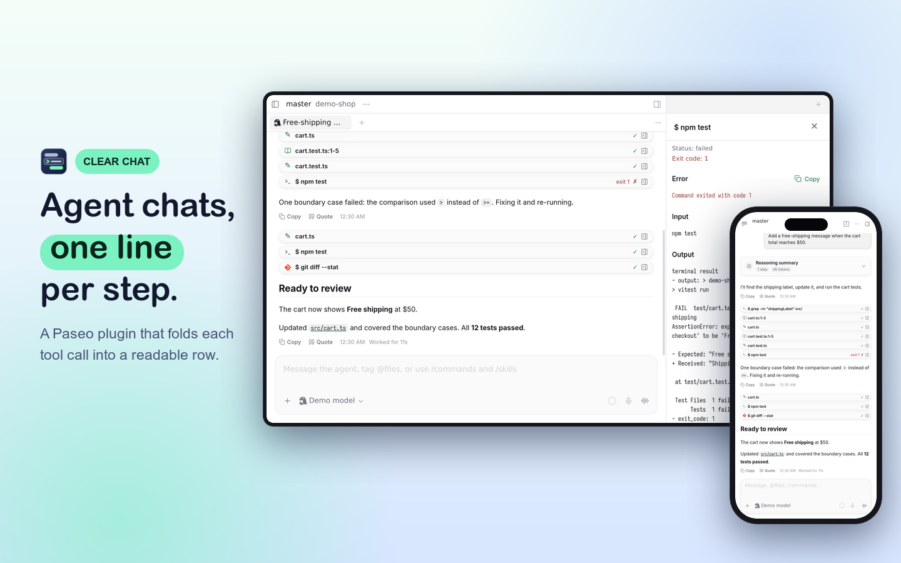
  </picture>
</p>

<p align="center">
  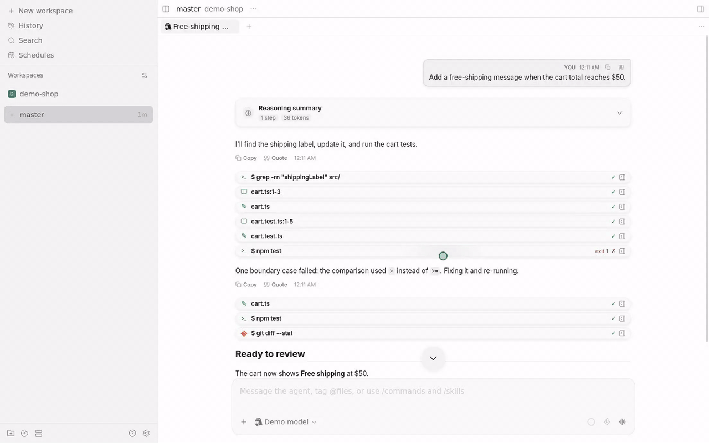
</p>

<p align="center"><sub><a href="images/demo.mp4"><picture><source media="(prefers-color-scheme: dark)" srcset="images/demo-poster-dark.png">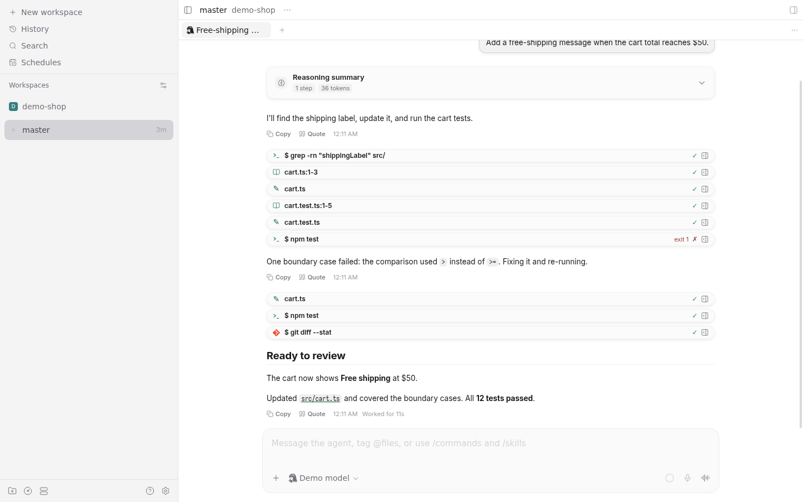</picture> Higher quality: watch the 22-second video</a></sub></p>

<p align="center"><sub>Every screenshot and the demo use sample data.</sub></p>

## Why Clear Chat

- **One row per step.** Each step is one row with its status, and an edit step shows the lines it added and removed. The reply that ends the turn always stays open.
- **Open any step.** The full input, output and error of a step open in a side panel on desktop, a popover on iPad and a bottom sheet on a phone, so a long output does not stretch the conversation. See [Phones and iPad](#phones-and-ipad).
- **A card for every tool.** Claude, Codex and Hermes calls all get proper cards. Every tool kind Paseo reports has its own card, and Hermes tools such as `skill_view` and `memory` get dedicated rows. See [Features](#features).
- **Speaks your language.** Clear Chat's own text follows the Paseo app language: English, Simplified Chinese or Japanese.
- **Make it yours.** Fifteen settings: accent colour, interface and code fonts, text size, folding, the installed version and more. Settings are saved on the host, so every device connected to it shares them. See [Settings](#settings).
- **Stays fast.** In a 300-step test on a 4-core cloud machine, Clear Chat drew the first screen in 673–843 ms; with Clear Chat off, native Paseo drew it in 387–444 ms, because it folds the whole turn into one row instead of showing each step. The method is under [Performance](#performance).<sup>1</sup>
- **Quote and reply.** Pick the quote icon on a message that contains text and send your reply as a quoted block.

<sub>1. Median of five runs in headless Google Chrome on one machine. Your numbers will differ. The method is in [scripts/perf/README.md](scripts/perf/README.md).</sub>

## What's new in 0.15.1.1

- **The settings page version line is easier to read.** The installed version now stands out from its label, the note under it is narrower so it no longer ends on a very short last line in Chinese, and the accent colour card no longer has a black border on top ([#147](https://github.com/jasonhnd/paseo-clear-chat/issues/147)).
- **A file path in inline code opens the file.** In a reply, a path written in inline code opens the file the same way a path in running text does (see **Open files** below). It must be a single path, and the file must exist in the agent's workspace; if it does not exist or lies outside the workspace, you only get the "could not be opened" message. **Copy** still copies the original text. A path that contains spaces is no longer a link when written in inline code (it used to be); write it as a Markdown link instead. ([#163](https://github.com/jasonhnd/paseo-clear-chat/issues/163)).
- **The quote panel looks like the message it quotes.** The quoted message is shown as Markdown with a vertical bar on its left, in the same font as the conversation, so bold text is visible. The text that is sent does not change ([#166](https://github.com/jasonhnd/paseo-clear-chat/issues/166), [#172](https://github.com/jasonhnd/paseo-clear-chat/issues/172)).
- **A prompt's time matches the reply footer.** The time in a prompt's header now uses the same format as the footer under a reply: it follows your locale, has no seconds, and older messages show the weekday or date ([#170](https://github.com/jasonhnd/paseo-clear-chat/issues/170)).
- **"1 step" and "1 token".** A reasoning card with one step or one token now reads "1 step" and "1 token" in English instead of "1 steps". The Chinese and Japanese text is unchanged ([#167](https://github.com/jasonhnd/paseo-clear-chat/issues/167)).
- **A failed shell step says its exit code.** When a shell step fails with a non-zero exit code and the provider gave no error text, the Error line, and **Copy error**, now read "Command exited with code N" (in English, Chinese or Japanese) instead of "Tool call failed" ([#168](https://github.com/jasonhnd/paseo-clear-chat/issues/168), [#180](https://github.com/jasonhnd/paseo-clear-chat/issues/180)).
- **Hermes·CC command steps look like shell steps.** In a Hermes·CC conversation, a command step is now shown as a shell step, the same as with the base Hermes provider: the command sits in a terminal frame, and the step details show the command, its output and its exit code. When the command fails, the Error line reads "Command exited with code N". The bold asterisks around the labels of Hermes' result in the output are gone, as with the base provider. The wrapper itself (the "terminal result" and "exit_code" lines) is still part of the Output, and Copy gives the original text ([#184](https://github.com/jasonhnd/paseo-clear-chat/issues/184), [#187](https://github.com/jasonhnd/paseo-clear-chat/issues/187)).

## Install

```bash
paseo plugin install git:jasonhnd/paseo-clear-chat --ref v0.15.1.1
```

Open Paseo’s plugins page and look for the version at the start of the Clear Chat description. Paseo 0.14.0 displays the default English description there even when the app language is changed.

Clear Chat 0.15.1.1 needs Paseo 0.14.0 or later. Open **Settings → Plugins → Clear Chat** to choose colours, fonts and folding.

To update later:

```bash
paseo plugin update clear-chat
```

This moves Clear Chat to the latest version on the `main` branch, not the release you first installed, and asks before it changes anything. In a script, add `--yes`. To move to a specific release, or back to an earlier one, add `--ref`, for example `paseo plugin update clear-chat --ref v0.13.0.1`. Updates normally keep settings, but the outcome and settings compatibility of a specific rollback are not guaranteed; see the untested Paseo 0.13 example below.

> [!IMPORTANT]
> Already using Beautiful Chat? Read [Upgrading from Beautiful Chat](#upgrading-from-beautiful-chat) **before** you install or remove anything. Removing a plugin in Paseo also deletes its settings.

<details>
<summary><b>Older Paseo versions (0.13 / 0.12), and how version numbers work</b></summary>

Still on Paseo 0.13? Clear Chat 0.13.2.2 is already released and declares support for Paseo 0.13.0 or later. The exact installation command below has not yet been tested on Paseo 0.13:

```bash
paseo plugin install git:jasonhnd/paseo-clear-chat --ref v0.13.2.2
```

If Clear Chat is already installed, the proposed way to select that release is shown below. **This exact switch and its effect on settings have not yet been verified on Paseo 0.13; switching from the new version to the old one is also untested.**

```bash
paseo plugin update clear-chat --ref v0.13.2.2 --yes
```

On Paseo 0.12, install Clear Chat 0.12.0.1 instead:

```bash
paseo plugin install git:jasonhnd/paseo-clear-chat --ref v0.12.0.1
```

If Clear Chat is already installed, `install` stops with `Plugin ID clear-chat is already configured`. Switch versions with `update` instead; it keeps your settings:

```bash
paseo plugin update clear-chat --ref v0.12.0.1 --yes
```

A Clear Chat version is the Paseo version it is built and tested for, plus one more number that counts Clear Chat's releases for that Paseo version. For example, 0.13.0.1 is the first Clear Chat release for Paseo 0.13.0, and 0.13.0.2 is the second. After Paseo releases a new version, the next Clear Chat release starts counting again, for example 0.13.1.1 for Paseo 0.13.1. Clear Chat does not release a new version just because Paseo did. Releases 1.0.0 and 1.0.1 came out before this rule; 0.12.0.1 is newer than both.

</details>

## Upgrade and rollback

```bash
paseo plugin update clear-chat                 # latest on main, asks first
paseo plugin update clear-chat --yes           # same, no question
paseo plugin update clear-chat --ref v0.15.1.1 --yes   # pin one release
```

An update keeps your settings. A rollback to an earlier ref also keeps them, but the effect of a specific rollback on settings is not guaranteed, so back them up first if the settings matter. Removing the plugin deletes its settings.

## What changes by device

### Desktop and web
The full layout: side panel for step details, hover previews on cards, keyboard navigation between steps, pointer glow, and text selection with copy. Ctrl/Cmd+F opens the find bar here.

### iPad
Step details open in a popover; the conversation keeps its width. The same screenshots and folding apply, and the toolbar stays a single row. Dragging to select text works while **Assistant markdown** is off.

### Phone
Step details open as a bottom sheet, long output scrolls inside it, and the conversation uses the full width. The composer stays one line until you type more. Selection actions and pointer glow are off; use the copy buttons.


Paseo runs the same plugin on desktop, web, iPhone and iPad. Clear Chat picks the layout from the width it has, not from the device name, so a narrow desktop window behaves like a phone.

| | Phone | iPad | Desktop and web |
|---|---|---|---|
| Step details | Bottom sheet | Popover (744–1023px wide) or side panel (1024px and wider) | Side panel; a popover or bottom sheet in narrower windows |
| Rows | Smaller titles, icons and padding, so more steps fit; buttons stay easy to tap | Standard | Standard |
| Step menu | Long-press a step | Long-press a step | Right-click a step |
| Hover preview | – | – | Rest the pointer on a collapsed step |
| Keyboard | – | Tab, arrows, Enter and Escape in a browser with a hardware keyboard | Tab, arrows, Enter and Escape |
| Paths in replies | Copied, with a hint to open them on the host | Copied, with a hint to open them on the host | Open in Finder, Explorer or your file manager |

When you resize a window, rotate an iPad or use Split View, the details move to the matching layout and keep the same step, your reading position and what you had open.

<sub>These screenshots are taken in a browser at phone and iPad widths, with sample data.</sub>

| Phone width: conversation | Phone width: step details | Phone width: step menu |
|---|---|---|
| <picture><source media="(prefers-color-scheme: dark)" srcset="docs/images/phone-timeline-dark.png">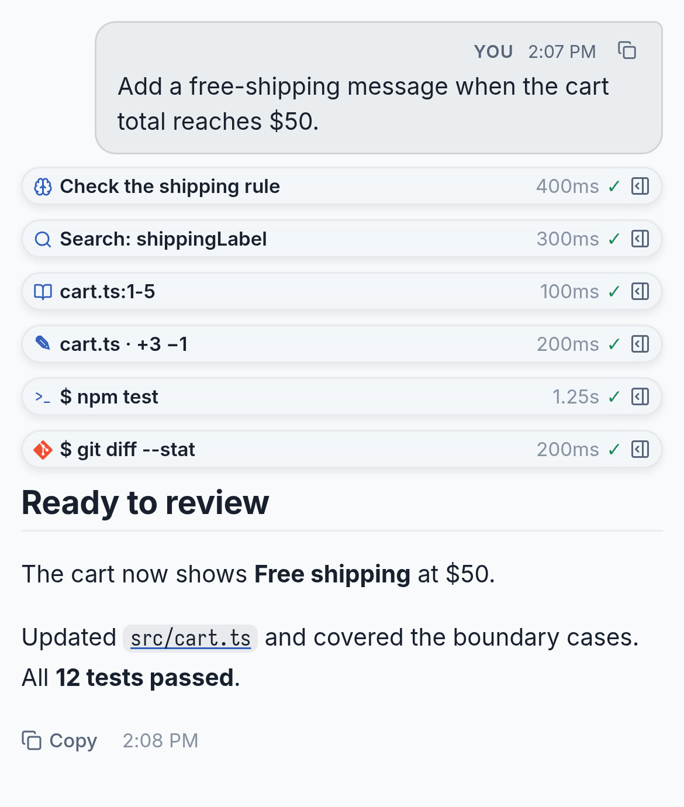</picture> | <picture><source media="(prefers-color-scheme: dark)" srcset="docs/images/phone-details-dark.png">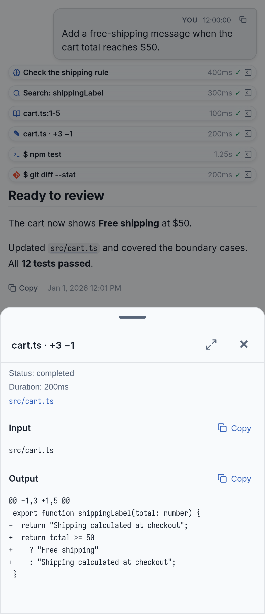</picture> | <picture><source media="(prefers-color-scheme: dark)" srcset="docs/images/phone-menu-dark.png">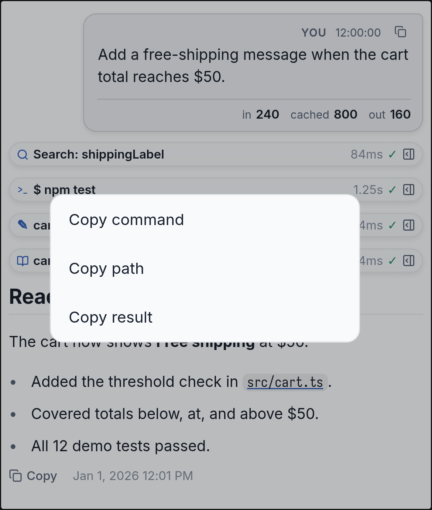</picture> |

| iPad width, portrait: popover | iPad width, landscape: side panel |
|---|---|
| <picture><source media="(prefers-color-scheme: dark)" srcset="docs/images/ipad-popover-dark.png">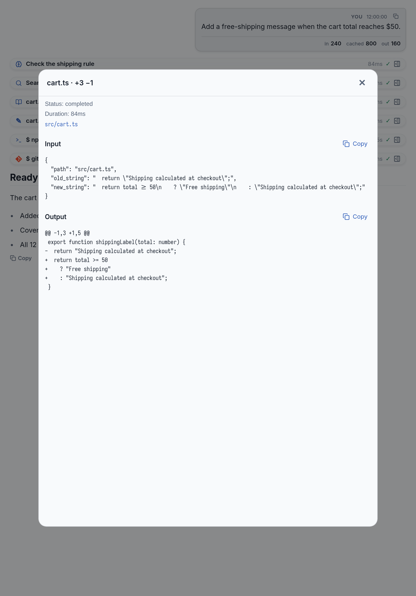</picture> | <picture><source media="(prefers-color-scheme: dark)" srcset="docs/images/ipad-side-dark.png">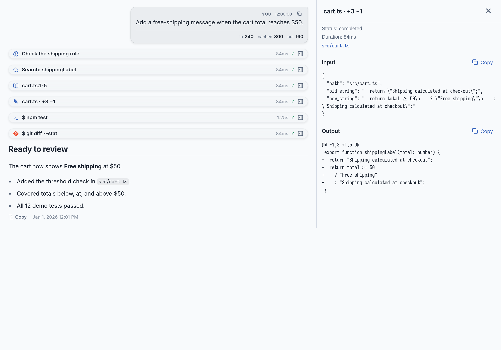</picture> |

<p align="center">
  <picture>
    <source media="(prefers-color-scheme: dark)" srcset="images/fold-compare-dark.png">
    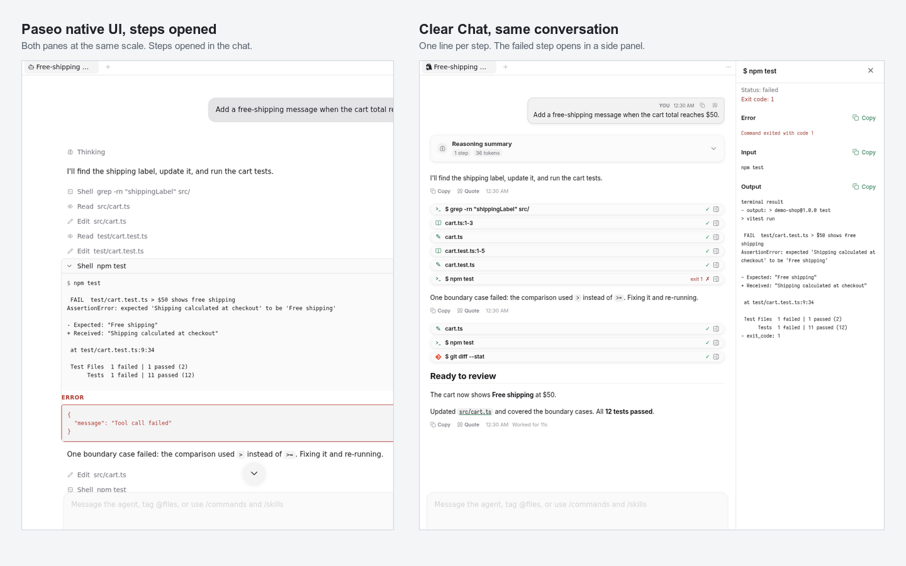
  </picture>
</p>

## Features

### Tool calls

| | |
|---|---|
| <picture><source media="(prefers-color-scheme: dark)" srcset="docs/images/tool-bash-dark.png">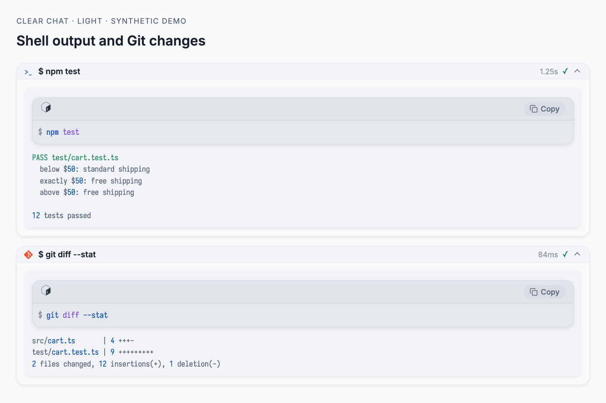</picture><br>**Shell and Git.** Terminal frame, highlighted command, and the exit code marked on the card when it is not 0. | <picture><source media="(prefers-color-scheme: dark)" srcset="docs/images/tool-read-dark.png">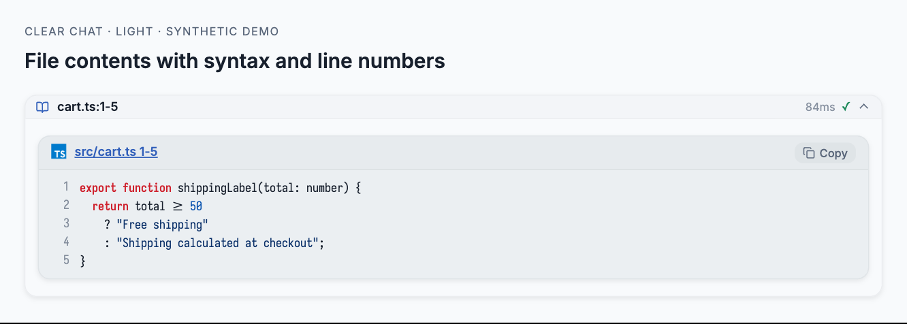</picture><br>**Read.** Language icon, line numbers, copy button. The file name shows the file in your file manager. |
| <picture><source media="(prefers-color-scheme: dark)" srcset="docs/images/tool-edit-dark.png">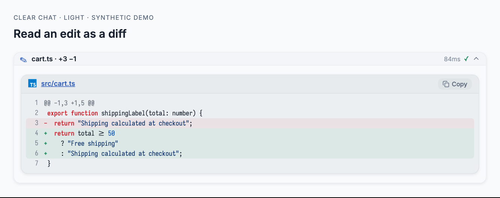</picture><br>**Edit.** A clean diff, also built from old and new text when no diff is given. | <picture><source media="(prefers-color-scheme: dark)" srcset="docs/images/tool-image-dark.png">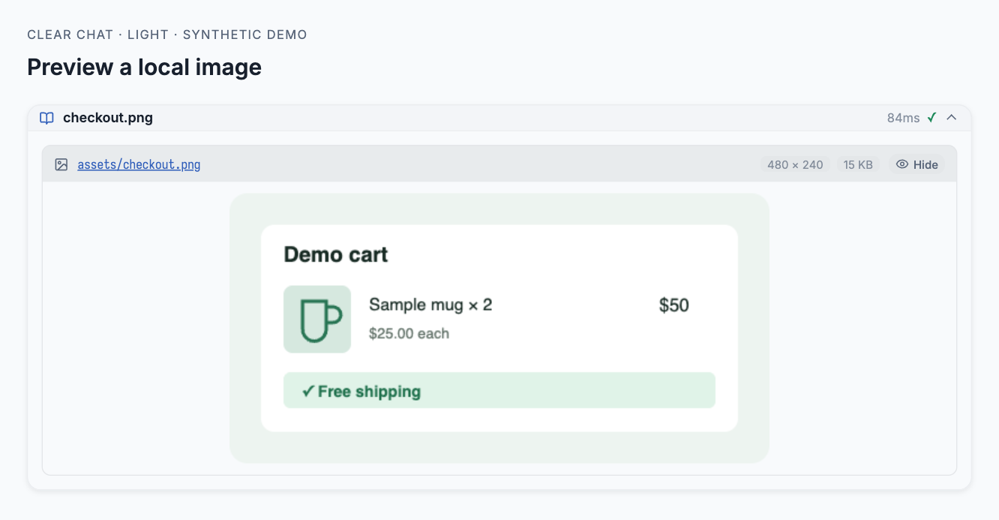</picture><br>**Images.** Read and generated images appear inline, with size and a clickable source. |
| <picture><source media="(prefers-color-scheme: dark)" srcset="docs/images/tool-thinking-dark.png">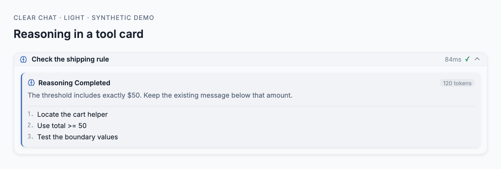</picture><br>**Reasoning tool.** Live thinking text, token count and numbered steps. | <picture><source media="(prefers-color-scheme: dark)" srcset="docs/images/tool-mcp-dark.png">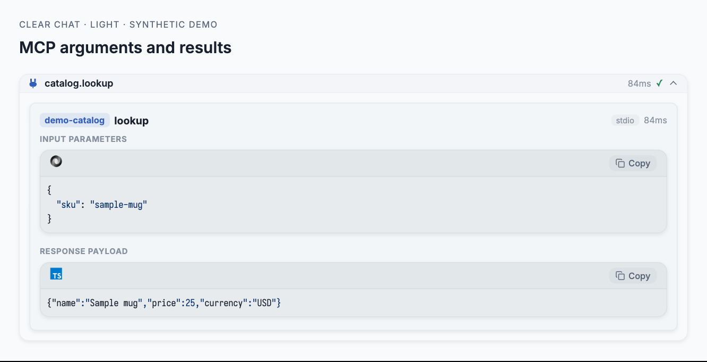</picture><br>**MCP.** Server, transport, inputs and response, all highlighted. |
| <picture><source media="(prefers-color-scheme: dark)" srcset="docs/images/tool-eval-dark.png">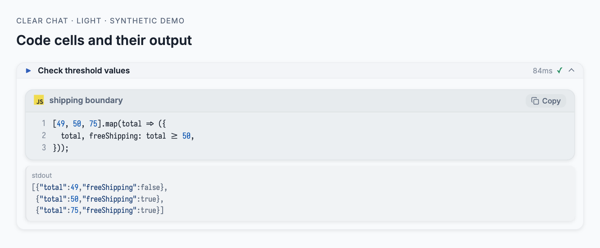</picture><br>**Eval.** Each cell's code, then what it printed. | <picture><source media="(prefers-color-scheme: dark)" srcset="docs/images/tool-ask-dark.png">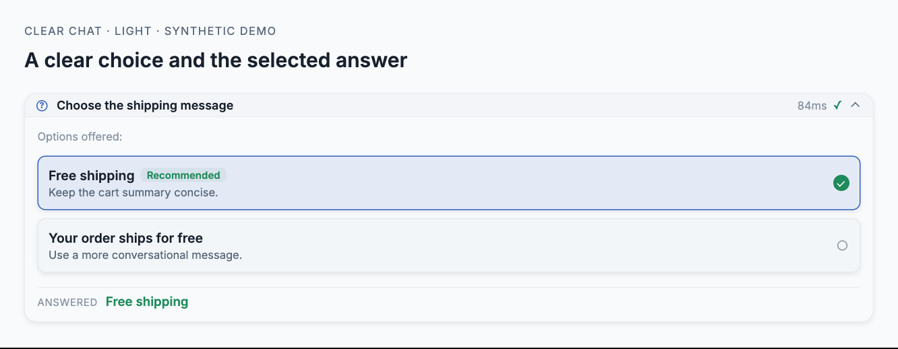</picture><br>**Ask.** Options with the recommended one and the chosen answer marked. |
| <picture><source media="(prefers-color-scheme: dark)" srcset="docs/images/tool-task-dark.png">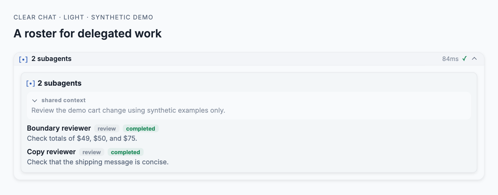</picture><br>**Subagents.** Name, type, model and the task it was given. | <picture><source media="(prefers-color-scheme: dark)" srcset="docs/images/hub-dark.png">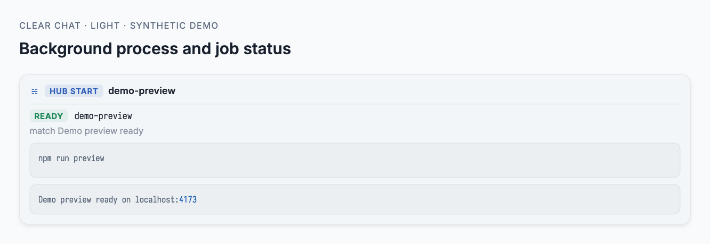</picture><br>**Hub.** Process, message and job cards for every hub operation. |
| <picture><source media="(prefers-color-scheme: dark)" srcset="docs/images/paseo-dark.png">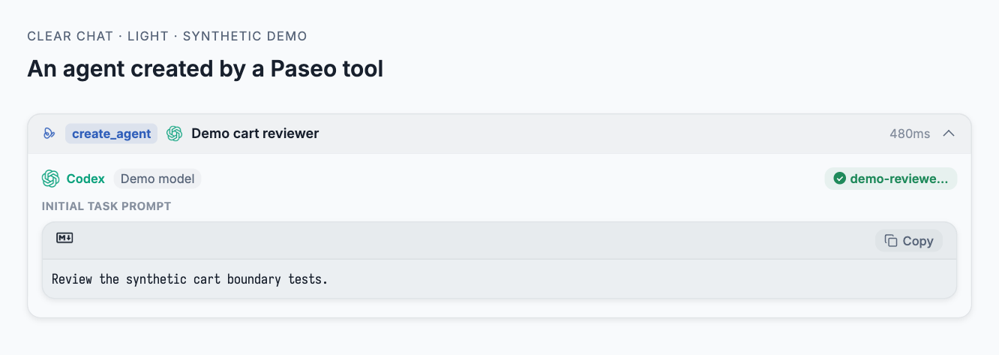</picture><br>**Paseo tools.** Paseo's mark, with the provider's mark on created agents. | |

Search, fetch and web search, plans and checklists, plain text, skills and any other tool also get their own cards. An unknown tool shows its name, its inputs as `name: value` and a preview of its output. It is never an empty box.

### Shell and Git
A terminal frame around the command. The card marks the exit code when it is not 0; open the step and the details show the exit code whenever the provider reports one (a zero is shown too). Shell commands generally have no duration. **Copy command** copies the command, **Copy result** the output, **Open in file manager** shows the working directory. Image: `tool-bash-light.png` / `tool-bash-dark.png`.

### Read
The language icon, the file name and line numbers, with one button that copies the whole file text. Pressing the file name shows the file in Finder, Explorer or your file manager on the host. Image: `tool-read-light.png` / `tool-read-dark.png`.

### Edit and Write
A line diff built from the old and new text, including when the provider sends no diff of its own. Write shows what was written; the text of Write and Edit is not offered as a copyable result, so the menu lists **Copy path** instead. Image: `tool-edit-light.png` / `tool-edit-dark.png`.

### Search, fetch and web search
Query, result count and the matching lines; fetch shows the address, the status and the first lines of the body. Long output folds at your **Fold long output after** setting. Image: results reuse the `tool-mcp-*` frame.

### Subagents and tasks
Name, type, model and the task the child agent was given, with its own status. Subagent activity stays in its own panel instead of repeating inside the parent's card. Image: `tool-task-light.png` / `tool-task-dark.png`.

### Plans and checklists
Phase, status per task and the reason a task is blocked. Updates to a to-do list never repeat the whole list — they fold into one row. Image: `tasks-light.png` / `tasks-dark.png`.

### Ask and approvals
The question with lettered options, the recommended one marked, and the answer you chose. Past approvals stay as short status rows with the exact command and target. Image: `approval-light.png` / `approval-dark.png`.

### Images
Read and generated images appear inline with their size and a clickable source; pressing one opens it. In the prompt bubble, images larger than 1.5 MB or 24 megapixels are not previewed. Image: `tool-image-light.png` / `tool-image-dark.png`.

### MCP calls
Server, transport, inputs and the response, all syntax-highlighted. Image: `tool-mcp-light.png` / `tool-mcp-dark.png`.

### Reasoning and evals
Reasoning shows the thinking text as it arrives, a token count and numbered steps. An eval shows each cell's code followed by what it printed. Image: `tool-thinking-light.png`, `tool-eval-light.png`, and their dark pairs.

### Hub and Paseo tools
Hub shows process, message and job cards for every hub operation; Paseo's own tools show Paseo's mark, with the provider's mark on the agents they create. Image: `hub-light.png`, `paseo-light.png`, and dark pairs.

### Unknown tools
A tool with no card of its own still shows its name, its inputs as `name: value` and a preview of its output — never an empty box. No marketing image: this state is covered by a test fixture.

### Step details
Pressing a folded step opens the same panel everywhere: a side panel on desktop and web, a popover on iPad, a bottom sheet on a phone.

- **Input**: the full command, path, query or MCP payload, highlighted, with its own copy button.
- **Output**: the complete output, virtualised so 10,000 lines still scroll; **Copy** copies the full text, not the preview.
- **Error**: the provider's error text, copyable with **Copy error**.
- **Exit code**: only when the provider reports one; a zero is shown as zero, and an HTTP status is never treated as an exit code.
- **Duration**: only some tools have one (for example web fetch and search); shell commands generally do not. It is shown only when the provider reports it, and the plugin never computes one from timestamps.
- **Separate stdout and stderr**: shown as separate sections when the provider sends them that way.
- **Step menu**: **Copy command**, **Copy path**, **Copy result**, **Open in file manager** — each only when it applies.

<p align="center">
  <picture>
    <source media="(prefers-color-scheme: dark)" srcset="images/step-details-dark.png">
    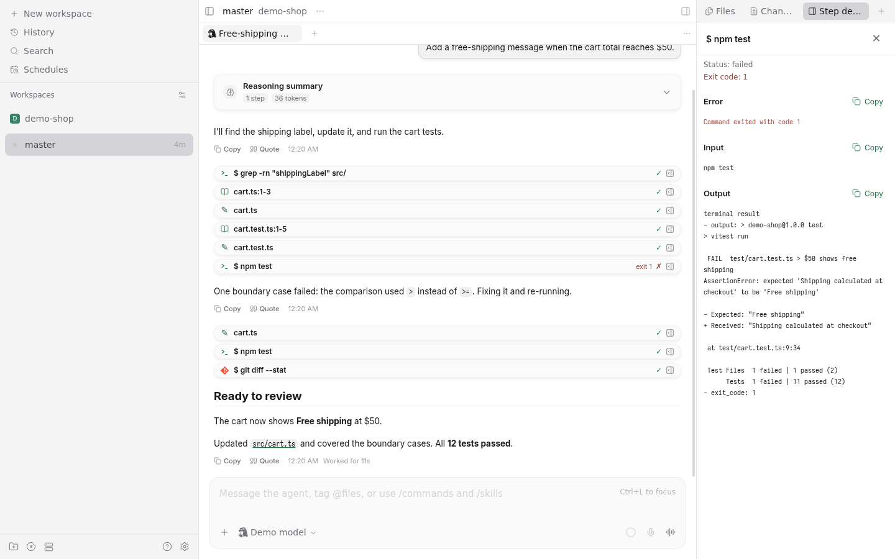
  </picture>
</p>

### Folding
- A finished step folds into one row: icon, summary, status. Running, failed and waiting calls open by default.
- Once you open or close a row, Clear Chat remembers it, also after a reload, and a preference change does not discard it; **Never** always shows complete content.
- **Fold long output after** applies to tool output, fenced code in replies and text in the enhanced prompt bubble: 10, 15 (default), 30 source lines or Never. A block exactly at the threshold stays whole; line counting accepts LF and CRLF; soft wrapping never adds a line.
- For these decisions only identities, timestamps and on/off choices are stored — never message content.

### Finding text
Ctrl/Cmd+F opens a find bar. It searches only the text that is currently shown: a folded step row or a folded card has to be opened before its content can be found. It also searches only the messages already loaded, so scroll up before searching in a long conversation.

<p align="center">
  <picture>
    <source media="(prefers-color-scheme: dark)" srcset="images/find-dark.png">
    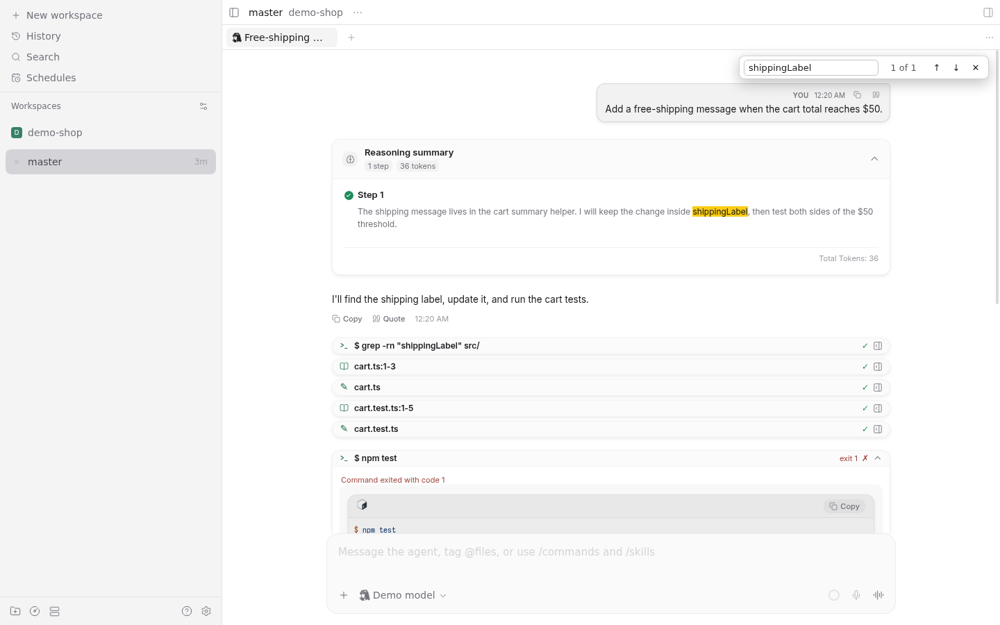
  </picture>
</p>

### Quote and reply
On a message that contains text, pick the quote icon beside Copy. A panel opens with the quoted text (**Expand quote** for long ones), a **Your reply** box, **Cancel** and **Send**; the reply is sent as the quoted block, a blank line and your text. The icon is greyed out while the agent is busy; if the agent turns busy as you send, your text is kept and the panel asks you to wait.

<p align="center">
  <picture>
    <source media="(prefers-color-scheme: dark)" srcset="images/quote-dark.png">
    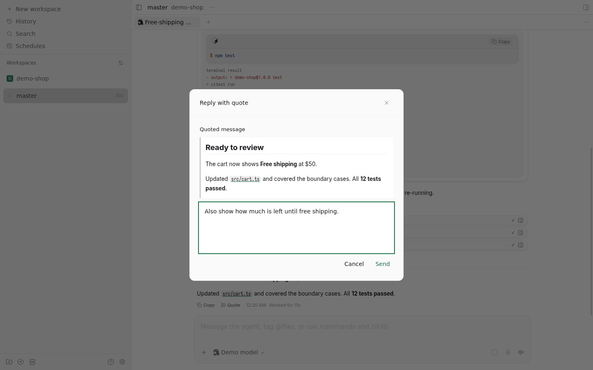
  </picture>
</p>

### Conversation

| | |
|---|---|
| <picture><source media="(prefers-color-scheme: dark)" srcset="docs/images/reasoning-dark.png">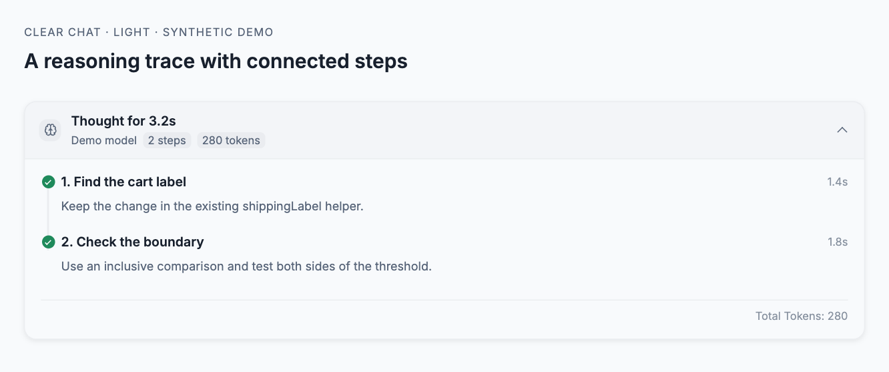</picture><br>**Reasoning trace.** Collapsible steps with time per step and a token total. | <picture><source media="(prefers-color-scheme: dark)" srcset="docs/images/tasks-dark.png">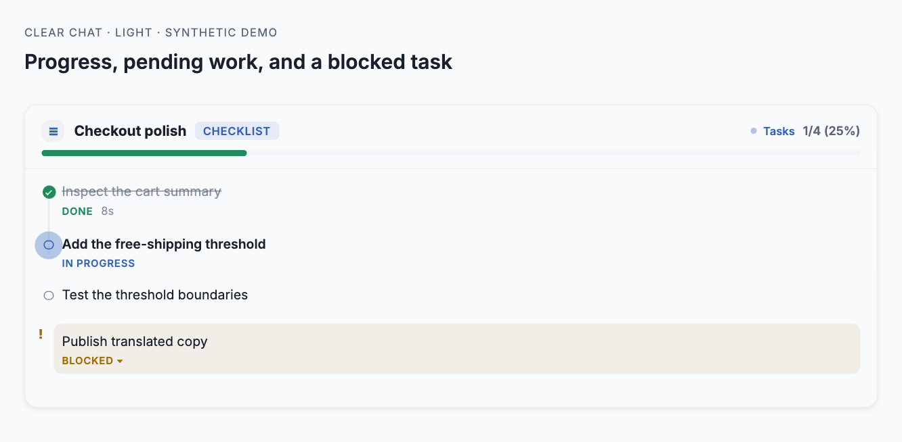</picture><br>**Checklist.** Phase, status per task and the reason a task is blocked. |
| <picture><source media="(prefers-color-scheme: dark)" srcset="docs/images/approval-dark.png">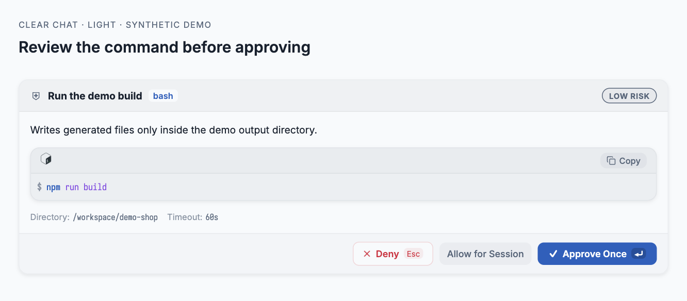</picture><br>**Approvals.** Risk, the exact command and target. Past approvals stay as short status rows. | <picture><source media="(prefers-color-scheme: dark)" srcset="docs/images/user-dark.png">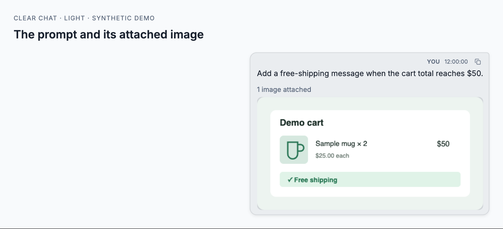</picture><br>**Prompt bubble.** Copy button and token usage. |
| <picture><source media="(prefers-color-scheme: dark)" srcset="docs/images/syntax-dark.png">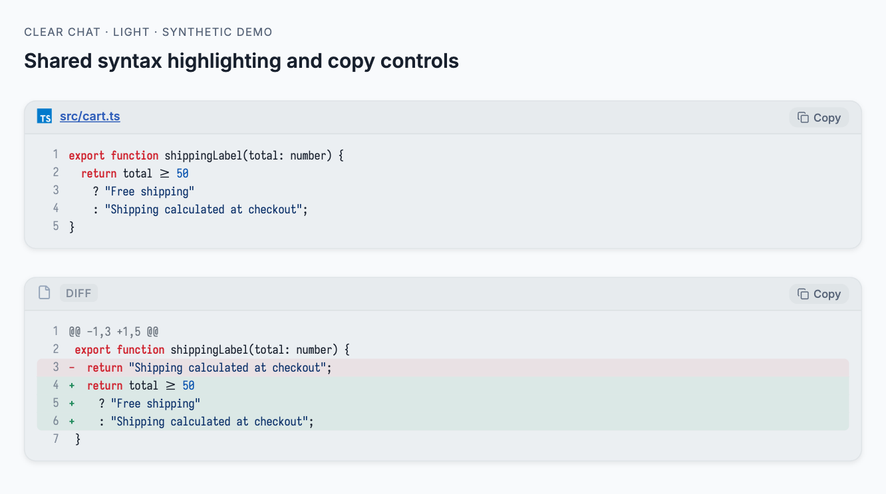</picture><br>**Code.** Language detection, line numbers, diff colours and a full-source copy. | |

### Also included

- **Step details.** Click a collapsed step to see the full input and output, the exit code when the provider reports one (a zero is shown too), and a duration for the few tools that have one, such as web fetch and search; shell commands generally have none. Input and output have separate copy buttons, and a failed step shows its error text, which you can copy too. Very long output, even 10,000 lines, scrolls smoothly. To open steps inside the conversation instead, set **When a collapsed step is pressed** to **Expand inline**.
- **Folding you control.** Click an open row to close it. Running, failed and waiting calls open by default. Once you open or close a row, Clear Chat remembers your choice, even after reloads. Long tool output, long code blocks in replies and long prompts show the first 15 lines, with **Show all N lines**. **Copy** always copies the full text.
- **Step menu.** **Copy command**, **Copy path**, **Copy result** and **Open in file manager**. Each item appears only when it applies; the text written by Write and Edit is not copied as a result.
- **Wrap-up replies.** Replies sent through a `wrap_up` tool show as a full reply card, with recap, question, lettered options and a **Blocked** alert.
- **Clickable links.** Links in replies, including bare web addresses and image addresses, open on desktop, web and iOS, and `mailto:` links open your mail app.
- **Find in chat.** Ctrl/Cmd+F opens a find bar. It searches only the text that is currently shown, so open a folded step or card first, and only messages already loaded.
- **Open files.** File names in cards and paths in replies show the file in Finder, Explorer or your file manager on the host computer. For a path that contains spaces, use a Markdown link; a path with spaces written in inline code is no longer a link in replies.
- **Highlight text.** `==marked text==` highlights text in replies. Inside code, the equals signs stay as they are.
- **Quote and reply.** Pick **Quote reply** under a message's text; it appears on messages that contain text and is greyed out while the agent is busy. A **Reply with quote** panel opens with the quoted text (long quotes have **Expand quote**), a **Your reply** box, and **Cancel** and **Send** buttons. The reply is sent as the quoted block followed by your reply. **Cancel** closes the panel and discards the draft. **Send** stays greyed out while the agent is busy, while a reply is being sent, or while the reply is empty; if the agent turns busy at the moment you send, the panel stays open, your text is kept, and it asks you to wait for the agent to finish. If the send fails, it says the reply could not be sent and asks you to check that the agent is idle and try again.
- **Pasted images.** With **Enhanced prompt bubble** on, images you paste into a prompt show as thumbnails in the prompt bubble, for Codex and Claude agents. Tap one to see it full size. Images larger than 1.5 MB or 24 megapixels are not shown. For Hermes agents, choose the **·CC** version of the provider when you create the agent; see [Pasted images in Hermes agents](#pasted-images-in-hermes-agents).

## Settings

<picture><source media="(prefers-color-scheme: dark)" srcset="docs/images/settings-dark.png">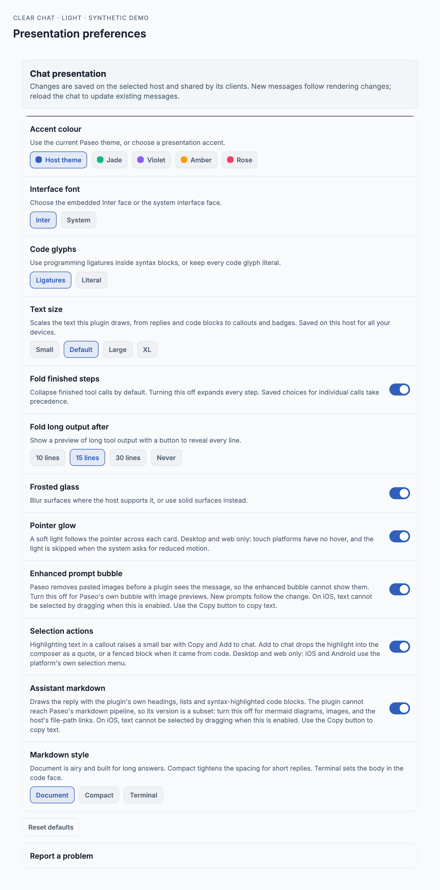</picture>

| Setting | Effect |
|---|---|
| Accent colour | Follow the Paseo theme, pick Jade, Violet, Amber or Rose, or choose **Custom** for colour swatches and a HEX field. Custom colours are adjusted to keep text contrast at 4.5:1 or higher. |
| Interface font | Embedded Inter, or your system font. |
| Code glyphs | Iosevka with ligatures, or plain glyphs. |
| Code font | Default (Iosevka) (default), Iosevka, Menlo, Consolas, Fira Code or Cascadia Code. Applies to code blocks, inline code, terminal output and diffs. |
| Text size | Small (90%), Default (100%), Large (115%) or XL (130%). Icons keep their size. |
| Hermes·CC providers | On by default. Adds a **·CC** version of each Hermes provider that starts with `hermes acp`, so images pasted into Hermes agents can show in the prompt bubble. Changes apply after you reload the host. |
| Fold finished steps | On by default. Off opens every step unless you chose otherwise for that call. |
| When a collapsed step is pressed | Open details (default) shows the step in a sheet, popover or side panel. Expand inline opens it inside the conversation. |
| Fold long output after | 10, 15 (default) or 30 lines, or Never. Applies to tool output, code blocks in replies and prompts. Lines are counted in the source text, so wrapped lines do not count extra. |
| Frosted glass | Blur card backgrounds, or paint them solid. |
| Pointer glow | A soft light follows the pointer across each card. Desktop and web only. |
| Enhanced prompt bubble | Styles your prompts. Off uses Paseo's own bubble. |
| Selection actions | Highlighting text in a card shows a small bar with Copy and Add to chat. Desktop and web only. |
| Assistant markdown | Draws replies with Clear Chat's own headings, lists and code blocks. Off hands replies back to Paseo. |
| Markdown style | Document (airy, for long answers), Compact (tighter, for short replies) or Terminal (body in the code font). |

**Installed version.** Under the title of the settings page, Clear Chat shows `Clear Chat version 0.15.1.1`. The line below it explains the value: a directory install keeps the version information already in that directory, so it can show an older release than the one you installed. If the build carries no usable version, the line shows **Unknown**.

**Custom accent colour.** Tap a swatch, or enter `#RGB` or `#RRGGBB` and press **Apply**. An invalid HEX value stays in the field with an error, and the saved colour does not change. Switching to a preset remembers your custom colour. The saved HEX value never changes; only the colour you see is darkened on light themes or lightened on dark themes when text would otherwise be hard to read. Filled buttons use black or white text, whichever has more contrast.

Settings are saved on the host, so every device connected to that host shares them. Accent colours, folding and step-click settings apply at once, including to rows already shown. Other changes apply to new messages; reload the chat to update older ones.

### Defaults and where a setting applies

| Setting | Default | Applies on |
| --- | --- | --- |
| Accent colour | Follow the Paseo theme | Every device |
| Interface font | Embedded Inter | Every device |
| Code glyphs | Iosevka with ligatures | Every device |
| Code font | Iosevka | Every device; the native apps use their system monospace |
| Text size | Default (100%) | Every device |
| Hermes·CC providers | On | Every device; changes apply after a plugin reload |
| Fold finished steps | On | Every device |
| When a collapsed step is pressed | Open details | Every device |
| Fold long output after | 15 lines | Every device |
| Frosted glass | On | Every device |
| Pointer glow | Off | Desktop and web only |
| Enhanced prompt bubble | On | Every device |
| Selection actions | On | Desktop and web only |
| Assistant markdown | On | Every device |
| Markdown style | Document | Every device |

The settings page also shows the installed build's version under its title, with a line explaining that a directory install keeps the version information already in that directory.

## Languages

Clear Chat's own text follows the Paseo app language: English, Simplified Chinese and Japanese. All three languages are complete — the settings page, the step menu, the quote panel, the find bar and the notices are translated, not just the README. Paseo's own text keeps Paseo's language, and agent output is never translated.

## Pasted images in Hermes agents

Paseo 0.13 removes pasted images before a plugin sees the message, and Hermes does not keep what Clear Chat would need to find them later. So Clear Chat adds its own copy of each Hermes provider you have set up, named with **·CC**, for example **Hermes·PP·CC**. It covers every Hermes provider whose command is `hermes acp`, with or without `-p <profile>`, and starts the same Hermes with the same command, profile and environment. Before it passes your prompt on, unchanged, it saves the pasted images in its own folder. The prompt bubble shows an image only when it matches the exact message, and shows nothing otherwise.

The **·CC** provider list is rebuilt from the current provider configuration when Clear Chat starts or reloads, not while it is running; after changing providers, run `paseo plugin reload clear-chat` to update it.

To use it, choose the **·CC** version when you create a new agent in Paseo. The images and your original prompt text are still there after Paseo's background service restarts, your Mac restarts, you upgrade Paseo, or Paseo is killed or crashes while no reply is in progress. Your original Hermes agents do not change.

The **·CC** version's permission modes appear in the list after you open a **·CC** window for the first time and Paseo has refreshed its options (or after you reload). Its models do too, unless your Hermes provider settings already list them.

The **·CC** entries use the Hermes icon. You can choose a supported model when creating a **·CC** agent, including when Hermes reports its models through its native interface. If Hermes rejects a model selection, Clear Chat reports the error instead of silently choosing another model.

**Previously affected conversations.** Clear Chat 0.13.2.2 prevents a compatibility issue in which certain failed tool calls with no error message could make a **·CC** conversation's history fail to open. Conversations already affected by this issue may still fail to open after upgrading; there is currently no automatic fix for those affected conversations.

What to know:

- Only prompts you send in a **·CC** agent with this version or later show images. Agents you started before, and their old messages, do not.
- Errors and notices from the system are not saved, so they are not shown after a restart.
- If two writers that both carry the new identity information record the same conversation, Clear Chat shows that conversation with Hermes's own text instead of mixing their records; records written by earlier versions replay as ordinary history. If a message cannot be written to the saved copy, the window stays open and Clear Chat reports the message as not sent, so you can send it again; the saved copy itself is not deleted or changed.
- If the saved files themselves are damaged, that conversation falls back to Hermes's own text and shows no images; a damaged image only affects the prompt it belongs to.
- If the saved record does not match, has been changed, or you used a slash command or a revert such as `/undo`, Clear Chat falls back to Hermes's own text for that conversation and shows no images.
- Use one conversation from one window at a time. If a second window sends a prompt to the same conversation, the record is discarded and both windows fall back to Hermes's own text.
- The images are saved in the `plugin-data/clear-chat/hermes-cc-images` folder in your Paseo home (`~/.paseo` by default), up to 2 GiB. When it is full, the oldest are deleted first. The saved records are in `hermes-cc-history` next to it. A conversation whose record grows past 64 MiB falls back to Hermes's own text. When all records together pass 1 GiB, the record of the oldest conversation is deleted first, and that conversation falls back to Hermes's own text and shows no images.
- To clear them, quit Paseo first. Deleting the images folder keeps your conversations and text but removes the images. Deleting the records folder makes the conversations fall back to Hermes's own text, with no images.
- To stop adding the **·CC** versions, turn off **Hermes·CC providers** in the settings and reload the host. The **·CC** agents you already created stay in the list, but opening one shows "Failed to load agent" because its provider cannot be found; the conversation is not lost. Turn the setting back on and reload, and they open again, with their text and images.

## Performance

Measured on 2026-11-04 by the project's acceptance run: one 300-step conversation (150 tool calls and 150 status updates), opened from the sidebar, three runs per state, on a cloud test machine with 4 cores and 8 GB, using Playwright's Chromium, Clear Chat at commit `bcf896b7`.

| State | First screen (ms, three runs) | What the timeline shows |
| --- | --- | --- |
| Clear Chat on | 673, 742, 843 | every step as its own row |
| Clear Chat off | 387, 395, 444 | the whole turn folded into one row ("Ran 150 commands") |

- **First screen** is the time until the conversation can be scrolled, measured as `tContent`.
- With Clear Chat off the first screen takes about 45–55% of the time it takes with Clear Chat on, because native Paseo folds 150 steps into a single row. Clear Chat shows each step, which is the point of the plugin — the turn stays readable step by step.
- The earlier desktop run (2026-10-22, build `f637914f`, 221 steps) used a different machine and build; it is no longer the reference number.
- How to reproduce: [`scripts/perf/README.md`](scripts/perf/README.md) documents the setup, the metric definitions and the sampling rules; the runner is `scripts/perf/measure.cjs` — its usage is in that file's README (set `DAEMON_ORIGIN`, `AGENT_ID` and `KANBAN_TMP`, then run it).

## What a plugin cannot do

Clear Chat changes only how Paseo shows a conversation. Everything below is a limit of the plugin interface, not a bug list — each row says what you can do today and what would have to change upstream.

| Cannot | What to do instead | Waiting on |
| --- | --- | --- |
| Show pasted images in your original Hermes agents | Create the agent from the **·CC** copy of the provider; it saves the images itself | Paseo to hand pasted images to plugins before they are stripped |
| Use Paseo's own Markdown | Turn **Assistant markdown** off for mermaid, images and the host's file-path links | The plugin SDK to expose the host's Markdown renderer |
| Use hardware keys in the native apps | Keyboard navigation works in a browser and the desktop app | Native key events in the plugin SDK |
| Follow Paseo's code font in the native apps | iOS and iPadOS use Menlo, Android uses the system monospace | The SDK to read the host's font settings |
| Drag to select text on iOS and iPadOS | Keep **Assistant markdown** and **Enhanced prompt bubble** on and use the **Copy** buttons | Paseo to allow selection inside plugin-drawn text |
| Show a step's duration when the agent does not report one | Nothing to do: the row simply omits the time | Providers to send durations over ACP |
| Have Paseo's turn folding fold content Clear Chat drew | Use Clear Chat's own folding, and **When a collapsed step is pressed** | Paseo to include plugin content in its turn folding |
| Follow Paseo's text size | Use Clear Chat's own **Text size** | The same upstream change as above |
| Search messages that are not loaded yet | Scroll up to load older messages, then search again | A search API over unloaded history |
| **Fork chat from here**, from a message | Turn Clear Chat off in **Settings → Plugins**, then use Paseo's own message menu | The plugin API to expose Paseo's agent actions |
| **Copy turn** | Same: with Clear Chat off, Paseo's own **Copy turn** appears | The same plugin API |
| **Copy message**, by Paseo's own menu | Clear Chat's **Copy** button copies the reply while Clear Chat draws it | The same plugin API |
| **Rewind**, from a message | Turn Clear Chat off and use Paseo's own rewind | The same plugin API |
| Open a **·CC** conversation after Clear Chat is turned off | Turn Clear Chat back on: the conversation's saved record is written by Clear Chat | Paseo to read conversation history that a plugin wrote |
| Keep settings after you remove the plugin | Back up the settings before removing; removing a plugin deletes them | Paseo to keep plugin settings on removal |

## Privacy and data on the host

- Clear Chat reads the conversation Paseo already shows and changes only how it is displayed. It does not send conversation content off the host, to agent providers or to any other service.
- Images in a reply that point to a web address are loaded by the app or browser from that address, as in a web page. Clicking a link opens it in your browser or the matching app.
- On the host, the plugin's daemon side reads local image files a conversation refers to, highlights code locally, and opens files in the host's file manager when you ask.
- Saved Hermes·CC images live in `plugin-data/clear-chat/hermes-cc-images` (2 GiB cap, oldest deleted first); the matching records live in `hermes-cc-history` next to it (64 MiB per conversation, 1 GiB in total, oldest conversation dropped first).
- The only network use by Clear Chat itself is `npm ci` at install time.
- **Report a problem** opens a GitHub issue form in your browser; nothing is sent unless you submit it.

## FAQ

**Do I have to change how my agents are set up?** No. Clear Chat reads the conversation Paseo already shows. The one exception is pasted images in Hermes agents: those need the **·CC** provider copy.

**Why does a row look different from Paseo's own?** Paseo's default since 0.15.0 (Collapse turns) puts a whole turn on one line; Clear Chat draws one row per step, each with its status, so a 200-step turn can be read step by step. Turn **Assistant markdown** off if you prefer Paseo's own rendering of replies.

**Can I select text on my iPhone?** Dragging to select is off while Clear Chat draws the reply. Use the **Copy** button on the reply, the prompt or a code block.

**Does Clear Chat send my conversation anywhere?** No. It changes only what is displayed, on the host. Its only network use is `npm ci` at install time. The full statement is in [OVERVIEW](OVERVIEW.md).

**What happens to my settings if I remove the plugin?** They are deleted with the plugin. Back them up first — see [Upgrading from Beautiful Chat](#upgrading-from-beautiful-chat).

**How do I quote a message?** Pick the quote icon beside Copy on a message that contains text, write your reply, and send. It is greyed out while the agent is busy.

**Which Paseo versions work?** 0.14.0 or later. Clear Chat was installed on a Paseo 0.15.1 host and spot-checked there (the settings page, command steps, the reasoning card, the quote panel, file paths in inline code, and the time format); the other items have not been checked on 0.15.1. Paseo 0.13 has an older, untested path described under [Install](#install).

## Troubleshooting

| Problem | What to do |
|---|---|
| Installing through the Cafe plugin fails, or Paseo reports a missing Shiki dependency such as `@shikijs/core`. | Retry with the Paseo CLI command in [Install](#install), using the same repository and release ref. Clear Chat installs its dependencies with `npm ci --include=dev`, so Node.js and npm must be available on the daemon host, and its network must reach the npm registry. If you manage the checkout yourself, run `npm ci --include=dev` there before retrying. |
| Installation stops because the plugin needs a newer Paseo version. | For Clear Chat 0.15.1.1, update Paseo on the daemon host and all connected apps to 0.14.0 or later. For older hosts, see the [Install](#install) section for the Paseo 0.13 commands and their untested-status warning, and the separate Paseo 0.12 instructions. |
| Paseo rejects the plugin version, or Clear Chat says plugin settings or timeline support is missing. | Update Paseo on the daemon host and in every connected app, then reload Clear Chat. The Paseo version Clear Chat needs is declared in `paseo-plugin.json`. |
| Clear Chat cannot start because plugin registration failed. | Update Paseo and reload Clear Chat. If it still fails, back up the plugin settings before you reinstall from the CLI. |
| Clear Chat cannot read its settings from the host. | Reconnect to the host and choose **Retry** in **Settings → Plugins → Clear Chat**. If it still fails, check that the daemon can access the plugin settings folder. |
| Clear Chat says its settings are invalid or in an unsupported format. | Back up the settings first. Restore a valid backup, or repair the settings file on the daemon host, then choose **Retry**. Clear Chat never erases the file by itself. |
| Clear Chat cannot save settings. | Check write permission and free disk space on the daemon host, reconnect, then make the change again. **Retry** reloads the settings; it does not resend a change that failed. |
| Settings keep changing because of another client. | Wait until the other edits finish, then make the change again. |
| Beautiful Chat settings were not migrated. | Keep Beautiful Chat's original settings and back them up. Check read and write access to both plugin settings folders and free disk space, then reload Clear Chat to try again. A failed migration leaves a recovery message in the daemon log; existing settings are never overwritten. |

If Paseo cannot run the build command or load the plugin bundle, Clear Chat cannot show a message of its own. Check Node.js, npm and the Paseo version on the daemon host, then retry from the CLI. If the problem stays, use **Report a problem** in the plugin settings and include the recovery message and your Paseo version. Remove private paths and conversation content before you share any logs.

## Upgrading from Beautiful Chat

1. **Back up** your Beautiful Chat settings.
2. **Install Clear Chat** while Beautiful Chat is still installed. On first start, Clear Chat copies your settings.
3. **Check** that your settings look right, then remove Beautiful Chat.

<details>
<summary><b>Exact commands, rollback, and how the migration works</b></summary>

The commands use `PASEO_HOME` and fall back to `$HOME/.paseo`. If your daemon uses only `--home`, set `PASEO_HOME` to that path first. Stop if a backup or check fails.

**1. Back up**

```bash
legacy_backup="${PASEO_HOME:-$HOME/.paseo}/backups/plugin-settings-beautiful-chat-$(date +%Y%m%d-%H%M%S)"
mkdir -p "${PASEO_HOME:-$HOME/.paseo}/backups"
cp -a "${PASEO_HOME:-$HOME/.paseo}/plugin-settings/beautiful-chat" "$legacy_backup"
```

If the `beautiful-chat` settings folder does not exist, you never changed Beautiful Chat's settings, and you can skip this step.

**2. Install**

```bash
paseo plugin install git:jasonhnd/paseo-clear-chat --ref v0.15.1.1
```

**3. Check, then remove the old plugin**

Confirm that `${PASEO_HOME:-$HOME/.paseo}/plugin-settings/clear-chat/presentation.json` exists and matches `$legacy_backup/presentation.json`. An existing Clear Chat settings file is never overwritten. If the file is missing or differs, keep Beautiful Chat and the backup, and check the migration error in the log.

```bash
paseo plugin remove beautiful-chat
```

Keep the backup.

**Rollback**

Back up Clear Chat's current settings, then remove it. Removing Clear Chat deletes all of its settings; `update` does not. If the `clear-chat` settings folder does not exist, skip the `cp` line.

```bash
clear_chat_backup="${PASEO_HOME:-$HOME/.paseo}/backups/plugin-settings-clear-chat-$(date +%Y%m%d-%H%M%S)"
mkdir -p "${PASEO_HOME:-$HOME/.paseo}/backups"
cp -a "${PASEO_HOME:-$HOME/.paseo}/plugin-settings/clear-chat" "$clear_chat_backup"
paseo plugin remove clear-chat
```

If Beautiful Chat's settings folder is gone, restore it from the upgrade backup. Replace `YYYYMMDD-HHMMSS` with your backup's timestamp. An existing folder is never overwritten.

```bash
legacy_backup="${PASEO_HOME:-$HOME/.paseo}/backups/plugin-settings-beautiful-chat-YYYYMMDD-HHMMSS"
test ! -e "${PASEO_HOME:-$HOME/.paseo}/plugin-settings/beautiful-chat" &&
  cp -a "$legacy_backup" "${PASEO_HOME:-$HOME/.paseo}/plugin-settings/beautiful-chat"
```

Then install the last Beautiful Chat version:

```bash
paseo plugin install git:jasonhnd/paseo-clear-chat --ref 2bf25e8
```

Changes made in Clear Chat do not sync back to Beautiful Chat. Keep both backups.

**How the migration works**

- On first start, the server copies Beautiful Chat's `presentation.json` into Clear Chat's settings folder if Clear Chat has none yet. It never deletes or overwrites either file.
- If copying fails, the error is logged with both paths, and Clear Chat starts with default settings. The next start tries again.
- Settings are then upgraded from version 1 to version 2. Your choices stay; the two new folding settings start at their defaults.
- In a browser, older preferences stored in the browser are imported once. Settings saved on the host always win.
- Migration expects the default installation IDs. An installation with a custom `--id`, or a daemon home set only with `--home`, needs its settings copied by hand.

</details>

## Reporting problems

Something wrong, or an idea? [Open an issue on GitHub](https://github.com/jasonhnd/paseo-clear-chat/issues/new/choose). You can also use **Report a problem** at the bottom of the settings page. Chinese and Japanese are welcome too. Every release is listed in the [changelog](CHANGELOG.md).

The bug form asks for a redacted screenshot or video for a UI problem; if you cannot provide one, say why. For a non-UI problem, enter `N/A — not a UI issue` if no image is relevant. Give the installed product version if known; an installed Git revision is a commit, not a product version. The feature form asks for the use case and the expected result. The forms' live GitHub rendering and submission have not been tested.

## Credits

Clear Chat is based on [Beautiful Chat](https://github.com/ABorakati/beautiful-chat) by ABorakati, under the MIT License. The original copyright notice is kept in [LICENSE](LICENSE).

Thanks to Moyf for the [text size contribution](https://github.com/ABorakati/beautiful-chat/pull/9), adapted here to host settings.

For developers: build steps, project layout and the Paseo plugin SDK limits found along the way are in [docs/DEVELOPMENT.md](docs/DEVELOPMENT.md).

## License

[MIT](LICENSE)