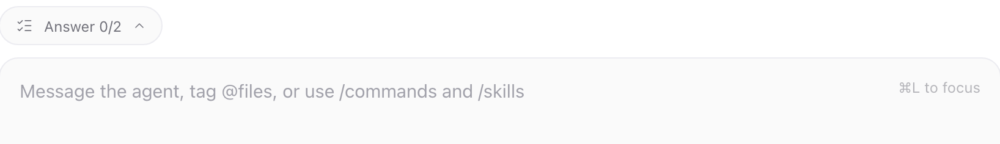

<p align="right"><b>English</b> | <a href="README.zh-CN.md">简体中文</a> | <a href="README.ja.md">日本語</a></p>

<p align="center">
  
</p>

<h1 align="center">Clear Chat</h1>

<p align="center">Clear Chat is a plugin for <a href="https://paseo.sh">Paseo</a>. It keeps the answer card: when a reply asks lettered questions, the card lets you pick an option or write your own, preview the answer, and send it. This version adds <b>What I said</b>: a panel beside the conversation that lists what you sent today, and a full screen, opened from the sidebar, that gathers today's messages from this host's conversations. Clear Chat does not draw the conversation. For the conversation view, use the separate plugin <a href="https://paseo.sh/plugins/roundreddot/better-paseo">Better Paseo</a>.</p>

<p align="center">
  <a href="https://github.com/jasonhnd/paseo-clear-chat/releases"></a>
  <a href="LICENSE"></a>
  <a href="https://paseo.sh"></a>
</p>

## This version

Clear Chat 0.17.5.1 follows Paseo 0.17.5: the first three parts of the version are the Paseo version this release is for. This release adds the **What I said** screen. A **What I said** row in the sidebar header opens a full screen that lists the messages you typed today across this host's conversations, conversations archived today included. Each row shows the conversation title, its local `HH:MM` and up to three lines of the body; press a row to copy that message exactly as it was sent, and a **Copied** toast confirms it. The top line counts the day, for example `From you today: 12 · Conversations: 3`; while the screen reads it shows `Reading 3 of 7…`, and rows appear as each conversation is read. A list that was only partly read says `This list may be incomplete.` and offers **Try again**; **Refresh** reads again; conversations whose history the host could not give back are counted in a line of their own. The panel beside the conversation and the answer card are unchanged from the previous release. The limits are listed in [Known limitations](#known-limitations): the screen lists today and nothing earlier, a row copies but does not jump, conversations another agent started are not listed, and opening the screen right after a daemon restart takes about a second per conversation restored from storage with Codex, where a test agent took about 4 s.

The full list of changes is in the [changelog](CHANGELOG.md).

## Answer card

A reply that asks lettered questions gets a button above the message box once that reply has finished. It carries the progress, for example **Answer 0/2**. On a desktop, hovering shows the full name, **Answer card · 0/2 answered**; on a narrow screen the panel opens with that full name as its title. Press it to open the whole card in a panel; on a narrow screen the panel rises from the bottom. In the desktop panel the question area scrolls inside the card, and the progress line and **Send** stay in one row at the bottom, so **Send** is visible without scrolling the panel. Choose your answers there and press **Send** on the card: the message goes to the chat as if you had sent it, and the message box keeps what you were writing. The count follows your answers (**Answer 1/2**), closing the panel keeps them, and after **Send** the button is gone until another reply asks lettered questions. If you send an ordinary message with part of the card answered, the button stays above the message box with that progress; pressing it opens the card with **Continue answering**, and that button restores the saved draft. The button belongs to the conversation on screen, so switching chats shows that chat's own card, or none.

<p align="center">
  
  
  
</p>

Open **Settings → Plugins → Clear Chat**. The page heading is **Clear Chat**; the first settings card is titled **Answer card**. The switch **Show an answer card under replies that ask lettered questions** is on when the settings file has no stored value. A stored on or off value still wins. The note under that switch says to reload the chat to update existing replies.

The card's controls are:

A reply is recognised only when it has numbered questions, each with at least two lettered options (`A`–`H`, including full-width `Ａ`–`Ｈ`), and either a recommendation mark or a short-reply hint such as “reply with” or “answer with”. Lines inside code fences and quotations are ignored. Letters must move forward in each question (`A` then `C` counts; `B` then `A` does not). A mark such as `（推荐）` or `(recommended)` is read; “not recommended” and `不推荐` are not. A line on its own under the options that names one option and holds nothing else, such as `Recommended: A`, `推荐：A`, or `おすすめ：A`, marks that option as recommended and is not part of the option above it; the label may end with a period and may be bold. In Japanese it needs a colon or a space after it. A line such as `不推荐：A` is not read as a recommendation, and the line stays ordinary text.

1. Choose an option by clicking it, or, with focus inside the card, press its letter. You can also move with **↑/↓** and press **Enter**. Keys typed in Paseo's input box stay in that box.
2. Choosing an unanswered question moves to the next unanswered question. The last choice moves focus to **Send**. Until every question has an answer, **Send** names the missing question and cannot be used.
3. Question tabs show a short name. An answered tab that is not current shows `✓` and the answer text. Changing an answered question stays on that question.
4. To write your own answer, choose **Other**. Press **Enter** to confirm and move on, or **Shift+Enter** for a new line. Choosing a character with an input method does not confirm. An empty answer shows a prompt.
5. **Send** shows the letter indexes, such as `1B 2A`. A written answer is included in the message as you confirmed it. In the desktop panel a written answer is previewed above the footer row in at most two lines: the whole answer index, then the start of the first written answer; the message that is sent keeps the full answer. After a successful send the button is gone and the card is no longer shown; the message in the chat, for example `1B 2A`, is your answer.
6. If an ordinary list was mistaken for questions, press **Not options**. That reply stays dismissed after reloading. The button is not shown while sending.
7. Saved replies that you edit on the settings page appear on the card as buttons. In the desktop panel they sit below the options and scroll with the question. Choosing one inserts the phrase at the cursor and does not send.

A bare letter inside a sentence (for example “wait a moment”) is not treated as an answer. A numbered token such as `1A`, `2b`, or `Q1A` still counts, including when punctuation sits against it (`1A.`). A message that is only an answer is unchanged, including a single-question reply whose whole message is `b`. A message such as `Plan 2B` can still be read as an answer.

## What I said

**What I said** is a panel beside the conversation that lists what you sent today. Open it from the **What I said** button in the workspace header (the message icon). The panel opens in the pane beside the conversation; when the host cannot place it there, it opens as a tab in the main pane. At phone width the workspace header keeps its actions in a **Workspace actions** sheet: the button is in that sheet, and the panel opens full screen.

The top line counts the day, for example `Machine messages today: 5 · From you: 7`. Below it are your own messages, newest first, each with its local time (`HH:MM`) and up to three lines of the body. Press a row to copy that message exactly as it was sent, spaces and line endings included; a **Copied** toast confirms it. A row that holds only an image has no text to copy and says so. A row does not jump to the message in the conversation.

- The panel reads today, the device's local calendar day; earlier days are not listed. It reads again at the next local midnight and when the app comes back to the foreground.
- Machine messages are counted, not listed: host envelopes, instruction tags, pasted context headers, and delegation wrappers. A message inserted mid-turn counts as yours and is listed with the body inside its markers. An image-only message is shown as `(image)`.
- A day that could not be read in full says it is partial and offers **Try again**, which reads further each time, up to a cap. The counts are then a lower bound: at least the number of rows listed.
- Counts that belong to an earlier day are marked stale with **Try again**; they are never shown as today's.
- While the panel is open, a new message updates the counts and the list. A warning that new messages are not coming through appears only after live delivery has stopped.
- With several conversations in the workspace and none in front, the **What I said** button does not guess: Paseo shows Clear Chat's message in its own toast. The button reads the conversation list up to 25 pages of 200 entries; past that it says the list could not be read.

### The What I said screen

The panel reads one conversation. The screen reads this host's conversations, across its workspaces: a **What I said** row in the sidebar header opens it full-width, and it lists the messages you typed today — the device's local calendar day — across this host's conversations, conversations archived today included. At phone width the row is in the sidebar drawer, and the list fits the width without scrolling sideways.

The top line counts the day, for example `From you today: 12 · Conversations: 3`. While it reads it shows `Reading the conversation list…` and then `Reading 3 of 7…`, and the rows of each conversation appear as soon as that conversation has been read, so you can read and copy before the screen has finished. Each row shows the conversation title, its local `HH:MM` and up to three lines of the body; press a row to copy that message exactly as it was sent, spaces and line endings included, and a **Copied** toast confirms it. A row that holds only an image has no text to copy and says so. A conversation with no title is shown as `Untitled conversation`.

- **Refresh** lists the conversations again and refills an empty list; conversations already read today come back quickly. **Try again** appears when a list was only partly read or a conversation could not be read: it runs the same pass with a doubled page budget for a conversation that was only partly read or failed, up to a cap.
- The screen says `This list may be incomplete.` whenever a read stopped short, failed, or could not be given back by the host, and `Conversations without readable history today: 3` counts the conversations whose history the host could not return. Those are not cached, so **Refresh** and **Try again** read them again.
- A screen left open past local midnight says its rows are an earlier day's the next time you scroll or press on it, and **Refresh** brings today's.
- **Conversations another agent started are not listed, and nothing typed into them directly is listed either.** Conversations whose provider is unavailable are not listed by the host, so the screen does not read them.
- Reading a conversation that is not loaded makes the daemon load it from storage, which takes time and memory until the daemon's idle cleanup.
- How long it takes, measured on Paseo 0.17.4 with a real provider (Codex): 20 conversations already loaded were read in 0.38 s; right after a daemon restart, when all 20 had to come back from storage — 5 of them archived — the same list took 20.4 s, about a second each. A test agent that needs no model took about 4 s per conversation restored from storage, so another provider can be slower. Rows appear as each conversation is read. These are measurements under those conditions, not a promise for other hosts or providers.

<p align="center">
  
</p>

## Install

Clear Chat 0.17.5.1 needs Paseo 0.16.0 or later. On Paseo 0.15.x this version cannot be installed or run normally; stay on Clear Chat 0.15.4.x. Paseo 0.17.4 is the host the browser checks ran on; it was not checked on Paseo 0.16.x, 0.17.1, 0.17.2, or 0.17.3. The install command was not checked on Paseo 0.16.x; Paseo 0.16.0 and 0.16.1 were not checked. Also checked on Paseo 0.17.5: [[HOST-0175]].

```bash
paseo plugin install git:jasonhnd/paseo-clear-chat --ref v0.17.5.1
```

Installation runs `npm ci --include=dev --ignore-scripts` on the daemon host, so Node.js and npm must be available there and the host must be able to reach the npm registry.

To update an existing install to this version:

```bash
paseo plugin update clear-chat --ref v0.17.5.1 --yes
```

Open **Settings → Plugins → Clear Chat** and read the version line in the **Answer card** card. A directory install keeps the version information already in that directory, so it can show an older release. If the build carries no usable version, the line shows **Unknown**.

> [!IMPORTANT]
> Already using Beautiful Chat? Read [Upgrading from Beautiful Chat](#upgrading-from-beautiful-chat) **before** you install or remove anything. Removing a plugin in Paseo also deletes its settings.

<details>
<summary><b>Older Paseo versions (0.13 / 0.12), and how version numbers work</b></summary>

Still on Paseo 0.13? Clear Chat 0.13.2.2 is already released and declares support for Paseo 0.13.0 or later. The exact installation command below has not yet been tested on Paseo 0.13:

```bash
paseo plugin install git:jasonhnd/paseo-clear-chat --ref v0.13.2.2
```

If Clear Chat is already installed, the proposed way to select that release is shown below. **This exact switch and its effect on settings have not yet been verified on Paseo 0.13; switching from the new version to the old one is also untested.**

```bash
paseo plugin update clear-chat --ref v0.13.2.2 --yes
```

On Paseo 0.12, install Clear Chat 0.12.0.1 instead:

```bash
paseo plugin install git:jasonhnd/paseo-clear-chat --ref v0.12.0.1
```

If Clear Chat is already installed, `install` stops with `Plugin ID clear-chat is already configured`. Switch versions with `update` instead; it keeps your settings:

```bash
paseo plugin update clear-chat --ref v0.12.0.1 --yes
```

A Clear Chat version is the Paseo version it is built for, plus one more number that counts Clear Chat's releases for that Paseo version. For example, 0.13.0.1 is the first Clear Chat release for Paseo 0.13.0, and 0.13.0.2 is the second. Clear Chat does not release a new version just because Paseo did. Releases 1.0.0 and 1.0.1 came out before this rule; 0.12.0.1 is newer than both.

</details>

## Upgrade and rollback

```bash
paseo plugin update clear-chat --ref v0.17.5.1 --yes
```

An update keeps the settings file. Values for the answer card, saved replies, dismissed false detections, and unfinished drafts are kept. A stored draft entry that is damaged, of an older shape, or of an unknown shape is ignored when the settings are read; it stays in the file until the settings are next written. The other drafts and your preferences still load, and the settings page no longer reports the whole file as invalid because of it. Keys for features this version no longer shows stay in the file and have no control on the settings page. A rollback to an earlier ref also keeps the file, but the effect of a specific rollback on settings is not guaranteed, so back the file up first if the settings matter. A rollback to the previous release keeps the settings and removes the **What I said** screen, which that release does not have; the panel beside the conversation stays, because that release has it. A rollback to an earlier release keeps the saved choices, but that version ignores `resumed: true`, so a card you continued asks for **Continue answering** again after a reload. Removing the plugin deletes its settings.

After this update the conversation is no longer drawn by Clear Chat. Use [Better Paseo](https://paseo.sh/plugins/roundreddot/better-paseo) for that view. You will not see Clear Chat's step rows, tool cards, or sidebar.

The answer card opens from the button above the message box. After the update, a reply that asks lettered questions shows the button, for example **Answer 0/2**, when that reply has finished; on a desktop, hover it for the full name, **Answer card · 0/2 answered** (on a narrow screen the panel opens with that title), and press it to open the card.

Startup does not delete anything under the plugin's data directory. Older image and history directories are left in place. This version does not use them.

## Settings

The page heading is **Clear Chat**; the first settings card is titled **Answer card**.

| Setting | Effect |
|---|---|
| Show an answer card under replies that ask lettered questions | On when no value is stored. A stored value still wins. The note under the switch says to reload the chat to update existing replies. |
| Saved replies | One phrase per line. The default phrases are `Go with the recommended`, `Leave it for now`, and `Continue`. On the answer card, choosing a phrase inserts it and does not send. Editing here is saved on blur. |

**Installed version.** In the **Answer card** card, Clear Chat shows the version of the build this install was made from. A directory install keeps the version information already in that directory, so it can show an older release. If the build carries no usable version, the line shows **Unknown**.

**Report a problem** opens a GitHub issue form in your browser. Nothing is sent unless you submit that form.

Settings are saved on the host and shared by every client connected to that host.

## Languages

Clear Chat's own text follows the Paseo app language: English, Simplified Chinese, and Japanese. The settings page, the answer card, the panel and the screen are translated. Paseo's own text keeps Paseo's language, and agent output is never translated. The plugin list shows the English description.

## Known limitations

- The **What I said** screen and panel show today's messages and nothing earlier: the device's local calendar day.
- The screen lists the conversations on this host whose last message from you is today, archived ones included; conversations another agent started are not listed, and nothing typed into them directly is listed either.
- Conversations whose provider is unavailable are not listed by the host, so the screen does not read them.
- Some providers cannot give back the history of a conversation restored from storage. Such conversations are counted as `Conversations without readable history today: N` instead of being listed; they are not cached, and **Refresh** and **Try again** read them again.
- A total loss of today's history is detected; a partial loss is not reported, and the screen lists what the provider gave back without a warning.
- Reading a conversation that is not loaded makes the daemon load it from storage, which takes time and memory until the daemon's idle cleanup.
- With a real provider (Codex), 20 conversations already loaded were read in 0.38 s; right after a daemon restart, when all 20 had to come back from storage, the same list took 20.4 s, about a second each. A test agent took about 4 s per conversation restored from storage, so another provider can be slower. Measured on Paseo 0.17.4, not a promise for other hosts.
- On the screen a row copies the message and does not jump back to it.
- A panel row copies the message and does not jump to it: the plugin API has no scroll-to-message surface.
- A row that holds only an image has no text to copy; pressing it says so.
- A machine message is recognised by its leading text, so a message that opens with one of those shapes for another reason is counted as machine and is not listed.
- A day has a page budget. A read that stops short says it is partial and offers **Try again** (up to a cap), and the counts are then a lower bound, at least the number of rows listed. While the panel is open, every timeline event asks for a fresh read of today, so a large conversation may read several pages.
- With several conversations in the workspace and none in front, the **What I said** button does not guess; Paseo shows Clear Chat's message in its own toast.
- At phone width the **What I said** button is in the **Workspace actions** sheet, and the panel covers the conversation while the host's Explorer overlay is open.
- `Plan 2B` can still be read as an answer. A bare letter inside a sentence is not.
- In the desktop panel a long written answer previews in at most two lines: the whole answer index, then the start of the first written answer. The message that is sent keeps the full answer, and the narrow panel shows the full preview; a long preview may need scrolling there.
- A window shorter than about 117 px is not supported: the panel's footer no longer fits.
- While the agent is answering, a card you can still edit has no button above the message box, and a panel that is already open says the reply is still running; the button and the answers come back when the agent finishes. A read-only card that is still waiting for your answer keeps its button.
- For up to about half a second after the agent starts answering, the button can still be there; a panel opened in that moment can show the wait message.
- A draft read that fails after the saved preferences are ready, and before a new reply or a new message from you arrives, leaves the card out of reach until one of those arrives or you reload; the draft itself is not lost. A read that succeeds and finds no draft, or a shape this version rejects, is final and not retried.
- A rollback to the previous release keeps your saved choices but not the continued state: a card you continued asks for **Continue answering** again after a reload.
- An answer typed after an ordinary message in the same turn is not linked to the card. Nothing is lost: the card stays continuable and the draft is kept.
- At phone width, Enter in Paseo's own input box inserts a newline. Use that box's Send button. This is the host's behaviour.
- At phone width, Esc does not close the answer card; tap outside the panel to close it (the sheet closes about a second after the tap). This is the host's behaviour. **Not options** is not a way to close the card: it dismisses that reply for good, and neither the card nor its button comes back.
- The button above the message box is drawn by Paseo and is 32 px high at tablet and phone widths; the card's option rows and **Send** are at least 44 px.
- The browser checks ran in the interface of Paseo 0.17.4 (the web UI the `paseo` command starts), in a headless browser, at 1280×800 and 390×844, with a test agent that needs no model and a real provider (Codex), on commit 0b334a91. For the screen: the sidebar row opens it; rows and conversation titles are right; a row copy is byte-for-byte identical and shows its toast; at 390 wide the row is in the sidebar drawer and the list does not overflow sideways; the panel's button beside the conversation is still there; the console shows no plugin errors; a conversation of the real provider that had been archived still lists its messages after the daemon restarts; and a conversation of the test agent, which cannot replay its history, is counted as unreadable. The release head was smoke-checked; the result is in the [changelog](CHANGELOG.md). It was not checked in the desktop app, on physical iOS or Android devices, on Paseo 0.16.x, 0.17.1, 0.17.2 and 0.17.3, in the dark theme, in other interface languages, or at other viewport sizes.
- Removing the plugin deletes its settings. Back them up first. Startup does not delete older files in the plugin data directory.

## Privacy and data on the host

- Clear Chat does not send conversation content off the host, to agent providers, or to any other service, except the message you send yourself. **Send** on the answer card sends one message, written as you, through Paseo to the agent of the current chat, like a message you type.
- The **What I said** panel and screen read conversations from the host and copy a message to your clipboard when you press a row. They send nothing and keep no settings of their own.
- This version does not read local image files, highlight code, or register a provider copy.
- The only network use by Clear Chat itself is `npm ci` at install time.
- **Report a problem** opens a GitHub issue form in your browser. Nothing is sent unless you submit it.
- An existing plugin data directory is left in place. This version does not write a new image or history store.

## FAQ

**Does Clear Chat still draw the conversation?** No. Step rows, tool cards, the sidebar, search, quote-and-reply, jump chips, and syntax highlighting are gone. The **Workspace changes during this turn** card is gone. Use [Better Paseo](https://paseo.sh/plugins/roundreddot/better-paseo) for the conversation view.

**Why do I not see the answer card?** Turn on **Show an answer card under replies that ask lettered questions**. The latest reply must have numbered questions, each with at least two lettered options, and either a recommendation mark or a short-reply hint such as “reply with” or “answer with”. The button for a reply appears above the message box when that reply has finished; press it to open the card.

**Which replies would the card recognise?** Numbered questions with at least two lettered options each, plus a recommendation mark or a short-reply hint. Code fences and quotations are ignored.

**Do I have to change how my agents are set up?** No. This version does not add a provider copy. Pasted-image handling from earlier releases is gone.

**Why is a message missing from What I said?** The panel lists the messages it decides are yours from today in the conversation in front; the screen does the same across this host's conversations. A message that opens with a machine shape (a host envelope, an instruction tag, a pasted context header, or a delegation wrapper) is counted as a machine message instead, earlier days are not listed, and the screen skips conversations another agent started, along with anything typed into them. A message inserted mid-turn is listed with the body inside its markers.

**Which Paseo versions work?** 0.16.0 or later. On Paseo 0.15.x this version cannot run normally: stay on Clear Chat 0.15.4.x. Older install paths for Paseo 0.13 and 0.12 are under [Install](#install); the 0.13 commands are still untested.

**What happens to my settings if I remove the plugin?** They are deleted with the plugin. Back them up first. See [Upgrading from Beautiful Chat](#upgrading-from-beautiful-chat).

**Does Clear Chat send my conversation anywhere?** No, except the answer you send yourself, which goes through Paseo like any message you type. The full statement is in [OVERVIEW](OVERVIEW.md).

## Troubleshooting

| Problem | What to do |
|---|---|
| Installing through the Cafe plugin fails. | Retry with the Paseo CLI command in [Install](#install), using the same repository and release ref. Clear Chat installs its dependencies with `npm ci --include=dev --ignore-scripts`, so Node.js and npm must be available on the daemon host, and its network must reach the npm registry. If you manage the checkout yourself, run `npm ci --include=dev --ignore-scripts` there before retrying. |
| Installation stops because the plugin needs a newer Paseo version. | Clear Chat 0.17.5.1 needs Paseo 0.16.0 or newer on the daemon host and on every connected app. On Paseo 0.15.x, stay on Clear Chat 0.15.4.x. For older hosts, see the [Install](#install) section. |
| Clear Chat says it requires plugin RPC, a settings screen, settings registration, and a request handler. | Update Paseo on the daemon host and in every connected app, then reload Clear Chat. The Paseo version Clear Chat needs is declared in `paseo-plugin.json`. |
| Clear Chat cannot start because plugin registration failed. | Update Paseo and reload Clear Chat. If it still fails, back up the plugin settings before you reinstall from the CLI. |
| Clear Chat cannot read its settings from the host. | Reconnect to the host and choose **Retry** on the settings page. If it still fails, check that the daemon can access the plugin settings folder. |
| Clear Chat says its settings are invalid or in an unsupported format. | Back up the settings first. Restore a valid backup, or repair the settings file on the daemon host, then choose **Retry**. Clear Chat never erases the file by itself. |
| Clear Chat cannot save settings. | Check write permission and free disk space on the daemon host, reconnect, then make the change again. **Retry** reloads the settings; it does not resend a change that failed. |
| Settings keep changing because of another client. | Wait until the other edits finish, then make the change again. |
| Beautiful Chat settings were not copied. | Keep Beautiful Chat's original settings and back them up. Check read and write access to both plugin settings folders and free disk space, then reload Clear Chat to try again. A failed copy leaves a recovery message in the daemon log; an existing Clear Chat settings file is never overwritten. |

If Paseo cannot run the build command or load the plugin bundle, Clear Chat cannot show a message of its own. Check Node.js, npm, and the Paseo version on the daemon host, then retry from the CLI. If the problem stays, use **Report a problem** on the settings page and include the recovery message and your Paseo version. Remove private paths and conversation content before you share any logs.

## Upgrading from Beautiful Chat

1. **Back up** your Beautiful Chat settings.
2. **Install Clear Chat** while Beautiful Chat is still installed. On first start, if Clear Chat has no settings file yet, it copies Beautiful Chat's file.
3. **Check** that the file arrived, then remove Beautiful Chat. The settings page will only show the answer card switch and saved replies. Other copied keys stay in the file and have no control.

<details>
<summary><b>Exact commands, rollback, and how the copy works</b></summary>

The commands use `PASEO_HOME` and fall back to `$HOME/.paseo`. If your daemon uses only `--home`, set `PASEO_HOME` to that path first. Stop if a backup or check fails.

**1. Back up**

```bash
legacy_backup="${PASEO_HOME:-$HOME/.paseo}/backups/plugin-settings-beautiful-chat-$(date +%Y%m%d-%H%M%S)"
mkdir -p "${PASEO_HOME:-$HOME/.paseo}/backups"
cp -a "${PASEO_HOME:-$HOME/.paseo}/plugin-settings/beautiful-chat" "$legacy_backup"
```

If the `beautiful-chat` settings folder does not exist, you never changed Beautiful Chat's settings, and you can skip this step.

**2. Install**

```bash
paseo plugin install git:jasonhnd/paseo-clear-chat --ref v0.17.5.1
```

**3. Check, then remove the old plugin**

Confirm that `${PASEO_HOME:-$HOME/.paseo}/plugin-settings/clear-chat/presentation.json` exists and matches `$legacy_backup/presentation.json`. An existing Clear Chat settings file is never overwritten. If the file is missing or differs, keep Beautiful Chat and the backup, and check the copy error in the log.

```bash
paseo plugin remove beautiful-chat
```

Keep the backup.

**Rollback**

Back up Clear Chat's current settings, then remove it. Removing Clear Chat deletes all of its settings; `update` does not. If the `clear-chat` settings folder does not exist, skip the `cp` line.

```bash
clear_chat_backup="${PASEO_HOME:-$HOME/.paseo}/backups/plugin-settings-clear-chat-$(date +%Y%m%d-%H%M%S)"
mkdir -p "${PASEO_HOME:-$HOME/.paseo}/backups"
cp -a "${PASEO_HOME:-$HOME/.paseo}/plugin-settings/clear-chat" "$clear_chat_backup"
paseo plugin remove clear-chat
```

If Beautiful Chat's settings folder is gone, restore it from the upgrade backup. Replace `YYYYMMDD-HHMMSS` with your backup's timestamp. An existing folder is never overwritten.

```bash
legacy_backup="${PASEO_HOME:-$HOME/.paseo}/backups/plugin-settings-beautiful-chat-YYYYMMDD-HHMMSS"
test ! -e "${PASEO_HOME:-$HOME/.paseo}/plugin-settings/beautiful-chat" &&
  cp -a "$legacy_backup" "${PASEO_HOME:-$HOME/.paseo}/plugin-settings/beautiful-chat"
```

Then install the last Beautiful Chat version:

```bash
paseo plugin install git:jasonhnd/paseo-clear-chat --ref 2bf25e8
```

Changes made in Clear Chat do not sync back to Beautiful Chat. Keep both backups.

**How the copy works**

- On first start, if Clear Chat has no settings file yet, the server copies Beautiful Chat's `presentation.json` into Clear Chat's settings folder. It never deletes or overwrites either file.
- If copying fails, the error is logged, and Clear Chat starts with default settings. The next start tries again.
- The file is then read with the current settings schema. Answer-card values in it are kept. Keys for features this version no longer shows are still accepted and are not shown as controls.
- In a browser, older preferences stored in the browser are imported once. Settings saved on the host always win.
- The copy expects the default installation ids. An installation with a custom `--id`, or a daemon home set only with `--home`, needs its settings copied by hand.

</details>

## Reporting problems

Something wrong, or an idea? [Open an issue on GitHub](https://github.com/jasonhnd/paseo-clear-chat/issues/new/choose). You can also use **Report a problem** at the bottom of the settings page. Chinese and Japanese are welcome too. Every release is listed in the [changelog](CHANGELOG.md).

The bug form asks for a redacted screenshot or video for a UI problem; if you cannot provide one, say why. For a non-UI problem, enter `N/A — not a UI issue` if no image is relevant. Give the installed product version if known; an installed Git revision is a commit, not a product version. The feature form asks for the use case and the expected result. The forms' live GitHub rendering and submission have not been tested.

## Credits

Clear Chat is based on [Beautiful Chat](https://github.com/ABorakati/beautiful-chat) by ABorakati, under the MIT License. The original copyright notice is kept in [LICENSE](LICENSE).

For developers: build steps and project layout are in [docs/DEVELOPMENT.md](docs/DEVELOPMENT.md).

## License

[MIT](LICENSE)
