<p align="right"><b>English</b> | <a href="README.zh-CN.md">简体中文</a> | <a href="README.ja.md">日本語</a></p>

<p align="center">
  
</p>

<h1 align="center">Clear Chat</h1>

<p align="center">Clear Chat is a plugin for <a href="https://paseo.sh">Paseo</a>. It keeps the answer card: when a reply asks lettered questions, the card lets you pick an option or write your own, preview the answer, and send it. This version turns <b>What I said</b> into a calendar of the days you typed. Each row still has <b>Copy</b> and <b>Quote</b>, and pressing a row opens the conversation. Clear Chat does not draw the conversation. For the conversation view, use the separate plugin <a href="https://paseo.sh/plugins/roundreddot/better-paseo">Better Paseo</a>.</p>

<p align="center">
  <a href="https://github.com/jasonhnd/paseo-clear-chat/releases"></a>
  <a href="LICENSE"></a>
  <a href="https://paseo.sh"></a>
</p>

## This version

Clear Chat 0.18.1.2 follows Paseo 0.18.1: the first three parts of the version are the Paseo version this release is for, and the fourth counts Clear Chat's releases for it. This is the second Clear Chat release for that host. **What I said** is a calendar, opened from the same sidebar row (the calendar arrived in the previous release; this release adds the month summary, the ranking and the narrow-screen column). It opens on today. Days with messages are shaded in four steps of the theme colour, with a **Less** / **More** legend, and a bubble such as `Nov 25 Wed · 41 messages`. The bubble is a solid card: one step darker than the page on a dark theme, white with dark text on a light theme, with a thin border, a soft shadow, and a small point under the card that stays on the cell. Its label is one size larger than the cell's text and stays on one line. The card is about as wide as that label: a conservative character-width estimate plus its padding and border, between 96 and 420 px and never wider than the row. On a row too narrow for the whole label the card drops the weekday first, then the word for `messages`, and the cell still reads the whole date aloud. Arrow keys move the highlight, Enter selects that day, and **T** selects today. The selected day keeps its own step colour, with a thin ring inside the cell and a thin gap. Today is a bold date with a small dot under it. The highlight is a dashed box just outside the cell, and it shows only while you use the keyboard, not after a mouse or touch press. The month title opens twelve months. Each month shows a short name and does not repeat the year; the bubble and the name a screen reader reads still use the full month and year. A bubble stays inside the left and right edges of the grid. December continues into January of the next year. On a screen that is already narrow, you see the selected week first. If you open the calendar on a wide screen and then make the window narrow, the week does not collapse on its own. The expanded month stays until you press **▾**. Choosing a day lists what you typed that day, with **Copy**, **Quote**, and a row press. Under the calendar, **This month** counts the month's messages, the days with messages, the busiest day and the average per day, and lists the five conversations you typed in most; choosing one filters that day's list to it, choosing it again clears the filter, and a bar above the list names the conversation it is showing. On a wide screen the calendar stays at the top of the left column and only the summary and the ranking scroll; on a narrow screen the panel sits between the week strip or the month and the list. **Quote** keeps the draft and adds the quote after the whole draft, with one blank line between them. Two releases ago the quote sat against the draft with no line break; the previous release fixed that. This was checked on Paseo 0.18.1. A day or month with no messages is a neutral cell, at the quiet end of the scale. Each number uses whichever text colour reads more clearly on its cell. At 390 wide the header arrows are 44×44. Messages already read are kept in a local archive, so a day can remain after Hermes has deleted the conversation. This version reads Hermes directly. Another provider's conversation is filled in when you open that day. A host that cannot answer the history calls keeps the previous today-only page. The answer card is unchanged, and there are no new settings. The minimum host stays Paseo 0.16.0. The limits are in [Known limitations](#known-limitations).

The full list of changes is in the [changelog](CHANGELOG.md).

## Answer card

A reply that asks lettered questions gets a button above the message box once that reply has finished. It carries the progress, for example **Answer 0/2**. On a desktop, hovering shows the full name, **Answer card · 0/2 answered**; on a narrow screen the panel opens with that full name as its title. Press it to open the whole card in a panel; on a narrow screen the panel rises from the bottom. In the desktop panel the question area scrolls inside the card, and the progress line and **Send** stay in one row at the bottom, so **Send** is visible without scrolling the panel. Choose your answers there and press **Send** on the card: the message goes to the chat as if you had sent it, and the message box keeps what you were writing. The count follows your answers (**Answer 1/2**), closing the panel keeps them, and after **Send** the button is gone until another reply asks lettered questions. If you send an ordinary message with part of the card answered, the button stays above the message box with that progress; pressing it opens the card with **Continue answering**, and that button restores the saved draft. The button belongs to the conversation on screen, so switching chats shows that chat's own card, or none.

<p align="center">
  
  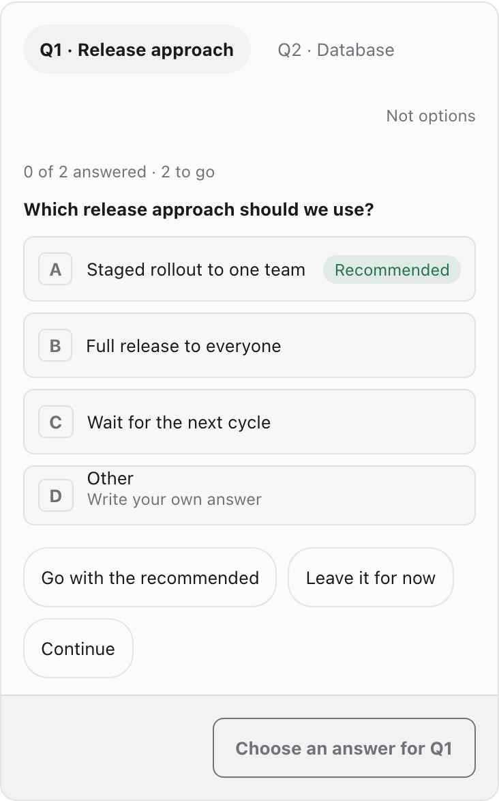
  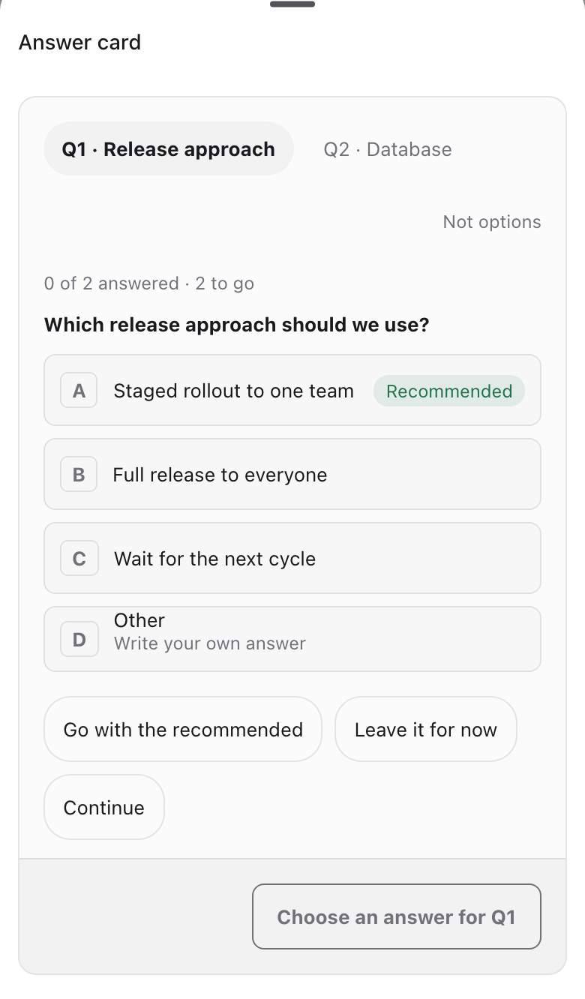
</p>

Open **Settings → Plugins → Clear Chat**. The page heading is **Clear Chat**; the first settings card is titled **Answer card**. The switch **Show an answer card under replies that ask lettered questions** is on when the settings file has no stored value. A stored on or off value still wins. The note under that switch says to reload the chat to update existing replies.

The card's controls are:

A reply is recognised only when it has numbered questions, each with at least two lettered options (`A`–`H`, including full-width `Ａ`–`Ｈ`), and either a recommendation mark or a short-reply hint such as “reply with” or “answer with”. Lines inside code fences and quotations are ignored. Letters must move forward in each question (`A` then `C` counts; `B` then `A` does not). A mark such as `（推荐）` or `(recommended)` is read; “not recommended” and `不推荐` are not. A line on its own under the options that names one option and holds nothing else, such as `Recommended: A`, `推荐：A`, or `おすすめ：A`, marks that option as recommended and is not part of the option above it; the label may end with a period and may be bold. In Japanese it needs a colon or a space after it. A line such as `不推荐：A` is not read as a recommendation, and the line stays ordinary text.

1. Choose an option by clicking it, or, with focus inside the card, press its letter. You can also move with **↑/↓** and press **Enter**. Keys typed in Paseo's input box stay in that box.
2. Choosing an unanswered question moves to the next unanswered question. The last choice moves focus to **Send**. Until every question has an answer, **Send** names the missing question and cannot be used.
3. Question tabs show a short name. An answered tab that is not current shows `✓` and the answer text. Changing an answered question stays on that question.
4. To write your own answer, choose **Other**. Press **Enter** to confirm and move on, or **Shift+Enter** for a new line. Choosing a character with an input method does not confirm. An empty answer shows a prompt.
5. **Send** shows the letter indexes, such as `1B 2A`. A written answer is included in the message as you confirmed it. In the desktop panel a written answer is previewed above the footer row in at most two lines: the whole answer index, then the start of the first written answer; the message that is sent keeps the full answer. After a successful send the button is gone and the card is no longer shown; the message in the chat, for example `1B 2A`, is your answer.
6. If an ordinary list was mistaken for questions, press **Not options**. That reply stays dismissed after reloading. The button is not shown while sending.
7. Saved replies that you edit on the settings page appear on the card as buttons. In the desktop panel they sit below the options and scroll with the question. Choosing one inserts the phrase at the cursor and does not send.

A bare letter inside a sentence (for example “wait a moment”) is not treated as an answer. A numbered token such as `1A`, `2b`, or `Q1A` still counts, including when punctuation sits against it (`1A.`). A message that is only an answer is unchanged, including a single-question reply whose whole message is `b`. A message such as `Plan 2B` can still be read as an answer.

## What I said

**What I said** lists what you typed, by day, across this host's conversations. It is a full screen, opened from its row in the sidebar header. It opens on today. Every row of the selected day has **Copy** and **Quote**, and pressing a row opens the conversation the message was sent in. On a host without client navigation, pressing a row copies the message. A host that cannot answer the history calls keeps the previous today-only page.

### The month

The wide screen keeps the whole month on one side and the selected day on the other. The grid starts on Monday. A day with no messages is a neutral cell, at the quiet end of the scale: darker than the first step on a dark theme, lighter than the first step on a light theme. Days with messages use four steps of the host's accent, from the whole history, not only the month you are looking at. The legend is **Less** / **More**. A bubble on the hovered or focused cell reads like `Nov 25 Wed · 41 messages` (one message: `Jan 14 Wed · 1 message`). The bubble stays inside the left and right edges of the grid, including a cell in the second column or the second column from the right. The bubble is a solid card with a thin border, a soft shadow and a small point under it that stays on the cell, and its label is one size larger than the cell's text on one line; on a light theme the card is white with dark text. Arrow keys move the highlight one day or one week, including into the next month. Enter selects that day. **T** selects today. The highlight moves before the selection does. The highlight is a dashed box just outside the cell. It appears only while you are using the keyboard (the arrow keys, Enter, Space, **T**, or Tab into the grid). A mouse or touch press does not show it. The selected day keeps that day's own step colour. A thin ring sits inside the cell, with a thin gap of the page colour between the fill and the ring. Today is not a box: the date is bold, and a small dot sits under it.

**‹** / **›** change the month, and December goes on to January of the next year. **Today** returns to today. **Refresh** reads again.

The month title, such as **November 2026**, opens the year: twelve months, four across on a wide screen and two across on a narrow one. Each month shows a short name and its total, and uses the same four steps. The short name does not repeat the year: Jan, Feb, and so on in English, and `1月`, `2月`, and so on in Simplified Chinese and Japanese. Months in the same row are the same height. The bubble, and the name a screen reader reads, still use the full month and year. Months before the first recorded day, and months after the current month, are dimmed and cannot be opened. A month in between with no messages is a neutral cell and can still be opened. A bubble reads like `October 2026 · 18 messages`. The month you are looking at keeps its own step colour, with the same thin inner ring and gap as a selected day. Changing the year does not leave that ring on the month with the same number. Enter opens that month.

On a screen that is already narrow, the calendar is the week of the selected day. **▾** expands the month, and choosing a day collapses it. If you open the calendar on a wide screen and then make the window narrow, the week does not collapse on its own. The expanded month stays until you press **▾**. The header arrows move a week and stop at the earliest day and at today. The list does not scroll sideways.

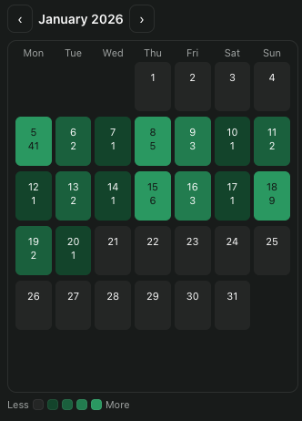

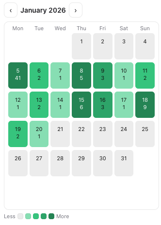

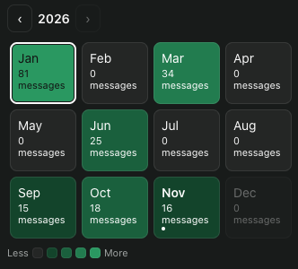

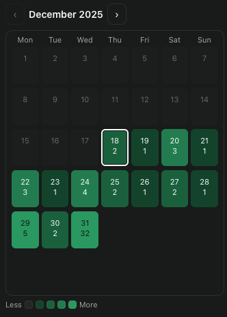

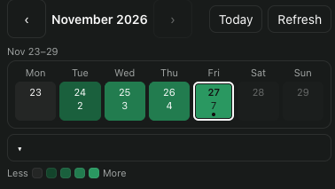

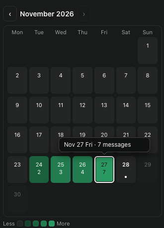

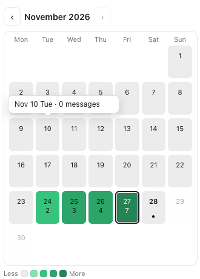

### This month

Under the calendar, **This month** counts what you typed in the month on screen: `Messages`, `Days with messages`, `Busiest day` with that day's count, and `Average per day`. The average divides by the days that have passed in the current month, and by the whole month for a month that has ended. When two days tie for the busiest, the earlier one is named. Another month shows its own name in place of `This month` and that month's numbers.

`Most talked-to conversations` lists up to five conversations by messages in that month, then by the most recent message. Choose one to show only that conversation in the day's list: the row keeps an outline and a background, and a bar above the list reads `Showing only <title> · Clear`. Choose the row again, or the bar, to show every conversation. Changing the month clears the filter. When that conversation has nothing on the selected day, the list says `No messages from this conversation on this day`.

On a wide screen the left column is 320 px wide, the calendar and its legend stay at the top, and only the summary and the ranking scroll under them. On a narrow screen the calendar, its legend and the panel share a column capped at about 58% of the room the page measures under the toolbar and scroll inside that cap. The list column below asks for its summary line, its filter bar, its notice lines and one whole row as a `minHeight`, so the calendar column is the one that shrinks when the cap and that floor do not both fit. The floor uses the row's real height (padding, title, three text lines and the copy and quote buttons), not the text alone; it is arithmetic in the styles rather than a measurement, so whether the whole row stays on the first screen is not known: this build's first row and real scrolling were not read on a page. At 390×844 the floor leaves the list about 200 px, and the calendar column about 260 px under its cap. The four numbers wrap by their own width — the 390-wide screenshot below happens to show two rows of two — and the five conversations are one row of chips that scrolls sideways. A card on the first row of that column opens below its cell instead of above it; inside a scroller it can still be clipped at the bottom edge, and this build's first row was not read on a page, so the whole card is not proven visible. Collapsing the month returns the panel to the month the week strip shows; a filter chosen in that month stays, and one chosen in another month is dropped.

The summary and the ranking say `Some conversations could not be read, so these totals and this list may be incomplete.` when the history read did not return some conversations, when the conversation list itself was short, when the host sent no per-conversation counts at all, or when the cells count more messages than the ranking lists. That line, the numbers and the list are three different states, and the panel keeps them apart: reconciled (the ranking and the cells were read from the same records), partial (what it shows is what has been read, and the may-be-incomplete line says so), or unavailable (the host sent no per-conversation counts, and the panel says the ranking is not available). A month with nothing in it says `No messages in this month` only in the first state; a month with no rows yet but an unread conversation says the ranking holds only what has been read. A conversation read by opening a day counts in the ranking as well as in the cell and the summary, so those rows are not left out of the ranking. The list shows five conversations, so its five rows can add up to less than the month. The day's rows are merged into the cell, the summary and the ranking only when all three hold: its own read answered, the answer named the count-only records, and no instant holds both a record and an unmatched row. A failed read, a host that omits that list, and a same-millisecond ambiguity each leave the day on the host's count without adding or subtracting; the day then says `This day's count and the messages it can list were not matched`, its month carries the may-be-incomplete line too, and the day was not cached, so opening it again reads it again. The day's own difference is not turned into a claim that text was not kept. The count-only line under the list names only records the answer itself returned, one row consumes one record at the same conversation and instant; while a conversation is filtered it counts that conversation's own records, so another conversation's record does not stand in for its empty answer. Most conversations on a real machine are not in the Hermes databases, so the may-be-incomplete line can stay on.

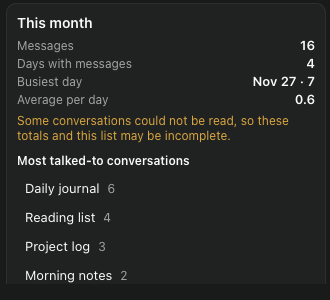

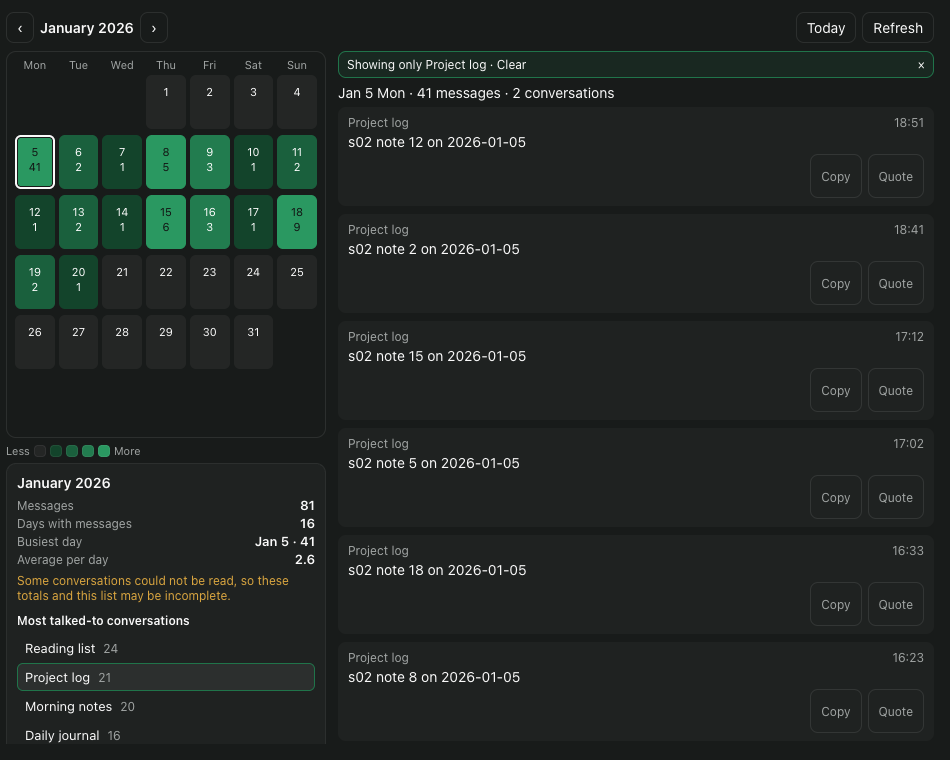

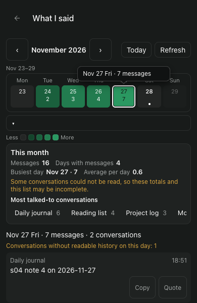

### The selected day

The heading is `Nov 25 Wed · 41 messages · 9 conversations`, or `Today · Nov 27 Fri` for today. Each row shows the conversation title, the local time, and up to three lines. Press the row to open that conversation on the same host. **Copy** copies the message and shows `Copied`. **Quote** keeps that conversation's draft and adds the quote after the whole draft, with one blank line between them. An empty draft gets only the quote. The quote is not placed at the cursor. Every line of the quote starts with `> `, a blank line in the message becomes `>`, and one empty line follows the quote. When the conversation has no input, **Quote** opens the conversation and copies the quote, with `Can't insert into this conversation — quote copied`. A message with no text says `This message has no text to copy` or `This message has no text to quote`. This was checked on Paseo 0.18.1. An empty day says `Nothing from you on this day`. While the day is read it says `Reading this day…`.

This version reads Hermes directly. A conversation from another provider is filled in from its timeline when you open that day. Until then, that day's cell and the month and year totals can leave it out.

If some conversations could not be read, a line says `Some conversations could not be read, so some counts may be incomplete.` A day can also say `Conversations without readable history on this day: N`. If older text was not kept, it says `Some old days are stored as counts only; their message text is no longer available.`

Days follow the clock of the page. The same message can fall on different dates in different time zones.

## Install

Clear Chat 0.18.1.2 needs Paseo 0.16.0 or later. On Paseo 0.15.x this version cannot be installed or run normally; stay on Clear Chat 0.15.4.x. The browser and desktop checks for this release ran on Paseo 0.18.1. It was not checked on Paseo 0.16.x, 0.17.1, 0.17.2, 0.17.3, or 0.17.4; Paseo 0.17.5 was checked for the previous release, not for this release. The install command was not checked on Paseo 0.16.x. On Paseo 0.18.1 the checks covered the bubble at six positions (the middle of the month, the first and last column, the year view, the light theme, and the week strip at 390 wide): each was an opaque card with a shadow, one line of text, and a point on its cell. The month summary was read against the cells for November 2026, January 2026 and December 2025, and the ranking, the filter and the cancel were checked on 5 January. The calendar stayed at the top of the left column while that column scrolled. At 390 wide the panel sat between the week strip and the list, and the list stayed visible. With the whole month open at 390×844, an earlier candidate of this release (9d967811, before the cap became a number measured from the page) stopped the column at 536 px and put the list at 592–832 px, its first row at 600–635 px. That reading does not describe this build: the cap is now a share of the measured body, the first-row card opens downward, the year view shortens its label, a collapse inside the same month keeps the filter, and a day whose own read fails keeps the host's count, marks the day as possibly incomplete, and is read again when reopened rather than ranked from rows it cannot prove are new. The first row and real scrolling at 390×844 were not read on a page for this build; the unit tests pin the layout arithmetic, the filter bar and the notice lines, not the pixels. The narrow bubble dropped the weekday at 162 px and the word for `messages` at 122 px and stayed on one line in all four widths that were read (282, 202, 162 and 122 px). An old host that omits the per-conversation counts showed the not-available line and did not call the month empty. **Quote** kept the draft and placed the quote after it, with one blank line, on Paseo 0.18.1. Each number used the text colour that read more clearly on its cell, and every step was at least 4.5 to 1 (the lowest 4.66 to 1). At 390 wide the header arrows were 44×44. Empty days and months use a neutral fill. In an earlier pass on Paseo 0.18.1, on a day filled in from the timeline, **Quote** was checked for today and for 14 January: an empty draft, a draft that was kept, a draft ending in one line break, and a draft that already ended with a blank line. The draft stayed, then a blank line, then the quote. A cursor in the middle of the draft left the quote at the end. On Paseo 0.18.1, on an archived conversation, **Quote** opened the conversation and copied the quote, with `Can't insert into this conversation — quote copied`. Simplified Chinese and Japanese labels were read in earlier passes on Paseo 0.17.5 and Paseo 0.18.0; this release added the same sixteen keys to all three language files. The readings above were taken on the 0.18.1.2 candidate at 9d967811. The changes after them have not been read on a page yet: the column's cap is now a number of pixels taken from the measured body instead of a percentage, a card on the first row opens below its cell, the year view shortens its label, a collapse inside the same month keeps the filter, and a day whose own read failed keeps the host's count, marks the day as possibly incomplete, and is read again when reopened instead of ranking the rows it can prove are new. The answer card was not part of this check. The Paseo 0.18.1 desktop app was checked on an isolated instance: the settings page listed Clear Chat, the sidebar row opened the screen, and a bubble and the console were read. That build is an earlier candidate of this release, before the month panel, the narrow column and the ranking changes landed; the left panel was read in the browser, not in that desktop build. The console showed no plugin error. See the list below.

```bash
paseo plugin install git:jasonhnd/paseo-clear-chat --ref v0.18.1.2
```

Installation runs `npm ci --include=dev --ignore-scripts` on the daemon host, so Node.js and npm must be available there and the host must be able to reach the npm registry.

To update an existing install to this version:

```bash
paseo plugin update clear-chat --ref v0.18.1.2 --yes
```

Open **Settings → Plugins → Clear Chat** and read the version line in the **Answer card** card. A directory install keeps the version information already in that directory, so it can show an older release. If the build carries no usable version, the line shows **Unknown**.

> [!IMPORTANT]
> Already using Beautiful Chat? Read [Upgrading from Beautiful Chat](#upgrading-from-beautiful-chat) **before** you install or remove anything. Removing a plugin in Paseo also deletes its settings.

<details>
<summary><b>Older Paseo versions (0.13 / 0.12), and how version numbers work</b></summary>

Still on Paseo 0.13? Clear Chat 0.13.2.2 is already released and declares support for Paseo 0.13.0 or later. The exact installation command below has not yet been tested on Paseo 0.13:

```bash
paseo plugin install git:jasonhnd/paseo-clear-chat --ref v0.13.2.2
```

If Clear Chat is already installed, the proposed way to select that release is shown below. **This exact switch and its effect on settings have not yet been verified on Paseo 0.13; switching from the new version to the old one is also untested.**

```bash
paseo plugin update clear-chat --ref v0.13.2.2 --yes
```

On Paseo 0.12, install Clear Chat 0.12.0.1 instead:

```bash
paseo plugin install git:jasonhnd/paseo-clear-chat --ref v0.12.0.1
```

If Clear Chat is already installed, `install` stops with `Plugin ID clear-chat is already configured`. Switch versions with `update` instead; it keeps your settings:

```bash
paseo plugin update clear-chat --ref v0.12.0.1 --yes
```

A Clear Chat version is the Paseo version it is built for, plus one more number that counts Clear Chat's releases for that Paseo version. For example, 0.13.0.1 is the first Clear Chat release for Paseo 0.13.0, and 0.13.0.2 is the second. Clear Chat does not release a new version just because Paseo did. Releases 1.0.0 and 1.0.1 came out before this rule; 0.12.0.1 is newer than both.

</details>

## Upgrade and rollback

```bash
paseo plugin update clear-chat --ref v0.18.1.2 --yes
```

An update keeps the settings file. Values for the answer card, saved replies, dismissed false detections, and unfinished drafts are kept. A stored draft entry that is damaged, of an older shape, or of an unknown shape is ignored when the settings are read; it stays in the file until the settings are next written. The other drafts and your preferences still load, and the settings page no longer reports the whole file as invalid because of it. Keys for features this version no longer shows stay in the file and have no control on the settings page. A rollback to an earlier ref also keeps the file, but the effect of a specific rollback on settings is not guaranteed, so back the file up first if the settings matter. After this update, **What I said** is the calendar on a host that answers the history calls. A rollback to the previous release keeps the settings, the calendar, the archive and the quote's blank line, and loses this release's month summary, ranking, narrow-screen column, short bubble label and day-open ranking. **Copy** and **Quote** stay. A rollback to a release before the calendar returns that screen to today only, does not read the archive this version writes, and does not bring back the conversation-header button or the panel beside the conversation. A rollback to a release older than 0.17.4.1 keeps the saved choices, but that version ignores `resumed: true`, so a card you continued asks for **Continue answering** again after a reload, and the screen's rows return to copy-only if that release has no **Copy** or **Quote** buttons. Removing the plugin deletes its settings.

After this update the conversation is no longer drawn by Clear Chat. Use [Better Paseo](https://paseo.sh/plugins/roundreddot/better-paseo) for that view. You will not see Clear Chat's step rows, tool cards, or sidebar.

The answer card opens from the button above the message box. After the update, a reply that asks lettered questions shows the button, for example **Answer 0/2**, when that reply has finished; on a desktop, hover it for the full name, **Answer card · 0/2 answered** (on a narrow screen the panel opens with that title), and press it to open the card.

Startup does not delete anything under the plugin's data directory. Older image and history directories are left in place. This version does not use them.

## Settings

The page heading is **Clear Chat**; the first settings card is titled **Answer card**.

| Setting | Effect |
|---|---|
| Show an answer card under replies that ask lettered questions | On when no value is stored. A stored value still wins. The note under the switch says to reload the chat to update existing replies. |
| Saved replies | One phrase per line. The default phrases are `Go with the recommended`, `Leave it for now`, and `Continue`. On the answer card, choosing a phrase inserts it and does not send. Editing here is saved on blur. |

**Installed version.** In the **Answer card** card, Clear Chat shows the version of the build this install was made from. A directory install keeps the version information already in that directory, so it can show an older release. If the build carries no usable version, the line shows **Unknown**.

**Report a problem** opens a GitHub issue form in your browser. Nothing is sent unless you submit that form.

Settings are saved on the host and shared by every client connected to that host.

## Languages

Clear Chat's own text follows the Paseo app language: English, Simplified Chinese, and Japanese. The settings page, the answer card and the **What I said** screen are translated. Paseo's own text keeps Paseo's language, and agent output is never translated. The plugin list shows the English description.

## Known limitations

- **What I said** is a calendar of local days, not only today. A host that cannot answer the history calls keeps the today-only page. Paseo 0.18.1 answered the calls, so that fallback was not seen on a real host. Paseo 0.16.x was not checked.
- This version reads Hermes directly. Another provider's conversation is filled in when you open that day. Until then the day's cell and the month and year totals can leave it out, and a day that only that provider has can stay closed. The earliest day you can open comes from the Hermes read.
- A conversation the Hermes read did not return is on that same fill-in. The fill-in still walks the timeline. The older timing — about one second per conversation restored from storage with Codex right after a daemon restart, and about four seconds for a test agent, measured on Paseo 0.17.4 — belongs to that path and was not measured again here.
- Hermes deletes old conversations. A day stays only if this plugin had already stored it. A month file that would pass 20 MB keeps later messages as counts only (`Some old days are stored as counts only; their message text is no longer available.`).
- **Quote** keeps the draft and adds the quote after it, with one blank line between them. It does not place the quote at the cursor. Two releases ago the quote sat against the draft with no line break; that was seen on Paseo 0.18.0. This release was checked on Paseo 0.18.1. An archived conversation has no input, so **Quote** opens it and copies the quote. The archived case was checked on the calendar: the screen showed that sentence, and the quote was copied.
- The first time **Quote** opens a conversation, the input can take a few seconds to appear. One cold open on Paseo 0.18.0 took about 4.2 seconds. That was only seen on a prepared test conversation, not on an ordinary conversation, and it was not measured again after this fix.
- A row opens the conversation, not the message. On a host without client navigation, a row press copies the message.
- A message with no text still has nothing to copy or quote. That row was not on the page in this check.
- Conversations another agent started are not listed, and nothing typed into them directly is listed either. Conversations whose provider is unavailable are not listed by the host.
- A message that opens with a machine shape is not listed.
- A card on the first row of the narrow month opens below its cell and can cover the next row of the month. On a wide screen it still opens above the cell and can cover the weekday names.
- On a narrow screen the header arrows were 44×44 in the browser check. **Today** and **Refresh** were shorter than 44 px in the first check and were not measured again.
- On a narrow screen the four numbers behind **This month** wrap by their own width; the 390-wide screenshot happens to show two rows of two, and a wider row can show them on one. The row of conversation chips can cut the last one at the right edge until you scroll it.
- The bubble's shadow was seen in the Paseo 0.18.1 browser and in the Paseo 0.18.1 desktop app. On another host, or outside the web interface, it may not be drawn; the card keeps its border and its solid fill.
- On a real machine most conversations are not in the Hermes databases, so `Some conversations could not be read, so these totals and this list may be incomplete.` can stay on above the summary and the ranking.
- The number on each cell uses whichever of the dark or light text reads more clearly on it. The browser check read at least 4.5 to 1 on every step (the lowest 4.66 to 1). An accent written as hsl or oklch was not entered in the browser UI. The text-size setting was not shown to change the calendar's type size.
- Leaving the calendar open across local midnight was not checked.
- The browser checks ran on Paseo 0.18.1, in a headless browser, at 1280×800 and 390×844. The Paseo 0.18.1 desktop app was checked on an isolated instance: the settings page listed Clear Chat, the sidebar row opened the screen, and a bubble and the console were read. That build is an earlier candidate of this release, before the month panel, the narrow column and the ranking changes landed; the left panel was read in the browser, not in that desktop build. The console showed no plugin error. It was not checked on a physical iOS or Android device, on Paseo 0.16.x, 0.17.1–0.17.4 or 0.17.5, on a second connected host, or with a history of several thousand days.
- If you open the calendar on a wide screen and then make the window narrow, the week does not collapse on its own. The expanded month stays until you press **▾**.
- When the view changes, the keyboard highlight does not follow. That includes pressing Enter to open a month from the year view, choosing a day on the narrow screen, and pressing **T** to jump to the current month.
- Reading a conversation that is not loaded makes the daemon load it from storage, which takes time and memory until the daemon's idle cleanup.
- **Quote** does not replace an existing draft.
- On a host without client navigation, a screen row press copies the message instead of opening the conversation.
- A day has a page budget. A read that stops short says the list may be incomplete and offers **Try again**. The counts are what the history read counted; when the day could not be matched with its rows the screen says so, and the list can then be shorter than the count.
- `Plan 2B` can still be read as an answer. A bare letter inside a sentence is not.
- In the desktop panel a long written answer previews in at most two lines: the whole answer index, then the start of the first written answer. The message that is sent keeps the full answer, and the narrow panel shows the full preview; a long preview may need scrolling there.
- A window shorter than about 117 px is not supported: the panel's footer no longer fits.
- While the agent is answering, a card you can still edit has no button above the message box, and a panel that is already open says the reply is still running; the button and the answers come back when the agent finishes. A read-only card that is still waiting for your answer keeps its button.
- For up to about half a second after the agent starts answering, the button can still be there; a panel opened in that moment can show the wait message.
- A draft read that fails after the saved preferences are ready, and before a new reply or a new message from you arrives, leaves the card out of reach until one of those arrives or you reload; the draft itself is not lost. A read that succeeds and finds no draft, or a shape this version rejects, is final and not retried.
- A rollback to a release older than 0.17.4.1 keeps your saved choices but not the continued state: a card you continued asks for **Continue answering** again after a reload.
- An answer typed after an ordinary message in the same turn is not linked to the card. Nothing is lost: the card stays continuable and the draft is kept.
- At phone width, Enter in Paseo's own input box inserts a newline. Use that box's Send button. This is the host's behaviour.
- At phone width, Esc does not close the answer card; tap outside the panel to close it (the sheet closes about a second after the tap). This is the host's behaviour. **Not options** is not a way to close the card: it dismisses that reply for good, and neither the card nor its button comes back.
- The button above the message box is drawn by Paseo and is 32 px high at tablet and phone widths; the card's option rows and **Send** are at least 44 px.
- Removing the plugin deletes its settings. Back them up first. Startup does not delete older files in the plugin data directory.

## Privacy and data on the host

- Clear Chat does not send conversation content off the host, to agent providers, or to any other service, except the message you send yourself. **Send** on the answer card sends one message, written as you, through Paseo to the agent of the current chat, like a message you type.
- **What I said** reads Hermes's databases read-only and does not write them. It stores a local archive of messages it has already counted, under the plugin data directory on the daemon host, so a day can still be opened after Hermes has deleted the conversation. A month that would pass 20 MB stops storing new text and keeps counts. The archive is not a setting. **Copy** puts a message on your clipboard. **Quote** adds the quote after that conversation's draft, without sending it, or copies the quote when it cannot be inserted. The screen sends nothing.
- This version does not read local image files, highlight code, or register a provider copy.
- The only network use by Clear Chat itself is `npm ci` at install time.
- **Report a problem** opens a GitHub issue form in your browser. Nothing is sent unless you submit it.
- An existing plugin data directory is left in place. This version does not write an image store; the only new thing it writes is the archive described above.

## FAQ

**Does Clear Chat still draw the conversation?** No. Step rows, tool cards, the sidebar, search, quote-and-reply, jump chips, and syntax highlighting are gone. The **Workspace changes during this turn** card is gone. Use [Better Paseo](https://paseo.sh/plugins/roundreddot/better-paseo) for the conversation view.

**Why do I not see the answer card?** Turn on **Show an answer card under replies that ask lettered questions**. The latest reply must have numbered questions, each with at least two lettered options, and either a recommendation mark or a short-reply hint such as “reply with” or “answer with”. The button for a reply appears above the message box when that reply has finished; press it to open the card.

**Which replies would the card recognise?** Numbered questions with at least two lettered options each, plus a recommendation mark or a short-reply hint. Code fences and quotations are ignored.

**Do I have to change how my agents are set up?** No. This version does not add a provider copy. Pasted-image handling from earlier releases is gone.

**Why is a message missing from What I said?** The calendar lists the messages it decides are yours, on the selected local day. A message that opens with a machine shape is not listed. Conversations another agent started are skipped, including text typed into them. Another provider's conversation is filled in when you open that day, so an unopened day can look empty of it. A day Hermes deleted before this plugin stored it stays empty.

**Which Paseo versions work?** 0.16.0 or later. This release was checked in the browser and in the desktop app on Paseo 0.18.1. On Paseo 0.15.x this version cannot run normally: stay on Clear Chat 0.15.4.x. Older install paths for Paseo 0.13 and 0.12 are under [Install](#install); the 0.13 commands are still untested.

**What happens to my settings if I remove the plugin?** They are deleted with the plugin. Back them up first. See [Upgrading from Beautiful Chat](#upgrading-from-beautiful-chat).

**Does Clear Chat send my conversation anywhere?** No, except the answer you send yourself, which goes through Paseo like any message you type. The full statement is in [OVERVIEW](OVERVIEW.md).

## Troubleshooting

| Problem | What to do |
|---|---|
| Installing through the Cafe plugin fails. | Retry with the Paseo CLI command in [Install](#install), using the same repository and release ref. Clear Chat installs its dependencies with `npm ci --include=dev --ignore-scripts`, so Node.js and npm must be available on the daemon host, and its network must reach the npm registry. If you manage the checkout yourself, run `npm ci --include=dev --ignore-scripts` there before retrying. |
| Installation stops because the plugin needs a newer Paseo version. | Clear Chat 0.18.1.2 needs Paseo 0.16.0 or newer on the daemon host and on every connected app. On Paseo 0.15.x, stay on Clear Chat 0.15.4.x. For older hosts, see the [Install](#install) section. |
| Clear Chat says it requires plugin RPC, a settings screen, settings registration, and a request handler. | Update Paseo on the daemon host and in every connected app, then reload Clear Chat. The Paseo version Clear Chat needs is declared in `paseo-plugin.json`. |
| Clear Chat cannot start because plugin registration failed. | Update Paseo and reload Clear Chat. If it still fails, back up the plugin settings before you reinstall from the CLI. |
| Clear Chat cannot read its settings from the host. | Reconnect to the host and choose **Retry** on the settings page. If it still fails, check that the daemon can access the plugin settings folder. |
| Clear Chat says its settings are invalid or in an unsupported format. | Back up the settings first. Restore a valid backup, or repair the settings file on the daemon host, then choose **Retry**. Clear Chat never erases the file by itself. |
| Clear Chat cannot save settings. | Check write permission and free disk space on the daemon host, reconnect, then make the change again. **Retry** reloads the settings; it does not resend a change that failed. |
| Settings keep changing because of another client. | Wait until the other edits finish, then make the change again. |
| Beautiful Chat settings were not copied. | Keep Beautiful Chat's original settings and back them up. Check read and write access to both plugin settings folders and free disk space, then reload Clear Chat to try again. A failed copy leaves a recovery message in the daemon log; an existing Clear Chat settings file is never overwritten. |

If Paseo cannot run the build command or load the plugin bundle, Clear Chat cannot show a message of its own. Check Node.js, npm, and the Paseo version on the daemon host, then retry from the CLI. If the problem stays, use **Report a problem** on the settings page and include the recovery message and your Paseo version. Remove private paths and conversation content before you share any logs.

## Upgrading from Beautiful Chat

1. **Back up** your Beautiful Chat settings.
2. **Install Clear Chat** while Beautiful Chat is still installed. On first start, if Clear Chat has no settings file yet, it copies Beautiful Chat's file.
3. **Check** that the file arrived, then remove Beautiful Chat. The settings page will only show the answer card switch and saved replies. Other copied keys stay in the file and have no control.

<details>
<summary><b>Exact commands, rollback, and how the copy works</b></summary>

The commands use `PASEO_HOME` and fall back to `$HOME/.paseo`. If your daemon uses only `--home`, set `PASEO_HOME` to that path first. Stop if a backup or check fails.

**1. Back up**

```bash
legacy_backup="${PASEO_HOME:-$HOME/.paseo}/backups/plugin-settings-beautiful-chat-$(date +%Y%m%d-%H%M%S)"
mkdir -p "${PASEO_HOME:-$HOME/.paseo}/backups"
cp -a "${PASEO_HOME:-$HOME/.paseo}/plugin-settings/beautiful-chat" "$legacy_backup"
```

If the `beautiful-chat` settings folder does not exist, you never changed Beautiful Chat's settings, and you can skip this step.

**2. Install**

```bash
paseo plugin install git:jasonhnd/paseo-clear-chat --ref v0.18.1.2
```

**3. Check, then remove the old plugin**

Confirm that `${PASEO_HOME:-$HOME/.paseo}/plugin-settings/clear-chat/presentation.json` exists and matches `$legacy_backup/presentation.json`. An existing Clear Chat settings file is never overwritten. If the file is missing or differs, keep Beautiful Chat and the backup, and check the copy error in the log.

```bash
paseo plugin remove beautiful-chat
```

Keep the backup.

**Rollback**

Back up Clear Chat's current settings, then remove it. Removing Clear Chat deletes all of its settings; `update` does not. If the `clear-chat` settings folder does not exist, skip the `cp` line.

```bash
clear_chat_backup="${PASEO_HOME:-$HOME/.paseo}/backups/plugin-settings-clear-chat-$(date +%Y%m%d-%H%M%S)"
mkdir -p "${PASEO_HOME:-$HOME/.paseo}/backups"
cp -a "${PASEO_HOME:-$HOME/.paseo}/plugin-settings/clear-chat" "$clear_chat_backup"
paseo plugin remove clear-chat
```

If Beautiful Chat's settings folder is gone, restore it from the upgrade backup. Replace `YYYYMMDD-HHMMSS` with your backup's timestamp. An existing folder is never overwritten.

```bash
legacy_backup="${PASEO_HOME:-$HOME/.paseo}/backups/plugin-settings-beautiful-chat-YYYYMMDD-HHMMSS"
test ! -e "${PASEO_HOME:-$HOME/.paseo}/plugin-settings/beautiful-chat" &&
  cp -a "$legacy_backup" "${PASEO_HOME:-$HOME/.paseo}/plugin-settings/beautiful-chat"
```

Then install the last Beautiful Chat version:

```bash
paseo plugin install git:jasonhnd/paseo-clear-chat --ref 2bf25e8
```

Changes made in Clear Chat do not sync back to Beautiful Chat. Keep both backups.

**How the copy works**

- On first start, if Clear Chat has no settings file yet, the server copies Beautiful Chat's `presentation.json` into Clear Chat's settings folder. It never deletes or overwrites either file.
- If copying fails, the error is logged, and Clear Chat starts with default settings. The next start tries again.
- The file is then read with the current settings schema. Answer-card values in it are kept. Keys for features this version no longer shows are still accepted and are not shown as controls.
- In a browser, older preferences stored in the browser are imported once. Settings saved on the host always win.
- The copy expects the default installation ids. An installation with a custom `--id`, or a daemon home set only with `--home`, needs its settings copied by hand.

</details>

## Reporting problems

Something wrong, or an idea? [Open an issue on GitHub](https://github.com/jasonhnd/paseo-clear-chat/issues/new/choose). You can also use **Report a problem** at the bottom of the settings page. Chinese and Japanese are welcome too. Every release is listed in the [changelog](CHANGELOG.md).

The bug form asks for a redacted screenshot or video for a UI problem; if you cannot provide one, say why. For a non-UI problem, enter `N/A — not a UI issue` if no image is relevant. Give the installed product version if known; an installed Git revision is a commit, not a product version. The feature form asks for the use case and the expected result. The forms' live GitHub rendering and submission have not been tested.

## Credits

Clear Chat is based on [Beautiful Chat](https://github.com/ABorakati/beautiful-chat) by ABorakati, under the MIT License. The original copyright notice is kept in [LICENSE](LICENSE).

For developers: build steps and project layout are in [docs/DEVELOPMENT.md](docs/DEVELOPMENT.md).

## License

[MIT](LICENSE)
