# Clear Chat

Clear Chat is a Paseo plugin that redraws the Oh My Pi (OMP) chat stream: tool calls, reasoning,
prompts, approvals, and checklists. It replaces the host rendering of OMP timeline items with typed,
syntax-aware cards that follow the active Paseo theme.

Clear Chat is based on Beautiful Chat by ABorakati (https://github.com/ABorakati/beautiful-chat).


Every screenshot here is a capture of the real component, rendered by the harness in `.showcase/`.
[One whole turn, top to bottom](images/thread.png) shows the cards in the order the timeline draws
them.

## Install

If Beautiful Chat is already installed, follow [Upgrading to Clear Chat](#upgrading-to-clear-chat)
before installing or removing either plugin.

Install from the GitHub repository:

```bash
paseo plugin install git:https://github.com/jasonhnd/paseo-clear-chat.git --ref main
```

The manifest requires Paseo `>=0.8.0`. Open **Settings → Plugins → Clear Chat** for the
accent, fonts, frosted glass, and prompt bubble options.

---

## Tool calls

Finished calls open as compact, single-line rows: tool icon, command or file/query summary,
status, and duration when the provider reports one. Running calls spin; failed calls show a
cross, completed calls a check, and canceled calls a separate label. Running, failed and
waiting-for-user calls default to expanded. Click a row to expand or collapse it.
Collapsed rows occupy 26px including their borders and vertical spacing.
On web, adjacent collapsed tool rows have a 30px center pitch with the host's
16px timeline gap: `26 + 16 - 12 = 30`. The plugin reads the preceding host
frame's actual gap and applies up to 12px of negative top margin to its own
root, leaving at least 4px of that gap. Expanded tools, replies, messages,
footers and auxiliary content end a compact sequence. Smaller gaps receive
less compensation, so rows never overlap. Host styles are not modified.

Explicit choices, including a manual collapse of an active call, survive reloads and history
navigation. They are saved on the selected host, independently for each host, agent and call;
the timeline timestamp distinguishes reused call IDs. The most recent 1,000 choices are retained.
Writes are merged and debounced, with revision conflicts retried. A storage error appears below
the affected row; toggling it again retries the save.

Long code and command output preview the first 15 lines by default. **Show all N lines** reveals
the complete output, and code's Copy control always copies the full source. Ordinary replies
stay fully expanded. Explicit `wrap_up` calls, including a `ccd_turn` operation marked
`wrap_up`, also render their reply text outside tool and output disclosures. A completed
transform phase alone never identifies a final reply.
Structured wrap-up replies have a **Wrap up** card header. They render `recap` as Markdown,
`ask` as a question, and `actions` as lettered options with each `label` and `message`.
Boolean `blocked: true` displays a prominent **Blocked** alert; false adds no section.
Legacy string options, option descriptions, blocked reasons and JSON string envelopes
remain supported. A recap can stand on its own. Unrecognized or invalid structured
replies remain fully visible as plain text inside the same expanded card.

### Shell and Git

Terminal frame, Bash syntax, exit code, duration, and the Git brand mark. A command that prints
nothing says so rather than showing an empty panel.

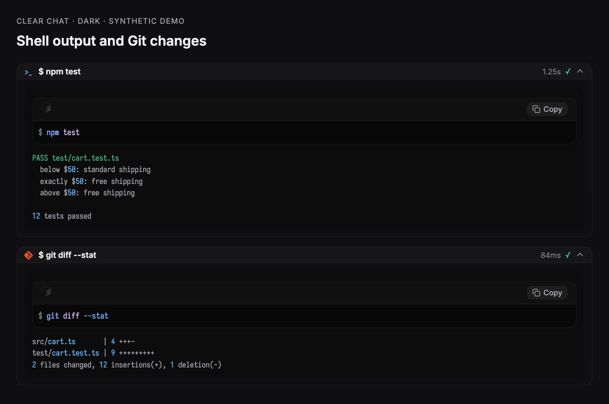

### Read

The file's own language logo, a wrapped path, line numbers, and a copy button. The path is a link:
pressing it shows the file in the machine's file manager.

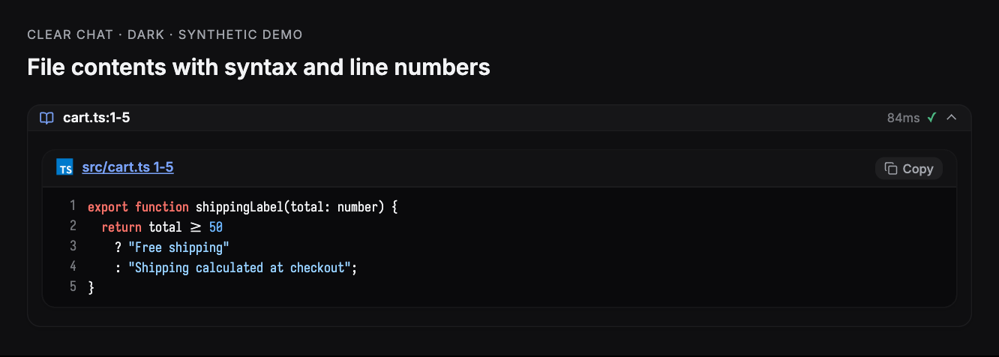

### Images

A read of a `.png` carries no bytes through the timeline, so the host draws it as an empty code
block with a language badge. This card draws the file instead: a picture mark, the path as a link,
the pixel size and file size read from the header, and an eye control that hides the thumbnail. The
bytes come from the plugin's own daemon-side RPC (`file.image`), which is the only side that can
reach the file; PNG, JPEG, GIF, WebP, AVIF, BMP, ICO and SVG are recognised, and anything past
3 MB reports its size rather than inlining a data URI.

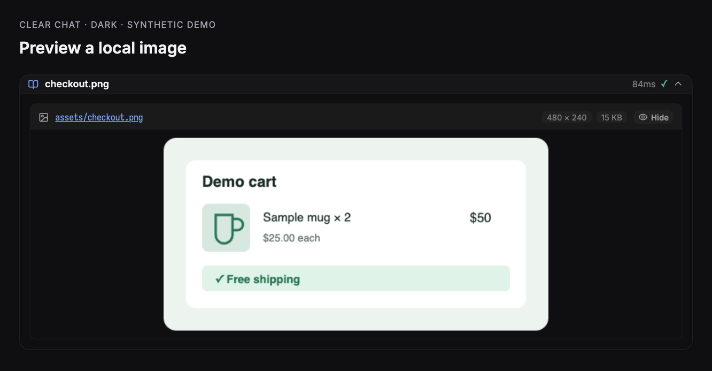

Assistant replies also render Markdown images (``) from absolute HTTP(S)
addresses and `data:image/...` URLs. Images fit the message width and keep their
aspect ratio, including in lists, quotes and table cells. A load or decode failure
shows the alt text and the original address; HTTP(S) addresses open through the
host's link opener, and data addresses can be pressed to copy them. Relative paths,
file URLs and unsupported schemes show the same visible fallback with a copyable
address instead of resolving against the Paseo app's page. Native image format
support still depends on the device; an unsupported format uses the failure fallback.

### Edit

Diff rendering where adjacent removed and added rows join into one rounded block, and only the
marker column carries the red or green.

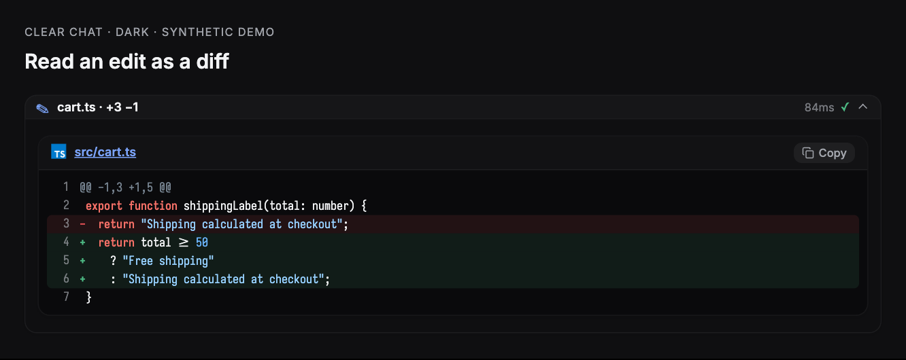

### Reasoning tool

Live thinking text, a token badge, and numbered steps.

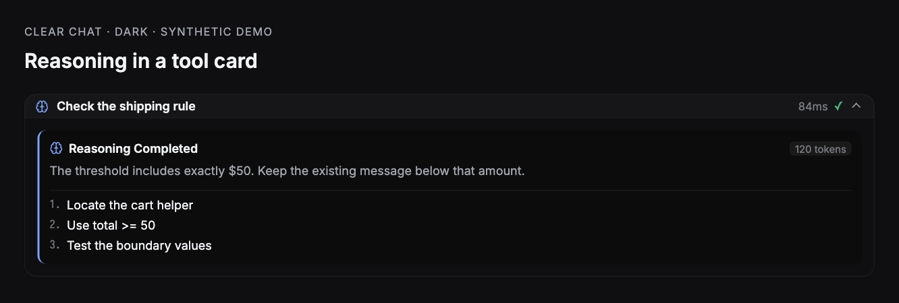

### MCP

Server badge, transport, input parameters, and the response payload, each syntax-highlighted.

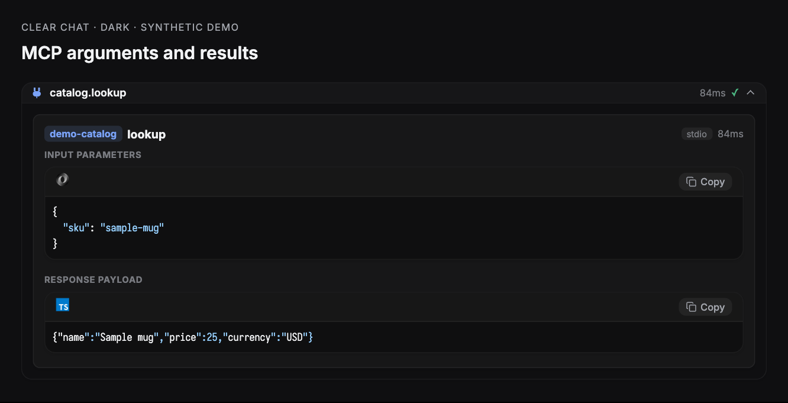

### Eval

One card per kernel cell: the source that ran, then the text it printed.

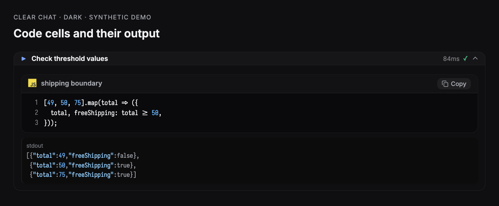

### Ask

Option cards with the recommended badge, the chosen answer marked, and a typed reply labelled as
typed rather than shown as a selection.

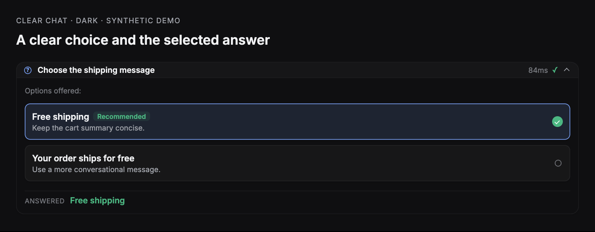

### Task

Subagent name, type, model, and the delegated instructions.
The normalized `sub_agent` card shows the model when reported and labels a
missing model as **Not reported**. Named `task` batches keep their existing roster.

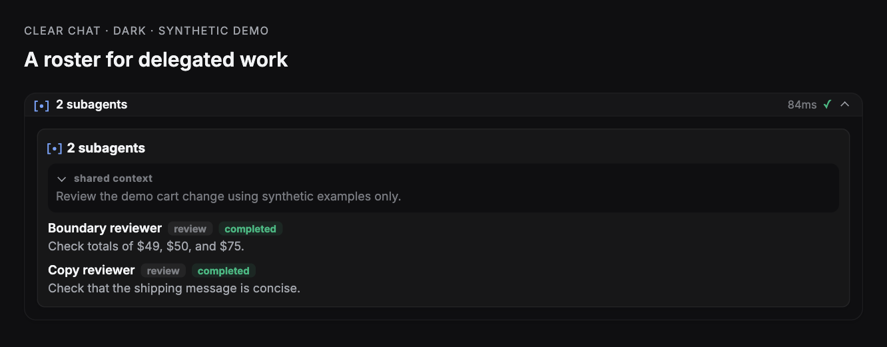

### Search, fetch and web search

Search cards show the query, scope and match count. Each result occupies a
clickable row that reveals its file. Fetch and web search cards show clickable
URLs, titles and the first five lines of available content. Web search results
open through the same platform URL helper used by reply links. Summary rows use
**Search: query** and **web_search: query**, including projected provider calls.
Shell rows show **$ command**, with the provider's display prefix removed.

Tool discovery has its own card. Its row shows **tool_search · browser** for a
browser query, and its expanded body preserves the query and discovery output
with the configured long-output control.

### Plans, checklists and plain text

Plans and todos use the checklist card, including checked, active and blocked
steps. This covers both tool details and independent todo timeline items.
Plain-text tools use the tool's own name as the title and preserve the original
text, including whitespace.

### Skills and other tools

Hermes `skill_view` calls display **Skill: name** without a line range. This also
covers Paseo's projected `read` calls carrying the source tool in `metadata.title`.
Other tools show their real name and a useful argument on the summary row, such as
**memory · add**. Expanded unknown cards list each input as `name: value` and
show a configurable output preview with a control to reveal all lines.

### Hub

Every `hub` op is mapped: `start`, `stop`, `restart`, `ps`, `logs`, and `describe` render the
process card with its launch line, readiness, and recent output; `send`, `wait`, `inbox`, and
`list` render the message card; `jobs` and `cancel` render the job snapshot. The cards report;
they carry no buttons, because a plugin cannot restart or cancel anything.

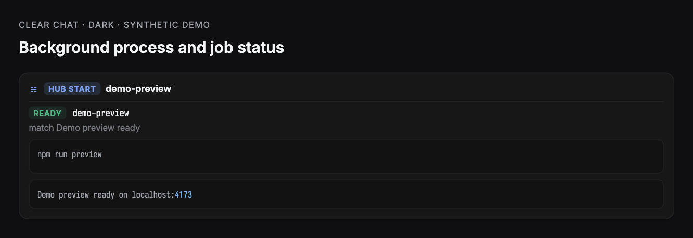

### Paseo tools

Paseo's own mark leads the card, and the created agent's provider carries its brand mark.

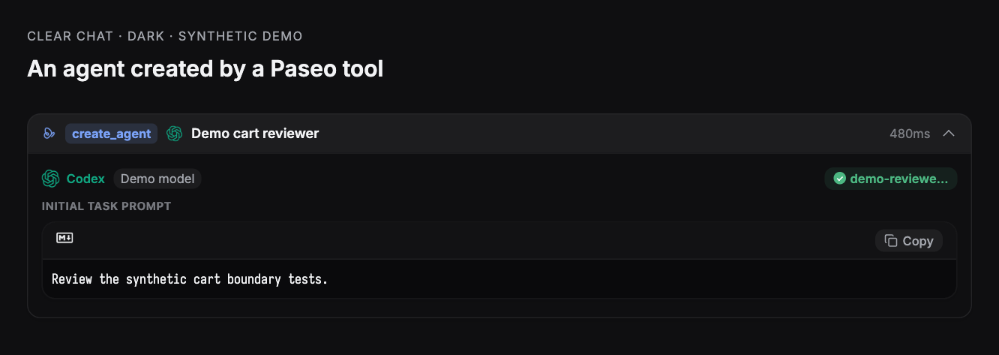

---

## Stream components

### Reasoning trace

A collapsible trace with a connected step rail, per-step duration, and a token total.

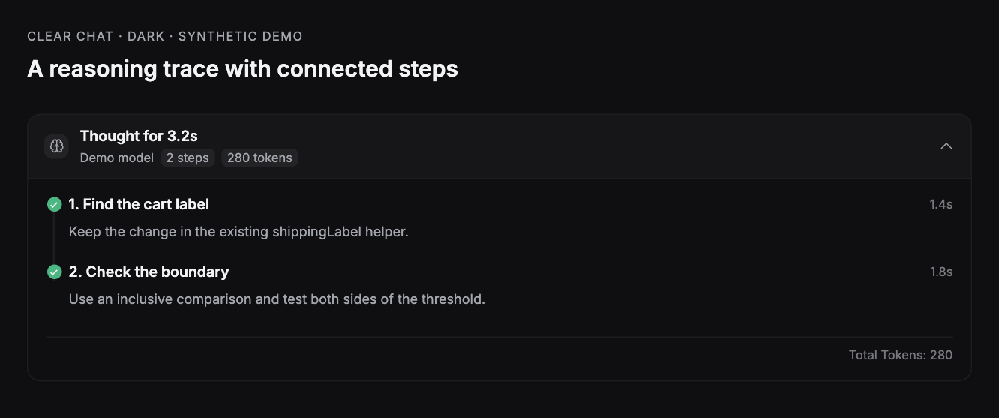

### Checklist

Phase name, per-task status, durations, and a blocked task with its reason.

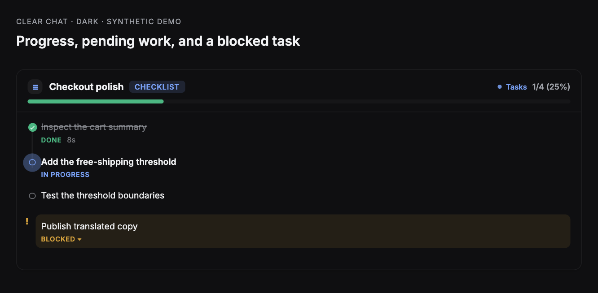

### Approval card

Risk classification, the exact command, target path, working directory, and the approve or deny
actions the host owns.

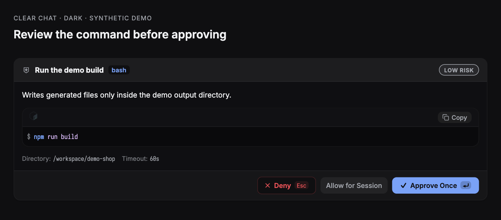

### Prompt bubble

The authored turn on a raised theme surface with a square tail, a copy button, and the turn's token
usage.

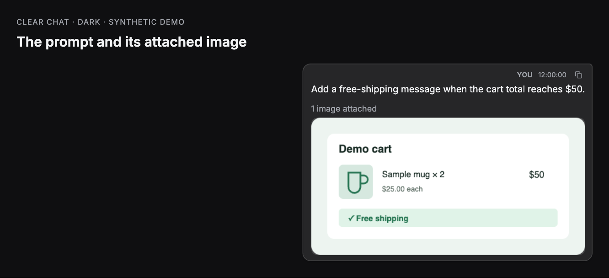

### Syntax block

Shared by every card that shows code: language detection from the path, line numbers, diff tints,
Devicon brand marks, and the file-manager link.

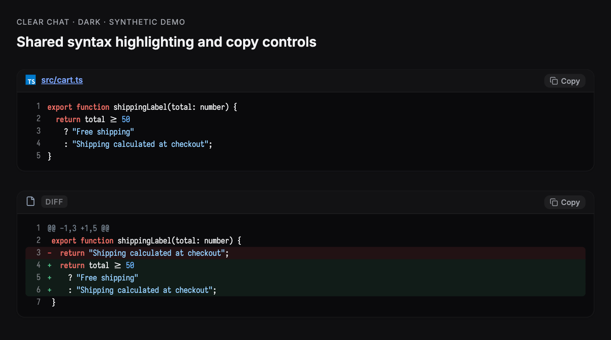

---

## Settings

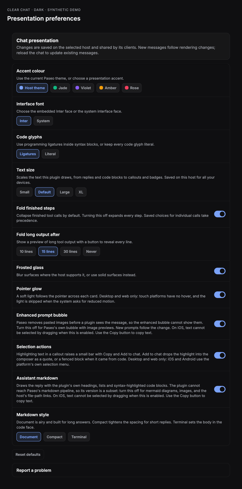

| Setting                | Effect                                                             |
| ---------------------- | ------------------------------------------------------------------ |
| Accent colour          | Follow the Paseo theme, or pick Jade, Violet, Amber, or Rose.      |
| Interface font         | Embedded Inter, or the system interface face.                      |
| Text size              | Small (90%), Default (100%), Large (115%), or XL (130%); icons keep their size. |
| Code glyphs            | Iosevka with ligatures, or literal glyphs.                         |
| Fold finished steps    | On by default. Off expands all steps unless a call has an explicit choice. |
| Fold long output after | 10, 15 (default), 30 lines, or Never. Applies to tool code and output. |
| Frosted glass          | Blur card surfaces, or paint them solid.                           |
| Enhanced prompt bubble | Off hands prompts back to Paseo, whose bubble shows pasted images. |
| Assistant markdown     | Off hands replies back to Paseo's own markdown renderer.           |

**Assistant markdown** and **Enhanced prompt bubble** are enabled by default on every platform.
On iOS and iPadOS, text cannot be selected by dragging when either renderer is enabled. Use the
**Copy** button on the reply, prompt, or code block. Copy uses the host clipboard and shows a
success or failure toast. If automatic copying fails, a dialog shows the full text in a read-only
input: touch and hold it, choose **Select All**, then **Copy**. Explicitly disabling either renderer
still hands that content back to Paseo.

**Text size** changes reply bodies, headings, prompts, footers, code, and card text, including line
heights. It is saved on the selected host and shared by all devices connected to that host.
Text scaling is clamped to 85–135%; the four presets provide common reading sizes. Thanks to
[Moyf's text size contribution in #9](https://github.com/ABorakati/beautiful-chat/pull/9), adapted
here to SDK host settings. Tool folding uses the two controls described above.

Preferences are saved with the plugin SDK on the selected host and shared by clients connected
to that host. Explicit choices override defaults. Existing browser preferences are
imported once when a client with browser storage first loads the host's settings; saved host
choices take precedence. A native client's first load leaves that migration available.
After that, browser storage is ignored, including after **Reset defaults**. Open the existing
web client before editing or resetting settings on native if you want to import its preferences;
an explicit edit or reset makes the SDK settings authoritative immediately.
Folding controls update mounted tool calls immediately. Changes to prompt and assistant renderer
ownership affect new messages; reload the chat to update rows already on screen. While settings
are loading or unavailable, text rows stay with Paseo's renderer. Storage errors appear in the
settings screen; try changing the setting again after the host reconnects.

### Upgrading to Clear Chat

Paseo 0.12's `paseo plugin remove <id>` also deletes
`${PASEO_HOME:-$HOME/.paseo}/plugin-settings/<id>`.
Back up first, install Clear Chat while the old settings still exist, verify the migrated file,
and only then remove Beautiful Chat. The commands below use `PASEO_HOME`, falling back to
`$HOME/.paseo`, and assume the default installation IDs. For a daemon configured only with `--home`,
set `PASEO_HOME` to that path first. Stop if a backup or verification fails.

1. Back up the old host settings and record the backup path for rollback:

   ```bash
   legacy_backup="${PASEO_HOME:-$HOME/.paseo}/backups/plugin-settings-beautiful-chat-$(date +%Y%m%d-%H%M%S)"
   mkdir -p "${PASEO_HOME:-$HOME/.paseo}/backups"
   cp -a "${PASEO_HOME:-$HOME/.paseo}/plugin-settings/beautiful-chat" "$legacy_backup"
   ```

2. Install Clear Chat from the GitHub repository:

   ```bash
   paseo plugin install git:https://github.com/jasonhnd/paseo-clear-chat.git --ref main
   ```

3. Confirm that `${PASEO_HOME:-$HOME/.paseo}/plugin-settings/clear-chat/presentation.json` was
   generated and that Clear Chat loads with the expected settings. For a fresh migration, compare the file with
   `$legacy_backup/presentation.json`; an existing Clear Chat document intentionally wins.
   If the file is missing or settings differ unexpectedly, keep Beautiful Chat and the backup,
   check the migration error log, and resolve the failure before proceeding.

4. Only after verification, uninstall the old plugin:

   ```bash
   paseo plugin remove beautiful-chat
   ```

Keep the backup after removal. Before any rollback, also back up Clear Chat's current settings;
see [Rollback](#rollback) for the pinned version and restoration order.

The first server start copies the previous plugin's `presentation.json` into
`plugin-settings/clear-chat/presentation.json` when the new document is absent. It preserves the
complete SDK envelope, including text size and the browser-import marker. Existing new documents,
including empty or invalid ones, are left untouched. The copy is published atomically without
replacing a destination created concurrently. A filesystem error is logged with both paths and
the original error; settings and RPC registration continue, using SDK defaults when no new
document exists. Migration does not delete or overwrite either document. The old directory stays
available for a later retry after the filesystem issue is resolved; an existing new document
still takes precedence on subsequent starts.

The SDK then upgrades presentation settings from version 1 to version 2, preserving existing
preferences and the browser-import marker. Unset folding preferences use their new defaults.
Expansion choices have a separate host settings document, `tool-expansion.json`; they never use
browser localStorage as their backend.

Paseo keys host settings by **installation ID**, then **settings ID**. `registerSettings` and
`settingsRpc` expose only the current installation's documents, with no directory or cross-plugin
lookup API in the pinned SDK. The server runs in Node and can read the previous directory directly
before registering settings. Migration uses `PASEO_HOME`, falling back to the daemon user's
`~/.paseo`, and assumes the default installation IDs defined in
[`server/settings-migration.ts`](server/settings-migration.ts). An installation with an overridden
`--id`, or a custom daemon home supplied only through `--home` without `PASEO_HOME`, cannot be
located through this SDK; its settings need to be copied to the corresponding installation's
directory separately.

On the first browser load, an absent `paseo/clear-chat/preferences/v1` key is copied from the legacy
key defined in [`client/preferences.ts`](client/preferences.ts). An observed existing new key takes
precedence, even if empty or invalid. This copy also runs when saved host settings are already
authoritative, without changing those host settings. Failed browser copies leave the host import
marker available for a later attempt. Native clients without localStorage continue to use host
settings and leave browser import available as described above.
The browser check and copy are best effort: localStorage has no cross-tab compare-and-swap,
so concurrent first writes can race. Saved host settings remain authoritative.

The migrations themselves retain the original data for rollback; uninstalling a plugin can delete
its host settings, so keep the backups described above. These are independent snapshots; later
changes in Clear Chat are saved through the host SDK and do not sync back to the previous plugin.

### Rollback

Paseo 0.12 removes an installation's settings directory together with the plugin. Before removing
Clear Chat, back up its current settings and keep the Beautiful Chat backup recorded during the
[upgrade](#upgrading-to-clear-chat). These commands use `PASEO_HOME`, falling back to
`$HOME/.paseo`. For a daemon configured only with `--home`, set `PASEO_HOME` to that path first.
Stop if the backup fails.

```bash
clear_chat_backup="${PASEO_HOME:-$HOME/.paseo}/backups/plugin-settings-clear-chat-$(date +%Y%m%d-%H%M%S)"
mkdir -p "${PASEO_HOME:-$HOME/.paseo}/backups"
cp -a "${PASEO_HOME:-$HOME/.paseo}/plugin-settings/clear-chat" "$clear_chat_backup"
```

After confirming the backup, uninstall Clear Chat:

```bash
paseo plugin remove clear-chat
```

If Beautiful Chat's settings directory was deleted during upgrade, restore its saved snapshot
before installing the pinned old version. Replace `YYYYMMDD-HHMMSS` with the actual upgrade
backup timestamp. Do not overwrite an existing settings directory; if it already exists, keep it
and skip this restore step. Verify the restored `presentation.json` before continuing.

```bash
legacy_backup="${PASEO_HOME:-$HOME/.paseo}/backups/plugin-settings-beautiful-chat-YYYYMMDD-HHMMSS"
test ! -e "${PASEO_HOME:-$HOME/.paseo}/plugin-settings/beautiful-chat" &&
  cp -a "$legacy_backup" "${PASEO_HOME:-$HOME/.paseo}/plugin-settings/beautiful-chat"
```

Then install the pinned Beautiful Chat version:

```bash
paseo plugin install git:https://github.com/jasonhnd/paseo-clear-chat.git --ref 2bf25e8
```

Migration itself keeps the old host settings and browser key untouched; plugin removal deletes
the host settings unless backed up separately. Later Clear Chat edits do not sync back to the
Beautiful Chat snapshot. Keep both backups to preserve those newer choices.

---

## Finding text

Paseo's own chat find (Ctrl/Cmd+F) cannot reach a prompt or reply this plugin draws (see
[limitation 14](#plugin-sdk-limitations-found-while-building-this)). The plugin therefore takes
Ctrl/Cmd+F on desktop and web and opens its own find bar over the chat. The bar searches
everything the chat has rendered, including tool cards. Enter moves to the next match, Shift+Enter
to the previous one, and Escape closes the bar.

The bar searches only messages the chat has loaded. Scroll up first to include older history.

To keep Paseo's native search, which also searches unloaded history, turn off **Assistant
markdown** and **Enhanced prompt bubble** in **Settings -> Plugins -> Clear Chat**. Paseo then
draws replies and prompts itself, and Ctrl/Cmd+F opens Paseo's find instead of the plugin's bar.
New messages follow the change.
Tool, reasoning, and checklist cards keep the plugin's styling, so Paseo's find still cannot reveal a
match inside one of them.

## Opening files

A file name in a read, write, edit, or code block is a link. Pressing it calls the plugin's own
daemon-side RPC (`file.reveal`), which resolves the path against the agent's working directory and
asks the platform shell to show it:

| Platform | Behaviour                                              |
| -------- | ------------------------------------------------------ |
| Windows  | `explorer.exe /select,<file>` selects the file.        |
| macOS    | `open -R <file>` selects the file in Finder.           |
| Other    | `xdg-open <directory>` opens the containing directory. |

A directory path opens that directory. A path the daemon cannot stat does nothing.

## Unmapped output

A tool the plugin has no typed adapter for uses the parameter table described
above. Structured output and multiple text blocks are preserved in its preview.
When input and output are empty, the tool name and status remain visible and the
expanded body reports that no output was returned. Failed calls keep their error
visible, and canceled calls retain their canceled status.

All thirteen tool categories have automated component coverage: shell, read, edit,
write, search, fetch, web search, tool discovery, subagent, plan, todo, plain text
and unknown. The [replay fixtures](test/fixtures/README.md) document two sanitized
real timelines and additional synthetic Hermes, Claude and Codex samples. Each
real timeline must have zero empty cards and at most five percent generic calls;
plain-text and unknown cards both count toward that budget. Replays also exercise
assistant replies and explicit wrap-up replies through the real Markdown renderer.

The link cannot open Paseo's own file editor: see the first limitation below.

---

## Plugin SDK limitations found while building this

Measured against `@getpaseo/plugin` 0.8.0 and the Paseo 0.8.0 desktop build. Each entry names the
evidence and the workaround this plugin uses.

1. **No file navigation.** Timeline renderer props are exactly `{agentId, theme, host, layout,
timestamp, item}`, and plugin navigation offers only `openSettings`, `openSurface`,
   `openWorkspacePanel`, `openAgentPanel`, `openAgent`, and `openWorkspace`. The host's own file tab
   target (`{kind:"file", path}`, reachable in-app through `?open=file:<path>`) is not exposed, and
   the `paseo://` scheme only carries agent deep links. Workaround: a daemon-side RPC that reveals
   the path in the operating system's file manager.
2. **Transformers see a stripped item.** The app maps its stream item to the plugin item before any
   transformer runs, and a user message keeps only `text`, `messageId`, and `clientMessageId`. Pasted
   images never reach plugin code, and the daemon timeline row stores the same item, so a server RPC
   cannot recover them either. Workaround: the **Enhanced prompt bubble** setting returns prompts to
   the host.
3. **Interception is all or nothing.** A transformer replaces the host item completely. There is no
   way to decorate an item or keep host affordances that the plugin does not reimplement. Returning
   `undefined` is the only opt-out.
4. **Transform results are cached per item.** Changing a preference does not re-run transformers for
   items already on screen. New items follow the change; existing ones need a reload.
5. **Renderers get no workspace.** Props carry `agentId` only, so `cwd` and `workspaceId` need a
   second lookup through `useAgent`.
6. **Token usage is live-only.** Usage is not persisted on timeline items, so a turn this client did
   not observe live shows no figures.
7. **RPC names are validated late.** The host requires `^[a-z][a-z0-9._-]*$`. A camelCase name such
   as `revealPath` typechecks, then fails the whole plugin at install or reload with
   `Invalid plugin RPC method`.
8. **The React Native runtime module is a stub in the package.** `@getpaseo/plugin/client/react-native`
   ships as `export {}`; the host injects the implementations. Bundling or testing plugin UI outside
   Paseo needs a shim, which is what `.showcase/shims` provides.
9. **The theme carries six colours.** `PluginTheme` exposes `surface0`–`surface2`, `border`,
   `foreground`, `foregroundMuted`, `accent`, `accentForeground`, and three status colours. Every
   other surface, including code backgrounds and diff tints, must be derived with alpha; that is what
   `client/components/theme-tokens.ts` exists for.
10. **No CSS escape hatch.** React Native styles drop unknown keys, so `backdrop-filter` is
    impossible through the style API. Frosted glass is a hand-injected `<style>` rule matched by a
    data attribute.
11. **No font registration.** Faces are embedded as data URIs in an injected `@font-face` rule, and
    every surface needs a wrapper that escapes the host's own font cascade.
12. **A closed module allowlist, and no SVG renderer.** Plugin client code may import only
    `react`, `react/jsx-runtime`, `react-native`, `@tanstack/react-query`, `zod`,
    `@getpaseo/plugin`, `@getpaseo/plugin/client`, `@getpaseo/plugin/client/react-native`, and
    `@getpaseo/plugin/client/ui`. Anything else throws
    `Module "x" is not available in plugin client code` when the bundle loads, so
    `react-native-svg` and `lucide-react-native` are out of reach. Lucide icons still work,
    because the host renders them: `Icon` from `@getpaseo/plugin/client/react-native` takes any
    Lucide name. Brand marks are not in Lucide, and React Native's `<Image>` decodes PNG, JPEG,
    GIF, and WebP but never SVG, so a data-URI SVG renders on web and stays blank on iOS and
    Android. Those marks ship as PNG rasters in `client/components/mark-bitmaps.ts`.
13. **Settings are host-scoped only.** `defineSettings` rejects any scope other than `host`, so
    per-workspace or per-agent presentation settings are impossible. This plugin stores explicit
    presentation choices with the SDK's host settings; unset choices use the plugin defaults.
14. **Paseo's chat find cannot reach replaced rows.** Paseo 0.9.1 finds a match by its original
    message id, then waits for a row carrying that id. A transformed row always carries
    `<pluginId>/<itemId>` instead, so Ctrl+F on a styled prompt or reply never reveals the match.
    Workaround: the plugin's own find bar, described in [Finding text](#finding-text).
15. **No timeline gap or neighbor props.** In the pinned SDK, `layout` exposes only
    `compact` (the device breakpoint) and `platform`; transform results expose only
    replacement items. The [v0.8 host spacing rules](https://github.com/getpaseo/paseo/blob/v0.8.0/packages/app/src/agent-stream/spacing.ts)
    give transformed `plugin` rows the default 16px gap, unlike native tool sequences.
    The web workaround reads the existing history row/frame DOM and adjusts only
    the plugin root between collapsed tools. Unknown layouts, nonconsecutive
    virtual rows and native apps keep host spacing. Controlling those gaps requires
    a host API that supplies the actual gap and adjacent item types.

---

## Project structure

```text
clear-chat/
  paseo-plugin.json          # Manifest: id and Paseo requirement
  index.client.tsx           # Timeline transformers, renderers, settings screen
  index.server.ts            # Host settings migration/registration and daemon-side RPCs
  server/
    settings-migration.ts    # First-run copy of the previous installation's host settings
  shared/
    contracts.ts             # Data contracts shared by client and server
    file-rpc.ts              # file.reveal contract
  client/
    live-renderers.tsx       # Timeline item to component mapping
    tool-call-data.ts        # Normalized tool details to card data
    tool-detail.ts           # Search, fetch, checklist and fallback extraction
    tool-call-legacy.ts      # Existing named-tool adapters
    settings-page.tsx        # Settings screen
    preferences.ts           # Presentation preferences backed by host settings
    components/              # Cards, syntax block, glyphs, motion, theme tokens
      mark-bitmaps.ts        # GENERATED PNG rasters of every brand mark
      devicon-data.ts        # Vendor SVG sources, read only by the generator
      lobe-marks.ts          # Vendor SVG sources, read only by the generator
  .showcase/                 # Offline harness used to capture the screenshots
  docs/images/               # Screenshots in this README
```

## Development

```bash
npm install
npm test
npm run typecheck
paseo plugin reload clear-chat
```

Rebuild the screenshots after a visual change:

```bash
esbuild .showcase/showcase.tsx --bundle --outfile=.showcase/showcase.js --jsx=automatic \
  --alias:react-native=react-native-web \
  --alias:@getpaseo/plugin/client/react-native=./.showcase/shims/plugin-react-native.tsx
```

Then serve `.showcase/` and capture each `#shot-*` element.

## License

MIT
