<p align="right"><a href="README.md">English</a> | <b>简体中文</b> | <a href="README.ja.md">日本語</a></p>

<p align="center">
  
</p>

<h1 align="center">Clear Chat</h1>

<p align="center">Clear Chat 是 <a href="https://paseo.sh">Paseo</a> 的插件。它保留回答卡片：回复里有字母选项题时，用卡片选题或自己写答案，预览后发送。这一版把 <b>我说的话</b> 改成按天查看的日历。每一行仍有 <b>复制</b> 和 <b>引用</b>，点一行会打开对话。Clear Chat 不绘制对话。对话显示请用另一个插件 <a href="https://paseo.sh/plugins/roundreddot/better-paseo">Better Paseo</a>。</p>

<p align="center">
  <a href="https://github.com/jasonhnd/paseo-clear-chat/releases"></a>
  <a href="LICENSE"></a>
  <a href="https://paseo.sh"></a>
</p>

## 这一版

Clear Chat 0.18.1.2 跟上 Paseo 0.18.1：版本号前三段就是这一版对应的 Paseo 版本，第四段数的是 Clear Chat 在该 Paseo 版本上的第几次发布。这是该宿主版本上的第二次发布。**我说的话** 现在是日历，仍从左边栏原来的那一行打开，默认停在今天。有消息的日子按主题色分四档，图例是 **少** / **多**，气泡类似「11月25日 周三 · 41 条」。气泡是一张实心卡片：深色主题下比页面再深一档，浅色主题下是白底深字，带一圈细边、一层柔和阴影，卡片下面一个小三角始终指着那一格；字比格子里的字大一号，一行写完。方向键移动高亮，回车选中那一天，**T** 回到今天。选中的日子仍用自己那一档的颜色，格子内侧有一道细圈，圈和色块之间留一条细缝。今天的日期是粗体，下面有一个小圆点。键盘高亮是格子外面的虚线框，只有用键盘时才出现，鼠标或触屏按下不出现。点月份标题看十二个月。每个月显示简称，不重复年份；气泡和读屏仍是带年份的全称。气泡夹在网格的左右边里面。12 月再往后是下一年的 1 月。屏幕本来就是窄的时候，先显示选中日所在的一周。在宽屏打开日历后再把窗口缩窄，周条不会自己收起，展开的整月还在，要点 **▾**。点某一天列出那天你打过的话。日历下面有 **本月小结**：本月多少条、有消息的天数、最多的一天和日均，还有本月常聊的五个对话；点一个只显示那一天那个对话的消息，再点一次取消，列表上方有一条写着正在只看哪个对话。宽屏左栏往下滚时日历留在顶上，只有小结和排行跟着滚；窄屏时这块在周条或整月与消息列表之间。**引用** 保留草稿，接在整段草稿后面，中间空一行。上一版会把引用紧贴在草稿后面、没有换行。已在 Paseo 0.18.1 上验证。没有消息的日子和月份是中性底色，停在「少」的一端。每个格子的数字用读得更清楚的那种字色。390 宽时头部箭头是 44×44。已经读过的消息会留一份在本机，Hermes 之后删掉对话，这一天还可以在。这一版只直接读 Hermes，其他 provider 的对话点开那天才补上。宿主答不上历史调用时，整页仍是以前只看今天的那一页。回答卡片没有变，也没有新的设置。最低宿主仍是 Paseo 0.16.0。限制写在[已知限制](#已知限制)。

完整改动见 [变更记录](CHANGELOG.md)。

## 回答卡片

有字母选项题的回复生成完之后，输入框上方会出现一个按钮。按钮上带着进度，例如 **回答 0/2**。桌面上鼠标停在上面能看到完整名称 **回答卡片 · 已答 0/2**；窄屏上点开的面板标题就是这个名字。点它把整张卡片打开成面板；窄屏上是从底部升起的面板。桌面面板里，题目区在卡片内滚动，进度行和 **发送** 固定在底部同一行，不用滚动面板就能看到 **发送**。在面板里选好答案，按卡片上的 **发送**：消息像你亲手发的一样进到这个对话，输入框里正在写的内容不受影响。每答一题，按钮上的数字跟着变（**回答 1/2**）；关掉面板再打开，答案还在；发送之后按钮消失，等下一段有字母选项题的回复完成后再出现。已经答了一部分时发一条普通消息，按钮仍然留在输入框上方带着进度；点开卡片就是 **继续作答**，按下去存下的草稿就回来了。按钮只属于当前对话：换到别的对话，显示的是那个对话自己的卡片，没有就不显示。

<p align="center">
  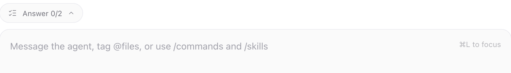
  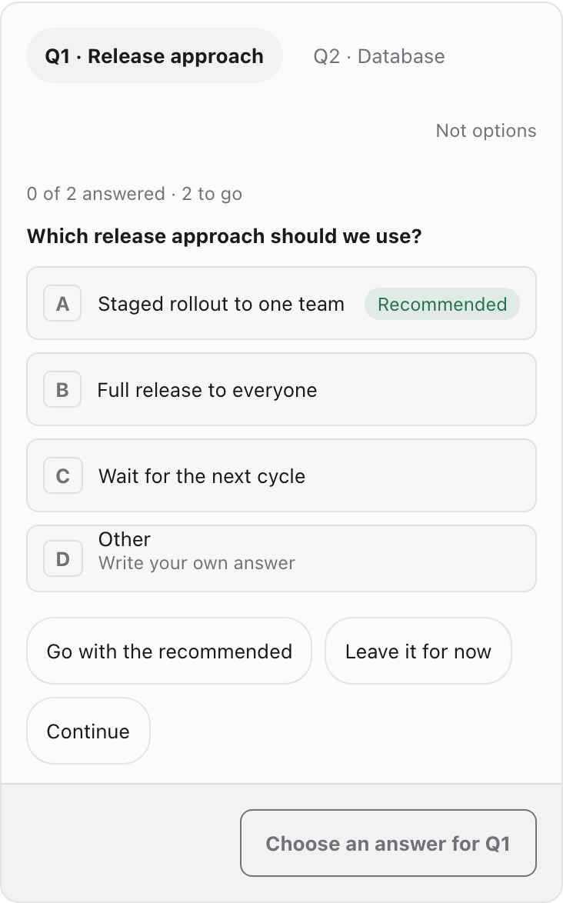
  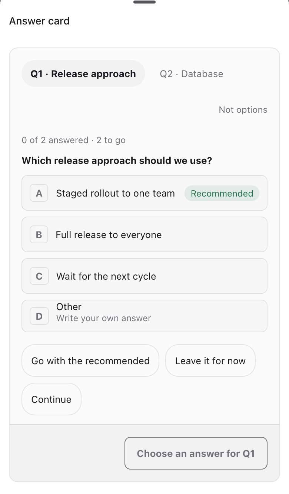
</p>

打开 **Settings → Plugins → Clear Chat**。页面主标题是 **Clear Chat**，第一张设置卡的标题是 **回答卡片**。设置文件里没有存过开关时，**在包含字母选项问题的回复下显示回答卡片** 是开的。已经存过的开或关仍然有效。开关下面的说明是：重新加载聊天以更新现有回复。

卡片本身的操作如下。

回复要同时满足这些条件才会被认成题：有编号的问题，每题至少两个字母选项（`A`–`H`，也包括全角 `Ａ`–`Ｈ`），并且有推荐标记，或有「reply with」「answer with」这类要求简短作答的提示。代码块和引用里的行不看。同一题里字母必须往前排（`A` 然后 `C` 可以；`B` 然后 `A` 不行）。`（推荐）` 或 `(recommended)` 会认出来；「not recommended」和 `不推荐` 不会。选项下面单独一行、只点一个选项（这一行没有别的字）的推荐，例如 `Recommended: A`、`推荐：A`、`おすすめ：A`，会标出这个选项，不算进上面那个选项；标记可以带句号，也可以加粗。日文的标记后面要有冒号或空格。像 `不推荐：A` 这样的一行不会被当成推荐，这一行按普通文字保留。

1. 点一个选项；焦点在卡片里时也可以按对应字母。还可以用 **↑/↓** 移动，按 **Enter** 选定。在 Paseo 输入框里按的键仍归输入框。
2. 答完一道还没答的题，会到下一道还没答的题。最后一道选定后，焦点到 **发送**。没答齐时，**发送** 会标出还缺哪一题，并且不能按。
3. 题签显示问题的短名。不是当前题、但已经答过的题签显示 `✓` 和答案。改一道已经答过的题时，停在这一题。
4. 要自己写，选 **自己写**。**Enter** 确认并往后走，**Shift+Enter** 换行。输入法选字不会确认。空着会提示先写答案。
5. **发送** 显示字母索引，例如 `1B 2A`。自己写的答案按你确认的文字放进消息。桌面面板里，自己写的答案在底栏上方最多预览两行：第一行是完整的答案编号，第二行是第一个自己写的答案的开头；发出的消息仍保留完整答案。发送成功后按钮消失，卡片不再显示；对话里那条消息（例如 `1B 2A`）就是你的回答。
6. 普通列表被误认成题时，点 **不是选项**。这条回复在重新加载后仍保持收起。发送过程中没有这个按钮。
7. 在设置页编辑的常用回答，会在卡片上变成按钮。桌面面板里它们在选项下面，跟着题目一起滚动。点一下把短语插到光标处，不会发送。

句子里单独出现的一个字母不当成答案，例如 “wait a moment”。带编号的记号仍然算，例如 `1A`、`2b`、`Q1A`，旁边有标点也算（`1A.`）。整条消息就是答案时不变，包括只有一道题、整条消息是 `b` 的情况。`Plan 2B` 这样的消息仍可能被当成答案。

## 我说的话

**我说的话** 按天列出你在本机各对话里打过的消息。它是左边栏头部一行打开的整页，打开时停在今天。选中那天的每一行都有 **复制** 和 **引用**，点一行会打开那条消息所在的对话。宿主没有客户端导航时，点一行是复制。宿主答不上历史调用时，整页仍是以前只看今天的那一页。

### 月视图

宽屏一边是整月，另一边是选中那天。格子从周一开始。没有消息的日子是中性底色，停在「少」的一端：深色主题比第一档更暗，浅色主题比第一档更浅。有消息的日子用宿主强调色分四档，档位按全部历史计算，不是只看屏幕上这个月。图例是 **少** / **多**。停在格子上的气泡类似 `11月25日 周三 · 41 条`（英文界面上见过 `Jan 14 Wed · 1 message`）。气泡夹在网格的左右边里面，靠左第二列和靠右第二列也不会伸出卡片。气泡是实心卡片，带一圈细边、一层柔和阴影，卡片下的小三角始终指着那一格，字比格子里的字大一号、一行写完；浅色主题下是白底深字。方向键一天一天或一周一周移动高亮，可以进到上个月或下个月。回车选中高亮的那一天。**T** 选中今天。按方向键时，选中的那一天先不动。键盘高亮是格子外面的虚线框，只有用键盘时才出现（方向键、回车、空格、**T**，或用 Tab 进到格子里）。鼠标或触屏按下不出现。选中的日子仍用自己那一档的颜色。格子内侧有一道细圈，圈和色块之间留一条页面颜色的细缝。今天不是方框：日期是粗体，下面有一个小圆点。

**‹** / **›** 换月，12 月的下一个月是下一年的 1 月。**今天** 回到今天。**刷新** 再读一次。

点月份标题（例如 **2026年11月**）进入年视图：十二个月，宽屏四列，窄屏两列。每个月显示简称和总数，同样四档上色。简称不重复年份：英文是 Jan、Feb 这样，简体中文和日文是「1月」「2月」这样。同一行一样高。气泡和读屏仍是带年份的全称。最早有记录之前的月份，以及当前月之后的月份，变暗并且点不开。这中间没有消息的月份是中性底色，仍可以点开。气泡类似 `2026年10月 · 18 条`。正在看的月份仍用自己那一档的颜色，内侧同样有一道细圈和一条细缝。翻到别的年份时，不会把这道圈留在同序号的月份上。回车进入那个月。

屏幕本来就是窄的时候，只显示选中日所在的一周。**▾** 展开整月，点某一天后收回。在宽屏打开日历后再把窗口缩窄，周条不会自己收起，展开的整月还在，要点 **▾**。头部箭头按周移动，停在最早一天和今天。列表不会横向溢出。

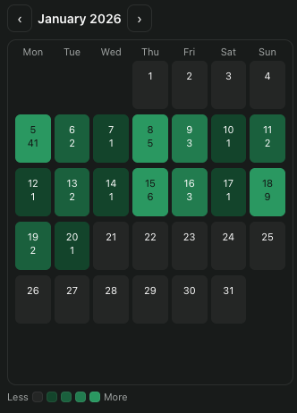

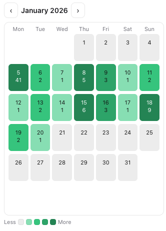

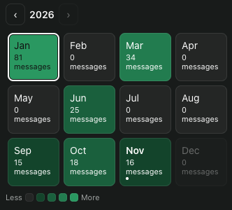

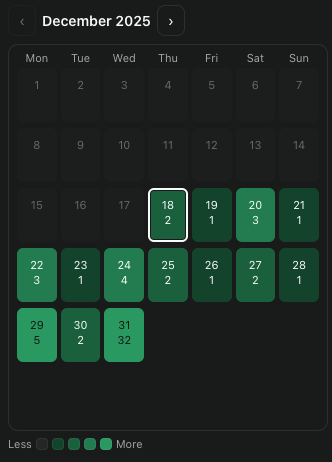

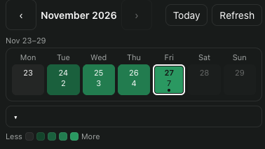

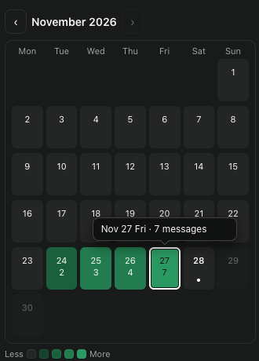

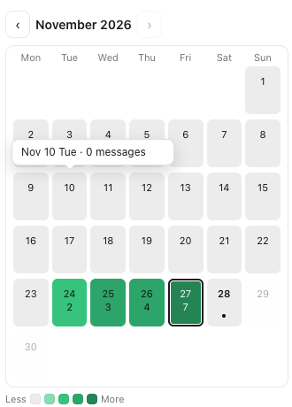

### 本月小结

日历下面那一块数的是屏幕上这个月的东西：`消息数`、`有消息的天数`、`最多的一天`（带那天的条数）和 `日均`。日均在当月按已经过去的天数除，在已经结束的月份按整月天数除。最多的一天并列时写较早的日期。翻到别的月份时，标题换成那个月自己的名字，数字也换成那个月的。

`本月常聊的对话` 按这个月的条数列出最多五个对话，条数相同按最近说话在前。点一个，右边列表只显示那一天那个对话的消息：那一行留一道描边和底色，列表上方一条写着 `只看：<对话名> · 清除`。再点这一行，或点那条，就显示全部对话。换月会清掉筛选。选中的那天那个对话没有消息时，列表显示 `这一天这个对话没有你的消息`。

宽屏左栏固定 320 宽，日历和图例留在顶上，只有小结和排行在下面滚。窄屏时这一块在周条或整月与消息列表之间：四个数折成两行两列，五个对话是一行可以横滑的标签，列表不会被挤掉。

读不到部分对话、对话目录本身不全、某天从时间线补进了快读没有的行，或宿主没有回答按对话的条数时，小结和排行都会显示 `有些对话没读全，这些数字和排行可能不全。` 真机上大多数对话不在 Hermes 库里，所以这一行会常驻。

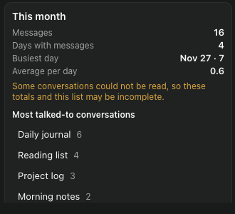

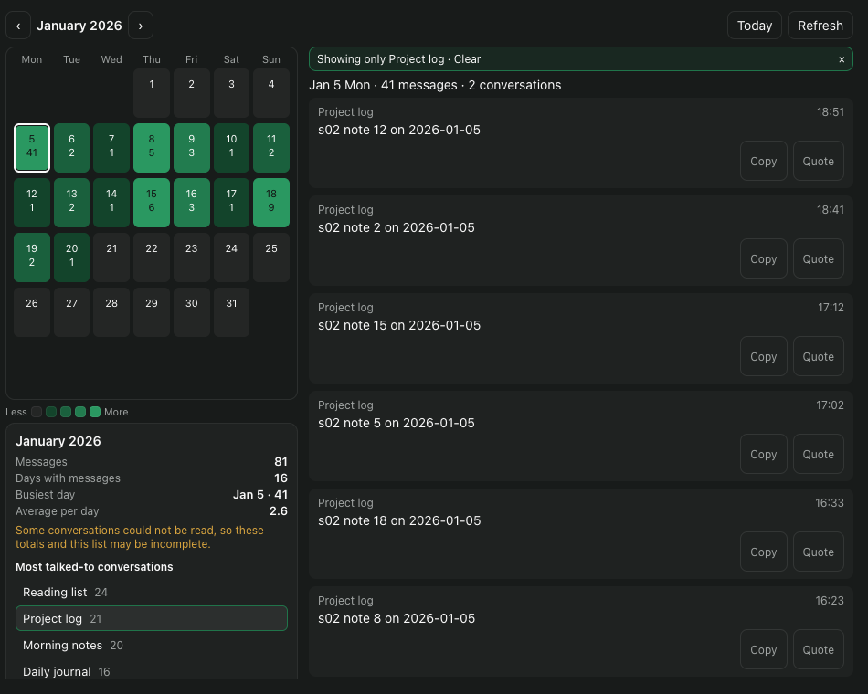

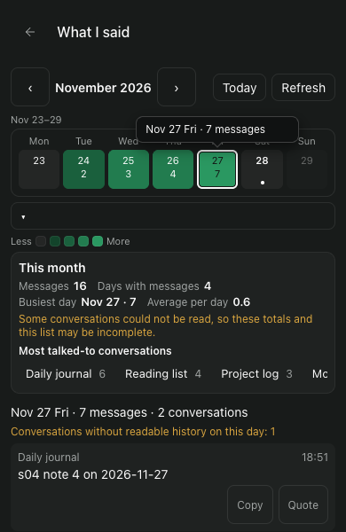

### 选中的那一天

标题类似 `11月25日 周三 · 41 条 · 9 个对话`，今天是 `今天 · 11月27日 周五`。每一行是对话名、本地时刻、最多三行正文。点一行在同一台宿主打开那个对话。**复制** 复制消息并提示「已复制」。**引用** 保留那个对话里已有的草稿，把引用接在整段草稿后面，中间空一行。草稿是空的就只有引用。引用不插在光标处。引用本身每行前面加 `> `，消息里的空行变成 `>`，末尾留一个空行。对话没有输入框时，**引用** 打开对话并复制引用，提示「无法将引用插入此对话，已复制引用」。没有文字的消息会说明不能复制或不能引用。已在 Paseo 0.18.1 上验证。这一天没有消息时显示「这天没有发过消息」。读取中显示「正在读取这一天…」。

这一版只直接读 Hermes。其他 provider 的对话，点开那天才从时间线补上。没点开之前，当天格子和月、年总数可以不含它们。

有对话没读全时，会显示「有对话没能读全，部分条数可能不准。」某一天也可以显示「这天有 N 个对话读不到历史。」更早的原文没留下时，会显示「有些旧日子只保留了条数，原文已经不在了。」

日子按页面所在时区计算。同一条消息在不同时区可能落在不同的日期。

## 安装

Clear Chat 0.18.1.2 需要 Paseo 0.16.0 或更新。在 Paseo 0.15.x 上这一版无法正常安装或运行，请留在 Clear Chat 0.15.4.x。这一版的浏览器和桌面 app 检查跑在 Paseo 0.18.1 上。没有在 Paseo 0.16.x、0.17.1、0.17.2、0.17.3、0.17.4 上检查。安装命令没有在 Paseo 0.16.x 上检查过。在 Paseo 0.18.1 上查的是新气泡的六个位置（月中间、最左列、最右列、年视图、浅色、390 宽周条）：都是不透明卡片、有阴影、一行字、三角对着那一格；本月小结在 2026 年 11 月、2026 年 1 月、2025 年 12 月三个月与格子合计逐项一致；排行和筛选在 1 月 5 日查过；左栏滚动时日历留在顶上；390 宽时小结在周条下面，列表仍然可见。**引用** 在 Paseo 0.18.1 上留下草稿，中间空一行再接引用。每个格子的数字用读得更清楚的那种字色，每一档至少 4.5 比 1（最低 4.66 比 1）。390 宽的头部箭头是 44×44。没有消息的日格和月格是中性底色。早一轮在 Paseo 0.18.1 上，从时间线补上的那一天，**引用** 查了今天和 1 月 14 日：空草稿、留下的草稿、末尾一个换行、末尾已经空一行。都是草稿还在，空一行，再接引用。光标在草稿中间时，引用仍在末尾。在 Paseo 0.18.1 上，已归档的对话上查过：**引用** 打开对话并复制引用，英文界面的提示是 `Can't insert into this conversation — quote copied`。简体中文和日文标签在早几轮的 Paseo 0.17.5 和 Paseo 0.18.0 上读过；这一版把同样的 12 个 key 加进了三份语言文件。回答卡片不在这次检查里。Paseo 0.18.1 桌面 app 在隔离实例上查过：设置页列出了 Clear Chat，侧栏那一行能打开整页，左栏小结、气泡和控制台都看过。控制台没有插件报错。详见下文。

```bash
paseo plugin install git:jasonhnd/paseo-clear-chat --ref v0.18.1.2
```

安装会在 daemon 主机上运行 `npm ci --include=dev --ignore-scripts`，所以那台机器要有 Node.js 和 npm，并且能连到 npm 仓库。

把已经安装的 Clear Chat 更新到这一版：

```bash
paseo plugin update clear-chat --ref v0.18.1.2 --yes
```

打开 **Settings → Plugins → Clear Chat**，看 **回答卡片** 卡片里的版本行。从目录安装时会沿用该目录里已有的版本信息，因此可能显示旧版本。构建里没有可用版本时，这一行显示 **未知**。

> [!IMPORTANT]
> 已经在用 Beautiful Chat？安装或卸载任何插件**之前**，请先看[从 Beautiful Chat 升级](#从-beautiful-chat-升级)。在 Paseo 里卸载插件，会连它的设置一起删掉。

<details>
<summary><b>旧版 Paseo（0.13 / 0.12），以及版本号怎么看</b></summary>

还在用 Paseo 0.13？Clear Chat 0.13.2.2 已经发布，并声明支持 Paseo 0.13.0 或更新版本。下面这条安装命令尚未在 Paseo 0.13 上实测：

```bash
paseo plugin install git:jasonhnd/paseo-clear-chat --ref v0.13.2.2
```

如果已经安装 Clear Chat，下方是拟使用的指定旧版命令。**这次切换及其对设置的影响尚未在 Paseo 0.13 上实测；从新版切回旧版也尚未验证。**

```bash
paseo plugin update clear-chat --ref v0.13.2.2 --yes
```

还在用 Paseo 0.12 的，请改装 Clear Chat 0.12.0.1：

```bash
paseo plugin install git:jasonhnd/paseo-clear-chat --ref v0.12.0.1
```

如果已经装着 Clear Chat，`install` 会停下并提示 `Plugin ID clear-chat is already configured`。这时请改用 `update` 换版本，设置会保留：

```bash
paseo plugin update clear-chat --ref v0.12.0.1 --yes
```

Clear Chat 的版本号是它所对应的 Paseo 版本，再加一位，表示在这个 Paseo 版本上是第几次发布。例如 0.13.0.1 是对应 Paseo 0.13.0 的第一个版本，0.13.0.2 是第二个。Paseo 出了新版本，Clear Chat 没有新东西就不跟着发。1.0.0 和 1.0.1 是定这个规则之前发的，0.12.0.1 比它们都新。

</details>

## 升级与回退

```bash
paseo plugin update clear-chat --ref v0.18.1.2 --yes
```

升级会保留设置文件。回答卡片、常用回答、被收起的误认，以及没写完的草稿都会留下。存下来的草稿里，坏掉的、旧形状的、或形状不认识的记录会在读取设置时被忽略（这条记录留在文件里，等下一次写入设置才消失）；其它草稿和你的偏好照常读出来，设置页也不会再因为这一条把整个文件报成无效。这一版不再显示的功能，它们的键还在文件里，设置页上没有对应控件。退回更早的 ref 一般也保留文件，但某一次回退对设置的影响没有保证，设置重要的话先备份。升级后，宿主能回答历史调用时，**我说的话** 是日历。退回上一版会保留设置，整页退回只看今天。**复制** 和 **引用** 还在，因为那一版已经有。头部按钮和对话旁边的面板不会回来，那一版也不读这一版写下的存档。退回比 0.17.4.1 更早的版本，存下的选项还在，但那一版会忽略 `resumed: true`，点过 **继续作答** 的卡片刷新后要再点一次 **继续作答**；如果那一版没有 **复制** 和 **引用**，整页的行会退回只能复制。卸载插件会删掉它的设置。

更新之后，对话不再由 Clear Chat 绘制。对话显示用 [Better Paseo](https://paseo.sh/plugins/roundreddot/better-paseo)。你不会再看到 Clear Chat 的步骤行、工具卡、侧边栏。

回答卡片从输入框上方的按钮打开。更新后，有字母选项题的回复生成完，输入框上方就会出现按钮，例如 **回答 0/2**；桌面上鼠标停在上面能看到完整名称 **回答卡片 · 已答 0/2**（窄屏上点开的面板标题就是它），点它打开卡片。

启动时不会删除插件数据目录里的任何东西。以前的图片和历史目录会留在原地。这一版不用它们。

## 设置

页面主标题是 **Clear Chat**，第一张设置卡的标题是 **回答卡片**。

| 设置 | 作用 |
|---|---|
| 在包含字母选项问题的回复下显示回答卡片 | 没有存过值时为开。存过的值仍然有效。开关下的说明是重新加载聊天以更新现有回复。 |
| 常用回答 | 每行一个短语。默认是 `Go with the recommended`、`Leave it for now`、`Continue`。在回答卡片上点一个短语会插入，不会发送。在这里改完，离开输入框就保存。 |

**已安装版本。** **回答卡片** 卡片里显示这次安装所用构建的版本。从目录安装时会沿用该目录里已有的版本信息，因此可能显示旧版本。没有可用版本时显示 **未知**。

**报告问题** 会在浏览器里打开 GitHub 的问题表单。你不提交，就什么都不会发出。

设置保存在主机上，连到这台主机的客户端都共用。

## 语言

Clear Chat 自己的文字跟随 Paseo 的应用语言：英文、简体中文、日文。设置页、回答卡片和 **我说的话** 整页都已翻译。Paseo 自己的文字仍用 Paseo 的语言，agent 的输出从不翻译。插件列表显示英文说明。

## 已知限制

- **我说的话** 是本地日历，不再只看今天。宿主答不上历史调用时，整页仍是只看今天。Paseo 0.18.1 能回答，所以这个退路没有在真宿主上看到。Paseo 0.16.x 没有检查。
- 这一版只直接读 Hermes。其他 provider 的对话，点开那天才补上。没点开之前，当天格子和月、年总数可以不含它们；只有那个 provider 有记录的日子可能点不开。能点开的最早一天来自 Hermes 的读取。
- Hermes 这次没读到的对话走同一条补读。补读仍走时间线。以前的数字——daemon 刚重启后，Codex 每个要从存储恢复的对话约一秒，测试用 provider 约 4 秒，是在 Paseo 0.17.4 上为那条时间线量的——这一版没有再量。
- Hermes 会删旧对话。这一天还在，只是因为这个插件已经存过。单月存档将超过 20 MB 时，之后的消息只留条数（「有些旧日子只保留了条数，原文已经不在了。」）。
- **引用** 保留草稿，接在整段草稿后面，中间空一行，不插在光标处。上一版把引用紧贴在草稿后面、没有换行；这是在 Paseo 0.18.0 上看到的。这一版已在 Paseo 0.18.1 上验证。已归档的对话没有输入框，**引用** 会打开对话并复制引用。已归档这一格在日历上查过：打开对话并复制引用，英文界面的提示是 `Can't insert into this conversation — quote copied`。
- 第一次用 **引用** 打开对话时，输入框可能要几秒才出现。在 Paseo 0.18.0 上有一次冷打开大约 4.2 秒。这只在合成测试对话上观察到，不是普通对话，改成接在草稿后面之后没有再量。
- 第一周的气泡可能挡住星期名。窄屏头部箭头在浏览器检查里是 44×44。**今天** 和 **刷新** 在第一次检查里矮于 44px，后来没有再量。
- 每个格子的数字用读得更清楚的那种字色。浏览器检查里每一档至少 4.5 比 1（最低 4.66 比 1）。浏览器里没有输入过 hsl 或 oklch 强调色。字号设置没有看出日历文字变大（两次读数都是 15px）。
- 点一行打开的是对话，不是那一条消息。宿主没有客户端导航时，点一行是复制。
- 没有文字的消息仍然不能复制或引用。这次页面上没有这种行。
- 别的 Agent 开的对话不列，直接打在里面的字也不列。provider 不可用的对话，宿主不列出。
- 开头是机器形状的消息不列。
- 日历开着跨过本地午夜，没有检查。
- 窄屏上 **本月小结** 的四个数排成两行两列；一行对话标签在右边缘可能切掉最后一个，要横滑才看得到。
- 气泡的阴影只在 Paseo 0.18.1 的浏览器和桌面 app 上看过；别的宿主或 web 以外的界面可能不画阴影，卡片本身仍有细边和实心底色。
- 真机上大多数对话不在 Hermes 库里，所以小结和排行上面的 `有些对话没读全，这些数字和排行可能不全。` 会常驻。
- 浏览器检查在 Paseo 0.18.1 上、无头浏览器、1280×800 和 390×844。Paseo 0.18.1 桌面 app 在隔离实例上查过：设置页列出了 Clear Chat，侧栏那一行能打开整页，左栏小结、气泡和控制台都看过。控制台没有插件报错。没有在真实的 iOS／Android 设备、Paseo 0.16.x 或 0.17.1–0.17.4、第二台宿主上检查，也没有用几千天的历史在屏幕上打开。
- 在宽屏打开日历后再把窗口缩窄，周条不会自己收起，展开的整月还在，要点 **▾**。
- 切换视图时，键盘高亮不跟着走。这包括在年视图按回车进入某月、在窄屏点选某一天，以及按 **T** 跳到当前月。
- 读未载入的对话会让 daemon 把它载入，占时间和内存，直到 daemon 空闲回收。
- **引用** 不替换已有草稿。
- 宿主没有客户端导航时，整页点一行是复制这条消息，不打开对话。
- 一天有页数上限。没读完时整页会说明消息列表可能不完整，并给出 **重试**；这时计数是下限，至少是列出的行数。
- `Plan 2B` 仍可能被当成答案。句子里的单个字母不会。
- 桌面面板里，长的自定义答案最多预览两行：第一行是完整的答案编号，第二行是第一个自定义答案的开头。发出的消息保留完整答案，窄屏面板照旧完整显示；太长时窄屏面板里可能要滚动才能看全。
- 窗口矮于约 117px 时不支持：面板的底栏已经放不下。
- agent 正在回答时，仍可编辑的卡片在输入框上方没有按钮；已经打开的面板会说明回复还在生成，回答结束后按钮和作答一起回来。仍在等你作答的只读卡片照旧显示按钮。
- agent 刚开始回答的半秒左右，按钮可能还在；这时打开的面板可能会显示等待提示。
- 偏好已经就绪之后才失败的草稿读取，如果随后既没有新回复、也没有你发的新消息，卡片要等到这两者之一出现、或者重新加载界面才回得来；草稿本身不会丢。读成功但确实没有草稿，或者形状被这一版拒绝，都是最终结果，不会再重试。
- 退回比 0.17.4.1 更早的版本会保留你选过的选项，但不保留「已继续」状态：点过 **继续作答** 的卡片刷新后要再点一次 **继续作答**。
- 同一条回复里先发一条普通消息、再打 `1B` 这样的答案，这个答案不会算到卡片上。没有东西会丢：卡片还能继续作答，草稿也保留。
- 手机宽度下，在 Paseo 自己的输入框里按 Enter 是换行，请用它的发送按钮。这是宿主的行为。
- 手机宽度下，按 Esc 不会关掉回答卡片；点面板外面可以关掉（约一秒后收起）。这是宿主的行为。**不是选项** 不是关闭卡片的办法：它会把这条回复永久收起，卡片和输入框上方的按钮都不再回来。
- 输入框上方的按钮由 Paseo 绘制，在平板和手机宽度下高 32px；卡片里的选项行和 **发送** 至少 44px。
- 卸载插件会删掉它的设置，请先备份。启动不会删除插件数据目录里的旧文件。

## 隐私与主机上的数据

- Clear Chat 不会把对话内容发到主机之外，不发给 agent 供应商，也不发给其他服务。例外是你自己发出的消息：回答卡片上的 **发送** 会以你的身份，经 Paseo 把一条消息发给当前对话的 agent，和你手打的消息一样。
- **我说的话** 只读打开 Hermes 的库，不写那些库。它在 daemon 主机的插件数据目录里留下已经数过的消息，这样 Hermes 删掉对话之后这一天还能打开。单月将超过 20 MB 时，不再存新的原文，只留条数。这份存档不是设置。**复制** 把消息放到剪贴板。**引用** 把引用接在那个对话已有草稿后面、不发送，插不进时改为复制引用。整页不向外发送。
- 这一版不读取本机图片、不做代码高亮，也不再注册 provider 副本。
- Clear Chat 自己唯一的联网是安装时的 `npm ci`。
- **报告问题** 在浏览器里打开 GitHub 表单。你不提交，就什么都不会发出。
- 已有的插件数据目录会留着。这一版不会新建图片库；新写的只有上面说的那份存档。

## 大家常问的问题

**Clear Chat 还绘制对话吗？** 不绘制。步骤行、工具卡、侧边栏、搜索、引用回复、跳转标签和语法高亮都没有了。标题为 **这一轮的改动** 的卡片也没有了。对话显示用 [Better Paseo](https://paseo.sh/plugins/roundreddot/better-paseo)。

**为什么看不到回答卡片？** 打开 **在包含字母选项问题的回复下显示回答卡片**。最新回复要有编号的问题，每题至少两个字母选项，并且有推荐标记，或有 “reply with”“answer with” 这类要求简短作答的提示。这段回复生成完之后，输入框上方才会出现它的按钮，点按钮打开卡片。

**哪些回复会被认成题？** 带编号的问题，每题至少两个字母选项，并且有推荐标记或简短作答的提示。代码块和引用不算。

**要改现在的 agent 设置吗？** 不用。这一版不加 provider 副本。以前的粘贴图片处理没有了。

**为什么「我说的话」里少了一条消息？** 日历列的是它判断成你说的、并且落在选中那一天的消息。开头是机器形状的不列。别的 Agent 开的对话会跳过，直接打在里面的字也不列。其他 provider 的对话要点开那天才补上，没点开的日子可以看起来没有它们。Hermes 在这个插件存档之前就删掉的那一天是空的。

**支持哪些 Paseo 版本？** 0.16.0 或更新。这一版在浏览器和桌面 app 里检查了 Paseo 0.18.1。在 Paseo 0.15.x 上无法正常运行，请留在 Clear Chat 0.15.4.x。Paseo 0.13 和 0.12 的旧安装路径见[安装](#安装)；0.13 的命令仍未实测。

**卸载插件后设置会怎样？** 会跟插件一起删掉。请先备份。见[从 Beautiful Chat 升级](#从-beautiful-chat-升级)。

**Clear Chat 会把对话发到别处吗？** 不会，除了你自己发出的答案，那和手打的消息一样经 Paseo 发出。完整说明见 [OVERVIEW](OVERVIEW.zh-CN.md)。

## 常见问题

| 问题 | 怎么办 |
|---|---|
| 用 Cafe 插件安装失败。 | 用[安装](#安装)里的 Paseo CLI 命令重试，仓库和版本标签保持不变。Clear Chat 用 `npm ci --include=dev --ignore-scripts` 安装依赖，所以运行 daemon 的主机上要有 Node.js 和 npm，网络也要能连到 npm 仓库。如果代码目录是你自己管理的，请先在那里运行 `npm ci --include=dev --ignore-scripts` 再重试。 |
| 安装停止，提示插件需要更新的 Paseo 版本。 | Clear Chat 0.18.1.2 需要 daemon 主机和所有连接的应用都用 Paseo 0.16.0 或更新版本。在 Paseo 0.15.x 上请留在 Clear Chat 0.15.4.x。更旧的宿主见[安装](#安装)。 |
| Clear Chat 提示需要插件 RPC、设置页面、设置注册和请求处理。 | 把运行 daemon 的主机和所有连着的应用都更新 Paseo，再重新加载 Clear Chat。需要的版本写在 `paseo-plugin.json` 里。 |
| 插件注册失败，Clear Chat 启动不了。 | 更新 Paseo，再重新加载 Clear Chat。还不行的话，先备份插件设置，再用 CLI 重新安装。 |
| Clear Chat 读不到主机上的设置。 | 重新连接主机，在设置页点 **重试**。还不行的话，检查 daemon 能不能访问插件设置文件夹。 |
| Clear Chat 提示设置无效或格式不支持。 | 先备份设置。用一份正常的备份恢复，或在 daemon 主机上修好设置文件，再点 **重试**。Clear Chat 不会自己删掉这个文件。 |
| Clear Chat 保存不了设置。 | 检查 daemon 主机上的写入权限和剩余磁盘空间，重新连接后再改一次。**重试** 只会重新读取设置，不会重发刚才失败的修改。 |
| 设置被另一个客户端不停改动。 | 等另一边改完，再改一次。 |
| Beautiful Chat 的设置没有复制过来。 | 保留 Beautiful Chat 原来的设置并备份。检查两个插件设置文件夹的读写权限和剩余磁盘空间，再重新加载 Clear Chat 重试。复制失败时，daemon 日志里会有一条恢复提示；已经存在的 Clear Chat 设置文件不会被覆盖。 |

如果 Paseo 运行不了构建命令，或加载不了插件包，Clear Chat 就没办法自己显示提示。请检查 daemon 主机上的 Node.js、npm 和 Paseo 版本，再用 CLI 重试。问题还在的话，用设置页里的 **报告问题**，附上恢复提示和你的 Paseo 版本。分享日志前，请去掉私人路径和对话内容。

## 从 Beautiful Chat 升级

1. **备份** Beautiful Chat 的设置。
2. 在 Beautiful Chat 还装着的时候**安装 Clear Chat**。Clear Chat 第一次启动、自己还没有设置文件时，会把 Beautiful Chat 的文件复制过来。
3. **确认**文件到了，再卸载 Beautiful Chat。设置页只显示回答卡片开关和常用回答。复制过来的其他键留在文件里，没有对应控件。

<details>
<summary><b>具体命令、回退方法、复制是怎么做的</b></summary>

下面的命令使用 `PASEO_HOME`，没有设置时用 `$HOME/.paseo`。如果你的 daemon 只用 `--home` 指定目录，请先把 `PASEO_HOME` 设成那个路径。备份或确认失败时请停下。

**1. 备份**

```bash
legacy_backup="${PASEO_HOME:-$HOME/.paseo}/backups/plugin-settings-beautiful-chat-$(date +%Y%m%d-%H%M%S)"
mkdir -p "${PASEO_HOME:-$HOME/.paseo}/backups"
cp -a "${PASEO_HOME:-$HOME/.paseo}/plugin-settings/beautiful-chat" "$legacy_backup"
```

如果没有 `beautiful-chat` 这个设置文件夹，说明你没改过 Beautiful Chat 的设置，这一步可以跳过。

**2. 安装**

```bash
paseo plugin install git:jasonhnd/paseo-clear-chat --ref v0.18.1.2
```

**3. 确认后卸载旧插件**

确认 `${PASEO_HOME:-$HOME/.paseo}/plugin-settings/clear-chat/presentation.json` 已经生成，并且和 `$legacy_backup/presentation.json` 一致。已经存在的 Clear Chat 设置文件绝不会被覆盖。如果文件不存在或内容不同，请保留 Beautiful Chat 和备份，到日志里查看复制错误。

```bash
paseo plugin remove beautiful-chat
```

备份请留着。

**回退**

先备份 Clear Chat 当前的设置，再卸载。卸载 Clear Chat 会把它的设置全部删掉，`update` 不会。如果没有 `clear-chat` 这个设置文件夹，跳过 `cp` 那一行。

```bash
clear_chat_backup="${PASEO_HOME:-$HOME/.paseo}/backups/plugin-settings-clear-chat-$(date +%Y%m%d-%H%M%S)"
mkdir -p "${PASEO_HOME:-$HOME/.paseo}/backups"
cp -a "${PASEO_HOME:-$HOME/.paseo}/plugin-settings/clear-chat" "$clear_chat_backup"
paseo plugin remove clear-chat
```

如果 Beautiful Chat 的设置文件夹已经没了，从升级时的备份恢复。把 `YYYYMMDD-HHMMSS` 换成你备份的时间。已经存在的文件夹绝不会被覆盖。

```bash
legacy_backup="${PASEO_HOME:-$HOME/.paseo}/backups/plugin-settings-beautiful-chat-YYYYMMDD-HHMMSS"
test ! -e "${PASEO_HOME:-$HOME/.paseo}/plugin-settings/beautiful-chat" &&
  cp -a "$legacy_backup" "${PASEO_HOME:-$HOME/.paseo}/plugin-settings/beautiful-chat"
```

然后安装 Beautiful Chat 的最后一个版本：

```bash
paseo plugin install git:jasonhnd/paseo-clear-chat --ref 2bf25e8
```

在 Clear Chat 里改过的设置不会同步回 Beautiful Chat。两份备份都请留着。

**复制是怎么做的**

- 第一次启动时，如果 Clear Chat 还没有设置文件，服务端会把 Beautiful Chat 的 `presentation.json` 复制到 Clear Chat 的设置文件夹。两边的文件都不会被删除或覆盖。
- 复制失败时，错误会记到日志，Clear Chat 用默认设置启动。下次启动会再试。
- 然后按当前的设置格式读取。文件里的回答卡片相关值会留下。这一版不再显示的功能，它们的键仍会被接受，但不会显示成控件。
- 在浏览器里，以前存在浏览器里的偏好会导入一次。以主机上保存的设置为准。
- 复制只认默认的安装 id。用了自定义 `--id`，或者 daemon 目录只用 `--home` 指定的，需要手动复制设置。

</details>

## 反馈问题

遇到问题或有想法？请[在 GitHub 上提问题](https://github.com/jasonhnd/paseo-clear-chat/issues/new/choose)。也可以点设置页最下面的 **报告问题**。每个版本的变化都记在 [变更记录](CHANGELOG.md) 里。

故障表单要求界面问题提供已去掉隐私的截图或视频；无法提供时请说明原因。非界面问题如无需图片，请填写 `N/A — not a UI issue`。知道已安装的产品版本就请填写。功能建议表单会询问使用场景和期望结果。GitHub 表单的实际显示和提交尚未测试。

## 致谢

Clear Chat 基于 [Beautiful Chat](https://github.com/ABorakati/beautiful-chat)（作者 ABorakati），按 MIT 许可证使用。原作的版权声明保留在 [LICENSE](LICENSE) 里。

开发者请看 [docs/DEVELOPMENT.md](docs/DEVELOPMENT.md)（英文）：构建步骤和项目结构。

## 许可证

[MIT](LICENSE)
