<p align="right"><a href="README.md">English</a> | <b>简体中文</b> | <a href="README.ja.md">日本語</a></p>

<p align="center">
  
</p>

<h1 align="center">Clear Chat</h1>

<p align="center">Clear Chat 是一个 <a href="https://paseo.sh">Paseo</a> 插件，让一段长对话一眼看得懂，而不会改变 Agent 做事的方式。完成的步骤各收成紧凑的一行，每次工具调用都有自己的卡片，结束一轮的回复保留代码、链接和路径。点开折叠的步骤，可以在桌面的侧边面板、iPad 的浮窗或手机的底部弹层里看到完整的输入和输出；供应商报了退出码和耗时的，也会显示。它自带设置页——强调色、字体、文字大小、折叠方式，以及已安装的版本——还能对任何一条消息引用回复。速度有多快、怎么测的，见<a href="#performance">性能一节</a>。</p>

<p align="center">
  <a href="https://github.com/jasonhnd/paseo-clear-chat/releases"></a>
  <a href="LICENSE"></a>
  <a href="https://paseo.sh"></a>
</p>

<p align="center">
  <picture>
    <source media="(prefers-color-scheme: dark)" srcset="images/hero-dark.png">
    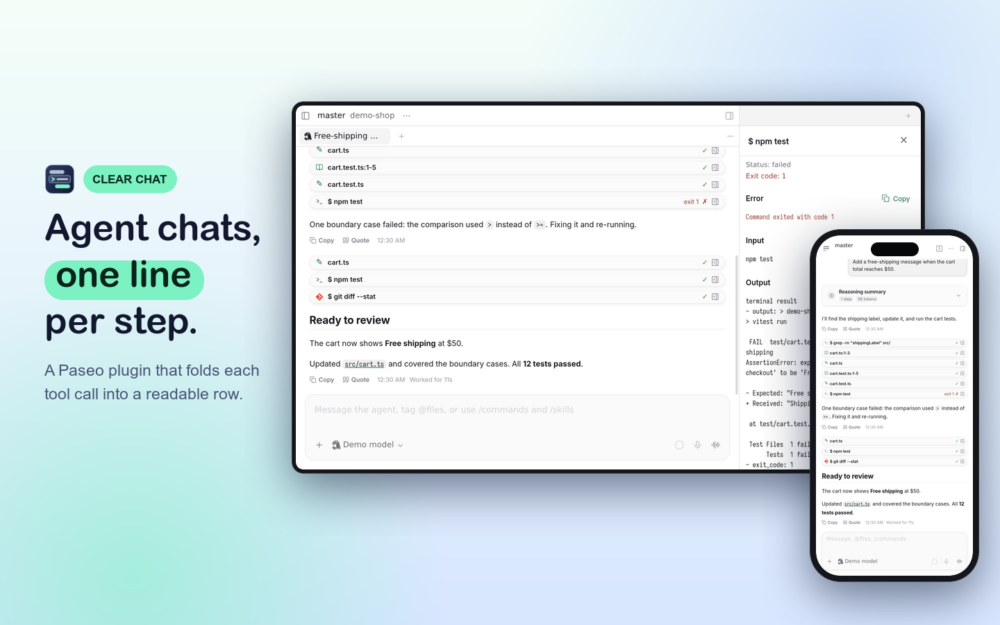
  </picture>
</p>

<p align="center">
  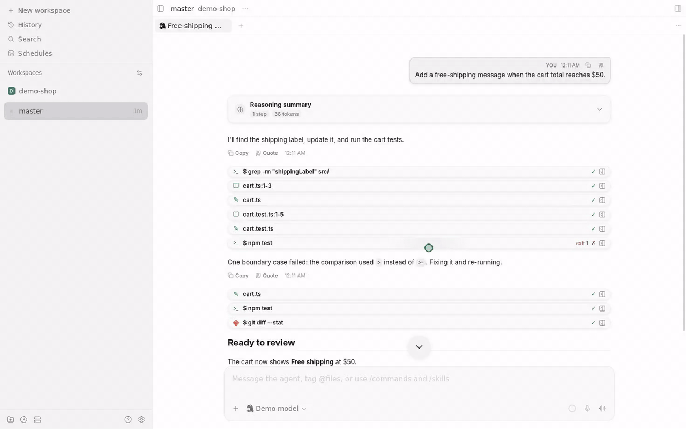
</p>

<p align="center"><sub>所有截图和演示都用示例数据。</sub></p>

## 为什么用 Clear Chat

- **一步一行。** 每一步各占一行并带着状态，编辑类的步骤还显示增删了多少行。结束这一轮的回复始终完整展开。
- **哪一步都能点开看。** 步骤的完整输入、输出和报错，在桌面上显示在侧边面板，在 iPad 上是浮出的小窗，在手机上从底部弹出，长输出不会把对话撑开。见[手机和 iPad](#手机和-ipad)。
- **每种工具都有卡片。** Claude、Codex、Hermes 的调用都有像样的卡片。Paseo 报告的每种工具类型都有自己的卡片，`skill_view`、`memory` 等 Hermes 工具也有专门的显示。见[功能](#功能)。
- **跟着你的语言。** Clear Chat 自己的界面文字跟随 Paseo 应用的语言：英文、简体中文或日文。
- **按你的习惯调。** 一共 23 项设置：强调色、界面与代码字体、文字大小、折叠方式、已安装版本等等。设置保存在主机上，连到这台主机的设备都共用。见[设置](#设置)。
- **不拖慢。** 在 4 核云机器的 300 步测试里，Clear Chat 的首屏是 673–843 毫秒；关掉 Clear Chat、用 Paseo 原生显示是 387–444 毫秒，因为原生把整轮折成一行，不逐步显示。测法见[性能](#性能)。<sup>1</sup>
- **引用回复。** 在含文字的消息上点引用图标，把回复作为引用块发出去。

<sub>1. 在一台机器上用无头 Google Chrome 跑 5 次取中位数。你的结果会不一样。测法见 [scripts/perf/README.md](scripts/perf/README.md)（英文）。</sub>

## 这一版新增（0.15.3.5）

- **答题卡按 `A3` 这类题号分题了。** 题号写成「大写字母加数字」的回复（`A3 …`、`A4 …`，加粗的 `**A3**` 也算），现在按题号一题一题拆开，每题只读自己的 `A`／`B`／`C` 选项；从 `C` 起或者跳号的选项列表也认，普通列表被误认时点 **不是选项** 收掉（[#353](https://github.com/jasonhnd/paseo-clear-chat/issues/353)、[PR #355](https://github.com/jasonhnd/paseo-clear-chat/pull/355)、[#337](https://github.com/jasonhnd/paseo-clear-chat/issues/337)、[PR #346](https://github.com/jasonhnd/paseo-clear-chat/pull/346)）。
- **带点的选项行也要看邻行。** 开着 **让每个选项单独占一行** 时，以字母加点或冒号开头的行（`A.`、`A：` …）要上下相邻的一行是相邻字母的选项行才单独成行，所以 `A. Smith wrote this` 这种单独一句留在原来的段落里；一行一项写成的列表照旧各自成行（[#338](https://github.com/jasonhnd/paseo-clear-chat/issues/338)、[PR #345](https://github.com/jasonhnd/paseo-clear-chat/pull/345)）。这个设置默认关。
- **手机宽度下 Esc 能关问题弹层了。** 390 px 宽时，从问题小条打开的弹层按 Esc 会关掉、回到输入框；电脑宽度本来就能关。其他按键没改（[#351](https://github.com/jasonhnd/paseo-clear-chat/issues/351)、[PR #352](https://github.com/jasonhnd/paseo-clear-chat/pull/352)）。
- **答题卡动图换新了。** README 里的那张图现在是「在卡片上选答案、按 Send」的新录版本（[PR #350](https://github.com/jasonhnd/paseo-clear-chat/pull/350)、[PR #354](https://github.com/jasonhnd/paseo-clear-chat/pull/354)、[PR #356](https://github.com/jasonhnd/paseo-clear-chat/pull/356)）。
- **仓库工具（写给维护者）。** 发版前的检查不再因为安装时留下的版本文件而失败（[#335](https://github.com/jasonhnd/paseo-clear-chat/issues/335)、[PR #347](https://github.com/jasonhnd/paseo-clear-chat/pull/347)）；`paseo-plugin.json` 去掉了 0.15.3 宿主不读的 `translations` 段（[#336](https://github.com/jasonhnd/paseo-clear-chat/issues/336)、[PR #343](https://github.com/jasonhnd/paseo-clear-chat/pull/343)）。

### 之前几版新增的

- **「让每个选项单独占一行」认得实际的写法了。** 开着 **让每个选项单独占一行**（Keep each option on its own line）时，以大写字母开头、后面跟着下面任意一种标记的行会各占一行：点、半角右括号、全角 `）`、顿号 `、`、半角或全角冒号、制表符、全角空格、半角空格（例如 `A. 先做`、`A) 先做`、`A、先做`、`A: 先做`、`A：先做`、`A　先做`）。字母前面允许有空格、制表符和 `*`／`_` 标记；字母可以是半角 A 到 H，也可以是全角 `Ａ` 到 `Ｈ`。点和半角括号、半角冒号后面必须跟一个空格或制表符，其他标记后面不用；制表符和全角空格本身就够。其余标记还要求紧邻的上一行或下一行是相邻字母的选项行（`A` 行下面是 `B`，或 `B` 行上面是 `A`），那一行用哪种标记写法都行，标点类标记下全角字母和半角字母算同一个。所以单独一行、以字母加点开头的普通句子，以及以 `A ` 开头的普通句子，都不会被单独切开。普通段落、引用里，以及编号列表项的续行里都一样。设置关着时，回复和上一版画得完全一样。这个设置默认关（[#315](https://github.com/jasonhnd/paseo-clear-chat/issues/315)、[PR #319](https://github.com/jasonhnd/paseo-clear-chat/pull/319)、[#323](https://github.com/jasonhnd/paseo-clear-chat/issues/323)、[PR #327](https://github.com/jasonhnd/paseo-clear-chat/pull/327)、[#332](https://github.com/jasonhnd/paseo-clear-chat/issues/332)、[PR #333](https://github.com/jasonhnd/paseo-clear-chat/pull/333)）。
- **答题卡认得用全角空格写的选项。** 写成 `A　先做` 或 `A：先做` 的选项，现在和点、括号、顿号、冒号这几种写法一样会被认出来，用这种写法写的列表也会出答题卡。答题卡出现的回复比以前多了；普通列表被当成选项时，点 **不是选项** 收掉即可（[#316](https://github.com/jasonhnd/paseo-clear-chat/issues/316)、[PR #320](https://github.com/jasonhnd/paseo-clear-chat/pull/320)）。
- **更多回复会有跳转标签了。** 整行只有一个加粗短语的行现在也算锚点，所以用加粗小标题写的回复，文字上方会出现一排标签：门槛降到 1200 字、至少 2 个锚点（原来是 3000 字、3 个标题）。加粗行要自己起一段才算；回复里给加粗锚点做了和标题一样的标记，点标签能滚到它对应的那一段。最多 8 个标签，每个锚点一个，每个截到 24 字；不会折叠或删掉任何内容。仍然只在网页和桌面应用里画，手机原生应用不画（[#317](https://github.com/jasonhnd/paseo-clear-chat/issues/317)、[PR #321](https://github.com/jasonhnd/paseo-clear-chat/pull/321)、[#322](https://github.com/jasonhnd/paseo-clear-chat/issues/322)、[PR #325](https://github.com/jasonhnd/paseo-clear-chat/pull/325)、[#318](https://github.com/jasonhnd/paseo-clear-chat/issues/318)、[PR #329](https://github.com/jasonhnd/paseo-clear-chat/pull/329)）。
- **新设置：让每个选项单独占一行（默认关）。** 新设置 **让每个选项单独占一行**（Keep each option on its own line）。打开后，回复里以大写字母 A 到 H 加点或右括号开头的行（例如 `A.`、`B)`，或全角的 `C）`、`D、`）会各占一行，不再和上一行连成一段；普通段落、引用里，以及编号列表项的续行（编号的问题后面跟着字母行）都一样。其余内容照旧，设置关着时回复和上一版完全一样。小写字母、H 以后的字母，以及 `e.g.` 这类写法不算。已经显示的旧回复，重新加载聊天后才会按新设置重画；新的回复马上按新设置显示。设置打开时，以单个大写字母 A 到 H 加点或括号开头的一行，即使是普通句子（例如 `A. Smith wrote this`）也会单独成行；不想这样就把这个设置关着。（[#304](https://github.com/jasonhnd/paseo-clear-chat/issues/304)、[PR #308](https://github.com/jasonhnd/paseo-clear-chat/pull/308)、[#305](https://github.com/jasonhnd/paseo-clear-chat/issues/305)、[PR #307](https://github.com/jasonhnd/paseo-clear-chat/pull/307)、[#306](https://github.com/jasonhnd/paseo-clear-chat/issues/306)、[PR #309](https://github.com/jasonhnd/paseo-clear-chat/pull/309)）。
- **「不是选项」重新加载后仍然记得。** 普通列表被当成选项时，点 **不是选项** 就能把这条回复下面的卡片收掉；现在重新加载聊天后它仍然收着，小条和浮动面板对这条回复也不会再出现。Clear Chat 把最多 100 条这样的回复记在主机上保存的设置里（先丢最旧的）；点 **恢复默认** 会清空。更新的回复不受影响，发送答案也不会往这个列表里加（[#252](https://github.com/jasonhnd/paseo-clear-chat/issues/252)）。
- **手机上的小条弹层：页签和发送行固定。** 手机上点小条打开的弹层，现在把题目页签固定在顶部、发送行固定在底部，题干和选项在中间滚动；以前页签会随内容滚走。弹层的高度限制在屏幕高度的一定比例内，触摸目标仍然至少 44 点（[#258](https://github.com/jasonhnd/paseo-clear-chat/issues/258)、[PR #291](https://github.com/jasonhnd/paseo-clear-chat/pull/291)、[#294](https://github.com/jasonhnd/paseo-clear-chat/issues/294)、[PR #297](https://github.com/jasonhnd/paseo-clear-chat/pull/297)）。
- **长回复顶部的跳转标签（默认关）。** 新设置 **在长回复中显示跳转标签**（Show jump chips on long replies）。打开后，写完的回复如果有 3000 字以上、至少 3 个一到三级标题，文字上方会出现一排标签，每个标题一个，最多 8 个；标签上是标题（最多 24 个字符），点一下，回复就滚到那个标题。Agent 还在输出时不显示标签。可在网页和桌面应用中使用，原生手机应用上不显示；回复的文字不会被折叠或删掉（[#259](https://github.com/jasonhnd/paseo-clear-chat/issues/259)、[#296](https://github.com/jasonhnd/paseo-clear-chat/issues/296)）。

  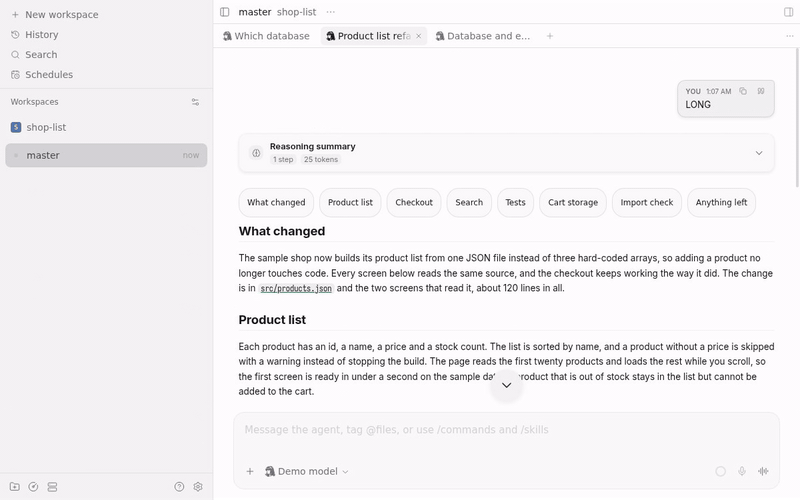

- **新设置：字母选项问题的回答卡片（默认关）。** 最新回复里有带编号的问题和字母选项，例如「1. 用哪个数据库？A. SQLite B. Postgres」，并且要你用简短形式回复、或者标出了推荐项时，Clear Chat 会在这条回复下面显示一张卡片。卡片上每题一个标签页，选项带 **推荐** 标记，**自己填写** 可以写备注，还有 **下一题**，以及回复只是看着像选项时用的 **不是选项**。**发送** 按钮会显示它将要发出的原文，例如 `1B 2A`，还没选的题会点名提示。卡片只出现在最新回复下面，只在 Agent 没在运行时出现，来了新消息就消失。触摸和鼠标都能用，行和按钮至少 44 点高（[#235](https://github.com/jasonhnd/paseo-clear-chat/issues/235)）。
- **网页和桌面上可以用键盘。** 你点一下卡片，或者在输入框为空时按上下箭头，卡片才开始接收按键。之后：上下箭头在选项间移动，`A` 到 `H` 或 `1` 到 `8` 选择选项，**Enter** 选中高亮的选项并进入下一题（最后一次 **Enter** 发送），**Tab** 或右箭头去下一题（在最后一题按 **Tab** 会先跳到 **发送** 按钮），**Shift+Tab** 或左箭头回上一题，**Esc** 收起卡片并回到输入框。输入框里一有文字，卡片就收起，所有按键都归输入框（[#236](https://github.com/jasonhnd/paseo-clear-chat/issues/236)）。
- **打字发送时带上已选的。** 卡片可用时（你一打字它就自己收起），你可以选一部分、其余自己打字：按 **Enter** 发送你的文字时，已选的答案会放在文字前面，后面跟一个空格。只有输入框不为空、至少选了一题、没有按住 Shift 或 Alt、也不在输入法组词时才会加；宿主在 300 毫秒内没有发出，前缀会被撤回（只限网页和桌面）。输入框按卡片所在的会话页面去找，访问过别的会话再回来，已选答案同样放在你打的字前面。（[#230](https://github.com/jasonhnd/paseo-clear-chat/issues/230)、[#281](https://github.com/jasonhnd/paseo-clear-chat/issues/281)）。

  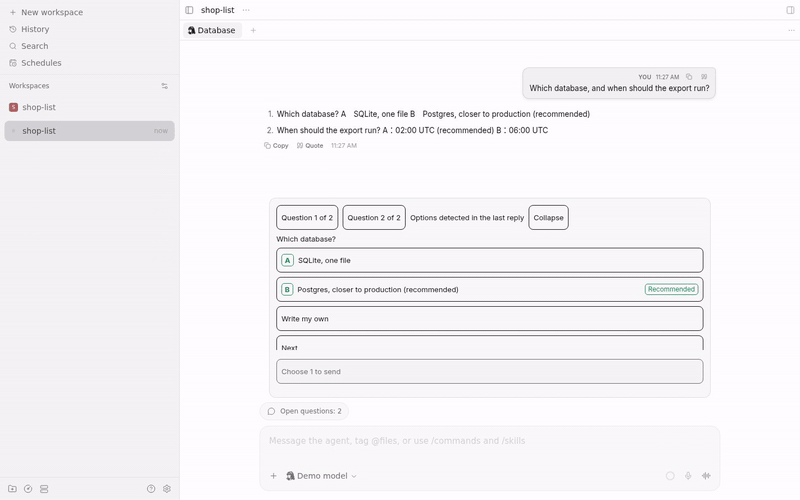
- **输入框上方的小条显示待回答的题。** 卡片可用时，输入框上方会有一个小条，写着「待回答的问题：N」，N 是你还没选的题数。点它会打开同一个选择面板：宽屏是弹层，手机上是底部弹层，你滚走了也能读到完整的题目。选择和卡片共用。Agent 在运行时弹层可以打开，但发送是灰的。设置关着，或者你点了「不是选项」之后，小条不显示（[#231](https://github.com/jasonhnd/paseo-clear-chat/issues/231)）。
- **网页和桌面上的浮动回答面板。** 面板浮在输入框上方，题目、选择、按键和发送与卡片相同；面板显示时，回复下面的卡片会隐藏。它靠 Paseo 页面的结构：页面不是面板预期的样子（找不到输入框、输入框被隐藏或被换掉，或者上方空间不够）时，面板会自己撤掉，回复下面的卡片保持展开，不报错，按键照样可用。点面板里的按钮，第一下就算数。面板、它的发送行和发送按钮都是不透明底色，下面的行不会透出来；小条的弹层打开时面板会隐藏，弹层关上后再回来。发送行放在面板滚动区的下面，发送不再盖住 **下一题**、**不是选项** 和选项行；重画时保留滚动位置，换题回到顶部。卡片出现时输入框还不在页面上，卡片每 250 毫秒再找一次、最多 3 秒；面板因页面被藏起来、或因页面结构问题退回卡片后，每次会话页面重新显示（切回会话）时都会再试一次面板，重新加载后也会再试（[#229](https://github.com/jasonhnd/paseo-clear-chat/issues/229)、[#255](https://github.com/jasonhnd/paseo-clear-chat/issues/255)、[#261](https://github.com/jasonhnd/paseo-clear-chat/issues/261)、[#263](https://github.com/jasonhnd/paseo-clear-chat/issues/263)、[#265](https://github.com/jasonhnd/paseo-clear-chat/issues/265)、[#264](https://github.com/jasonhnd/paseo-clear-chat/issues/264)、[#267](https://github.com/jasonhnd/paseo-clear-chat/issues/267)、[#275](https://github.com/jasonhnd/paseo-clear-chat/issues/275)、[#276](https://github.com/jasonhnd/paseo-clear-chat/issues/276)、[#281](https://github.com/jasonhnd/paseo-clear-chat/issues/281)）。
- **推荐标记读得对。** 选项后面写的 `（推荐）`、`(recommended)` 会被认出来，「not recommended」和 `不推荐` 不会（[#239](https://github.com/jasonhnd/paseo-clear-chat/issues/239)）。

## 安装

```bash
paseo plugin install git:jasonhnd/paseo-clear-chat --ref v0.15.3.5
```

打开 Paseo 的插件页面，在 Clear Chat 的说明开头查看版本号。Paseo 0.14.0 在这里显示默认英文说明，即使切换应用语言也是如此。

Clear Chat 0.15.3.5 需要 Paseo 0.14.0 或更新的版本。打开 **Settings → Plugins → Clear Chat**，可以选颜色、字体和折叠方式。

以后要更新：

```bash
paseo plugin update clear-chat
```

它会换到 `main` 分支上的最新一版，不会停在你当初装的那个版本，改动前会先问你一句。在脚本里运行请加 `--yes`。要换到某个指定版本，或退回以前的版本，加上 `--ref`，例如 `paseo plugin update clear-chat --ref v0.13.0.1`。更新通常会保留设置，但不保证特定版本回退的结果或设置兼容；请看下方尚未实测的 Paseo 0.13 示例。

> [!IMPORTANT]
> 已经在用 Beautiful Chat？安装或卸载任何插件**之前**，请先看[从 Beautiful Chat 升级](#从-beautiful-chat-升级)。在 Paseo 里卸载插件，会连它的设置一起删掉。

<details>
<summary><b>旧版 Paseo（0.13 / 0.12），以及版本号怎么看</b></summary>

还在用 Paseo 0.13？Clear Chat 0.13.2.2 已经发布，并声明支持 Paseo 0.13.0 或更新版本。下面这条安装命令尚未在 Paseo 0.13 上实测：

```bash
paseo plugin install git:jasonhnd/paseo-clear-chat --ref v0.13.2.2
```

如果已经安装 Clear Chat，下方是拟使用的指定旧版命令。**这次切换及其对设置的影响尚未在 Paseo 0.13 上实测；从新版切回旧版也尚未验证。**

```bash
paseo plugin update clear-chat --ref v0.13.2.2 --yes
```

还在用 Paseo 0.12 的，请改装 Clear Chat 0.12.0.1：

```bash
paseo plugin install git:jasonhnd/paseo-clear-chat --ref v0.12.0.1
```

如果已经装着 Clear Chat，`install` 会停下并提示 `Plugin ID clear-chat is already configured`。这时请改用 `update` 换版本，设置会保留：

```bash
paseo plugin update clear-chat --ref v0.12.0.1 --yes
```

Clear Chat 的版本号＝这一版对应、测过的 Paseo 版本，再加一位：在这个 Paseo 版本上是第几次发布。例如 0.13.0.1 是对应 Paseo 0.13.0 的第一个版本，0.13.0.2 是第二个。Paseo 出了新版本以后，Clear Chat 的下一次发布重新从 1 数，例如对应 Paseo 0.13.1 就叫 0.13.1.1。Paseo 出新版本时，Clear Chat 没有新东西就不跟着发。1.0.0 和 1.0.1 是定这个规则之前发的，0.12.0.1 比它们都新。

</details>

## 升级与回退

```bash
paseo plugin update clear-chat                 # 跟 main 上的最新版，改之前会问
paseo plugin update clear-chat --yes           # 同上，不再问
paseo plugin update clear-chat --ref v0.15.3.5 --yes   # 固定到某个版本
```

升级会保留你的设置。回退到更早的版本一般也保留，但某一次回退对设置的影响没有保证，设置重要的话先备份。卸载插件会删掉它的设置。

## 不同设备上的差别

### 桌面与网页
完整布局：步骤详情在侧边面板，卡片有悬停预览，步骤之间可以用键盘移动，有指针光晕，可以选中文字复制。查找栏（Ctrl/Cmd+F）在这里可用。

### iPad
步骤详情在浮窗里打开，对话保持原来的宽度；折叠规则与截图一致，工具栏保持一行。关掉 **助手回复 Markdown** 时可以用拖选。

### 手机
步骤详情从底部弹出的面板打开，长输出在面板里滚动，对话用满宽度。输入框在你多写之前保持一行。选区操作与指针光晕在手机上不启用，请用复制按钮。


Paseo 在桌面、网页、iPhone 和 iPad 上运行同一个插件。Clear Chat 按可用的宽度选样式，不看设备名，所以窄的桌面窗口也会用手机的样式。

| | 手机 | iPad | 桌面和网页 |
|---|---|---|---|
| 步骤详情 | 从底部弹出 | 浮出的小窗（宽 744～1023px）或侧边面板（1024px 以上） | 侧边面板；窗口窄时是浮出的小窗或底部弹窗 |
| 每一行 | 标题、图标和留白更小，一屏能看到更多步骤；按钮仍然好点 | 标准 | 标准 |
| 步骤菜单 | 长按步骤 | 长按步骤 | 右键点步骤 |
| 悬停预览 | – | – | 指针在收起的步骤上停一下 |
| 键盘 | – | 在浏览器里接实体键盘时，可用 Tab、方向键、Enter 和 Esc | Tab、方向键、Enter 和 Esc |
| 回复里的路径 | 复制到剪贴板，并提示你到主机上打开 | 复制到剪贴板，并提示你到主机上打开 | 在 Finder、资源管理器或文件管理器里显示 |

调整窗口大小、旋转 iPad 或分屏时，详情会换成对应的样式，还是同一个步骤，读到的位置和展开的内容都不变。

<sub>这些截图是在浏览器里按手机和 iPad 的宽度拍的，用的是示例数据。</sub>

| 手机宽度：对话 | 手机宽度：步骤详情 | 手机宽度：步骤菜单 |
|---|---|---|
| <picture><source media="(prefers-color-scheme: dark)" srcset="docs/images/phone-timeline-dark.png">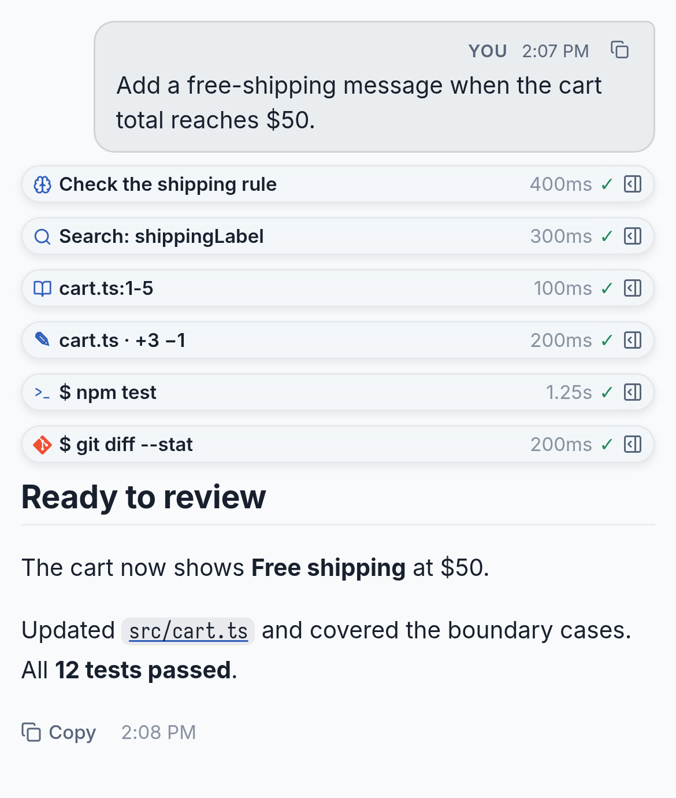</picture> | <picture><source media="(prefers-color-scheme: dark)" srcset="docs/images/phone-details-dark.png">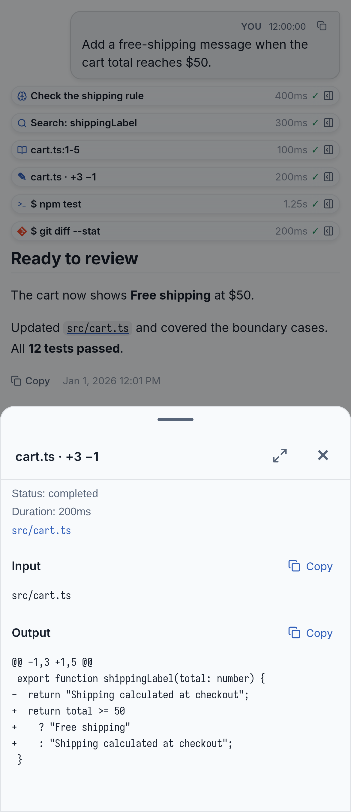</picture> | <picture><source media="(prefers-color-scheme: dark)" srcset="docs/images/phone-menu-dark.png">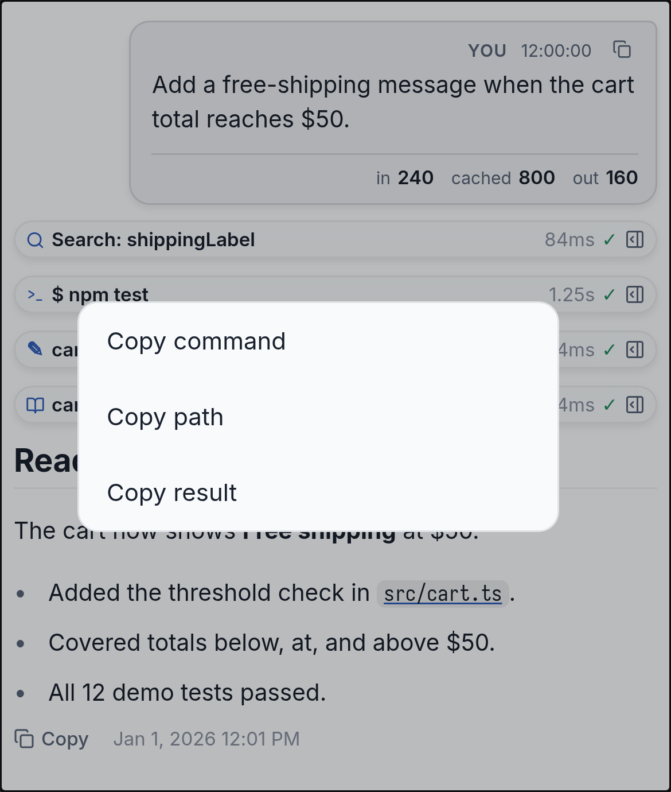</picture> |

| iPad 宽度，竖屏：浮出的小窗 | iPad 宽度，横屏：侧边面板 |
|---|---|
| <picture><source media="(prefers-color-scheme: dark)" srcset="docs/images/ipad-popover-dark.png">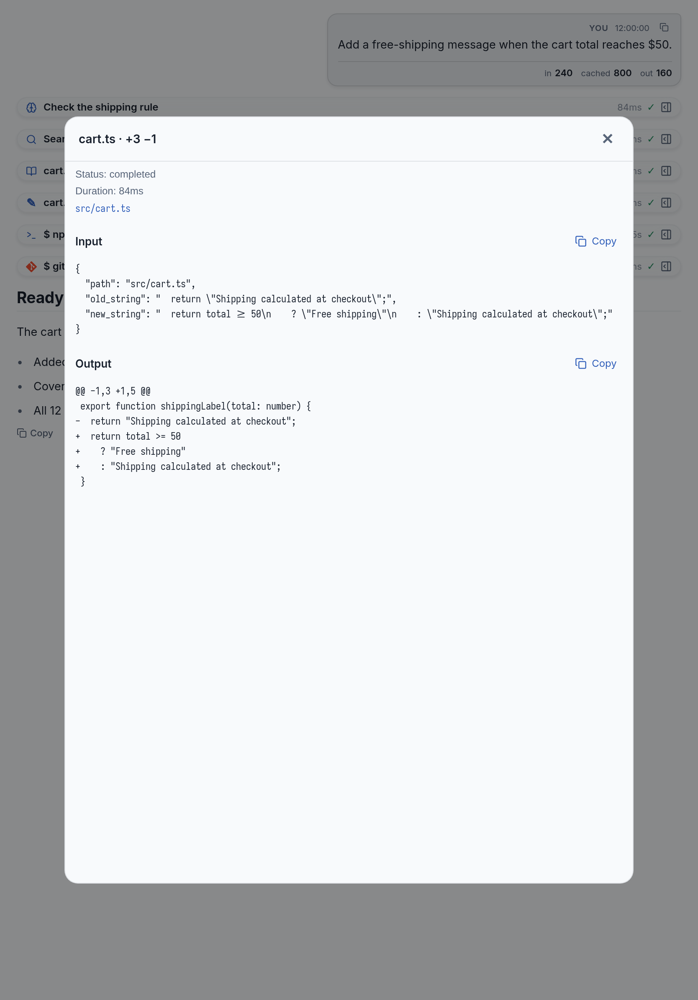</picture> | <picture><source media="(prefers-color-scheme: dark)" srcset="docs/images/ipad-side-dark.png">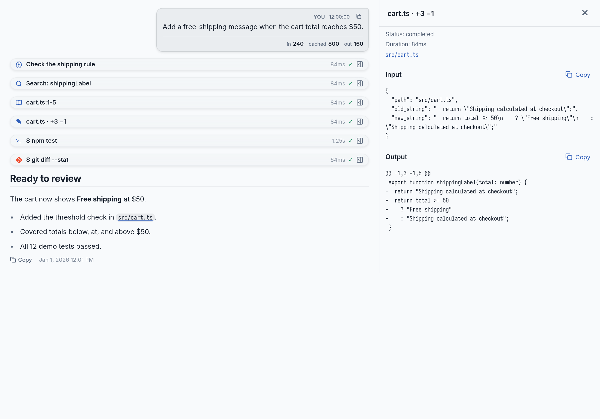</picture> |

<p align="center">
  <picture>
    <source media="(prefers-color-scheme: dark)" srcset="images/fold-compare-dark.png">
    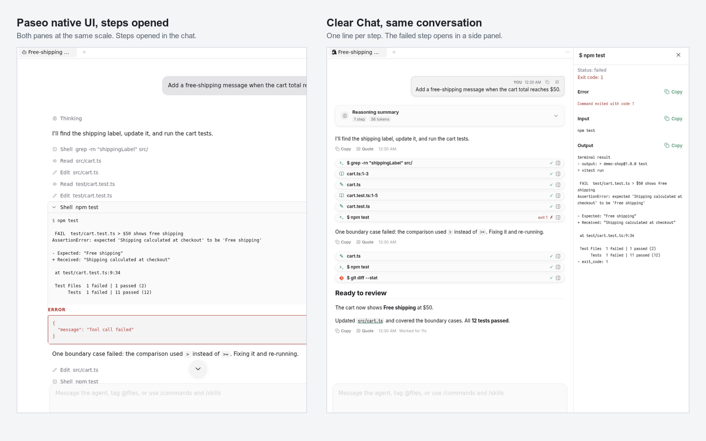
  </picture>
</p>

## 功能

### 工具调用

| | |
|---|---|
| <picture><source media="(prefers-color-scheme: dark)" srcset="docs/images/tool-bash-dark.png">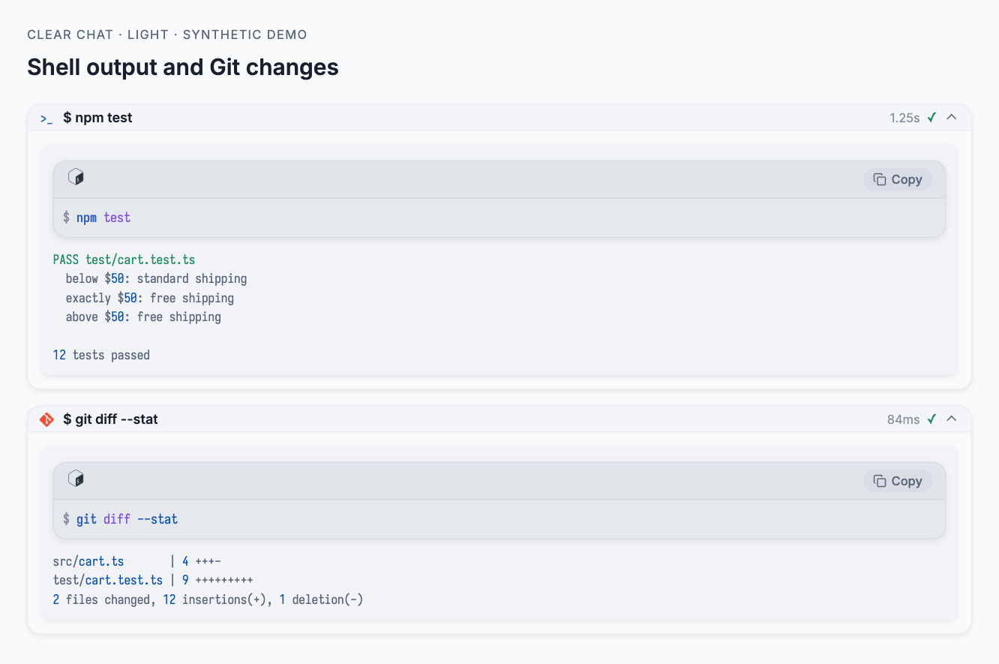</picture><br>**Shell 和 Git。** 终端外框、高亮的命令；退出码不是 0 时，卡片上会标出来。 | <picture><source media="(prefers-color-scheme: dark)" srcset="docs/images/tool-read-dark.png">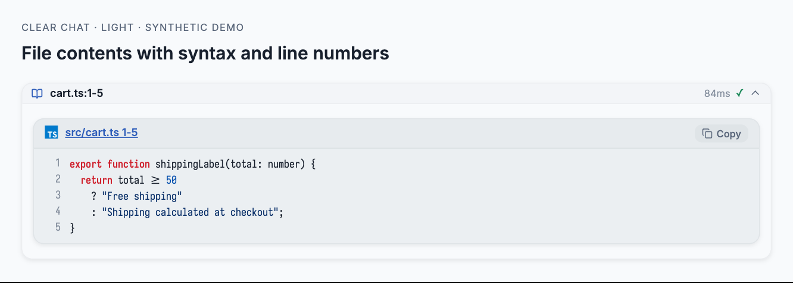</picture><br>**读取文件。** 语言图标、行号、复制按钮。点文件名会在文件管理器里显示这个文件。 |
| <picture><source media="(prefers-color-scheme: dark)" srcset="docs/images/tool-edit-dark.png">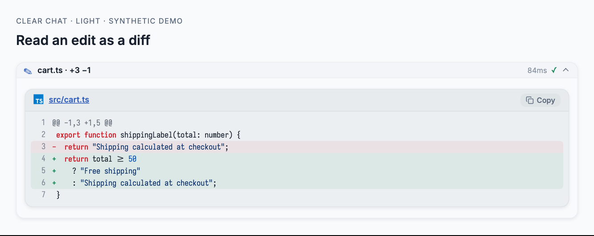</picture><br>**编辑。** 清楚的改动对比；没有给出 diff 时，也会用新旧文字算出对比。 | <picture><source media="(prefers-color-scheme: dark)" srcset="docs/images/tool-image-dark.png">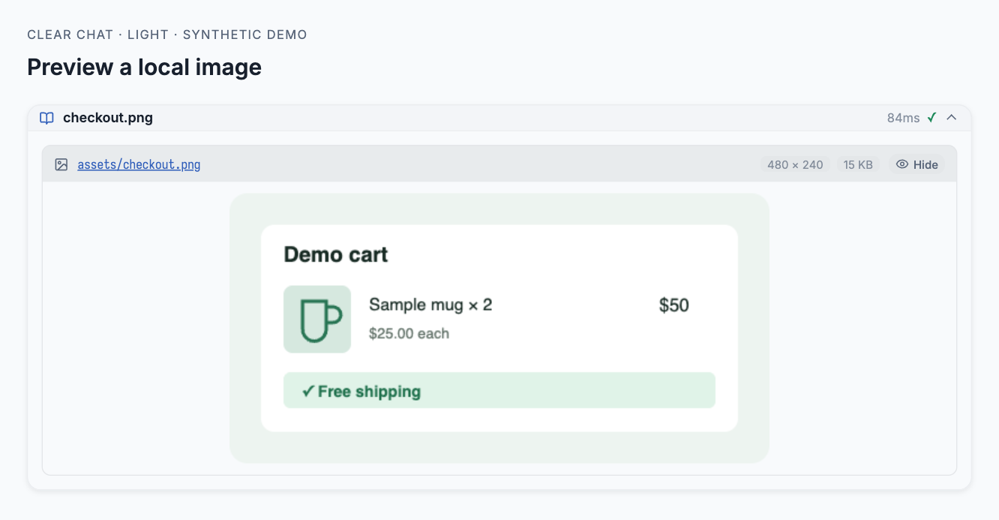</picture><br>**图片。** 读取和生成的图片直接显示，带尺寸和可以点的来源地址。 |
| <picture><source media="(prefers-color-scheme: dark)" srcset="docs/images/tool-thinking-dark.png">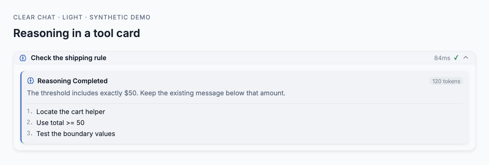</picture><br>**推理工具。** 实时的思考文字、token 数和编号步骤。 | <picture><source media="(prefers-color-scheme: dark)" srcset="docs/images/tool-mcp-dark.png">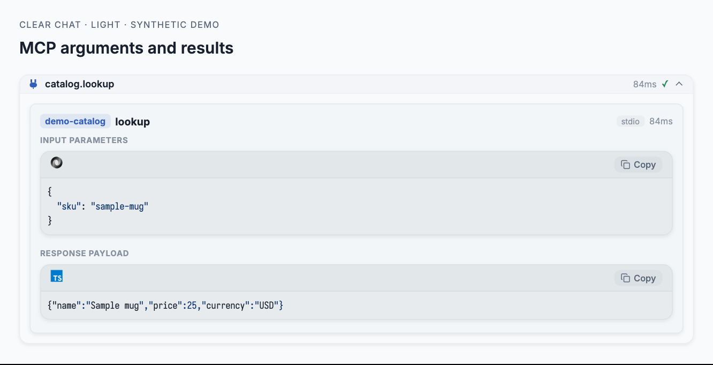</picture><br>**MCP。** 服务器、传输方式、输入和返回结果，全部高亮。 |
| <picture><source media="(prefers-color-scheme: dark)" srcset="docs/images/tool-eval-dark.png">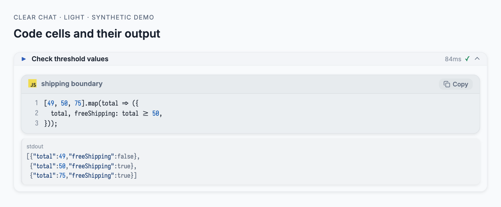</picture><br>**Eval。** 每个单元格先显示运行的代码，再显示输出。 | <picture><source media="(prefers-color-scheme: dark)" srcset="docs/images/tool-ask-dark.png">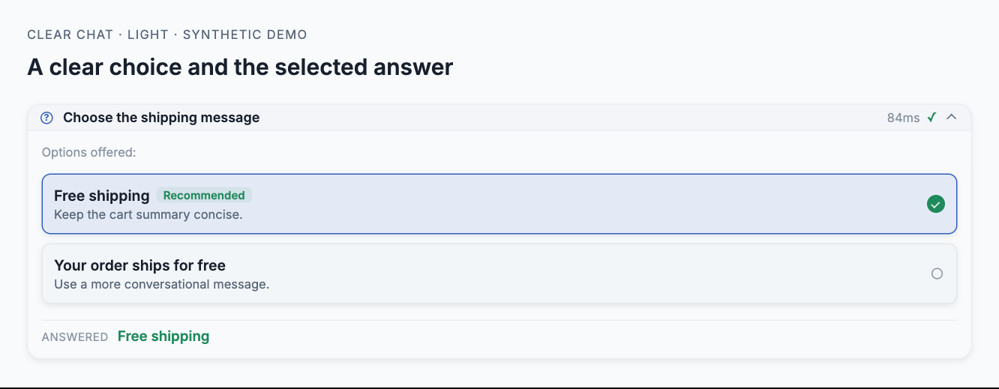</picture><br>**提问。** 列出选项，标出推荐项和最后选的答案。 |
| <picture><source media="(prefers-color-scheme: dark)" srcset="docs/images/tool-task-dark.png">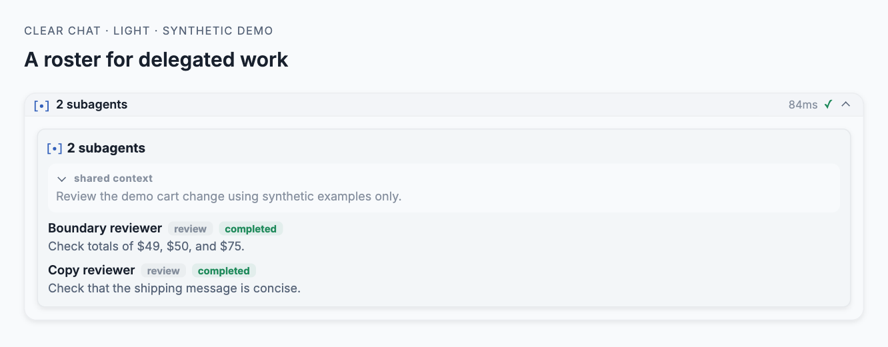</picture><br>**子 Agent。** 名字、类型、模型和交给它的任务。 | <picture><source media="(prefers-color-scheme: dark)" srcset="docs/images/hub-dark.png">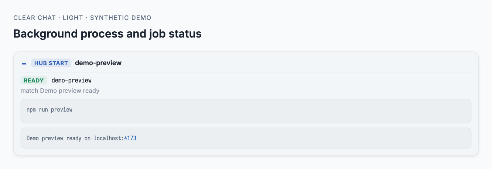</picture><br>**Hub。** 每一种 hub 操作都有对应的进程、消息或任务卡片。 |
| <picture><source media="(prefers-color-scheme: dark)" srcset="docs/images/paseo-dark.png">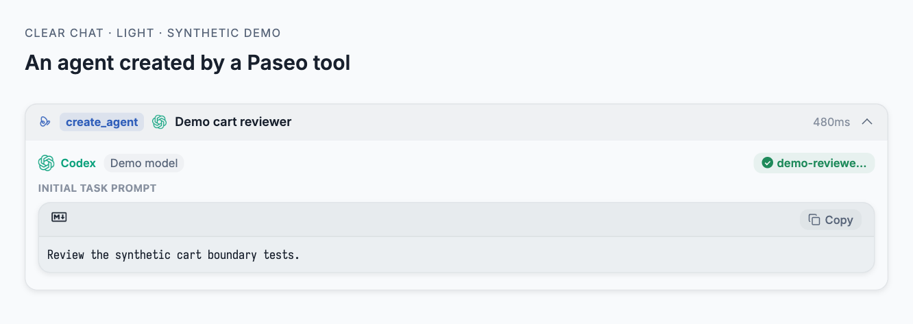</picture><br>**Paseo 工具。** 显示 Paseo 的标志，新建的 Agent 带上提供方的标志。 | |

搜索、网页获取、网页搜索、计划和清单、纯文字、Skill 以及其他工具也都有自己的卡片。不认识的工具会显示工具名、`名字: 值` 形式的输入和输出预览，绝不会是空框。

### Shell 和 Git
命令外面套终端外框。退出码不是 0 时，卡片上会标出来；点开步骤，详情里只要供应商报了退出码就会显示（0 也显示）。命令行一般没有耗时。**复制命令** 复制命令本身，**复制结果** 复制输出，**在文件管理器中打开** 显示命令的工作目录。图：`tool-bash-light.png`／`tool-bash-dark.png`。

### 读取文件
显示语言图标、文件名和行号，一个按钮复制整段文件文字。点文件名会在主机的访达、资源管理器或文件管理器里显示这个文件。图：`tool-read-light.png`／`tool-read-dark.png`。

### 编辑与写入
用旧文本和新文本画出行级 diff，供应商没给 diff 时也画得出来。写入显示写了什么；写入和编辑的正文不当作「结果」提供复制，所以菜单里给的是 **复制路径**。图：`tool-edit-light.png`／`tool-edit-dark.png`。

### 搜索、抓取与网页搜索
显示查询词、结果条数和命中的行；抓取显示地址、状态和正文前几行。输出长了按你设的 **长内容折叠** 阈值折叠。图：结果部分沿用 `tool-mcp-*` 的框架。

### 子代理与任务
显示名称、类型、模型，以及交给这个子代理的任务和它自己的状态。子代理的活动单独成一块，不会在父卡片里重复一遍。图：`tool-task-light.png`／`tool-task-dark.png`。

### 计划与清单
显示阶段、每项任务的状态，以及被卡住的原因。待办清单的更新不会把整张清单重复一遍，而是收进一行。图：`tasks-light.png`／`tasks-dark.png`。

### 提问与审批
问题带字母选项，标出推荐的那个，并显示你最终选的。过去的审批留成简短的状态行，带确切的命令和目标。图：`approval-light.png`／`approval-dark.png`。

### 图片
读取到的图片和生成的图片直接显示，带尺寸和可点的来源；点一下打开。提问气泡里超过 1.5 MB 或 2400 万像素的图不预览。图：`tool-image-light.png`／`tool-image-dark.png`。

### MCP 调用
显示服务器、传输方式、输入和返回结果，全部高亮。图：`tool-mcp-light.png`／`tool-mcp-dark.png`。

### 推理与代码执行
推理显示流式的思考文字、token 数和编号步骤。代码执行显示每个单元格的代码和它打印出来的内容。图：`tool-thinking-light.png`、`tool-eval-light.png` 及对应暗色版。

### Hub 与 Paseo 工具
Hub 显示每次 hub 操作的进程、消息和任务卡片；Paseo 自己的工具显示 Paseo 的标记，它创建的 Agent 上带供应商的标记。图：`hub-light.png`、`paseo-light.png` 及暗色版。

### 未知工具
没有专属卡片的工具也会显示名字、按 `name: value` 显示的输入和输出的预览，不会出现空白卡片。没有宣传图：这个状态由测试夹具覆盖。

### 步骤详情
点开折叠的步骤，在任何设备上都打开同一套详情：桌面和网页是侧边面板，iPad 是浮窗，手机是从底部弹出的面板。

- **输入**：完整的命令、路径、查询或 MCP 载荷，带高亮和自己的复制按钮。
- **输出**：完整输出，做了虚拟化，一万行也能顺滑滚动；**复制** 复制的是全文，不是预览的那几行。
- **错误**：供应商给的错误原文，可以用 **复制错误** 复制。
- **退出码**：只有供应商报了才显示；0 就显示 0，HTTP 状态码永远不会被当成退出码。
- **耗时**：只有部分工具（网页抓取、搜索等）供应商会给，命令行一般没有；供应商报了才显示，插件不会用时间戳自己算。
- **分开的 stdout 与 stderr**：供应商分开送的时候，也分成两块显示。
- **步骤菜单**：**复制命令**、**复制路径**、**复制结果**、**在文件管理器中打开**，每一项只在适用时出现。

<p align="center">
  <picture>
    <source media="(prefers-color-scheme: dark)" srcset="images/step-details-dark.png">
    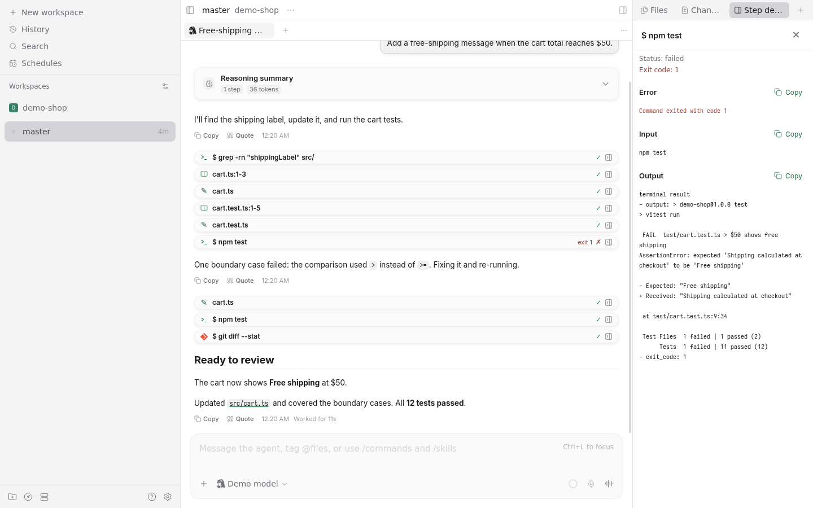
  </picture>
</p>

### 折叠规则
- 做完的步骤收成一行：图标、要点、状态。正在跑、失败和等待中的调用默认展开。
- 你手动展开或收起一行之后，Clear Chat 会记住，刷新后也记得；改设置不会丢掉这个选择；设成 **从不** 则永远显示完整内容。
- **长内容折叠** 作用于工具输出、回复里的代码块和增强提问气泡里的文字：10、15（默认）、30 行源码或从不。刚好等于阈值的那一块保持完整；换行符 LF 和 CRLF 都认；自动换行不算多出来的行。
- 这些选择只保存标识、时间戳和开关，不保存消息内容。

### 查找文字
Ctrl/Cmd+F 打开查找栏。只搜当前显示出来的文字：折叠的步骤行和折叠的卡片要先展开才能搜到。也只搜已经加载的消息，长对话先向上滚再搜。

<p align="center">
  <picture>
    <source media="(prefers-color-scheme: dark)" srcset="images/find-dark.png">
    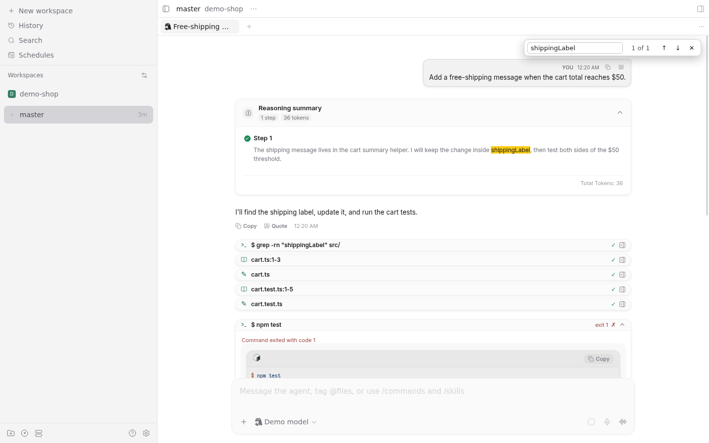
  </picture>
</p>

### 引用回复
在含文字的消息上，点 Copy 旁边的引用图标。面板里有引用的原文（长了有 **展开引用**）、**你的回复** 输入框、**取消** 和 **发送**；发出去的内容是引用块、一个空行，再是你的回复。Agent 忙时图标是灰的；点发送那一刻它刚好忙起来，你写的字会留着，面板提示你等它完成。

<p align="center">
  <picture>
    <source media="(prefers-color-scheme: dark)" srcset="images/quote-dark.png">
    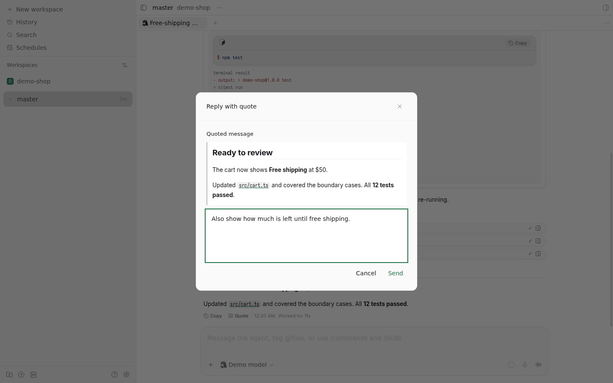
  </picture>
</p>

### 对话

| | |
|---|---|
| <picture><source media="(prefers-color-scheme: dark)" srcset="docs/images/reasoning-dark.png">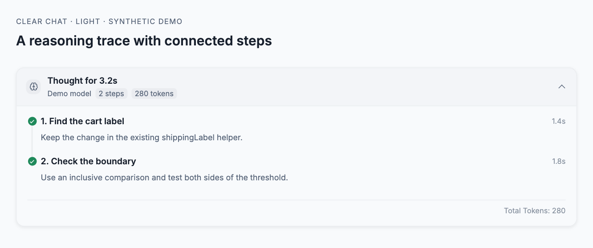</picture><br>**推理过程。** 可以收起的步骤，带每步耗时和 token 总数。 | <picture><source media="(prefers-color-scheme: dark)" srcset="docs/images/tasks-dark.png">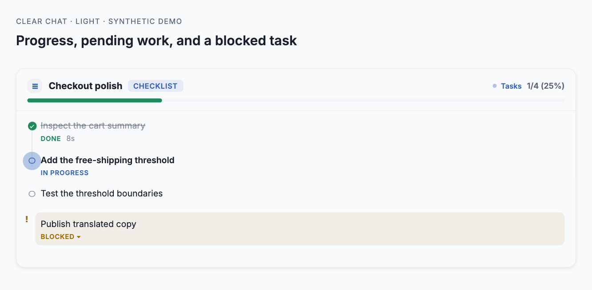</picture><br>**清单。** 阶段、每项任务的状态，以及任务被卡住的原因。 |
| <picture><source media="(prefers-color-scheme: dark)" srcset="docs/images/approval-dark.png">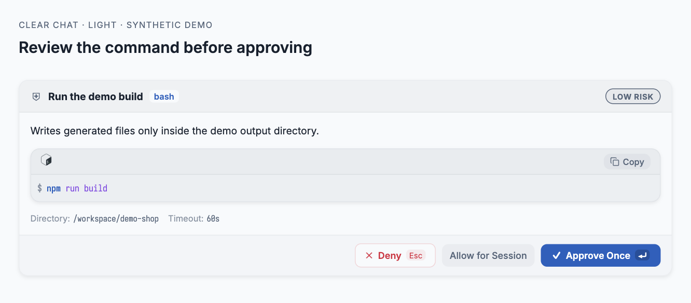</picture><br>**批准。** 风险等级、具体命令和目标。已经处理过的批准留成一行简短的状态。 | <picture><source media="(prefers-color-scheme: dark)" srcset="docs/images/user-dark.png">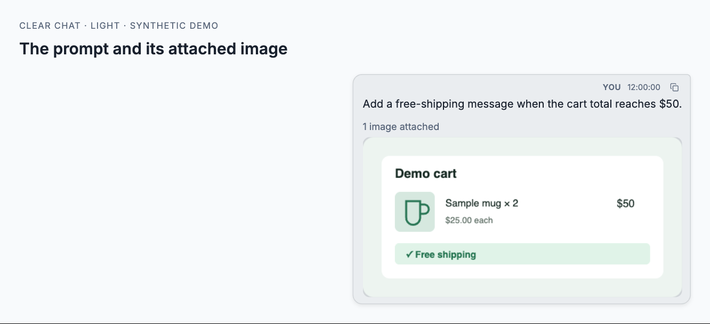</picture><br>**提问气泡。** 复制按钮和 token 用量。 |
| <picture><source media="(prefers-color-scheme: dark)" srcset="docs/images/syntax-dark.png">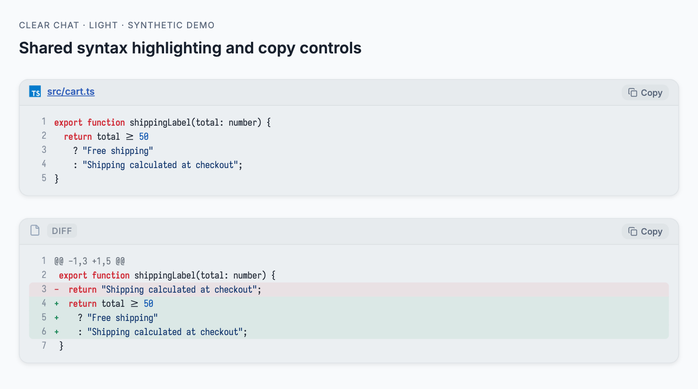</picture><br>**代码。** 识别语言、行号、改动颜色，复制时复制完整代码。 | |

### 还有这些

- **步骤详情。** 点一个收起的步骤，就能看它的完整输入和输出；供应商报了退出码就显示退出码（0 也显示），耗时只有部分工具（网页抓取、搜索等）会有，命令行一般没有。输入和输出可以分开复制；失败的步骤会显示报错内容，也能复制。很长的输出（哪怕 1 万行）也能顺畅滚动。想在对话里直接展开，把 **点按收起的步骤时**（When a collapsed step is pressed）设成 **原地展开**（Expand inline）。
- **折叠由你决定。** 点一下展开的行就收起。进行中、失败和等你处理的调用默认展开。你展开或收起过的行，会记住你的选择，刷新后也不变。很长的工具输出、回复里的长代码块和长提问，都先显示前 15 行，下面有 **显示全部 N 行**（Show all N lines）。**复制**（Copy）总是复制全文。
- **步骤菜单。** **复制命令**（Copy command）、**复制路径**（Copy path）、**复制结果**（Copy result）、**在文件管理器中打开**（Open in file manager）。只显示用得上的几项；Write 和 Edit 写入的内容不会被当成结果复制。
- **收尾回复。** 通过 `wrap_up` 工具发出的回复，会显示成完整的回复卡片：小结、问题、带字母的选项，以及 **受阻**（Blocked）提醒。
- **链接能点。** 回复里的链接（包括直接写出的网址和图片地址）在桌面、网页和 iOS 上都能打开，`mailto:` 链接会打开邮件应用。
- **对话内查找。** Ctrl/Cmd+F 打开查找栏。只搜当前显示出来的文字，折叠的步骤行和折叠的卡片要先展开；也只搜已经加载的消息。
- **打开文件。** 点卡片里的文件名或回复里的路径，会在主机上的 Finder、资源管理器或文件管理器里显示这个文件。路径里有空格时，请写成 Markdown 链接；回复里行内代码中含空格的路径不再是链接。
- **高亮文字。** 回复里写 `==要标出的文字==` 会加上高亮。代码里的等号照原样显示。
- **引用回复。** 在消息正文下面点 **引用回复**（Quote reply）——只有含文字的消息才有这个按钮，智能体不空闲时它是灰的、点不动。弹出 **引用消息回复**（Reply with quote）面板：里面是引用的原文（太长时有 **展开引用**／Expand quote）、**你的回复**（Your reply）输入框，以及 **取消**（Cancel）和 **发送**（Send）两个按钮。发出的内容是引用块加上你的回复。**取消** 会关掉面板并丢弃草稿。**发送** 在三种情况下是灰的：智能体不空闲、正在发送、回复正文为空；如果点发送那一刻才发现它不空闲，面板不关、你写的字还在，并提示 **请等待智能体完成后再发送。** 真发送失败时提示 **无法发送回复。请确认智能体空闲后重试。**
- **粘贴的图片。** 开着 **增强提问气泡**（Enhanced prompt bubble）时，提问里粘贴的图片会以缩略图显示在气泡里，支持 Codex 和 Claude 的 Agent。点一下看大图。超过 1.5 MB 或 2400 万像素的图不显示。Hermes 的 Agent 要在新建时选 **·CC** 版本的提供商，见[在 Hermes Agent 里粘贴图片](#在-hermes-agent-里粘贴图片)。

## 设置

<picture><source media="(prefers-color-scheme: dark)" srcset="docs/images/settings-dark.png">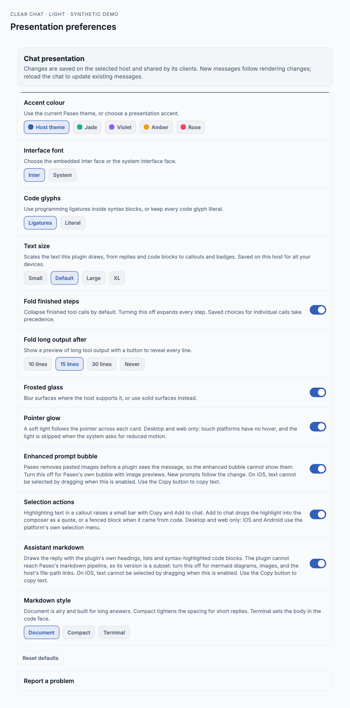</picture>

| 设置项 | 作用 |
|---|---|
| 强调色（Accent colour） | 跟随 Paseo 主题，选翡翠绿（Jade）、紫罗兰（Violet）、琥珀（Amber）、玫瑰（Rose），或选 **自定义**（Custom）用色板和 HEX 输入框自定颜色。自定颜色会自动调整，保证文字对比度不低于 4.5:1。 |
| 界面字体（Interface font） | 内置的 Inter 字体，或系统（System）字体。 |
| 代码字形（Code glyphs） | 带连字（Ligatures）的 Iosevka，或原样（Literal）字形。 |
| 代码字体（Code font） | 「默认（Iosevka）」（Default (Iosevka)，默认）、Iosevka、Menlo、Consolas、Fira Code 或 Cascadia Code。对代码块、行内代码、终端输出和差异对比生效。 |
| 文字大小（Text size） | 小（Small，90%）、默认（Default，100%）、大（Large，115%）、特大（XL，130%）。图标大小不变。 |
| Hermes·CC 提供商（Hermes·CC providers） | 默认开。为每个用 `hermes acp` 启动的 Hermes 提供商加一个 **·CC** 版本，这样粘贴到 Hermes Agent 里的图片就能显示在气泡里。改动在重新加载主机后生效。 |
| 折叠已完成的步骤（Fold finished steps） | 默认开。关掉后所有步骤都展开，你单独设过的调用除外。 |
| 点按收起的步骤时（When a collapsed step is pressed） | 打开详情（Open details，默认）：在底部弹窗、浮出小窗或侧边面板里显示步骤详情。原地展开（Expand inline）：在对话里直接展开。 |
| 长输出折叠行数（Fold long output after） | 10、15（默认）、30 行，或不折叠（Never）。对工具输出、回复里的代码块和提问生效。按原文的行数算，自动换行不多算。 |
| 毛玻璃（Frosted glass） | 卡片背景做毛玻璃效果，或用纯色。 |
| 指针光晕（Pointer glow） | 指针在卡片上移动时会跟着一圈柔光。只在桌面和网页上有效。 |
| 增强提问气泡（Enhanced prompt bubble） | 给你的提问加样式。关掉就用 Paseo 自带的气泡。 |
| 选中文字后的操作（Selection actions） | 在卡片里选中文字时，会出现一个小工具条，有「复制」和「添加到聊天」。只在桌面和网页上有效。 |
| 助手回复 Markdown（Assistant markdown） | 用插件自己的标题、列表和代码块显示回复。关掉后，回复交回 Paseo 自己显示。 |
| Markdown 样式（Markdown style） | 文档（Document，行距宽松，适合长回答）、紧凑（Compact，间距更小，适合短回复）或终端（Terminal，正文使用代码字体）。 |
| 将这些工具交给其他插件（Leave these tools to other plugins） | 默认是空的。填工具名，用逗号分隔；名字两边的空格会被忽略，名称精确匹配，区分大小写。Clear Chat 不画你列出的这些工具的行，别的插件可以画。 |
| 隐藏这些工具（Hide these tools） | 默认是空的。填工具名，用逗号分隔；名字两边的空格会被忽略，名称精确匹配，区分大小写。Clear Chat 会去掉你列出的工具的行，失败的调用和在等你批准的调用除外。同一个名字也填在 **将这些工具交给其他插件** 里时，隐藏优先。 |
| 将这些代码块交给其他插件（Leave these code blocks to other plugins） | 默认是空的。填语言名，用逗号分隔，不区分大小写；`ui` 和 `app` 始终包括，`math` 还包括公式。回复里有列出的语言的代码块时，由别的插件来画；没有插件画的话，由 Paseo 自己画，Clear Chat 的样式不生效。 |
| 折叠以下列文字开头的消息（Fold messages that start with） | 默认是空的。每行填一个消息开头，区分大小写，忽略消息开头的空白。匹配的消息显示成一行（第一行，约 120 个字，加上时间），带 **显示** 和 **隐藏**；Clear Chat 能看出带图片的消息不折叠；对于不向 Clear Chat 提供消息图片信息、图片查询又答不上来的提供商，带着图片的匹配消息也会被折叠，点 **显示** 就能打开。需要开着 **增强提问气泡**；已显示的消息要重新加载聊天才会更新。 |
| 在只包含一个网址的代码块上显示「打开」按钮（Show an Open button…） | 默认关。在整段内容就是一个 `https://` 网址的代码块上，**复制** 旁边加一个 **打开**；`http://`、`localhost`、`127.0.0.1`、`::1` 和 `.local` 的网址没有。 |
| 在包含字母选项问题的回复下显示回答卡片（Show an answer card under replies that ask lettered questions） | 默认关。最新回复里有带编号的问题和字母选项时，下面会出现一张卡片，可以用触摸、鼠标或键盘来选（键盘只限网页和桌面），并发出 `1B 2A` 这样的答案。输入框上方的小条会显示还有几题没回答，网页和桌面上还可以用浮动面板把选择面板放在输入框上方。在某条回复上点 **不是选项** 会收掉它的卡片，重新加载聊天后这个选择仍然记得。已显示的回复要重新加载聊天才会更新。 |
| 在长回复中显示跳转标签（Show jump chips on long replies） | 默认关。写完的回复有 1200 字以上、至少 2 个锚点时，文字上方出现一排标签，每个锚点一个（最多 8 个），点一下回复就滚到那一段。锚点是 1 到 3 级标题，或者整行只有一个加粗短语、自己起一段的行。可在网页和桌面应用中使用，原生手机应用上不显示。内容不会被折叠。 |
| 让每个选项单独占一行（Keep each option on its own line） | 默认关。以大写字母（A 到 H，也可以是全角 Ａ 到 Ｈ）开头、后面跟着点、括号、顿号 `、`、冒号、制表符、全角空格或半角空格（例如 `A.`、`B)`、`A、文字`、`A: 文字`、`A：文字`、`A　文字`）的行会各占一行，不再连成一段。点和半角括号、半角冒号后面要有空格或制表符，其他标记后面不用；制表符和全角空格本身就够，其余标记还要求紧邻的上一行或下一行是相邻字母的选项行。只对 Clear Chat 自己画的回复生效，所以要开着 **助手回复 Markdown**。在同一个窗口里切换开关，已经显示的回复会立刻重画；换到别的窗口或设备，就要重新加载聊天才会重画。 |

**已安装版本。** 设置页标题下面显示 `Clear Chat 版本 0.15.3.5`，再下面一行说明这个值的来历：从目录安装时会沿用该目录里已有的版本信息，因此可能显示比你安装的更旧的版本。构建里没有可用的版本信息时，这一行显示 **未知**（Unknown）。

**自定强调色。** 点一个色块，或输入 `#RGB`、`#RRGGBB` 后按 **应用**（Apply）。HEX 写错时会留在输入框里并提示错误，已保存的颜色不变。切换到预设色后，你的自定颜色仍会记住。保存的 HEX 值始终不变；只有文字可能看不清时，显示出来的颜色才会在浅色主题下调深、在深色主题下调浅。实心按钮上的文字用黑或白，哪个对比度高用哪个。

设置保存在主机上，连到同一台主机的设备都共用。强调色、折叠和点击步骤相关的设置马上生效，已经显示的行也会跟着变；其他改动对新消息生效，要更新之前的消息请重新加载对话。

### 默认值与适用范围

| 设置 | 默认 | 生效范围 |
| --- | --- | --- |
| 强调色 | 跟随 Paseo 主题 | 所有设备 |
| 界面字体 | 内置 Inter | 所有设备 |
| 代码字形 | Iosevka，连字开启 | 所有设备 |
| 代码字体 | Iosevka | 所有设备；手机应用用系统等宽字体 |
| 文字大小 | 默认（100%） | 所有设备 |
| Hermes·CC 提供商 | 开 | 所有设备；改完要重载插件才生效 |
| 折叠已完成的步骤 | 开 | 所有设备 |
| 点开折叠的步骤时 | 打开详情 | 所有设备 |
| 长内容折叠 | 15 行 | 所有设备 |
| 磨砂玻璃 | 开 | 所有设备 |
| 指针光晕 | 关 | 仅桌面与网页 |
| 增强提问气泡 | 开 | 所有设备 |
| 选区操作 | 开 | 仅桌面与网页 |
| 助手回复 Markdown | 开 | 所有设备 |
| Markdown 样式 | 文档 | 所有设备 |
| 将这些工具交给其他插件 | 空 | 所有设备 |
| 隐藏这些工具 | 空 | 所有设备 |
| 将这些代码块交给其他插件 | 空 | 所有设备 |
| 折叠以下列文字开头的消息 | 空 | 所有设备；需要开着增强提问气泡 |
| 在只包含一个网址的代码块上显示「打开」按钮 | 关 | 所有设备 |
| 在包含字母选项问题的回复下显示回答卡片 | 关 | 所有设备；键盘操作、打字时带上已选答案和浮动面板只限网页和桌面 |
| 在长回复中显示跳转标签 | 关 | 网页和桌面应用（原生应用上不显示） |
| 让每个选项单独占一行 | 关 | 所有设备；只在开着助手回复 Markdown 时有效 |

设置页标题下面还会显示已安装构建的版本号，再下面一行说明：从目录安装时会沿用该目录里已有的版本信息。

## 语言

Clear Chat 自己的文字跟随 Paseo 应用的语言：英文、简体中文、日文。三种语言都是完整的——设置页、步骤菜单、引用面板、查找栏和提示都已经翻译，不只是 README。Paseo 自己的文字用 Paseo 的语言，Agent 的输出从不翻译。

## 在 Hermes Agent 里粘贴图片

Paseo 0.13 会在插件拿到消息前去掉粘贴的图片，Hermes 也没有留下 Clear Chat 以后用来找图的凭据。所以 Clear Chat 为你配置的每个 Hermes 提供商加了一个自己的版本，名字带 **·CC**，例如 **Hermes·PP·CC**。凡是命令为 `hermes acp` 的 Hermes 提供商都支持，带不带 `-p <profile>` 都行；它用同样的命令、Profile 和环境启动同一个 Hermes。把提问原样转给 Hermes 之前，它先把粘贴的图片存在自己的文件夹里。气泡只在图片和这条消息完全对得上时才显示图，对不上就什么也不显示。

**·CC** 提供商列表只在 Clear Chat 启动或重新加载时根据当前提供商配置重建，运行期间不会更新；修改提供商后请运行 `paseo plugin reload clear-chat` 来更新列表。

要用的话，在 Paseo 里新建 Agent 时选 **·CC** 版本。Paseo 的后台服务重启、Mac 重启、升级 Paseo，或 Paseo 被强行结束、崩溃（当时没有回答到一半）以后，图片和你当时的原文都还在。你原来的 Hermes Agent 不受影响。

**·CC** 版本的权限模式要等你第一次打开 **·CC** 窗口、并且 Paseo 刷新了选项列表（或重新加载）以后，才会出现在列表里；模型也一样，除非你在 Hermes 提供商的设置里已经列出了模型。

**·CC** 入口使用 Hermes 头像。新建 **·CC** Agent 时可以选择支持的模型，包括 Hermes 通过原生接口提供的模型。如果 Hermes 拒绝所选模型，Clear Chat 会报告错误，不会悄悄换成另一个模型。

**已经受影响的旧对话。** Clear Chat 0.13.2.2 可以防止以后因某些工具调用失败且没有错误信息，导致 **·CC** 对话的历史打不开。已经受这个问题影响的旧对话升级后仍可能打不开，目前还没有自动修复这些对话的办法。

要知道的事：

- 只有装了这个版本之后，在 **·CC** Agent 里新发的提问才显示图。以前建的 Agent 和它们的旧消息不显示。
- 错误、通知这类系统消息不会保存，重启后看不到。
- 同一段对话要是被两处都带新版身份信息的写入同时记录，Clear Chat 会改用 Hermes 自己的原文显示，不把两边的记录混在一起；旧版本写下的记录没有这层信息，按历史记录照常回放。一条消息写不进保存的那份记录时，窗口不会关闭，并把这一条报成没发出去，你可以重发；那份记录本身不会被删掉，也不会被改写。
- 保存的文件本身被改坏时，这段对话会退回 Hermes 自己的原文，不显示图；坏一张图只影响它所在的那条提问。
- 保存的记录对不上、被改过，或用过斜杠命令、回退（例如 `/undo`）时，这段对话会退回 Hermes 自己的原文，不显示图。
- 同一段对话一次只从一个窗口用。要是第二个窗口也向同一段对话发了提问，记录会作废，两个窗口都退回 Hermes 自己的原文。
- 图片存在你的 Paseo 主目录（默认 `~/.paseo`）下的 `plugin-data/clear-chat/hermes-cc-images` 文件夹里，最多 2 GiB，满了先删最旧的。保存的记录在它旁边的 `hermes-cc-history` 里。一段对话的记录超过 64 MiB，这段对话就退回 Hermes 自己的原文。全部记录合计超过 1 GiB 时，先删最旧的那段对话的记录，那段对话退回 Hermes 自己的原文，不显示图。
- 想清理的话，先退出 Paseo。删掉图片文件夹，对话和文字都还在，只是图没了；删掉记录文件夹，对话会退回 Hermes 自己的原文，不显示图。
- 不想再加 **·CC** 版本，就在设置里关掉 **Hermes·CC 提供商**（Hermes·CC providers），再重新加载主机。已经建好的 **·CC** Agent 还在列表里，但点开会提示 "Failed to load agent"（找不到它的提供商），对话没有丢。把开关重新打开并重新加载，它们就又能打开了，原文和图都在。

## 性能

2026-11-04 由项目的验收测试测得：同一段 300 步的对话（150 次工具调用＋150 条状态更新），从侧栏打开，每种状态跑 3 次；机器是 4 核 8 GB 的云端测试机，浏览器用 Playwright 的 Chromium；Clear Chat 的提交 `bcf896b7`。

| 状态 | 首屏（毫秒，三次） | 时间线显示什么 |
| --- | --- | --- |
| 开着 Clear Chat | 673、742、843 | 每一步各占一行 |
| 关掉 Clear Chat | 387、395、444 | 整轮折成一行（「Ran 150 commands」） |

- **首屏**指对话能滚动所需的时间，指标名是 `tContent`。
- 关掉 Clear Chat 时首屏约为开着时的 45–55%，因为 Paseo 原生把 150 步折成一行。Clear Chat 逐步显示——这正是这个插件的用途：这一轮能一步一步看。
- 早先那轮桌面测试（2026-10-22、构建 `f637914f`、221 步）用的是另一台机器和另一个构建，不再是参照数字。
- 怎么复现：[`scripts/perf/README.md`](scripts/perf/README.md) 里写了环境、指标定义和取样规则，运行脚本是 `scripts/perf/measure.cjs`（用法见同目录 README：设好 `DAEMON_ORIGIN`、`AGENT_ID`、`KANBAN_TMP` 再跑）。

## 插件做不到的事

Clear Chat 只改变 Paseo 显示对话的方式。下面每一条都是插件接口的限制，不是 bug 清单——每一行都写了「现在怎么办」和「在等谁」。

| 做不到 | 现在怎么办 | 在等谁 |
| --- | --- | --- |
| 在原来的 Hermes Agent 里显示粘贴的图片 | 新建 Agent 时选提供商的 **·CC** 版本，它自己保存图片 | Paseo 在剥掉图片之前先交给插件（上游未开放）（[#8257](https://github.com/getpaseo/paseo/discussions/8257)、[#6736](https://github.com/getpaseo/paseo/pull/6736)、[#4556](https://github.com/getpaseo/paseo/issues/4556)） |
| 使用 Paseo 自己的 Markdown | 要显示 mermaid 图和公式，在 **将这些代码块交给其他插件** 里填 `mermaid`（公式填 `math`）；要显示图片和宿主的文件路径链接，关掉 **助手回复 Markdown** | 宿主的 Markdown 组件从 Paseo 0.14.0 起已向插件开放（[#7579](https://github.com/getpaseo/paseo/pull/7579)），但它只接收内容，没有流式控制、样式覆盖和解析扩展，Clear Chat 目前没有使用它 |
| 在手机应用里用硬件键盘 | 浏览器和桌面应用里可以用键盘操作步骤 | 插件 SDK 提供原生按键事件（官方暂无对应条目，截至 2026-11-06） |
| 在手机应用里跟随 Paseo 的代码字体 | iOS／iPadOS 用 Menlo，Android 用系统等宽字体 | SDK 开放读取宿主字体设置（[#6600](https://github.com/getpaseo/paseo/discussions/6600)） |
| 在 iOS／iPadOS 上拖选文字 | 开着 **助手回复 Markdown** 和 **增强提问气泡**，用 **复制** 按钮 | Paseo 允许在插件绘制的文字里选中（官方暂无对应条目，截至 2026-11-06） |
| Agent 没报耗时的时候显示这一步用了多久 | 不用做什么：这一行就不显示时间 | 供应商通过 ACP 上报耗时（官方暂无对应条目，截至 2026-11-06） |
| 让 Paseo 的聊天显示模式（Full、Collapse tool calls、Collapse turns）改变或折叠 Clear Chat 画的内容 | 用 Clear Chat 自己的折叠（**折叠已完成的步骤**、**长输出折叠行数**）和 **点开折叠的步骤时** 这一项；想用 Paseo 的三种模式，把 Clear Chat 关掉 | Paseo 把插件内容纳入整轮折叠（[#8842](https://github.com/getpaseo/paseo/issues/8842)、[#8811](https://github.com/getpaseo/paseo/pull/8811)） |
| 在电脑宽度下用空格键触发焦点所在的跳转标签 | 按回车或用鼠标点标签；窄屏下空格可用 | Paseo 在电脑宽度下把空格键让给页面处理 |
| 跟随 Paseo 的文字大小 | 用 Clear Chat 自己的 **文字大小** | Paseo 让插件跟随应用的字体大小设置（[#5642](https://github.com/getpaseo/paseo/discussions/5642)） |
| 搜索还没加载的消息 | 先向上滚把旧消息加载出来，再搜一次 | 未加载历史的搜索接口（官方暂无对应条目，截至 2026-11-06） |
| 从某条消息分叉对话（Fork chat from here） | 到 **Settings → Plugins** 关掉 Clear Chat，用 Paseo 自己的消息菜单 | Paseo 的插件 API 开放这些 Agent 动作（[#7462](https://github.com/getpaseo/paseo/pull/7462)、[#8290](https://github.com/getpaseo/paseo/discussions/8290)） |
| 复制整轮（Copy turn） | 同上：关掉 Clear Chat 后用 Paseo 自己的 **Copy turn** | 同一条插件 API（[#8290](https://github.com/getpaseo/paseo/discussions/8290)） |
| 用 Paseo 菜单复制单条消息 | Clear Chat 画这条消息时，用它的 **复制** 按钮 | 同一条插件 API（[#8290](https://github.com/getpaseo/paseo/discussions/8290)） |
| 从某条消息回退（Rewind） | 关掉 Clear Chat，用 Paseo 自己的回退 | 同一条插件 API（[#6676](https://github.com/getpaseo/paseo/discussions/6676)） |
| 在远程客户端（手机，或另一台机器上的浏览器）上点路径打开文件 | 文件会在运行 Paseo daemon 的那台机器的文件管理器里打开，不会在你的设备上打开；改为复制路径（步骤菜单里的 **复制路径**） | Paseo 让插件的行在它自己的文件面板里打开文件（[#7317](https://github.com/getpaseo/paseo/discussions/7317)、[#7318](https://github.com/getpaseo/paseo/pull/7318)） |
| 关掉 Clear Chat 后打开 **·CC** 对话 | 把 Clear Chat 重新打开：这段对话的保存记录是 Clear Chat 写的 | Paseo 能读插件写下的对话历史（官方暂无对应条目，截至 2026-11-06） |
| 卸载插件后还留着设置 | 卸载前先备份；卸载会把插件设置一起删掉 | Paseo 在卸载时保留插件设置（官方暂无对应条目，截至 2026-11-06） |

编号是 Paseo 官方仓库（`getpaseo/paseo`）里的 issue、PR 和讨论，进度以官方为准；清单截至 2026-11-06。

## 隐私与主机上的数据

- Clear Chat 只读取 Paseo 本来就显示的对话，只改变显示方式。它不会把对话内容发到主机以外，也不发给 Agent 服务商或任何其他服务。例外是你自己发出的消息：回答卡片的 **发送** 和引用回复，会像你打的消息一样，经 Paseo 发给当前聊天的 Agent。
- 回复里指向网址的图片，由应用或浏览器像网页一样从那个网址加载。点链接会用浏览器或对应的应用打开。
- 在主机上，插件的 daemon 侧会读取对话引用的本机图片、在本机做代码高亮，并在你要求时用主机的文件管理器打开文件。
- Hermes·CC 保存的图片在 `plugin-data/clear-chat/hermes-cc-images`（上限 2 GiB，满了先删最旧的）；对应的记录在旁边的 `hermes-cc-history`（单段对话 64 MiB、合计 1 GiB，超了先删最旧对话的记录）。
- Clear Chat 自己唯一联网的时候是安装时的 `npm ci`。
- 设置页里的 **Report a problem** 会在浏览器打开 GitHub 问题表单；只有你自己提交才会发出去。

## 大家常问的问题

**要改我现在的 Agent 设置吗？** 不用。Clear Chat 读的是 Paseo 已经在显示的对话。唯一的例外是 Hermes Agent 里粘贴的图片：那需要用 **·CC** 版的提供商。

**为什么这一行跟 Paseo 原来的样子不一样？** Paseo 0.15.0 起默认的 Collapse turns 把整轮压成一行；Clear Chat 每一步画一行并带状态，200 步的一轮也能一步一步读。想用 Paseo 自己的回复样式，关掉 **助手回复 Markdown** 即可。

**iPhone 上能选文字吗？** Clear Chat 绘制回复时不能拖选，请用回复、提问或代码块上的 **复制** 按钮。

**Clear Chat 会把对话发到哪里去吗？** 不会。它只在主机上改变显示的内容，唯一的网络使用是安装时的 `npm ci`。完整说明见 [OVERVIEW](OVERVIEW.zh-CN.md)。

**卸载插件后设置会怎样？** 会跟插件一起删掉。请先备份——见[从 Beautiful Chat 升级](#从-beautiful-chat-升级)。

**怎么引用一条消息？** 在含文字的消息上点 Copy 旁边的引用图标，写好回复再发送。Agent 忙的时候图标是灰的。

**能和画图表或其他工具行的插件一起用吗？** 能，但有两条限制。含 `ui` 或 `app` 代码块的回复，交给画这种块的插件；没装这类插件时，由 Paseo 自己画这条回复，Clear Chat 的样式对它不生效。其他画工具行的插件，把工具名填进设置里的 **将这些工具交给其他插件**。

**我装的图表或公式插件，能画出它的图和公式吗？** 能。在 **将这些代码块交给其他插件** 里填 `mermaid`（公式再填 `math`），然后重新加载聊天。含这种块的回复由那个插件来画，其他回复保持 Clear Chat 的样子。没有插件来画这个块时，由 Paseo 自己画（mermaid 的图 Paseo 自带，仍会画成图；公式会显示成原文），Clear Chat 的样式对它不生效。

**为什么看不到回答卡片？** 设置要开着。最新回复要有带编号的问题，选项是从 A 开始、连续不断的字母，每题至少两个选项，并且要你用简短形式回复（例如「回 1B 2A」）或标出了推荐项。Agent 不能在运行，你发了更新的消息也会让卡片消失。代码块和引用里的问题会被忽略。普通列表被当成选项时，点 **不是选项**；这个选择在重新加载聊天后仍然记得。

**支持哪些 Paseo 版本？** 0.14.0 或更新。Clear Chat 已在 Paseo 0.15.3 的主机上安装、加载，并跑完整测试（2,111 项）；最低仍是 Paseo 0.14.0。上一版在 Paseo 0.15.3 上验过的项目列在 CHANGELOG 里。Paseo 0.13 有一条旧的、未实测的路径，写在[安装](#安装)里。

## 常见问题

| 问题 | 怎么办 |
|---|---|
| 用 Cafe 插件安装失败，或 Paseo 提示缺少 `@shikijs/core` 等 Shiki 依赖。 | 用[安装](#安装)里的 Paseo CLI 命令重试，仓库和版本标签保持不变。Clear Chat 用 `npm ci --include=dev` 安装依赖，所以运行 daemon 的主机上要有 Node.js 和 npm，网络也要能连到 npm 仓库。如果代码目录是你自己管理的，请先在那里运行 `npm ci --include=dev` 再重试。 |
| 安装停止，提示插件需要更新的 Paseo 版本。 | 使用 Clear Chat 0.15.3.5 时，请把 daemon 主机和所有连接的应用升级到 Paseo 0.14.0 或更新。旧宿主请看[安装](#安装)中的 Paseo 0.13 命令及其未实测提示，以及单独的 Paseo 0.12 说明。 |
| Paseo 拒绝这个插件版本，或 Clear Chat 提示缺少插件设置或时间线支持。 | 把运行 daemon 的主机和所有连着的应用都更新到新版 Paseo，再重新加载 Clear Chat。Clear Chat 需要的 Paseo 版本写在 `paseo-plugin.json` 里。 |
| 插件注册失败，Clear Chat 启动不了。 | 更新 Paseo，再重新加载 Clear Chat。还不行的话，先备份插件设置，再用 CLI 重新安装。 |
| Clear Chat 读不到主机上的设置。 | 重新连接主机，在 **Settings → Plugins → Clear Chat** 里点 **重试**（Retry）。还不行的话，检查 daemon 能不能访问插件设置文件夹。 |
| Clear Chat 提示设置无效或格式不支持。 | 先备份设置。用一份正常的备份恢复，或在 daemon 主机上修好设置文件，再点 **重试**（Retry）。Clear Chat 不会自己删掉这个文件。 |
| Clear Chat 保存不了设置。 | 检查 daemon 主机上的写入权限和剩余磁盘空间，重新连接后再改一次。**重试**（Retry）只会重新读取设置，不会重发刚才失败的修改。 |
| 设置被另一个客户端不停改动。 | 等另一边改完，再改一次。 |
| Beautiful Chat 的设置没有搬过来。 | 保留 Beautiful Chat 原来的设置并备份。检查两个插件设置文件夹的读写权限和剩余磁盘空间，再重新加载 Clear Chat 重试。搬迁失败时，daemon 日志里会有一条恢复提示；已有的设置不会被覆盖。 |

如果 Paseo 运行不了构建命令，或加载不了插件包，Clear Chat 就没办法自己显示提示。请检查 daemon 主机上的 Node.js、npm 和 Paseo 版本，再用 CLI 重试。问题还在的话，请点插件设置里的 **报告问题**（Report a problem），附上恢复提示和你的 Paseo 版本。分享日志前，请删掉私人路径和对话内容。

## 从 Beautiful Chat 升级

1. **备份** Beautiful Chat 的设置。
2. 在 Beautiful Chat 还装着的时候**安装 Clear Chat**。Clear Chat 第一次启动时会把设置复制过来。
3. **确认**设置没问题，再卸载 Beautiful Chat。

<details>
<summary><b>具体命令、回退方法、迁移是怎么做的</b></summary>

下面的命令使用 `PASEO_HOME`，没有设置时用 `$HOME/.paseo`。如果你的 daemon 只用 `--home` 指定目录，请先把 `PASEO_HOME` 设成那个路径。备份或确认失败时请停下。

**1. 备份**

```bash
legacy_backup="${PASEO_HOME:-$HOME/.paseo}/backups/plugin-settings-beautiful-chat-$(date +%Y%m%d-%H%M%S)"
mkdir -p "${PASEO_HOME:-$HOME/.paseo}/backups"
cp -a "${PASEO_HOME:-$HOME/.paseo}/plugin-settings/beautiful-chat" "$legacy_backup"
```

如果没有 `beautiful-chat` 这个设置文件夹，说明你没改过 Beautiful Chat 的设置，这一步可以跳过。

**2. 安装**

```bash
paseo plugin install git:jasonhnd/paseo-clear-chat --ref v0.15.3.5
```

**3. 确认后卸载旧插件**

确认 `${PASEO_HOME:-$HOME/.paseo}/plugin-settings/clear-chat/presentation.json` 已经生成，并且和 `$legacy_backup/presentation.json` 一致。已经存在的 Clear Chat 设置文件绝不会被覆盖。如果文件不存在或内容不同，请保留 Beautiful Chat 和备份，到日志里查看迁移错误。

```bash
paseo plugin remove beautiful-chat
```

备份请留着。

**回退**

先备份 Clear Chat 当前的设置，再卸载。卸载 Clear Chat 会把它的设置全部删掉，`update` 不会。如果没有 `clear-chat` 这个设置文件夹，跳过 `cp` 那一行。

```bash
clear_chat_backup="${PASEO_HOME:-$HOME/.paseo}/backups/plugin-settings-clear-chat-$(date +%Y%m%d-%H%M%S)"
mkdir -p "${PASEO_HOME:-$HOME/.paseo}/backups"
cp -a "${PASEO_HOME:-$HOME/.paseo}/plugin-settings/clear-chat" "$clear_chat_backup"
paseo plugin remove clear-chat
```

如果 Beautiful Chat 的设置文件夹已经没了，从升级时的备份恢复。把 `YYYYMMDD-HHMMSS` 换成你备份的时间。已经存在的文件夹绝不会被覆盖。

```bash
legacy_backup="${PASEO_HOME:-$HOME/.paseo}/backups/plugin-settings-beautiful-chat-YYYYMMDD-HHMMSS"
test ! -e "${PASEO_HOME:-$HOME/.paseo}/plugin-settings/beautiful-chat" &&
  cp -a "$legacy_backup" "${PASEO_HOME:-$HOME/.paseo}/plugin-settings/beautiful-chat"
```

然后安装 Beautiful Chat 的最后一个版本：

```bash
paseo plugin install git:jasonhnd/paseo-clear-chat --ref 2bf25e8
```

在 Clear Chat 里改过的设置不会同步回 Beautiful Chat。两份备份都请留着。

**迁移是怎么做的**

- 第一次启动时，如果 Clear Chat 还没有设置文件，服务端会把 Beautiful Chat 的 `presentation.json` 复制到 Clear Chat 的设置文件夹。两边的文件都不会被删除或覆盖。
- 复制失败时，日志里会记下两个路径和错误，Clear Chat 用默认设置启动。下次启动会再试。
- 之后设置从第 1 版升级到第 2 版。你的选择都保留，两个新的折叠设置从默认值开始。
- 在浏览器里，以前存在浏览器里的偏好会导入一次。以主机上保存的设置为准。
- 迁移只认默认的安装 ID。用了自定义 `--id`，或者 daemon 目录只用 `--home` 指定的，需要手动复制设置。

</details>

## 反馈问题

遇到问题或有想法？请[在 GitHub 上提 Issue](https://github.com/jasonhnd/paseo-clear-chat/issues/new/choose)。也可以点设置页最下面的 **报告问题**（Report a problem）。用中文或日文写都可以。每个版本的变化都记在 [CHANGELOG](CHANGELOG.md) 里。

故障表单要求界面问题提供已去除隐私的截图或视频；无法提供时请说明原因。非界面问题如无需图片，请填写 `N/A — not a UI issue`。知道已安装的产品版本就请填写；Git revision 是提交号，不是产品版本。功能建议表单会询问使用场景和期望结果。GitHub 表单的实际显示和提交尚未测试。

## 致谢

Clear Chat 基于 ABorakati 的 [Beautiful Chat](https://github.com/ABorakati/beautiful-chat)，按 MIT 许可证使用。原作的版权声明保留在 [LICENSE](LICENSE) 里。

感谢 Moyf 贡献的[文字大小功能](https://github.com/ABorakati/beautiful-chat/pull/9)，这里改成了保存在主机设置里。

开发者请看 [docs/DEVELOPMENT.md](docs/DEVELOPMENT.md)（英文）：构建步骤、项目结构，以及开发中发现的 Paseo 插件 SDK 限制。

## 许可证

[MIT](LICENSE)