<p align="right"><a href="README.md">English</a> | <b>简体中文</b> | <a href="README.ja.md">日本語</a></p>

<h1 align="center">Clear Chat</h1>

<p align="center"><b>让 Agent 对话一眼就能看懂的 Paseo 插件。</b></p>

<p align="center">
  <a href="https://github.com/jasonhnd/paseo-clear-chat/releases"></a>
  <a href="LICENSE"></a>
  <a href="https://paseo.sh"></a>
</p>

<p align="center">
  <picture>
    <source media="(prefers-color-scheme: dark)" srcset="images/compare-dark.png">
    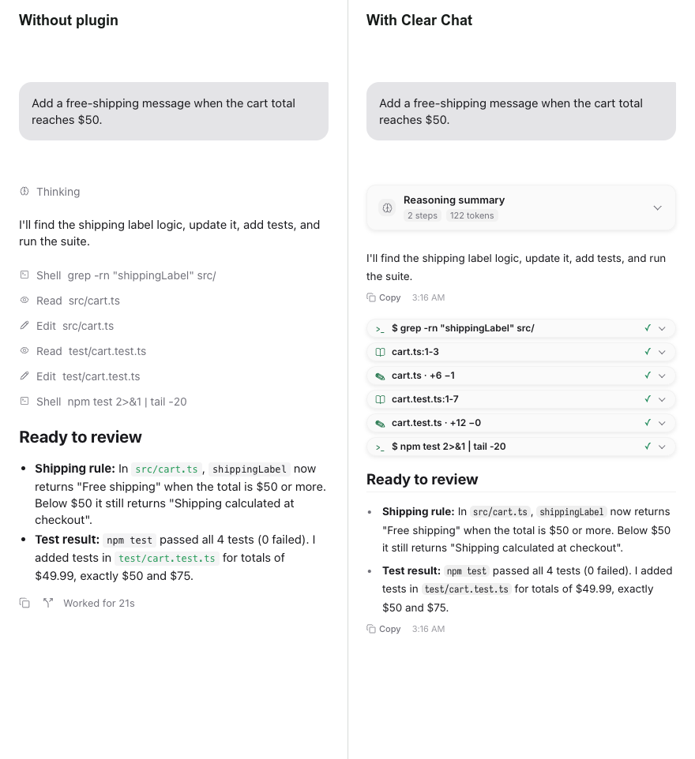
  </picture>
</p>

<p align="center"><sub>左：同一段对话，不装插件。右：装了 Clear Chat。所有截图都用示例数据。</sub></p>

## 为什么用 Clear Chat

- **先看到结论。** 做完的步骤各收成紧凑的一行：图标、要点、状态、耗时。结束这一轮的回复始终完整展开。
- **每个 Agent 都画得对。** Claude、Codex、Hermes 的调用都有像样的卡片。Paseo 报告的 12 种工具类型各有专门的卡片，`skill_view`、`memory` 等 Hermes 工具也有专门的显示。用真实对话回放测试，没有一张空卡片。
- **什么都不丢。** Beautiful Chat 的设置原样搬过来；粘贴的图片会显示张数；调用失败时会显示失败原因。
- **有人维护。** 1.0.0 处理了原插件里 7 条没解决的问题和修改请求。问题请提到 GitHub Issues，每个版本的变化都记在 [CHANGELOG](CHANGELOG.md) 里。
- **快。** 在我们的测试里，一段 221 步的对话约 1.3 秒显示出第一屏，跟不装插件时差不多（都是约 1.3 秒）。长对话滚动起来也不卡顿。<sup>1</sup>

<sub>1. 在一台机器上用无头 Google Chrome 跑 5 次取中位数。你的结果会不一样。测法见 [scripts/perf/README.md](scripts/perf/README.md)（英文）。</sub>

## 安装

```bash
paseo plugin install git:https://github.com/jasonhnd/paseo-clear-chat.git --ref v1.0.0
```

装好后打开 **Settings → Plugins → Clear Chat**，可以选颜色、字体和折叠方式。

> [!IMPORTANT]
> 已经在用 Beautiful Chat？安装或卸载任何插件**之前**，请先看[从 Beautiful Chat 升级](#从-beautiful-chat-升级)。在 Paseo 0.12 里卸载插件，会连它的设置一起删掉。

## 从 Beautiful Chat 升级

1. **备份** Beautiful Chat 的设置。
2. 在 Beautiful Chat 还装着的时候**安装 Clear Chat**。Clear Chat 第一次启动时会把设置复制过来。
3. **确认**设置没问题，再卸载 Beautiful Chat。

<details>
<summary><b>具体命令、回退方法、迁移是怎么做的</b></summary>

下面的命令使用 `PASEO_HOME`，没有设置时用 `$HOME/.paseo`。如果你的 daemon 只用 `--home` 指定目录，请先把 `PASEO_HOME` 设成那个路径。备份或确认失败时请停下。

**1. 备份**

```bash
legacy_backup="${PASEO_HOME:-$HOME/.paseo}/backups/plugin-settings-beautiful-chat-$(date +%Y%m%d-%H%M%S)"
mkdir -p "${PASEO_HOME:-$HOME/.paseo}/backups"
cp -a "${PASEO_HOME:-$HOME/.paseo}/plugin-settings/beautiful-chat" "$legacy_backup"
```

**2. 安装**

```bash
paseo plugin install git:https://github.com/jasonhnd/paseo-clear-chat.git --ref v1.0.0
```

**3. 确认后卸载旧插件**

确认 `${PASEO_HOME:-$HOME/.paseo}/plugin-settings/clear-chat/presentation.json` 已经生成，并且和 `$legacy_backup/presentation.json` 一致。已经存在的 Clear Chat 设置文件绝不会被覆盖。如果文件不存在或内容不同，请保留 Beautiful Chat 和备份，到日志里查看迁移错误。

```bash
paseo plugin remove beautiful-chat
```

备份请留着。

**回退**

先备份 Clear Chat 当前的设置，再卸载：

```bash
clear_chat_backup="${PASEO_HOME:-$HOME/.paseo}/backups/plugin-settings-clear-chat-$(date +%Y%m%d-%H%M%S)"
mkdir -p "${PASEO_HOME:-$HOME/.paseo}/backups"
cp -a "${PASEO_HOME:-$HOME/.paseo}/plugin-settings/clear-chat" "$clear_chat_backup"
paseo plugin remove clear-chat
```

如果 Beautiful Chat 的设置文件夹已经没了，从升级时的备份恢复。把 `YYYYMMDD-HHMMSS` 换成你备份的时间。已经存在的文件夹绝不会被覆盖。

```bash
legacy_backup="${PASEO_HOME:-$HOME/.paseo}/backups/plugin-settings-beautiful-chat-YYYYMMDD-HHMMSS"
test ! -e "${PASEO_HOME:-$HOME/.paseo}/plugin-settings/beautiful-chat" &&
  cp -a "$legacy_backup" "${PASEO_HOME:-$HOME/.paseo}/plugin-settings/beautiful-chat"
```

然后安装 Beautiful Chat 的最后一个版本：

```bash
paseo plugin install git:https://github.com/jasonhnd/paseo-clear-chat.git --ref 2bf25e8
```

在 Clear Chat 里改过的设置不会同步回 Beautiful Chat。两份备份都请留着。

**迁移是怎么做的**

- 第一次启动时，如果 Clear Chat 还没有设置文件，服务端会把 Beautiful Chat 的 `presentation.json` 复制到 Clear Chat 的设置文件夹。两边的文件都不会被删除或覆盖。
- 复制失败时，日志里会记下两个路径和错误，Clear Chat 用默认设置启动。下次启动会再试。
- 之后设置从第 1 版升级到第 2 版。你的选择都保留，两个新的折叠设置从默认值开始。
- 在浏览器里，以前存在浏览器里的偏好会导入一次。以主机上保存的设置为准。
- 迁移只认默认的安装 ID。用了自定义 `--id`，或者 daemon 目录只用 `--home` 指定的，需要手动复制设置。

</details>

## 功能

### 工具调用

| | |
|---|---|
| <picture><source media="(prefers-color-scheme: dark)" srcset="docs/images/tool-bash-dark.png">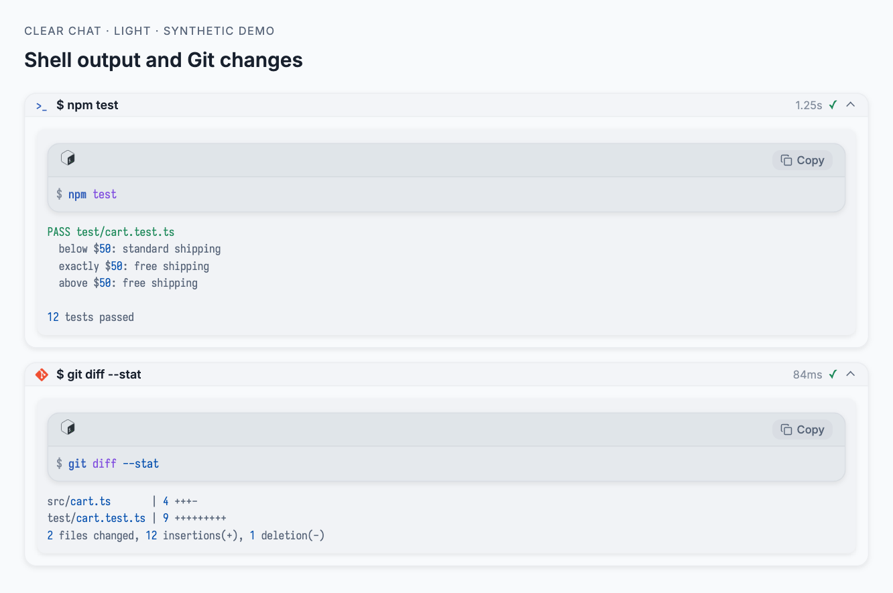</picture><br>**Shell 和 Git。** 终端外框、高亮的命令、退出码和耗时。 | <picture><source media="(prefers-color-scheme: dark)" srcset="docs/images/tool-read-dark.png">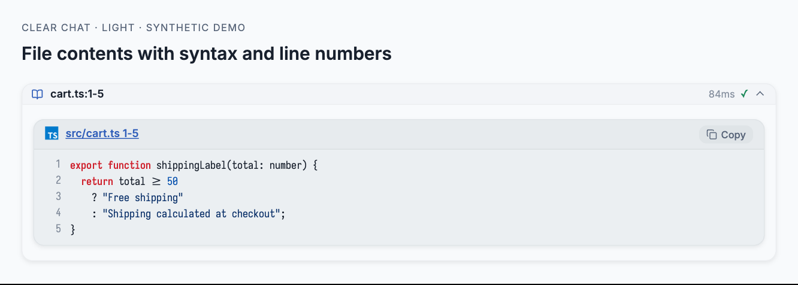</picture><br>**读取文件。** 语言图标、行号、复制按钮。点文件名会在文件管理器里显示这个文件。 |
| <picture><source media="(prefers-color-scheme: dark)" srcset="docs/images/tool-edit-dark.png">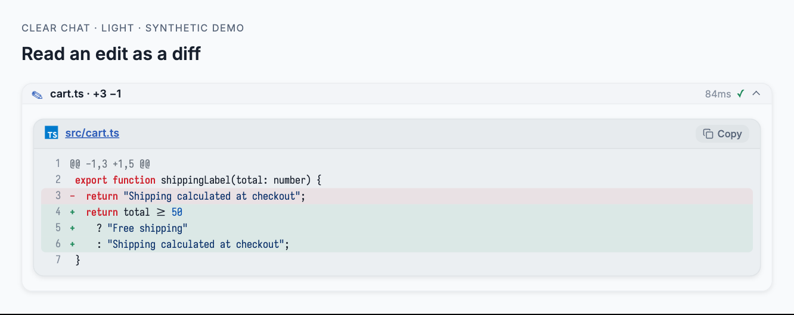</picture><br>**编辑。** 清楚的改动对比；没有给出 diff 时，也会用新旧文字算出对比。 | <picture><source media="(prefers-color-scheme: dark)" srcset="docs/images/tool-image-dark.png">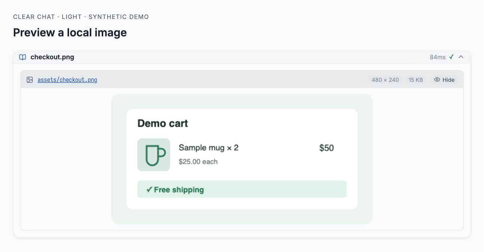</picture><br>**图片。** 读取和生成的图片直接显示，带尺寸和可以点的来源地址。 |
| <picture><source media="(prefers-color-scheme: dark)" srcset="docs/images/tool-thinking-dark.png">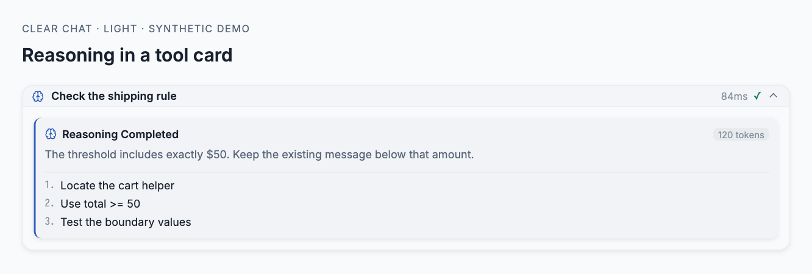</picture><br>**推理工具。** 实时的思考文字、token 数和编号步骤。 | <picture><source media="(prefers-color-scheme: dark)" srcset="docs/images/tool-mcp-dark.png">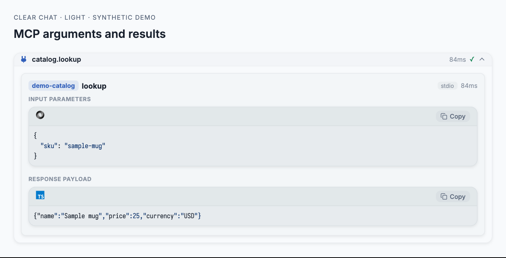</picture><br>**MCP。** 服务器、传输方式、输入和返回结果，全部高亮。 |
| <picture><source media="(prefers-color-scheme: dark)" srcset="docs/images/tool-eval-dark.png">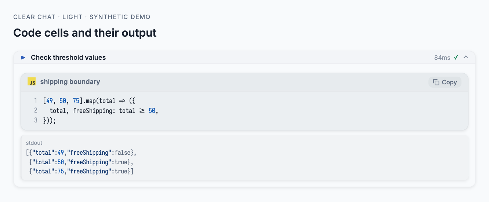</picture><br>**Eval。** 每个单元格先显示运行的代码，再显示输出。 | <picture><source media="(prefers-color-scheme: dark)" srcset="docs/images/tool-ask-dark.png">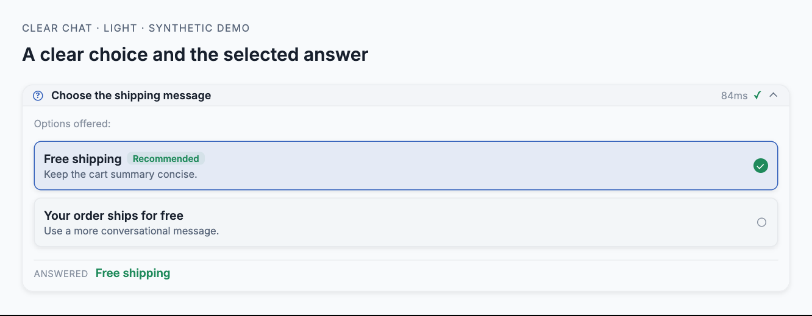</picture><br>**提问。** 列出选项，标出推荐项和最后选的答案。 |
| <picture><source media="(prefers-color-scheme: dark)" srcset="docs/images/tool-task-dark.png">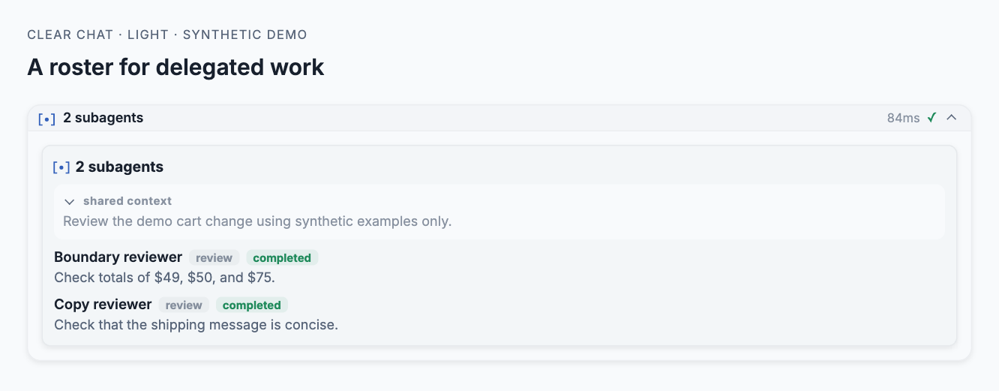</picture><br>**子 Agent。** 名字、类型、模型和交给它的任务。 | <picture><source media="(prefers-color-scheme: dark)" srcset="docs/images/hub-dark.png">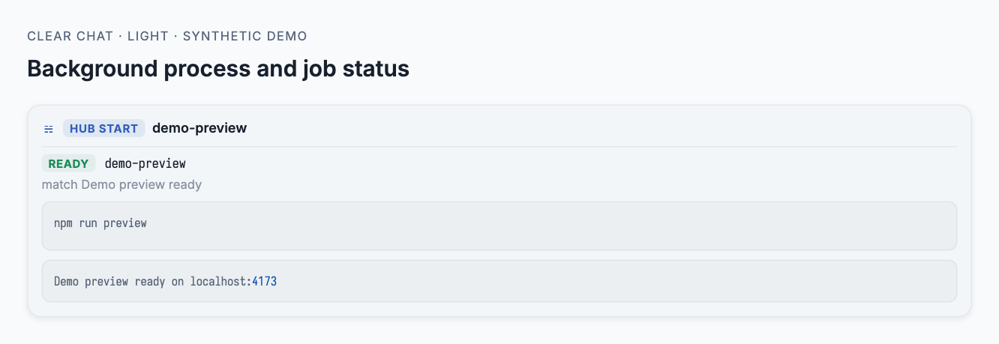</picture><br>**Hub。** 每一种 hub 操作都有对应的进程、消息或任务卡片。 |
| <picture><source media="(prefers-color-scheme: dark)" srcset="docs/images/paseo-dark.png">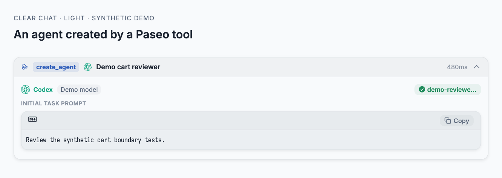</picture><br>**Paseo 工具。** 显示 Paseo 的标志，新建的 Agent 带上提供方的标志。 | |

搜索、网页获取、网页搜索、计划和清单、纯文字、Skill 以及其他工具也都有自己的卡片。不认识的工具会显示工具名、`名字: 值` 形式的输入和输出预览，绝不会是空框。

### 对话

| | |
|---|---|
| <picture><source media="(prefers-color-scheme: dark)" srcset="docs/images/reasoning-dark.png">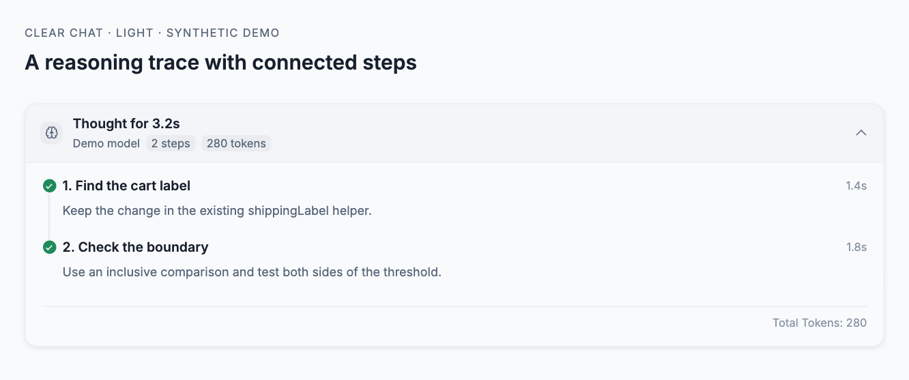</picture><br>**推理过程。** 可以收起的步骤，带每步耗时和 token 总数。 | <picture><source media="(prefers-color-scheme: dark)" srcset="docs/images/tasks-dark.png">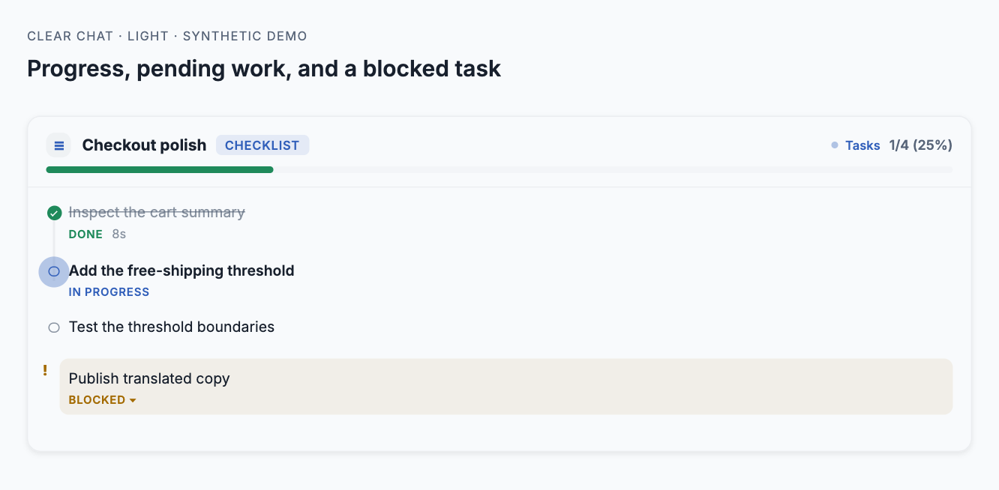</picture><br>**清单。** 阶段、每项任务的状态，以及任务被卡住的原因。 |
| <picture><source media="(prefers-color-scheme: dark)" srcset="docs/images/approval-dark.png">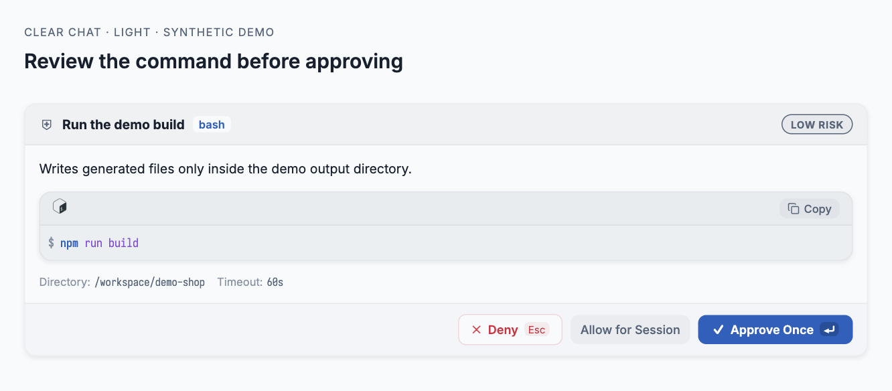</picture><br>**批准。** 风险等级、具体命令和目标。已经处理过的批准留成一行简短的状态。 | <picture><source media="(prefers-color-scheme: dark)" srcset="docs/images/user-dark.png">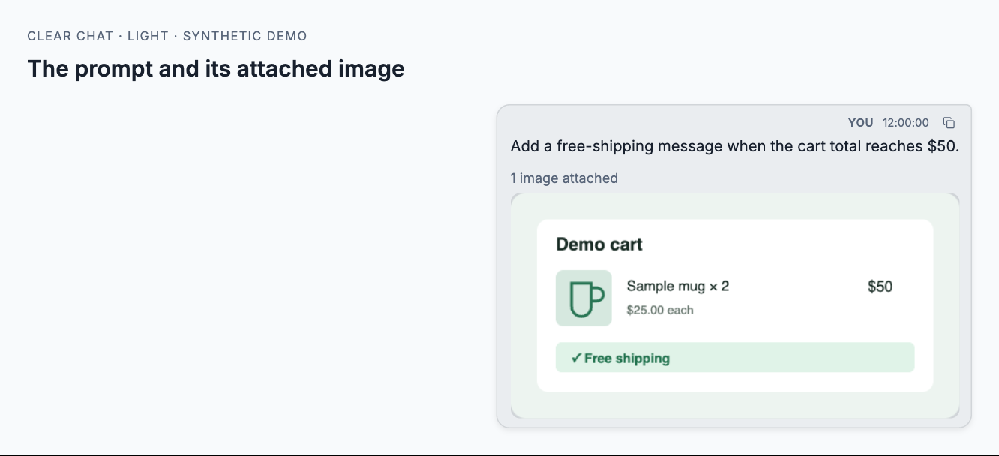</picture><br>**提问气泡。** 复制按钮、token 用量和粘贴的图片，例如「3 images attached」。 |
| <picture><source media="(prefers-color-scheme: dark)" srcset="docs/images/syntax-dark.png">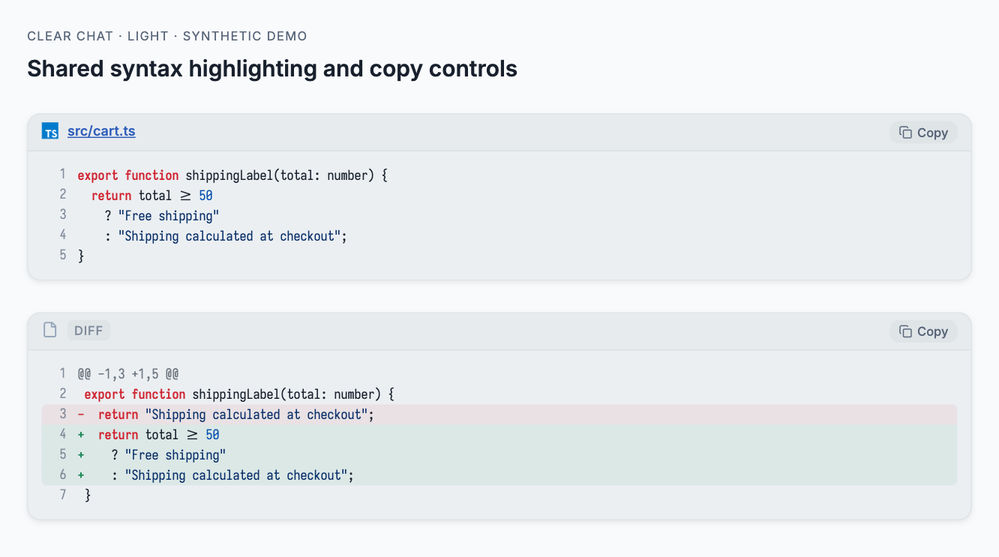</picture><br>**代码。** 识别语言、行号、改动颜色，复制时复制完整代码。 | |

### 还有这些

- **折叠由你决定。** 点任意一行就能展开或收起，刷新后还记得。进行中、失败和等你处理的调用默认展开。长输出先显示前 15 行，下面有 **Show all N lines**。
- **收尾回复。** 通过 `wrap_up` 工具发出的回复，会显示成完整的回复卡片：小结、问题、带字母的选项，以及 **Blocked** 提醒。
- **链接能点。** 回复里的链接在桌面、网页和 iOS 上都能打开，`mailto:` 链接会打开邮件应用。
- **对话内查找。** Ctrl/Cmd+F 打开查找栏，工具卡片里的内容也能搜到。只搜已经加载的消息，要搜更早的请先往上滚。
- **打开文件。** 点卡片里的文件名或回复里的路径，会在主机上的 Finder、资源管理器或文件管理器里显示这个文件。在手机、平板和窄的网页窗口里，点回复里的路径会改为复制到剪贴板，并提示你到主机上打开。文件名或路径里有空格时，请写成行内代码，或用 Markdown 链接。
- **高亮文字。** 回复里写 `==要标出的文字==` 会加上高亮。代码里的等号照原样显示。

## 设置

<picture><source media="(prefers-color-scheme: dark)" srcset="docs/images/settings-dark.png">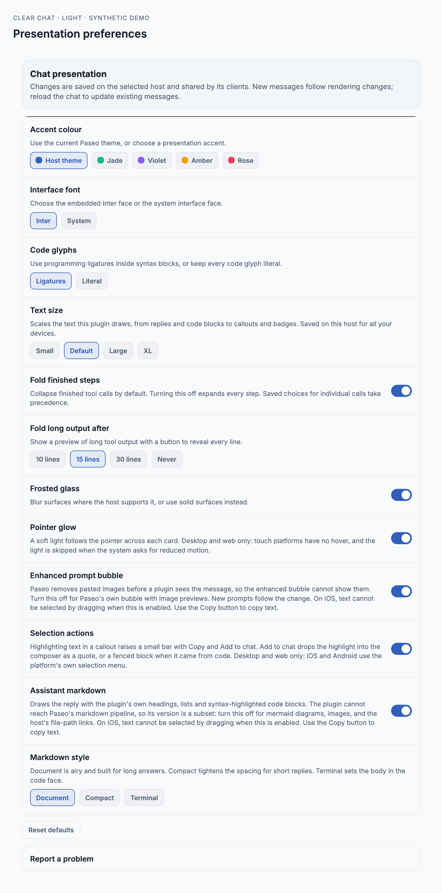</picture>

| 设置项 | 作用 |
|---|---|
| Accent colour | 跟随 Paseo 主题，选 Jade、Violet、Amber、Rose，或选 **Custom** 用色板和 HEX 输入框自定颜色。自定颜色会自动调整，保证文字对比度不低于 4.5:1。 |
| Interface font | 内置的 Inter 字体，或系统字体。 |
| Text size | Small (90%)、Default (100%)、Large (115%)、XL (130%)。图标大小不变。 |
| Code glyphs | 带连字的 Iosevka，或普通字形。 |
| Code font | Default (Iosevka)（默认）、Iosevka、Menlo、Consolas、Fira Code 或 Cascadia Code。对代码块、行内代码、终端输出和差异对比生效。 |
| Fold finished steps | 默认开。关掉后所有步骤都展开，你单独设过的调用除外。 |
| Fold long output after | 10、15（默认）、30 行，或 Never。对代码和工具输出生效。 |
| Frosted glass | 卡片背景做毛玻璃效果，或用纯色。 |
| Enhanced prompt bubble | 给你的提问加样式。关掉就用 Paseo 自带的气泡。 |
| Assistant markdown | 关掉后，回复交回 Paseo 自己显示。 |

**自定强调色。** 点一个色块，或输入 `#RGB`、`#RRGGBB` 后按 **Apply**。HEX 写错时会留在输入框里并提示错误，已保存的颜色不变。切换到预设色后，你的自定颜色仍会记住。保存的 HEX 值始终不变；只有文字可能看不清时，显示出来的颜色才会在浅色主题下调深、在深色主题下调浅。实心按钮上的文字用黑或白，哪个对比度高用哪个。

**代码字体。** 插件 SDK 读不到 Paseo 自己的代码字体设置。**Default (Iosevka)** 使用 Iosevka，并沿用你在 **Code glyphs** 里的选择。在网页和桌面上，其他字体要先装在电脑上；没装的话改用内置的 Iosevka。在 iOS 和 iPadOS 上，代码一律用 Menlo；在 Android 上用系统的等宽字体，因为从插件目录安装的插件在这些平台上加载不了内置的网页字体。

设置保存在主机上，连到同一台主机的设备都共用。强调色和折叠相关的设置马上生效；其他改动对新消息生效，要更新之前的消息请重新加载对话。

> [!NOTE]
> **在 iOS 和 iPadOS 上**，开着 **Assistant markdown** 或 **Enhanced prompt bubble** 时，不能拖动选择文字。请用回复、提问或代码块上的 **Copy** 按钮。复制失败时，会弹出一个显示全文的窗口，可以手动选择复制。

## 常见问题

| 问题 | 怎么办 |
|---|---|
| 用 Cafe 插件安装失败，或 Paseo 提示缺少 `@shikijs/core` 等 Shiki 依赖。 | 用[安装](#安装)里的 Paseo CLI 命令重试，仓库和版本标签保持不变。Clear Chat 用 `npm ci --include=dev` 安装依赖，所以运行 daemon 的主机上要有 Node.js 和 npm，网络也要能连到 npm 仓库。如果代码目录是你自己管理的，请先在那里运行 `npm ci --include=dev` 再重试。 |
| Paseo 拒绝这个插件版本，或 Clear Chat 提示缺少插件设置或时间线支持。 | 把运行 daemon 的主机和所有连着的应用都更新到新版 Paseo，再重新加载 Clear Chat。Clear Chat 需要的 Paseo 版本写在 `paseo-plugin.json` 里。 |
| 插件注册失败，Clear Chat 启动不了。 | 更新 Paseo，再重新加载 Clear Chat。还不行的话，先备份插件设置，再用 CLI 重新安装。 |
| Clear Chat 读不到主机上的设置。 | 重新连接主机，在 **Settings → Plugins → Clear Chat** 里点 **Retry**。还不行的话，检查 daemon 能不能访问插件设置文件夹。 |
| Clear Chat 提示设置无效或格式不支持。 | 先备份设置。用一份正常的备份恢复，或在 daemon 主机上修好设置文件，再点 **Retry**。Clear Chat 不会自己删掉这个文件。 |
| Clear Chat 保存不了设置。 | 检查 daemon 主机上的写入权限和剩余磁盘空间，重新连接后再改一次。**Retry** 只会重新读取设置，不会重发刚才失败的修改。 |
| 设置被另一个客户端不停改动。 | 等另一边改完，再改一次。 |
| Beautiful Chat 的设置没有搬过来。 | 保留 Beautiful Chat 原来的设置并备份。检查两个插件设置文件夹的读写权限和剩余磁盘空间，再重新加载 Clear Chat 重试。搬迁失败时，daemon 日志里会有一条恢复提示；已有的设置不会被覆盖。 |

如果 Paseo 运行不了构建命令，或加载不了插件包，Clear Chat 就没办法自己显示提示。请检查 daemon 主机上的 Node.js、npm 和 Paseo 版本，再用 CLI 重试。问题还在的话，请点插件设置里的 **Report a problem**，附上恢复提示和你的 Paseo 版本。分享日志前，请删掉私人路径和对话内容。

## 反馈问题

遇到问题或有想法？请[在 GitHub 上提 Issue](https://github.com/jasonhnd/paseo-clear-chat/issues/new/choose)。也可以点设置页最下面的 **Report a problem**。用中文或日文写都可以。

## 致谢

Clear Chat 基于 ABorakati 的 [Beautiful Chat](https://github.com/ABorakati/beautiful-chat)，按 MIT 许可证使用。原作的版权声明保留在 [LICENSE](LICENSE) 里。

感谢 Moyf 贡献的[文字大小功能](https://github.com/ABorakati/beautiful-chat/pull/9)，这里改成了保存在主机设置里。

开发者请看 [docs/DEVELOPMENT.md](docs/DEVELOPMENT.md)（英文）：构建步骤、项目结构，以及开发中发现的 Paseo 插件 SDK 限制。

## 许可证

[MIT](LICENSE)
